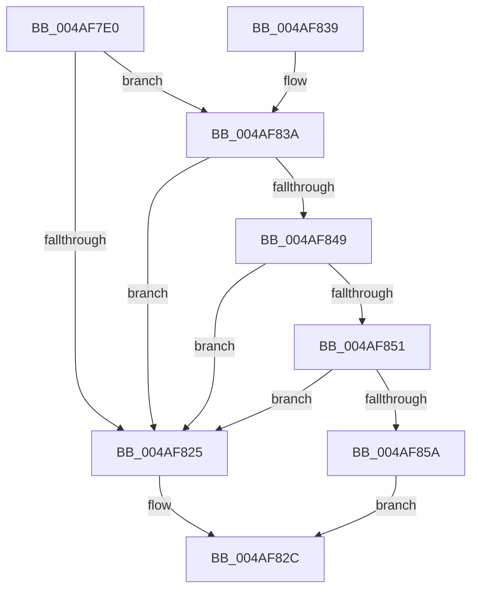

# HalpArtInitialize

- RVA: `0x004AF7E0`–`0x004AF869` (길이 `137` bytes)
- VA: `0x00000001404AF7E0`
- 실행 섹션: `.text`
- PDB 이름 있음: `예`; PDB Function 태그: `아니요`
- unwind 정보 RVA: `0x000B8814`
- 디코드: `42`개 명령, `137/137` bytes 표시
- 미해석 바이트: `0` (있으면 어셈블리에 `.byte`로 보존)

> 이 문서는 커널 이미지의 기계어와 PDB 기호를 분석해 생성했습니다. 4번과 5번은 함수 원형과 자료형을 바이너리 사용 방식에서 추정한 C 해석이며 원본 소스 복구 결과는 아닙니다.

## 1. Dependencies

- 직접 호출 지점: **2**; 고유 호출 대상: **2**
- 직접 호출자로 확인된 함수: **0**
- RIP 상대 이미지 참조: **1**

### Outgoing calls
- `0x004AF81C` → [HalpArtAvailable](HalpArtAvailable_function_004AF870.md) (function, `0x004AF870`)
- `0x004AF862` → [HalUpdateTimerCapabilities](../56/HalUpdateTimerCapabilities_function_005615E0.md) (function, `0x005615E0`)

### Direct callers
- 이 함수 시작 RVA로 연결되는 직접 call은 확인되지 않았습니다. 간접 호출은 완전히 역산할 수 없습니다.

### Static image references
- `0x004AF825` → RVA `0x00FC40E8` (`.data`; write)

## 2. Other-region calls and transfers

- 다른 실행 섹션으로 향하는 call: **0**
- 별도 외부 분기/꼬리 이동을 확인하지 못했습니다.

## 3. Assembly (complete function range)

```asm
004AF7E0  4C 8B DC                        mov r11, rsp
004AF7E3  49 89 5B 10                     mov qword ptr [r11 + 0x10], rbx
004AF7E7  57                              push rdi
004AF7E8  48 83 EC 30                     sub rsp, 0x30
004AF7EC  83 64 24 40 00                  and dword ptr [rsp + 0x40], 0
004AF7F1  49 8D 53 08                     lea rdx, [r11 + 8]
004AF7F5  33 C0                           xor eax, eax
004AF7F7  48 8B D9                        mov rbx, rcx
004AF7FA  49 89 43 E8                     mov qword ptr [r11 - 0x18], rax
004AF7FE  49 8D 4B E8                     lea rcx, [r11 - 0x18]
004AF802  65 48 8B 04 25 20 00 00 00      mov rax, qword ptr gs:[0x20]
004AF80B  8B B8 A4 00 00 00               mov edi, dword ptr [rax + 0xa4]
004AF811  0F AF B8 A0 00 00 00            imul edi, dword ptr [rax + 0xa0]
004AF818  FF CF                           dec edi
004AF81A  F7 D7                           not edi
004AF81C  E8 4F 00 00 00                  call 0x1404af870
004AF821  84 C0                           test al, al
004AF823  75 15                           jne 0x1404af83a
004AF825  C6 05 BC 48 B1 00 00            mov byte ptr [rip + 0xb148bc], 0
004AF82C  48 8B 5C 24 48                  mov rbx, qword ptr [rsp + 0x48]
004AF831  33 C0                           xor eax, eax
004AF833  48 83 C4 30                     add rsp, 0x30
004AF837  5F                              pop rdi
004AF838  C3                              ret
004AF839  CC                              int3
004AF83A  8B 4B 08                        mov ecx, dword ptr [rbx + 8]
004AF83D  8B 44 24 40                     mov eax, dword ptr [rsp + 0x40]
004AF841  23 CF                           and ecx, edi
004AF843  23 C7                           and eax, edi
004AF845  3B C8                           cmp ecx, eax
004AF847  75 DC                           jne 0x1404af825
004AF849  8B 44 24 20                     mov eax, dword ptr [rsp + 0x20]
004AF84D  39 03                           cmp dword ptr [rbx], eax
004AF84F  75 D4                           jne 0x1404af825
004AF851  8B 44 24 24                     mov eax, dword ptr [rsp + 0x24]
004AF855  39 43 04                        cmp dword ptr [rbx + 4], eax
004AF858  75 CB                           jne 0x1404af825
004AF85A  45 33 C0                        xor r8d, r8d
004AF85D  33 D2                           xor edx, edx
004AF85F  48 8B CB                        mov rcx, rbx
004AF862  E8 79 1D 0B 00                  call 0x1405615e0
004AF867  EB C3                           jmp 0x1404af82c
```

## 4. C-style interpretation (structured pseudocode)

```c
__int64 __fastcall HalpArtInitialize(__int64 a1, __int64 a2, int a3)
{
    __int64 result;
    __int64 v_rdi;
    __int64 v_rsp;
    unsigned __int64 v_stack_p10;
    unsigned int v_stack_p20;
    unsigned int v_stack_p24;
    unsigned int v_stack_p40;
    unsigned int v_stack_p8;

    *(unsigned __int64 *)(v_rsp + 16) = v_rbx;
    v_rsp = (v_rsp) - (48);
    result = 0;
    *(unsigned __int64 *)(v_rsp - 24) = 0;
    v_rdi = (unsigned int)(((unsigned int)(*(unsigned int *)(*(unsigned __int64 *)(gs_base + (0 + 32)) + 164))) * (*(unsigned int *)(*(unsigned __int64 *)(gs_base + (0 + 32)) + 160)));
    v_rdi = (unsigned int)((v_rdi) - 1);
    v_rdi = (unsigned int)(~(v_rdi));
    result = HalpArtAvailable(v_rsp - 24, v_rsp + 8, a3, a4);
    if ((unsigned __int8)(result) != 0) goto loc_004AF83A;
loc_004AF825:
    *(unsigned __int8 *)(v_rip + 11618492) = 0;
loc_004AF82C:
    result = 0;
    v_rsp = (v_rsp) + (48);
    return result;
loc_004AF83A:
    a1 = (unsigned int)(((unsigned int)(*(unsigned int *)(v_stack_p10 + 8))) & ((unsigned int)(v_rdi)));
    result = (unsigned int)(((unsigned int)(v_stack_p40)) & ((unsigned int)(v_rdi)));
    if (((unsigned int)(a1)) != ((unsigned int)(result))) goto loc_004AF825;
    if ((*(unsigned int *)(v_stack_p10)) != ((unsigned int)((unsigned int)(v_stack_p20)))) goto loc_004AF825;
    if ((*(unsigned int *)(v_stack_p10 + 4)) != ((unsigned int)((unsigned int)(v_stack_p24)))) goto loc_004AF825;
    a3 = 0;
    a2 = 0;
    result = HalUpdateTimerCapabilities(v_stack_p10, a2, a3, a4);
    goto loc_004AF82C;
}
```

## 5. (Beta) C Style

```c
int64_t HalpArtInitialize(void *Arg1, int64_t Arg2, int32_t Arg3)
{
    uint8_t *arg1 = (uint8_t *)Arg1;

    int64_t result;
    int64_t local_rdi;
    int64_t local_rsp;
    uint64_t v_stack_p10;
    uint32_t v_stack_p20;
    uint32_t v_stack_p24;
    uint32_t v_stack_p40;
    uint32_t v_stack_p8;

    *(uint64_t *)(local_rsp + 0x10) = local_rbx;
    local_rsp = (local_rsp) - (48);
    result = 0;
    *(uint64_t *)(local_rsp - 0x18) = 0;
    local_rdi = (uint32_t)(((uint32_t)(*(uint32_t *)(*(uint64_t *)(gs_base + (0 + 0x20)) + 0xA4))) * (*(uint32_t *)(*(uint64_t *)(gs_base + (0 + 0x20)) + 0xA0)));
    local_rdi = (uint32_t)((local_rdi) - 1);
    local_rdi = (uint32_t)(~(local_rdi));
    result = HalpArtAvailable(local_rsp - 24, local_rsp + 8, Arg3, a4);
    if ((uint8_t)(result) != 0) goto loc_004AF83A;
loc_004AF825:
    *(uint8_t *)(v_rip + 0xB148BC) = 0;
loc_004AF82C:
    result = 0;
    local_rsp = (local_rsp) + (48);
    return result;
loc_004AF83A:
    Arg1 = (uint32_t)(((uint32_t)(*(uint32_t *)(v_stack_p10 + 0x8))) & ((uint32_t)(local_rdi)));
    result = (uint32_t)(((uint32_t)(v_stack_p40)) & ((uint32_t)(local_rdi)));
    if (((uint32_t)(Arg1)) != ((uint32_t)(result))) goto loc_004AF825;
    if ((*(uint32_t *)(v_stack_p10)) != ((uint32_t)((uint32_t)(v_stack_p20)))) goto loc_004AF825;
    if ((*(uint32_t *)(v_stack_p10 + 0x4)) != ((uint32_t)((uint32_t)(v_stack_p24)))) goto loc_004AF825;
    Arg3 = 0;
    Arg2 = 0;
    result = HalUpdateTimerCapabilities(v_stack_p10, Arg2, Arg3, a4);
    goto loc_004AF82C;
}
```

### 관측된 메모리 오프셋

구조체 형식이 확인되지 않은 접근은 인자 기준의 오프셋으로만 기록했습니다.

| 기준 인자 | 오프셋 표현 | 폭 (bit) | 접근 |
|---|---:|---:|---|
| `Arg1` | `+ 0x0` | `32` | `R` |
| `Arg1` | `+ 0x4` | `32` | `R` |
| `Arg1` | `+ 0x8` | `32` | `R` |

## 6. Execution-region graph

[열기: 2D/3D 그래프와 함수 탐색 컨트롤 패널](../../../control-panel.html?section=text&rva=0x004AF7E0&view=graph)

- 2D 그래프는 위에서 아래로 흐르고, 3D 그래프는 빈 공간을 드래그해 회전합니다. Shift+드래그는 이동, 휠은 확대·축소, 함수 노드 선택은 대상 보고서 이동입니다.

### Static fallback


