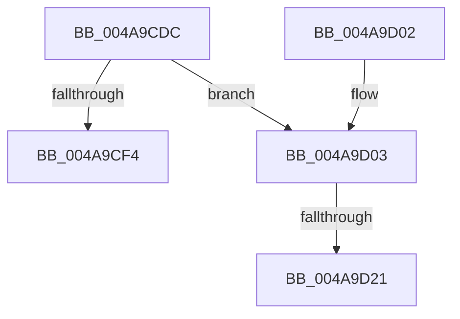

# HalpCheckAndReportGhes

- RVA: `0x004A9CDC`–`0x004A9D2F` (길이 `83` bytes)
- VA: `0x00000001404A9CDC`
- 실행 섹션: `.text`
- PDB 이름 있음: `예`; PDB Function 태그: `예`
- unwind 정보 RVA: `0x000B7B78`
- 디코드: `24`개 명령, `83/83` bytes 표시
- 미해석 바이트: `0` (있으면 어셈블리에 `.byte`로 보존)

> 이 문서는 커널 이미지의 기계어와 PDB 기호를 분석해 생성했습니다. 4번과 5번은 함수 원형과 자료형을 바이너리 사용 방식에서 추정한 C 해석이며 원본 소스 복구 결과는 아닙니다.

## 1. Dependencies

- 직접 호출 지점: **3**; 고유 호출 대상: **3**
- 직접 호출자로 확인된 함수: **4**
- RIP 상대 이미지 참조: **1**

### Outgoing calls
- `0x004A9CEB` → [HalpReadGenericErrorInfo](HalpReadGenericErrorInfo_function_004A9D38.md) (function, `0x004A9D38`)
- `0x004A9D0B` → `PSHED.dll!PshedRetrieveErrorInfo` (import, 간접 대상; import `PSHED.dll!PshedRetrieveErrorInfo`)
- `0x004A9D24` → [HalpSignalRAS](../55/HalpSignalRAS_function_00555C7C.md) (function, `0x00555C7C`)

### Direct callers
- [HalpGenericPolledWorkerRoutine](HalpGenericPolledWorkerRoutine_function_004A9C70.md) at `0x004A9CCA`
- [HalHandleNMI](../54/HalHandleNMI_function_00545800.md) at `0x00545855`
- [HalpPeiInterruptHandler](../55/HalpPeiInterruptHandler_function_00555BB0.md) at `0x00555BC5`
- [HalpGenInitialRead](../../pagelk/B5/HalpGenInitialRead_function_00B5DED4.md) at `0x00B5DF4A`

### Static image references
- `0x004A9D0B` → RVA `0x00151150` (`PSHED.dll!PshedRetrieveErrorInfo (IAT)`; read)

## 2. Other-region calls and transfers

- 다른 실행 섹션으로 향하는 call: **0**
- call이 아닌 외부 분기/꼬리 이동: **2**
  - `0x004A9D1B` → [sub_006FA00E](../6F/Unknown_function_006FA00E.md) (`tail-transfer`)
  - `0x004A9D2A` → [sub_006FA00E](../6F/Unknown_function_006FA00E.md) (`tail-transfer`)

## 3. Assembly (complete function range)

```asm
004A9CDC  48 89 5C 24 08                  mov qword ptr [rsp + 8], rbx
004A9CE1  57                              push rdi
004A9CE2  48 83 EC 20                     sub rsp, 0x20
004A9CE6  48 8B D9                        mov rbx, rcx
004A9CE9  33 FF                           xor edi, edi
004A9CEB  E8 48 00 00 00                  call 0x1404a9d38
004A9CF0  85 C0                           test eax, eax
004A9CF2  79 0F                           jns 0x1404a9d03
004A9CF4  48 8B 5C 24 30                  mov rbx, qword ptr [rsp + 0x30]
004A9CF9  40 8A C7                        mov al, dil
004A9CFC  48 83 C4 20                     add rsp, 0x20
004A9D00  5F                              pop rdi
004A9D01  C3                              ret
004A9D02  CC                              int3
004A9D03  48 8B 4B 18                     mov rcx, qword ptr [rbx + 0x18]
004A9D07  48 8D 53 58                     lea rdx, [rbx + 0x58]
004A9D0B  48 FF 15 3E 74 CA FF            call qword ptr [rip - 0x358bc2]
004A9D12  0F 1F 44 00 00                  nop dword ptr [rax + rax]
004A9D17  83 7B 60 0C                     cmp dword ptr [rbx + 0x60], 0xc
004A9D1B  0F 85 ED 02 25 00               jne 0x1406fa00e
004A9D21  48 8B CB                        mov rcx, rbx
004A9D24  E8 53 BF 0A 00                  call 0x140555c7c
004A9D29  90                              nop
004A9D2A  E9 DF 02 25 00                  jmp 0x1406fa00e
```

## 4. C-style interpretation (structured pseudocode)

```c
__int64 __fastcall HalpCheckAndReportGhes(__int64 a1)
{
    __int64 result;
    __int64 v_rdi;
    __int64 v_rsp;
    unsigned __int64 v_stack_p8;

    v_stack_p8 = v_rbx;
    v_rsp = (v_rsp) - (32);
    v_rdi = 0;
    result = HalpReadGenericErrorInfo(a1, a2, a3, a4);
    if (!sign_flag) goto loc_004A9D03;
    v_rsp = (v_rsp) + (32);
    return 0;
loc_004A9D03:
    result = PSHED_dll_PshedRetrieveErrorInfo(*(unsigned __int64 *)(v_stack_p8 + 24), v_stack_p8 + 88, a3, a4);
    result = HalpSignalRAS(v_stack_p8, v_stack_p8 + 88, a3, a4);
}
```

## 5. (Beta) C Style

```c
int64_t HalpCheckAndReportGhes(void *Arg1)
{
    uint8_t *arg1 = (uint8_t *)Arg1;

    int64_t result;
    int64_t local_rdi;
    int64_t local_rsp;
    uint64_t v_stack_p8;

    v_stack_p8 = local_rbx;
    local_rsp = (local_rsp) - (32);
    local_rdi = 0;
    result = HalpReadGenericErrorInfo(Arg1, a2, a3, a4);
    if (!sign_flag) goto loc_004A9D03;
    local_rsp = (local_rsp) + (32);
    return 0;
loc_004A9D03:
    result = kernel_indirect_call(*(uint64_t *)(v_stack_p8 + 0x18), v_stack_p8 + 88, a3, a4);
    result = HalpSignalRAS(v_stack_p8, v_stack_p8 + 88, a3, a4);
}
```

### 관측된 메모리 오프셋

구조체 형식이 확인되지 않은 접근은 인자 기준의 오프셋으로만 기록했습니다.

| 기준 인자 | 오프셋 표현 | 폭 (bit) | 접근 |
|---|---:|---:|---|
| `Arg1` | `+ 0x18` | `64` | `R` |
| `Arg1` | `+ 0x58` | `64` | `R` |
| `Arg1` | `+ 0x60` | `32` | `R` |

## 6. Execution-region graph

[열기: 2D/3D 그래프와 함수 탐색 컨트롤 패널](../../../control-panel.html?section=text&rva=0x004A9CDC&view=graph)

- 2D 그래프는 위에서 아래로 흐르고, 3D 그래프는 빈 공간을 드래그해 회전합니다. Shift+드래그는 이동, 휠은 확대·축소, 함수 노드 선택은 대상 보고서 이동입니다.

### Static fallback


