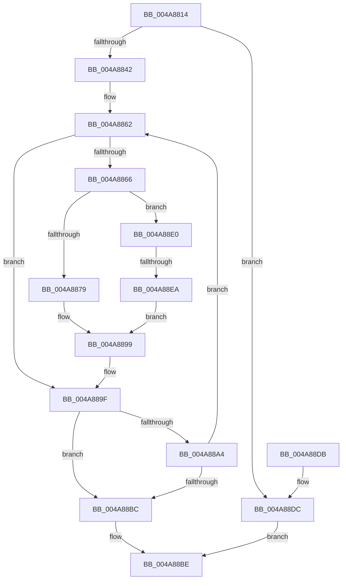

# HalpCmosRangeHandler

- RVA: `0x004A8814`–`0x004A88EE` (길이 `218` bytes)
- VA: `0x00000001404A8814`
- 실행 섹션: `.text`
- PDB 이름 있음: `예`; PDB Function 태그: `예`
- unwind 정보 RVA: `0x000B76A0`
- 디코드: `70`개 명령, `218/218` bytes 표시
- 미해석 바이트: `0` (있으면 어셈블리에 `.byte`로 보존)

> 이 문서는 커널 이미지의 기계어와 PDB 기호를 분석해 생성했습니다. 4번과 5번은 함수 원형과 자료형을 바이너리 사용 방식에서 추정한 C 해석이며 원본 소스 복구 결과는 아닙니다.

## 1. Dependencies

- 직접 호출 지점: **1**; 고유 호출 대상: **1**
- 직접 호출자로 확인된 함수: **2**
- RIP 상대 이미지 참조: **2**

### Outgoing calls
- `0x004A8888` → [guard_dispatch_icall](../6B/guard_dispatch_icall_function_006BAAD0.md) (function, `0x006BAAD0`)

### Direct callers
- [HalpcGetCmosDataByType](HalpcGetCmosDataByType_function_004A87F0.md) at `0x004A8803`
- [HalpcSetCmosDataByType](../56/HalpcSetCmosDataByType_function_00562D80.md) at `0x00562D96`

### Static image references
- `0x004A8847` → RVA `0x00003700` (`.rdata`; read)
- `0x004A884E` → RVA `0x00003704` (`.rdata`; read)

## 2. Other-region calls and transfers

- 다른 실행 섹션으로 향하는 call: **0**
- call이 아닌 외부 분기/꼬리 이동: **1**
  - `0x004A88E4` → [sub_006F9CE8](../6F/Unknown_function_006F9CE8.md) (`tail-transfer`)

## 3. Assembly (complete function range)

```asm
004A8814  48 8B C4                        mov rax, rsp
004A8817  48 89 58 08                     mov qword ptr [rax + 8], rbx
004A881B  48 89 68 10                     mov qword ptr [rax + 0x10], rbp
004A881F  48 89 70 18                     mov qword ptr [rax + 0x18], rsi
004A8823  4C 89 48 20                     mov qword ptr [rax + 0x20], r9
004A8827  57                              push rdi
004A8828  41 54                           push r12
004A882A  41 55                           push r13
004A882C  41 56                           push r14
004A882E  41 57                           push r15
004A8830  48 83 EC 20                     sub rsp, 0x20
004A8834  41 8B D8                        mov ebx, r8d
004A8837  44 8B E1                        mov r12d, ecx
004A883A  85 D2                           test edx, edx
004A883C  0F 85 9A 00 00 00               jne 0x1404a88dc
004A8842  44 8B 7C 24 70                  mov r15d, dword ptr [rsp + 0x70]
004A8847  4C 8D 15 B2 AE B5 FF            lea r10, [rip - 0x4a514e]
004A884E  8B 05 B0 AE B5 FF               mov eax, dword ptr [rip - 0x4a5150]
004A8854  33 F6                           xor esi, esi
004A8856  33 ED                           xor ebp, ebp
004A8858  45 33 F6                        xor r14d, r14d
004A885B  45 33 C0                        xor r8d, r8d
004A885E  46 8D 2C 3B                     lea r13d, [rbx + r15]
004A8862  3B D8                           cmp ebx, eax
004A8864  77 39                           ja 0x1404a889f
004A8866  2B C3                           sub eax, ebx
004A8868  41 8B FF                        mov edi, r15d
004A886B  FF C0                           inc eax
004A886D  2B FE                           sub edi, esi
004A886F  3B F8                           cmp edi, eax
004A8871  0F 43 F8                        cmovae edi, eax
004A8874  45 85 E4                        test r12d, r12d
004A8877  75 67                           jne 0x1404a88e0
004A8879  4B 8B 44 10 08                  mov rax, qword ptr [r8 + r10 + 8]
004A887E  8B D5                           mov edx, ebp
004A8880  44 8B C7                        mov r8d, edi
004A8883  49 03 D1                        add rdx, r9
004A8886  8B CB                           mov ecx, ebx
004A8888  E8 43 22 21 00                  call 0x1406baad0
004A888D  4C 8B 4C 24 68                  mov r9, qword ptr [rsp + 0x68]
004A8892  4C 8D 15 67 AE B5 FF            lea r10, [rip - 0x4a5199]
004A8899  03 F0                           add esi, eax
004A889B  03 DF                           add ebx, edi
004A889D  03 EF                           add ebp, edi
004A889F  41 3B DD                        cmp ebx, r13d
004A88A2  73 18                           jae 0x1404a88bc
004A88A4  41 FF C6                        inc r14d
004A88A7  4B 8D 14 76                     lea rdx, [r14 + r14*2]
004A88AB  4C 8D 04 D5 00 00 00 00         lea r8, [rdx*8]
004A88B3  43 8B 44 10 04                  mov eax, dword ptr [r8 + r10 + 4]
004A88B8  85 C0                           test eax, eax
004A88BA  75 A6                           jne 0x1404a8862
004A88BC  8B C6                           mov eax, esi
004A88BE  48 8B 5C 24 50                  mov rbx, qword ptr [rsp + 0x50]
004A88C3  48 8B 6C 24 58                  mov rbp, qword ptr [rsp + 0x58]
004A88C8  48 8B 74 24 60                  mov rsi, qword ptr [rsp + 0x60]
004A88CD  48 83 C4 20                     add rsp, 0x20
004A88D1  41 5F                           pop r15
004A88D3  41 5E                           pop r14
004A88D5  41 5D                           pop r13
004A88D7  41 5C                           pop r12
004A88D9  5F                              pop rdi
004A88DA  C3                              ret
004A88DB  CC                              int3
004A88DC  33 C0                           xor eax, eax
004A88DE  EB DE                           jmp 0x1404a88be
004A88E0  41 83 FC 01                     cmp r12d, 1
004A88E4  0F 84 FE 13 25 00               je 0x1406f9ce8
004A88EA  33 C0                           xor eax, eax
004A88EC  EB AB                           jmp 0x1404a8899
```

## 4. C-style interpretation (structured pseudocode)

```c
__int64 __fastcall HalpCmosRangeHandler(int a1, int a2, int a3, __int64 a4, unsigned int a5)
{
    __int64 result;
    __int64 v_r14;
    __int64 v_rbp;
    __int64 v_rbx;
    __int64 v_rdi;
    __int64 v_rsi;
    __int64 v_rsp;
    unsigned __int64 v_stack_p10;
    unsigned __int64 v_stack_p18;
    unsigned __int64 v_stack_p20;
    unsigned __int64 v_stack_p8;

    *(unsigned __int64 *)(v_rsp + 8) = v_rbx;
    *(unsigned __int64 *)(v_rsp + 16) = v_rbp;
    *(unsigned __int64 *)(v_rsp + 24) = v_rsi;
    *(unsigned __int64 *)(v_rsp + 32) = a4;
    v_rsp = (v_rsp) - (32);
    if (a2 != 0) goto loc_004A88DC;
    v_rsi = 0;
    v_rbp = 0;
    v_r14 = 0;
    a3 = 0;
loc_004A8862:
    if (((unsigned int)((unsigned int)(a3))) > ((unsigned int)((unsigned int)(*(unsigned int *)(v_rip - 4870480))))) goto loc_004A889F;
    result = (unsigned int)(((unsigned int)(*(unsigned int *)(v_rip - 4870480))) - ((unsigned int)((unsigned int)(a3))));
    result = (unsigned int)((result) + 1);
    v_rdi = (unsigned int)(((unsigned int)((unsigned int)((unsigned int)(a5)))) - (0));
    if (((unsigned int)(v_rdi)) >= ((unsigned int)(result))) { v_rdi = (unsigned int)(result); }
    if ((unsigned int)((unsigned int)(a1)) != 0) goto loc_004A88E0;
    a2 = (0) + (a4);
    result = guard_dispatch_icall((unsigned int)((unsigned int)((unsigned int)(a3))), a2, (unsigned int)((unsigned int)(v_rdi)), a4);
loc_004A8899:
    v_rsi = (unsigned int)((v_rsi) + ((unsigned int)(result)));
    v_rbx = (unsigned int)(((unsigned int)(a3)) + ((unsigned int)(v_rdi)));
    v_rbp = (unsigned int)((v_rbp) + ((unsigned int)(v_rdi)));
loc_004A889F:
    if (((unsigned int)(v_rbx)) >= ((unsigned int)((unsigned int)(a3) + (unsigned int)(a5) * 1))) goto loc_004A88BC;
    v_r14 = (unsigned int)((v_r14) + 1);
    if ((unsigned int)((unsigned int)(*(unsigned int *)(v_r14 + v_r14 * 2 * 8 + v_rip - 4870553 * 1 + 4))) != 0) goto loc_004A8862;
loc_004A88BC:
loc_004A88BE:
    v_rsp = (v_rsp) + (32);
    return (unsigned int)((unsigned int)(v_rsi));
loc_004A88DC:
    result = 0;
    goto loc_004A88BE;
loc_004A88E0:
    result = 0;
    goto loc_004A8899;
}
```

## 5. (Beta) C Style

```c
int64_t HalpCmosRangeHandler(int32_t Arg1, int32_t Arg2, void *Arg3, int64_t Arg4, uint32_t Arg5)
{
    uint8_t *arg3 = (uint8_t *)Arg3;

    int64_t result;
    int64_t local_r14;
    int64_t local_rbp;
    int64_t local_rbx;
    int64_t local_rdi;
    int64_t local_rsi;
    int64_t local_rsp;
    uint64_t v_stack_p10;
    uint64_t v_stack_p18;
    uint64_t v_stack_p20;
    uint64_t v_stack_p8;

    *(uint64_t *)(local_rsp + 0x8) = local_rbx;
    *(uint64_t *)(local_rsp + 0x10) = local_rbp;
    *(uint64_t *)(local_rsp + 0x18) = local_rsi;
    *(uint64_t *)(local_rsp + 0x20) = Arg4;
    local_rsp = (local_rsp) - (32);
    if (Arg2 != 0) goto loc_004A88DC;
    local_rsi = 0;
    local_rbp = 0;
    local_r14 = 0;
    Arg3 = 0;
loc_004A8862:
    if (((uint32_t)((uint32_t)(Arg3))) > ((uint32_t)((uint32_t)(*(uint32_t *)(v_rip - 0x4A5150))))) goto loc_004A889F;
    result = (uint32_t)(((uint32_t)(*(uint32_t *)(v_rip - 0x4A5150))) - ((uint32_t)((uint32_t)(Arg3))));
    result = (uint32_t)((result) + 1);
    local_rdi = (uint32_t)(((uint32_t)((uint32_t)((uint32_t)(Arg5)))) - (0));
    if (((uint32_t)(local_rdi)) >= ((uint32_t)(result))) { local_rdi = (uint32_t)(result); }
    if ((uint32_t)((uint32_t)(Arg1)) != 0) goto loc_004A88E0;
    Arg2 = (0) + (Arg4);
    result = guard_dispatch_icall((uint32_t)((uint32_t)((uint32_t)(Arg3))), Arg2, (uint32_t)((uint32_t)(local_rdi)), Arg4);
loc_004A8899:
    local_rsi = (uint32_t)((local_rsi) + ((uint32_t)(result)));
    local_rbx = (uint32_t)(((uint32_t)(Arg3)) + ((uint32_t)(local_rdi)));
    local_rbp = (uint32_t)((local_rbp) + ((uint32_t)(local_rdi)));
loc_004A889F:
    if (((uint32_t)(local_rbx)) >= ((uint32_t)((uint32_t)(Arg3) + (uint32_t)(Arg5) * 1))) goto loc_004A88BC;
    local_r14 = (uint32_t)((local_r14) + 1);
    if ((uint32_t)((uint32_t)(*(uint32_t *)(local_r14 + local_r14 * 2 * 8 + v_rip - 0x4A5199 * 1 + 0x4))) != 0) goto loc_004A8862;
loc_004A88BC:
loc_004A88BE:
    local_rsp = (local_rsp) + (32);
    return (uint32_t)((uint32_t)(local_rsi));
loc_004A88DC:
    result = 0;
    goto loc_004A88BE;
loc_004A88E0:
    result = 0;
    goto loc_004A8899;
}
```

### 관측된 메모리 오프셋

구조체 형식이 확인되지 않은 접근은 인자 기준의 오프셋으로만 기록했습니다.

| 기준 인자 | 오프셋 표현 | 폭 (bit) | 접근 |
|---|---:|---:|---|
| `Arg3` | `+ 0x0 + r15*1` | `32` | `R` |

## 6. Execution-region graph

[열기: 2D/3D 그래프와 함수 탐색 컨트롤 패널](../../../control-panel.html?section=text&rva=0x004A8814&view=graph)

- 2D 그래프는 위에서 아래로 흐르고, 3D 그래프는 빈 공간을 드래그해 회전합니다. Shift+드래그는 이동, 휠은 확대·축소, 함수 노드 선택은 대상 보고서 이동입니다.

### Static fallback


