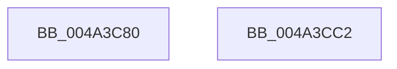

# HalpCpuID

- RVA: `0x004A3C80`–`0x004A3CC3` (길이 `67` bytes)
- VA: `0x00000001404A3C80`
- 실행 섹션: `.text`
- PDB 이름 있음: `예`; PDB Function 태그: `아니요`
- unwind 정보 RVA: `0x000B64AC`
- 디코드: `21`개 명령, `67/67` bytes 표시
- 미해석 바이트: `0` (있으면 어셈블리에 `.byte`로 보존)

> 이 문서는 커널 이미지의 기계어와 PDB 기호를 분석해 생성했습니다. 4번과 5번은 함수 원형과 자료형을 바이너리 사용 방식에서 추정한 C 해석이며 원본 소스 복구 결과는 아닙니다.

## 1. Dependencies

- 직접 호출 지점: **1**; 고유 호출 대상: **1**
- 직접 호출자로 확인된 함수: **2**
- RIP 상대 이미지 참조: **1**

### Outgoing calls
- `0x004A3CB7` → [_security_check_cookie](../6A/_security_check_cookie_function_006AC640.md) (function, `0x006AC640`)

### Direct callers
- [HalpGetProcessorBrandString](../../page/70/HalpGetProcessorBrandString_function_0070C050.md) at `0x0070C093`
- [HalpGetProcessorBrandString](../../page/70/HalpGetProcessorBrandString_function_0070C050.md) at `0x0070C0F1`
- [HalpMcaSetFeatureFlags](../../pagelk/B5/HalpMcaSetFeatureFlags_function_00B5C434.md) at `0x00B5C4B5`
- [HalpMcaSetFeatureFlags](../../pagelk/B5/HalpMcaSetFeatureFlags_function_00B5C434.md) at `0x00B5C4D9`

### Static image references
- `0x004A3C86` → RVA `0x00E0A740` (`.data`; read)

## 2. Other-region calls and transfers

- 다른 실행 섹션으로 향하는 call: **0**
- 별도 외부 분기/꼬리 이동을 확인하지 못했습니다.

## 3. Assembly (complete function range)

```asm
004A3C80  40 53                           push rbx
004A3C82  48 83 EC 20                     sub rsp, 0x20
004A3C86  48 8B 05 B3 6A 96 00            mov rax, qword ptr [rip + 0x966ab3]
004A3C8D  48 33 C4                        xor rax, rsp
004A3C90  48 89 44 24 10                  mov qword ptr [rsp + 0x10], rax
004A3C95  4C 8B 54 24 50                  mov r10, qword ptr [rsp + 0x50]
004A3C9A  4C 8B DA                        mov r11, rdx
004A3C9D  8B C1                           mov eax, ecx
004A3C9F  33 C9                           xor ecx, ecx
004A3CA1  0F A2                           cpuid
004A3CA3  41 89 03                        mov dword ptr [r11], eax
004A3CA6  41 89 18                        mov dword ptr [r8], ebx
004A3CA9  41 89 09                        mov dword ptr [r9], ecx
004A3CAC  41 89 12                        mov dword ptr [r10], edx
004A3CAF  48 8B 4C 24 10                  mov rcx, qword ptr [rsp + 0x10]
004A3CB4  48 33 CC                        xor rcx, rsp
004A3CB7  E8 84 89 20 00                  call 0x1406ac640
004A3CBC  48 83 C4 20                     add rsp, 0x20
004A3CC0  5B                              pop rbx
004A3CC1  C3                              ret
004A3CC2  CC                              int3
```

## 4. C-style interpretation (structured pseudocode)

```c
__int64 __fastcall HalpCpuID(int a1, __int64 a2, __int64 a3, __int64 a4, __int64 a5)
{
    __int64 result;
    __int64 v_rsp;
    unsigned __int64 v_stack_m18;

    v_rsp = (v_rsp) - (32);
    result = (*(unsigned __int64 *)(v_rip + 9857715)) ^ (v_rsp);
    v_stack_m18 = result;
    a1 = 0;
    *(unsigned int *)(a2) = (unsigned int)((unsigned int)(a1));
    *(unsigned int *)(a3) = (unsigned int)(v_rbx);
    *(unsigned int *)(a4) = 0;
    *(unsigned int *)(a5) = (unsigned int)(a2);
    a1 = (v_stack_m18) ^ (v_rsp);
    result = _security_check_cookie(a1, a2, a3, a4);
    v_rsp = (v_rsp) + (32);
    return result;
}
```

## 5. (Beta) C Style

```c
int64_t HalpCpuID(int32_t Arg1, void *Arg2, void *Arg3, void *Arg4, void *Arg5)
{
    uint8_t *arg2 = (uint8_t *)Arg2;
    uint8_t *arg3 = (uint8_t *)Arg3;
    uint8_t *arg4 = (uint8_t *)Arg4;
    uint8_t *arg5 = (uint8_t *)Arg5;

    int64_t result;
    int64_t local_rsp;
    uint64_t v_stack_m18;

    local_rsp = (local_rsp) - (32);
    result = (*(uint64_t *)(v_rip + 0x966AB3)) ^ (local_rsp);
    v_stack_m18 = result;
    Arg1 = 0;
    *(uint32_t *)(arg2) = (uint32_t)((uint32_t)(Arg1));
    *(uint32_t *)(arg3) = (uint32_t)(local_rbx);
    *(uint32_t *)(arg4) = 0;
    *(uint32_t *)(arg5) = (uint32_t)(Arg2);
    Arg1 = (v_stack_m18) ^ (local_rsp);
    result = _security_check_cookie(Arg1, Arg2, Arg3, Arg4);
    local_rsp = (local_rsp) + (32);
    return result;
}
```

### 관측된 메모리 오프셋

구조체 형식이 확인되지 않은 접근은 인자 기준의 오프셋으로만 기록했습니다.

| 기준 인자 | 오프셋 표현 | 폭 (bit) | 접근 |
|---|---:|---:|---|
| `Arg2` | `+ 0x0` | `32` | `W` |
| `Arg3` | `+ 0x0` | `32` | `W` |
| `Arg4` | `+ 0x0` | `32` | `W` |
| `Arg5` | `+ 0x0` | `32` | `W` |

## 6. Execution-region graph

[열기: 2D/3D 그래프와 함수 탐색 컨트롤 패널](../../../control-panel.html?section=text&rva=0x004A3C80&view=graph)

- 2D 그래프는 위에서 아래로 흐르고, 3D 그래프는 빈 공간을 드래그해 회전합니다. Shift+드래그는 이동, 휠은 확대·축소, 함수 노드 선택은 대상 보고서 이동입니다.

### Static fallback


