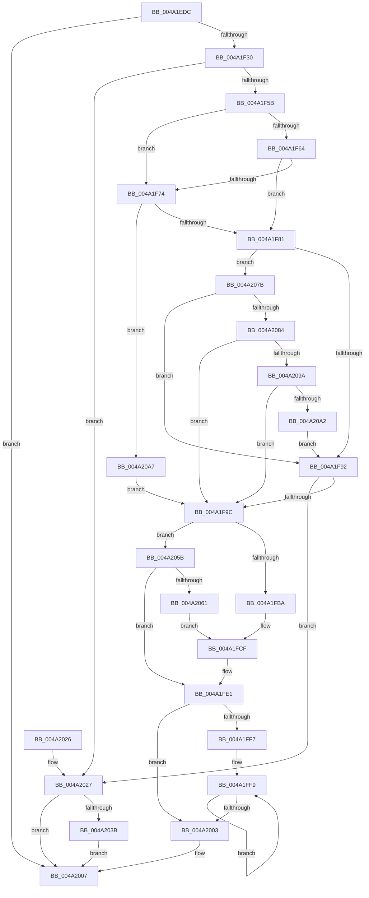

# HalpDmaMapScatterTransferV3

- RVA: `0x004A1EDC`–`0x004A20B3` (길이 `471` bytes)
- VA: `0x00000001404A1EDC`
- 실행 섹션: `.text`
- PDB 이름 있음: `예`; PDB Function 태그: `아니요`
- unwind 정보 RVA: `0x000B5D68`
- 디코드: `116`개 명령, `471/471` bytes 표시
- 미해석 바이트: `0` (있으면 어셈블리에 `.byte`로 보존)

> 이 문서는 커널 이미지의 기계어와 PDB 기호를 분석해 생성했습니다. 4번과 5번은 함수 원형과 자료형을 바이너리 사용 방식에서 추정한 C 해석이며 원본 소스 복구 결과는 아닙니다.

## 1. Dependencies

- 직접 호출 지점: **4**; 고유 호출 대상: **4**
- 직접 호출자로 확인된 함수: **1**
- RIP 상대 이미지 참조: **1**

### Outgoing calls
- `0x004A1F1F` → [HalpDmaNextContiguousPiece](../3D/HalpDmaNextContiguousPiece_function_003DECB0.md) (function, `0x003DECB0`)
- `0x004A1FDC` → [HalpDmaSyncMapBuffers](../3D/HalpDmaSyncMapBuffers_function_003DEFD0.md) (function, `0x003DEFD0`)
- `0x004A2054` → [HalpDmaFlushBuffer](../3D/HalpDmaFlushBuffer_function_003DC1DC.md) (function, `0x003DC1DC`)
- `0x004A2087` → [HalpDmaGetAdapterCacheAlignment](../3D/HalpDmaGetAdapterCacheAlignment_function_003DC150.md) (function, `0x003DC150`)

### Direct callers
- [HalpMapTransferV3](../3D/HalpMapTransferV3_function_003DCCAC.md) at `0x003DCD17`

### Static image references
- `0x004A1F5B` → RVA `0x00FC18A0` (`.data`; read)

## 2. Other-region calls and transfers

- 다른 실행 섹션으로 향하는 call: **0**
- 별도 외부 분기/꼬리 이동을 확인하지 못했습니다.

## 3. Assembly (complete function range)

```asm
004A1EDC  4C 8B DC                        mov r11, rsp
004A1EDF  49 89 5B 08                     mov qword ptr [r11 + 8], rbx
004A1EE3  49 89 6B 10                     mov qword ptr [r11 + 0x10], rbp
004A1EE7  49 89 73 18                     mov qword ptr [r11 + 0x18], rsi
004A1EEB  49 89 7B 20                     mov qword ptr [r11 + 0x20], rdi
004A1EEF  41 54                           push r12
004A1EF1  41 56                           push r14
004A1EF3  41 57                           push r15
004A1EF5  48 83 EC 40                     sub rsp, 0x40
004A1EF9  48 8B 9C 24 80 00 00 00         mov rbx, qword ptr [rsp + 0x80]
004A1F01  4D 8B F1                        mov r14, r9
004A1F04  44 8A A4 24 88 00 00 00         mov r12b, byte ptr [rsp + 0x88]
004A1F0C  49 8B E8                        mov rbp, r8
004A1F0F  4C 8B FA                        mov r15, rdx
004A1F12  48 8B F9                        mov rdi, rcx
004A1F15  8B 03                           mov eax, dword ptr [rbx]
004A1F17  89 44 24 28                     mov dword ptr [rsp + 0x28], eax
004A1F1B  45 88 63 C8                     mov byte ptr [r11 - 0x38], r12b
004A1F1F  E8 8C CD F3 FF                  call 0x1403decb0
004A1F24  8B F0                           mov esi, eax
004A1F26  89 33                           mov dword ptr [rbx], esi
004A1F28  85 C0                           test eax, eax
004A1F2A  0F 84 D7 00 00 00               je 0x1404a2007
004A1F30  49 8B DE                        mov rbx, r14
004A1F33  49 8B CE                        mov rcx, r14
004A1F36  49 2B 4F 20                     sub rcx, qword ptr [r15 + 0x20]
004A1F3A  81 E3 FF 0F 00 00               and ebx, 0xfff
004A1F40  48 C1 E9 0C                     shr rcx, 0xc
004A1F44  8B C9                           mov ecx, ecx
004A1F46  4D 8B 4C CF 30                  mov r9, qword ptr [r15 + rcx*8 + 0x30]
004A1F4B  49 C1 E1 0C                     shl r9, 0xc
004A1F4F  4C 03 CB                        add r9, rbx
004A1F52  48 85 ED                        test rbp, rbp
004A1F55  0F 84 CC 00 00 00               je 0x1404a2027
004A1F5B  80 3D 3E F9 B1 00 00            cmp byte ptr [rip + 0xb1f93e], 0
004A1F62  75 10                           jne 0x1404a1f74
004A1F64  48 8D 4E FF                     lea rcx, [rsi - 1]
004A1F68  49 03 C9                        add rcx, r9
004A1F6B  48 39 8F 90 00 00 00            cmp qword ptr [rdi + 0x90], rcx
004A1F72  73 0D                           jae 0x1404a1f81
004A1F74  83 BF 08 02 00 00 03            cmp dword ptr [rdi + 0x208], 3
004A1F7B  0F 85 26 01 00 00               jne 0x1404a20a7
004A1F81  4C 8D 87 BD 01 00 00            lea r8, [rdi + 0x1bd]
004A1F88  41 80 38 00                     cmp byte ptr [r8], 0
004A1F8C  0F 84 E9 00 00 00               je 0x1404a207b
004A1F92  80 7D 40 00                     cmp byte ptr [rbp + 0x40], 0
004A1F96  0F 84 8B 00 00 00               je 0x1404a2027
004A1F9C  4C 8B 4D 38                     mov r9, qword ptr [rbp + 0x38]
004A1FA0  48 8B 84 24 98 00 00 00         mov rax, qword ptr [rsp + 0x98]
004A1FA8  49 8B 09                        mov rcx, qword ptr [r9]
004A1FAB  48 03 CB                        add rcx, rbx
004A1FAE  48 89 08                        mov qword ptr [rax], rcx
004A1FB1  45 84 E4                        test r12b, r12b
004A1FB4  0F 84 A1 00 00 00               je 0x1404a205b
004A1FBA  8A 84 24 90 00 00 00            mov al, byte ptr [rsp + 0x90]
004A1FC1  88 44 24 38                     mov byte ptr [rsp + 0x38], al
004A1FC5  C6 44 24 30 00                  mov byte ptr [rsp + 0x30], 0
004A1FCA  44 88 64 24 28                  mov byte ptr [rsp + 0x28], r12b
004A1FCF  4D 8B C6                        mov r8, r14
004A1FD2  89 74 24 20                     mov dword ptr [rsp + 0x20], esi
004A1FD6  49 8B D7                        mov rdx, r15
004A1FD9  48 8B CF                        mov rcx, rdi
004A1FDC  E8 EF CF F3 FF                  call 0x1403defd0
004A1FE1  48 8B 45 38                     mov rax, qword ptr [rbp + 0x38]
004A1FE5  48 8D 8B FF 0F 00 00            lea rcx, [rbx + 0xfff]
004A1FEC  48 03 CE                        add rcx, rsi
004A1FEF  48 C1 E9 0C                     shr rcx, 0xc
004A1FF3  85 C9                           test ecx, ecx
004A1FF5  74 0C                           je 0x1404a2003
004A1FF7  8B D1                           mov edx, ecx
004A1FF9  48 8B 40 08                     mov rax, qword ptr [rax + 8]
004A1FFD  48 83 EA 01                     sub rdx, 1
004A2001  75 F6                           jne 0x1404a1ff9
004A2003  48 89 45 38                     mov qword ptr [rbp + 0x38], rax
004A2007  48 8B 5C 24 60                  mov rbx, qword ptr [rsp + 0x60]
004A200C  48 8B 6C 24 68                  mov rbp, qword ptr [rsp + 0x68]
004A2011  48 8B 74 24 70                  mov rsi, qword ptr [rsp + 0x70]
004A2016  48 8B 7C 24 78                  mov rdi, qword ptr [rsp + 0x78]
004A201B  48 83 C4 40                     add rsp, 0x40
004A201F  41 5F                           pop r15
004A2021  41 5E                           pop r14
004A2023  41 5C                           pop r12
004A2025  C3                              ret
004A2026  CC                              int3
004A2027  80 BF BD 01 00 00 00            cmp byte ptr [rdi + 0x1bd], 0
004A202E  48 8B 84 24 98 00 00 00         mov rax, qword ptr [rsp + 0x98]
004A2036  4C 89 08                        mov qword ptr [rax], r9
004A2039  75 CC                           jne 0x1404a2007
004A203B  8A 84 24 90 00 00 00            mov al, byte ptr [rsp + 0x90]
004A2042  44 8B CE                        mov r9d, esi
004A2045  88 44 24 28                     mov byte ptr [rsp + 0x28], al
004A2049  4D 8B C6                        mov r8, r14
004A204C  49 8B D7                        mov rdx, r15
004A204F  44 88 64 24 20                  mov byte ptr [rsp + 0x20], r12b
004A2054  E8 83 A1 F3 FF                  call 0x1403dc1dc
004A2059  EB AC                           jmp 0x1404a2007
004A205B  41 80 38 00                     cmp byte ptr [r8], 0
004A205F  75 80                           jne 0x1404a1fe1
004A2061  8A 84 24 90 00 00 00            mov al, byte ptr [rsp + 0x90]
004A2068  88 44 24 38                     mov byte ptr [rsp + 0x38], al
004A206C  C6 44 24 30 01                  mov byte ptr [rsp + 0x30], 1
004A2071  C6 44 24 28 00                  mov byte ptr [rsp + 0x28], 0
004A2076  E9 54 FF FF FF                  jmp 0x1404a1fcf
004A207B  45 84 E4                        test r12b, r12b
004A207E  0F 85 0E FF FF FF               jne 0x1404a1f92
004A2084  48 8B CF                        mov rcx, rdi
004A2087  E8 C4 A0 F3 FF                  call 0x1403dc150
004A208C  8D 48 FF                        lea ecx, [rax - 1]
004A208F  8B C1                           mov eax, ecx
004A2091  49 85 C1                        test r9, rax
004A2094  0F 85 02 FF FF FF               jne 0x1404a1f9c
004A209A  85 CE                           test esi, ecx
004A209C  0F 85 FA FE FF FF               jne 0x1404a1f9c
004A20A2  E9 EB FE FF FF                  jmp 0x1404a1f92
004A20A7  4C 8D 87 BD 01 00 00            lea r8, [rdi + 0x1bd]
004A20AE  E9 E9 FE FF FF                  jmp 0x1404a1f9c
```

## 4. C-style interpretation (structured pseudocode)

```c
__int64 __fastcall HalpDmaMapScatterTransferV3(__int64 a1, __int64 a2, __int64 a3, __int64 a4, __int64 a5, unsigned __int8 a6, unsigned __int8 a7, __int64 a8)
{
    __int64 result;
    __int64 v_rbx;
    __int64 v_rsp;
    unsigned __int8 v_stack_m20;
    unsigned __int8 v_stack_m28;
    unsigned int v_stack_m30;
    unsigned int v_stack_m38;
    unsigned __int64 v_stack_p10;
    unsigned __int64 v_stack_p18;
    unsigned __int64 v_stack_p20;
    unsigned __int8 v_stack_p28;
    unsigned __int8 v_stack_p30;
    unsigned __int8 v_stack_p38;
    unsigned __int64 v_stack_p8;

    *(unsigned __int64 *)(v_rsp + 8) = v_rbx;
    *(unsigned __int64 *)(v_rsp + 16) = v_rbp;
    *(unsigned __int64 *)(v_rsp + 24) = v_rsi;
    *(unsigned __int64 *)(v_rsp + 32) = v_rdi;
    v_rsp = (v_rsp) - (64);
    v_stack_m30 = (unsigned int)((unsigned int)(*(unsigned int *)(a5)));
    *(unsigned __int8 *)(v_rsp - 56) = a6;
    result = HalpDmaNextContiguousPiece(a1, a2, a3, a4);
    *(unsigned int *)(a5) = (unsigned int)((unsigned int)((unsigned int)(result)));
    if ((unsigned int)(result) == 0) goto loc_004A2007;
    a1 = (a4) - (*(unsigned __int64 *)(a2 + 32));
    v_rbx = (unsigned int)((a4) & (0xFFFULL));
    a1 = (a1) >> (12);
    a4 = (*(unsigned __int64 *)(a2 + (unsigned int)((unsigned int)(a1)) * 8 + 48)) << (12);
    a4 = (a4) + (v_rbx);
    if (a3 == 0) goto loc_004A2027;
    if ((*(unsigned __int8 *)(v_rip + 11663678)) != 0) goto loc_004A1F74;
    a1 = ((unsigned int)((unsigned int)(result)) - 1) + (a4);
    if ((*(unsigned __int64 *)(a1 + 144)) >= a1) goto loc_004A1F81;
loc_004A1F74:
    if ((*(unsigned int *)(a1 + 520)) != 3) goto loc_004A20A7;
loc_004A1F81:
    if ((*(unsigned __int8 *)(a1 + 445)) == 0) goto loc_004A207B;
loc_004A1F92:
    if ((*(unsigned __int8 *)(a3 + 64)) == 0) goto loc_004A2027;
loc_004A1F9C:
    a1 = (*(unsigned __int64 *)(*(unsigned __int64 *)(a3 + 56))) + (v_rbx);
    *(unsigned __int64 *)(a8) = a1;
    if (a6 == 0) goto loc_004A205B;
    v_stack_m20 = a7;
    v_stack_m28 = 0;
    v_stack_m30 = a6;
loc_004A1FCF:
    v_stack_m38 = (unsigned int)((unsigned int)((unsigned int)(result)));
    result = HalpDmaSyncMapBuffers(a1, a2, a4, *(unsigned __int64 *)(a3 + 56));
loc_004A1FE1:
    a1 = (v_rbx + 4095) + ((unsigned int)((unsigned int)(result)));
    a1 = (a1) >> (12);
    if ((unsigned int)(a1) == 0) goto loc_004A2003;
loc_004A1FF9:
    a2 = ((unsigned int)((unsigned int)(a1))) - (1);
    if (condition_is_not_equal) goto loc_004A1FF9;
loc_004A2003:
    *(unsigned __int64 *)(a3 + 56) = *(unsigned __int64 *)(*(unsigned __int64 *)(a3 + 56) + 8);
loc_004A2007:
    v_rsp = (v_rsp) + (64);
    return *(unsigned __int64 *)(*(unsigned __int64 *)(a3 + 56) + 8);
loc_004A2027:
    *(unsigned __int64 *)(a8) = *(unsigned __int64 *)(a3 + 56);
    if ((*(unsigned __int8 *)(v_stack_p20 + 445)) != 0) goto loc_004A2007;
    v_stack_p28 = a7;
    v_stack_p20 = a6;
    result = HalpDmaFlushBuffer(a1, a2, a4, (unsigned int)((unsigned int)(v_stack_p18)));
    goto loc_004A2007;
loc_004A205B:
    if ((*(unsigned __int8 *)(a4)) != 0) goto loc_004A1FE1;
    v_stack_p38 = a7;
    v_stack_p30 = 1;
    v_stack_p28 = 0;
    goto loc_004A1FCF;
loc_004A207B:
    if (a6 != 0) goto loc_004A1F92;
    result = HalpDmaGetAdapterCacheAlignment(v_stack_p20, a2, a4, (unsigned int)((unsigned int)(v_stack_p18)));
    if ((((unsigned int)((unsigned int)(v_stack_p18))) & ((unsigned int)((unsigned int)(result - 1)))) != 0) goto loc_004A1F9C;
    if ((((unsigned int)(v_stack_p18)) & ((unsigned int)(result - 1))) != 0) goto loc_004A1F9C;
    goto loc_004A1F92;
loc_004A20A7:
    goto loc_004A1F9C;
}
```

## 5. (Beta) C Style

```c
int64_t HalpDmaMapScatterTransferV3(void *Arg1, void *Arg2, int64_t Arg3, void *Arg4, void *Arg5, uint8_t Arg6, uint8_t Arg7, void *Arg8)
{
    uint8_t *arg1 = (uint8_t *)Arg1;
    uint8_t *arg2 = (uint8_t *)Arg2;
    uint8_t *arg4 = (uint8_t *)Arg4;
    uint8_t *arg5 = (uint8_t *)Arg5;
    uint8_t *arg8 = (uint8_t *)Arg8;

    int64_t result;
    int64_t local_rbx;
    int64_t local_rsp;
    uint8_t v_stack_m20;
    uint8_t v_stack_m28;
    uint32_t v_stack_m30;
    uint32_t v_stack_m38;
    uint64_t v_stack_p10;
    uint64_t v_stack_p18;
    uint64_t v_stack_p20;
    uint8_t v_stack_p28;
    uint8_t v_stack_p30;
    uint8_t v_stack_p38;
    uint64_t v_stack_p8;

    *(uint64_t *)(local_rsp + 0x8) = local_rbx;
    *(uint64_t *)(local_rsp + 0x10) = local_rbp;
    *(uint64_t *)(local_rsp + 0x18) = local_rsi;
    *(uint64_t *)(local_rsp + 0x20) = local_rdi;
    local_rsp = (local_rsp) - (64);
    v_stack_m30 = (uint32_t)((uint32_t)(*(uint32_t *)(arg5)));
    *(uint8_t *)(local_rsp - 0x38) = Arg6;
    result = HalpDmaNextContiguousPiece(Arg1, Arg2, Arg3, Arg4);
    *(uint32_t *)(arg5) = (uint32_t)((uint32_t)((uint32_t)(result)));
    if ((uint32_t)(result) == 0) goto loc_004A2007;
    Arg1 = (Arg4) - (*(uint64_t *)(arg2 + 0x20));
    local_rbx = (uint32_t)((Arg4) & (0xFFFULL));
    Arg1 = (Arg1) >> (12);
    Arg4 = (*(uint64_t *)(arg2 + (uint32_t)((uint32_t)(arg1)) * 8 + 0x30)) << (12);
    Arg4 = (Arg4) + (local_rbx);
    if (Arg3 == 0) goto loc_004A2027;
    if ((*(uint8_t *)(v_rip + 0xB1F93E)) != 0) goto loc_004A1F74;
    Arg1 = ((uint32_t)((uint32_t)(result)) - 1) + (Arg4);
    if ((*(uint64_t *)(arg1 + 0x90)) >= Arg1) goto loc_004A1F81;
loc_004A1F74:
    if ((*(uint32_t *)(arg1 + 0x208)) != 3) goto loc_004A20A7;
loc_004A1F81:
    if ((*(uint8_t *)(arg1 + 0x1BD)) == 0) goto loc_004A207B;
loc_004A1F92:
    if ((*(uint8_t *)(Arg3 + 0x40)) == 0) goto loc_004A2027;
loc_004A1F9C:
    Arg1 = (*(uint64_t *)(*(uint64_t *)(Arg3 + 0x38))) + (local_rbx);
    *(void **)(arg8) = Arg1;
    if (Arg6 == 0) goto loc_004A205B;
    v_stack_m20 = Arg7;
    v_stack_m28 = 0;
    v_stack_m30 = Arg6;
loc_004A1FCF:
    v_stack_m38 = (uint32_t)((uint32_t)((uint32_t)(result)));
    result = HalpDmaSyncMapBuffers(Arg1, Arg2, Arg4, *(uint64_t *)(Arg3 + 0x38));
loc_004A1FE1:
    Arg1 = (local_rbx + 4095) + ((uint32_t)((uint32_t)(result)));
    Arg1 = (Arg1) >> (12);
    if ((uint32_t)(Arg1) == 0) goto loc_004A2003;
loc_004A1FF9:
    Arg2 = ((uint32_t)((uint32_t)(Arg1))) - (1);
    if (condition_is_not_equal) goto loc_004A1FF9;
loc_004A2003:
    *(uint64_t *)(Arg3 + 0x38) = *(uint64_t *)(*(uint64_t *)(Arg3 + 0x38) + 0x8);
loc_004A2007:
    local_rsp = (local_rsp) + (64);
    return *(uint64_t *)(*(uint64_t *)(Arg3 + 0x38) + 0x8);
loc_004A2027:
    *(uint64_t *)(arg8) = *(uint64_t *)(Arg3 + 0x38);
    if ((*(uint8_t *)(v_stack_p20 + 0x1BD)) != 0) goto loc_004A2007;
    v_stack_p28 = Arg7;
    v_stack_p20 = Arg6;
    result = HalpDmaFlushBuffer(Arg1, Arg2, Arg4, (uint32_t)((uint32_t)(v_stack_p18)));
    goto loc_004A2007;
loc_004A205B:
    if ((*(uint8_t *)(arg4)) != 0) goto loc_004A1FE1;
    v_stack_p38 = Arg7;
    v_stack_p30 = 1;
    v_stack_p28 = 0;
    goto loc_004A1FCF;
loc_004A207B:
    if (Arg6 != 0) goto loc_004A1F92;
    result = HalpDmaGetAdapterCacheAlignment(v_stack_p20, Arg2, Arg4, (uint32_t)((uint32_t)(v_stack_p18)));
    if ((((uint32_t)((uint32_t)(v_stack_p18))) & ((uint32_t)((uint32_t)(result - 1)))) != 0) goto loc_004A1F9C;
    if ((((uint32_t)(v_stack_p18)) & ((uint32_t)(result - 1))) != 0) goto loc_004A1F9C;
    goto loc_004A1F92;
loc_004A20A7:
    goto loc_004A1F9C;
}
```

### 관측된 메모리 오프셋

구조체 형식이 확인되지 않은 접근은 인자 기준의 오프셋으로만 기록했습니다.

| 기준 인자 | 오프셋 표현 | 폭 (bit) | 접근 |
|---|---:|---:|---|
| `Arg1` | `+ 0x0` | `8` | `R` |
| `Arg1` | `+ 0x90` | `64` | `R` |
| `Arg1` | `+ 0x1BD` | `8` | `R` |
| `Arg1` | `+ 0x1BD` | `64` | `R` |
| `Arg1` | `+ 0x208` | `32` | `R` |
| `Arg2` | `+ 0x20` | `64` | `R` |
| `Arg2` | `+ 0x30 + rcx*8` | `64` | `R` |
| `Arg4` | `+ 0xFFF` | `64` | `R` |
| `Arg5` | `+ 0x0` | `32` | `R` |
| `Arg5` | `+ 0x0` | `32` | `W` |
| `Arg8` | `+ 0x0` | `64` | `W` |

## 6. Execution-region graph

[열기: 2D/3D 그래프와 함수 탐색 컨트롤 패널](../../../control-panel.html?section=text&rva=0x004A1EDC&view=graph)

- 2D 그래프는 위에서 아래로 흐르고, 3D 그래프는 빈 공간을 드래그해 회전합니다. Shift+드래그는 이동, 휠은 확대·축소, 함수 노드 선택은 대상 보고서 이동입니다.

### Static fallback


