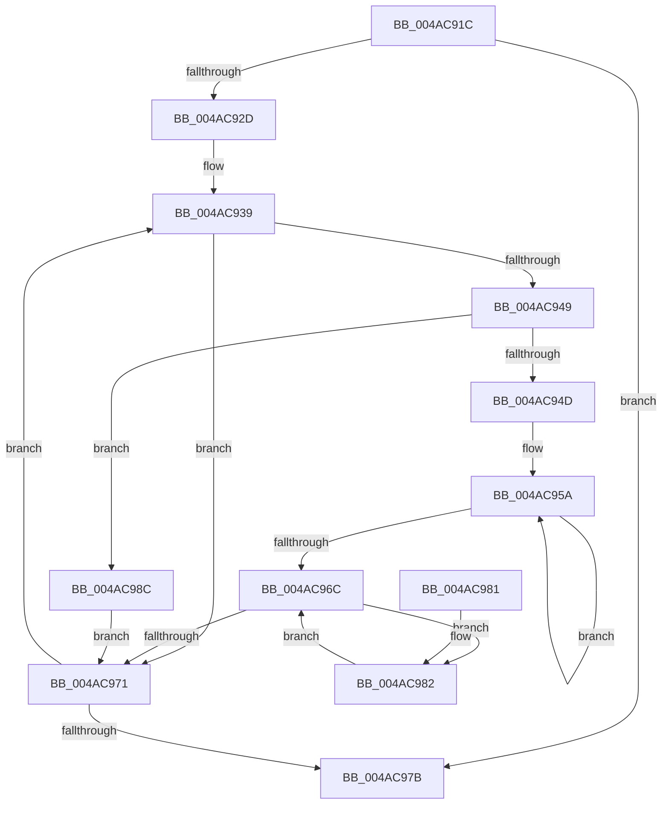

# HalpEfiLockOutRuntimeCallsForSystemSleep

- RVA: `0x004AC91C`–`0x004AC999` (길이 `125` bytes)
- VA: `0x00000001404AC91C`
- 실행 섹션: `.text`
- PDB 이름 있음: `예`; PDB Function 태그: `아니요`
- unwind 정보 RVA: `0x0009D0AC`
- 디코드: `35`개 명령, `125/125` bytes 표시
- 미해석 바이트: `0` (있으면 어셈블리에 `.byte`로 보존)

> 이 문서는 커널 이미지의 기계어와 PDB 기호를 분석해 생성했습니다. 4번과 5번은 함수 원형과 자료형을 바이너리 사용 방식에서 추정한 C 해석이며 원본 소스 복구 결과는 아닙니다.

## 1. Dependencies

- 직접 호출 지점: **1**; 고유 호출 대상: **1**
- 직접 호출자로 확인된 함수: **1**
- RIP 상대 이미지 참조: **1**

### Outgoing calls
- `0x004AC924` → [HalQueryMaximumProcessorCount](HalQueryMaximumProcessorCount_function_004AC9A0.md) (function, `0x004AC9A0`)

### Direct callers
- [HalpDispatchSystemStateTransition](../4C/HalpDispatchSystemStateTransition_function_004C8E34.md) at `0x004C8E86`
- [HalpDispatchSystemStateTransition](../4C/HalpDispatchSystemStateTransition_function_004C8E34.md) at `0x004C8EE8`

### Static image references
- `0x004AC939` → RVA `0x00FC19B0` (`.data`; read)

## 2. Other-region calls and transfers

- 다른 실행 섹션으로 향하는 call: **0**
- 별도 외부 분기/꼬리 이동을 확인하지 못했습니다.

## 3. Assembly (complete function range)

```asm
004AC91C  40 53                           push rbx
004AC91E  48 83 EC 20                     sub rsp, 0x20
004AC922  8A D9                           mov bl, cl
004AC924  E8 77 00 00 00                  call 0x1404ac9a0
004AC929  85 C0                           test eax, eax
004AC92B  74 4E                           je 0x1404ac97b
004AC92D  45 33 C0                        xor r8d, r8d
004AC930  44 8B C8                        mov r9d, eax
004AC933  41 BA FF 01 00 00               mov r10d, 0x1ff
004AC939  48 8B 05 70 50 B1 00            mov rax, qword ptr [rip + 0xb15070]
004AC940  49 8B 14 00                     mov rdx, qword ptr [r8 + rax]
004AC944  48 85 D2                        test rdx, rdx
004AC947  74 28                           je 0x1404ac971
004AC949  84 DB                           test bl, bl
004AC94B  75 3F                           jne 0x1404ac98c
004AC94D  0F 0D 8A E0 00 00 00            prefetchw byte ptr [rdx + 0xe0]
004AC954  8B 82 E0 00 00 00               mov eax, dword ptr [rdx + 0xe0]
004AC95A  8B C8                           mov ecx, eax
004AC95C  81 C9 00 00 00 80               or ecx, 0x80000000
004AC962  F0 0F B1 8A E0 00 00 00         lock cmpxchg dword ptr [rdx + 0xe0], ecx
004AC96A  75 EE                           jne 0x1404ac95a
004AC96C  41 85 C2                        test r10d, eax
004AC96F  75 11                           jne 0x1404ac982
004AC971  49 83 C0 08                     add r8, 8
004AC975  49 83 E9 01                     sub r9, 1
004AC979  75 BE                           jne 0x1404ac939
004AC97B  48 83 C4 20                     add rsp, 0x20
004AC97F  5B                              pop rbx
004AC980  C3                              ret
004AC981  CC                              int3
004AC982  F3 90                           pause
004AC984  8B 82 E0 00 00 00               mov eax, dword ptr [rdx + 0xe0]
004AC98A  EB E0                           jmp 0x1404ac96c
004AC98C  F0 81 A2 E0 00 00 00 FF FF FF 7F  lock and dword ptr [rdx + 0xe0], 0x7fffffff
004AC997  EB D8                           jmp 0x1404ac971
```

## 4. C-style interpretation (structured pseudocode)

```c
__int64 __fastcall HalpEfiLockOutRuntimeCallsForSystemSleep(unsigned __int8 a1, __int64 a2, int a3)
{
    __int64 result;
    __int64 v_rsp;

    v_rsp = (v_rsp) - (32);
    result = HalQueryMaximumProcessorCount(a1, a2, a3, a4);
    if ((unsigned int)(result) == 0) goto loc_004AC97B;
    a3 = 0;
loc_004AC939:
    if (*(unsigned __int64 *)(a3 + *(unsigned __int64 *)(v_rip + 11620464) * 1) == 0) goto loc_004AC971;
    if (a1 != 0) goto loc_004AC98C;
loc_004AC95A:
    a1 = (unsigned int)(((unsigned int)((unsigned int)((unsigned int)(*(unsigned int *)(*(unsigned __int64 *)(a3 + *(unsigned __int64 *)(v_rip + 11620464) * 1) + 224))))) | (0x80000000ULL));
    if (condition_is_not_equal) goto loc_004AC95A;
loc_004AC96C:
    if (((511) & ((unsigned int)((unsigned int)(*(unsigned int *)(*(unsigned __int64 *)(a3 + *(unsigned __int64 *)(v_rip + 11620464) * 1) + 224))))) != 0) goto loc_004AC982;
loc_004AC971:
    a3 = (a3) + (8);
    a4 = ((unsigned int)((unsigned int)(result))) - (1);
    if (condition_is_not_equal) goto loc_004AC939;
loc_004AC97B:
    v_rsp = (v_rsp) + (32);
    return (unsigned int)(*(unsigned int *)(*(unsigned __int64 *)(a3 + *(unsigned __int64 *)(v_rip + 11620464) * 1) + 224));
loc_004AC982:
    goto loc_004AC96C;
loc_004AC98C:
    goto loc_004AC971;
}
```

## 5. (Beta) C Style

```c
int64_t HalpEfiLockOutRuntimeCallsForSystemSleep(uint8_t Arg1, int64_t Arg2, int32_t Arg3)
{
    int64_t result;
    int64_t local_rsp;

    local_rsp = (local_rsp) - (32);
    result = HalQueryMaximumProcessorCount(Arg1, Arg2, Arg3, a4);
    if ((uint32_t)(result) == 0) goto loc_004AC97B;
    Arg3 = 0;
loc_004AC939:
    if (*(uint64_t *)(Arg3 + *(uint64_t *)(v_rip + 0xB15070) * 1) == 0) goto loc_004AC971;
    if (Arg1 != 0) goto loc_004AC98C;
loc_004AC95A:
    Arg1 = (uint32_t)(((uint32_t)((uint32_t)((uint32_t)(*(uint32_t *)(*(uint64_t *)(Arg3 + *(uint64_t *)(v_rip + 0xB15070) * 1) + 0xE0))))) | (0x80000000ULL));
    if (condition_is_not_equal) goto loc_004AC95A;
loc_004AC96C:
    if (((511) & ((uint32_t)((uint32_t)(*(uint32_t *)(*(uint64_t *)(Arg3 + *(uint64_t *)(v_rip + 0xB15070) * 1) + 0xE0))))) != 0) goto loc_004AC982;
loc_004AC971:
    Arg3 = (Arg3) + (8);
    a4 = ((uint32_t)((uint32_t)(result))) - (1);
    if (condition_is_not_equal) goto loc_004AC939;
loc_004AC97B:
    local_rsp = (local_rsp) + (32);
    return (uint32_t)(*(uint32_t *)(*(uint64_t *)(Arg3 + *(uint64_t *)(v_rip + 0xB15070) * 1) + 0xE0));
loc_004AC982:
    goto loc_004AC96C;
loc_004AC98C:
    goto loc_004AC971;
}
```

## 6. Execution-region graph

[열기: 2D/3D 그래프와 함수 탐색 컨트롤 패널](../../../control-panel.html?section=text&rva=0x004AC91C&view=graph)

- 2D 그래프는 위에서 아래로 흐르고, 3D 그래프는 빈 공간을 드래그해 회전합니다. Shift+드래그는 이동, 휠은 확대·축소, 함수 노드 선택은 대상 보고서 이동입니다.

### Static fallback


