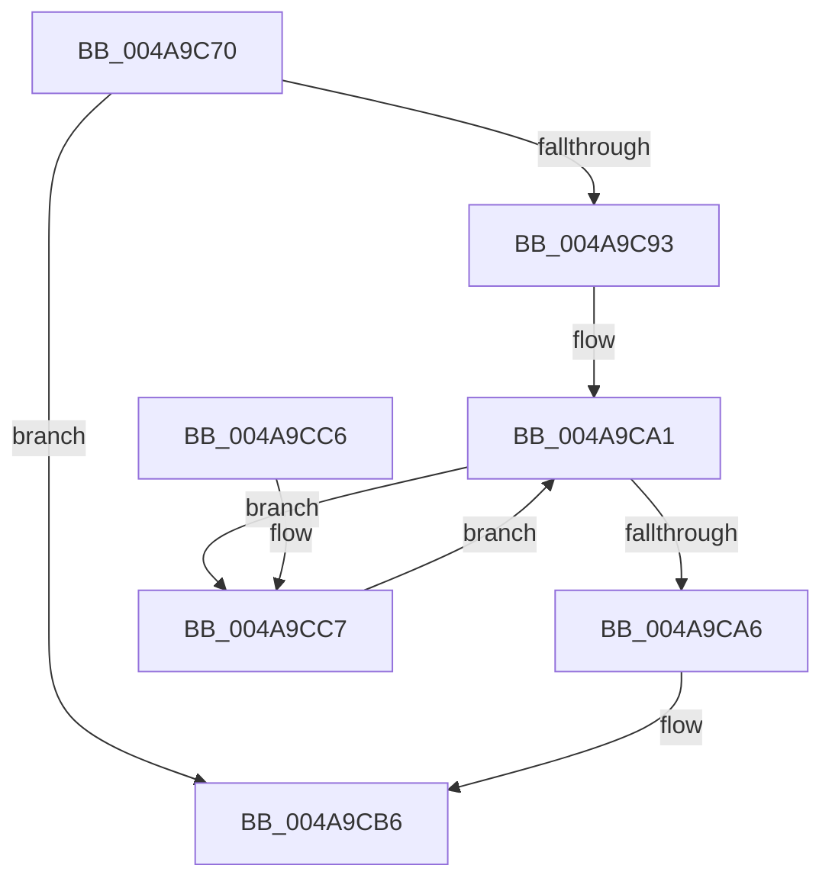

# HalpGenericPolledWorkerRoutine

- RVA: `0x004A9C70`–`0x004A9CD4` (길이 `100` bytes)
- VA: `0x00000001404A9C70`
- 실행 섹션: `.text`
- PDB 이름 있음: `예`; PDB Function 태그: `아니요`
- unwind 정보 RVA: `0x000B7B64`
- 디코드: `27`개 명령, `100/100` bytes 표시
- 미해석 바이트: `0` (있으면 어셈블리에 `.byte`로 보존)

> 이 문서는 커널 이미지의 기계어와 PDB 기호를 분석해 생성했습니다. 4번과 5번은 함수 원형과 자료형을 바이너리 사용 방식에서 추정한 C 해석이며 원본 소스 복구 결과는 아닙니다.

## 1. Dependencies

- 직접 호출 지점: **1**; 고유 호출 대상: **1**
- 직접 호출자로 확인된 함수: **0**
- RIP 상대 이미지 참조: **1**

### Outgoing calls
- `0x004A9CCA` → [HalpCheckAndReportGhes](HalpCheckAndReportGhes_function_004A9CDC.md) (function, `0x004A9CDC`)

### Direct callers
- 이 함수 시작 RVA로 연결되는 직접 call은 확인되지 않았습니다. 간접 호출은 완전히 역산할 수 없습니다.

### Static image references
- `0x004A9C93` → RVA `0x00FC1570` (`.data`; read)

## 2. Other-region calls and transfers

- 다른 실행 섹션으로 향하는 call: **0**
- 별도 외부 분기/꼬리 이동을 확인하지 못했습니다.

## 3. Assembly (complete function range)

```asm
004A9C70  48 89 5C 24 10                  mov qword ptr [rsp + 0x10], rbx
004A9C75  48 89 74 24 18                  mov qword ptr [rsp + 0x18], rsi
004A9C7A  57                              push rdi
004A9C7B  48 83 EC 20                     sub rsp, 0x20
004A9C7F  48 8B D9                        mov rbx, rcx
004A9C82  33 C0                           xor eax, eax
004A9C84  B9 01 00 00 00                  mov ecx, 1
004A9C89  F0 0F B1 8B F4 00 00 00         lock cmpxchg dword ptr [rbx + 0xf4], ecx
004A9C91  75 23                           jne 0x1404a9cb6
004A9C93  48 8B 3D D6 78 B1 00            mov rdi, qword ptr [rip + 0xb178d6]
004A9C9A  48 8D 35 CF 78 B1 00            lea rsi, [rip + 0xb178cf]
004A9CA1  48 3B FE                        cmp rdi, rsi
004A9CA4  75 21                           jne 0x1404a9cc7
004A9CA6  33 C9                           xor ecx, ecx
004A9CA8  8B C1                           mov eax, ecx
004A9CAA  87 83 F0 00 00 00               xchg dword ptr [rbx + 0xf0], eax
004A9CB0  87 8B F4 00 00 00               xchg dword ptr [rbx + 0xf4], ecx
004A9CB6  48 8B 5C 24 38                  mov rbx, qword ptr [rsp + 0x38]
004A9CBB  48 8B 74 24 40                  mov rsi, qword ptr [rsp + 0x40]
004A9CC0  48 83 C4 20                     add rsp, 0x20
004A9CC4  5F                              pop rdi
004A9CC5  C3                              ret
004A9CC6  CC                              int3
004A9CC7  48 8B CF                        mov rcx, rdi
004A9CCA  E8 0D 00 00 00                  call 0x1404a9cdc
004A9CCF  48 8B 3F                        mov rdi, qword ptr [rdi]
004A9CD2  EB CD                           jmp 0x1404a9ca1
```

## 4. C-style interpretation (structured pseudocode)

```c
__int64 __fastcall HalpGenericPolledWorkerRoutine(__int64 a1)
{
    __int64 result;
    __int64 v_rsp;
    unsigned __int64 v_stack_p10;
    unsigned __int64 v_stack_p18;

    v_stack_p10 = v_rbx;
    v_stack_p18 = v_rsi;
    v_rsp = (v_rsp) - (32);
    result = 0;
    if (condition_is_not_equal) goto loc_004A9CB6;
loc_004A9CA1:
    if ((*(unsigned __int64 *)(v_rip + 11630806)) != (v_rip + 11630799)) goto loc_004A9CC7;
    a1 = 0;
loc_004A9CB6:
    v_rsp = (v_rsp) + (32);
    return 0;
loc_004A9CC7:
    result = HalpCheckAndReportGhes(*(unsigned __int64 *)(v_rip + 11630806), a2, a3, a4);
    goto loc_004A9CA1;
}
```

## 5. (Beta) C Style

```c
int64_t HalpGenericPolledWorkerRoutine(void *Arg1)
{
    uint8_t *arg1 = (uint8_t *)Arg1;

    int64_t result;
    int64_t local_rsp;
    uint64_t v_stack_p10;
    uint64_t v_stack_p18;

    v_stack_p10 = local_rbx;
    v_stack_p18 = local_rsi;
    local_rsp = (local_rsp) - (32);
    result = 0;
    if (condition_is_not_equal) goto loc_004A9CB6;
loc_004A9CA1:
    if ((*(uint64_t *)(v_rip + 0xB178D6)) != (v_rip + 11630799)) goto loc_004A9CC7;
    Arg1 = 0;
loc_004A9CB6:
    local_rsp = (local_rsp) + (32);
    return 0;
loc_004A9CC7:
    result = HalpCheckAndReportGhes(*(uint64_t *)(v_rip + 0xB178D6), a2, a3, a4);
    goto loc_004A9CA1;
}
```

### 관측된 메모리 오프셋

구조체 형식이 확인되지 않은 접근은 인자 기준의 오프셋으로만 기록했습니다.

| 기준 인자 | 오프셋 표현 | 폭 (bit) | 접근 |
|---|---:|---:|---|
| `Arg1` | `+ 0xF0` | `32` | `R/W` |
| `Arg1` | `+ 0xF4` | `32` | `R` |
| `Arg1` | `+ 0xF4` | `32` | `R/W` |

## 6. Execution-region graph

[열기: 2D/3D 그래프와 함수 탐색 컨트롤 패널](../../../control-panel.html?section=text&rva=0x004A9C70&view=graph)

- 2D 그래프는 위에서 아래로 흐르고, 3D 그래프는 빈 공간을 드래그해 회전합니다. Shift+드래그는 이동, 휠은 확대·축소, 함수 노드 선택은 대상 보고서 이동입니다.

### Static fallback


