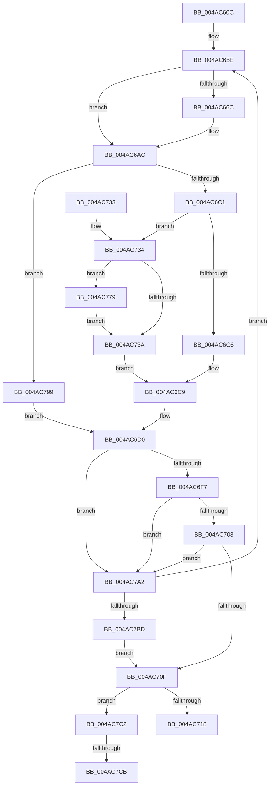

# HalpHpetSetMatchValue

- RVA: `0x004AC60C`–`0x004AC7E3` (길이 `471` bytes)
- VA: `0x00000001404AC60C`
- 실행 섹션: `.text`
- PDB 이름 있음: `예`; PDB Function 태그: `예`
- unwind 정보 RVA: `0x000B8230`
- 디코드: `129`개 명령, `471/471` bytes 표시
- 미해석 바이트: `0` (있으면 어셈블리에 `.byte`로 보존)

> 이 문서는 커널 이미지의 기계어와 PDB 기호를 분석해 생성했습니다. 4번과 5번은 함수 원형과 자료형을 바이너리 사용 방식에서 추정한 C 해석이며 원본 소스 복구 결과는 아닙니다.

## 1. Dependencies

- 직접 호출 지점: **2**; 고유 호출 대상: **1**
- 직접 호출자로 확인된 함수: **2**
- RIP 상대 이미지 참조: **2**

### Outgoing calls
- `0x004AC783` → [HalSetTimerProblem](../4F/HalSetTimerProblem_function_004FC9A0.md) (function, `0x004FC9A0`)
- `0x004AC7D4` → [HalSetTimerProblem](../4F/HalSetTimerProblem_function_004FC9A0.md) (function, `0x004FC9A0`)

### Direct callers
- [HalpHpetArmTimer](HalpHpetArmTimer_function_004AC5C0.md) at `0x004AC5FD`
- [HalpHpetAcknowledgeInterrupt](../4B/HalpHpetAcknowledgeInterrupt_function_004B9760.md) at `0x004B9791`

### Static image references
- `0x004AC62A` → RVA `0x00F8FBB0` (`.data`; read)
- `0x004AC6F7` → RVA `0x00F8FB9C` (`.data`; read)

## 2. Other-region calls and transfers

- 다른 실행 섹션으로 향하는 call: **0**
- call이 아닌 외부 분기/꼬리 이동: **2**
  - `0x004AC7C5` → [sub_006FA62C](../6F/Unknown_function_006FA62C.md) (`tail-transfer`)
  - `0x004AC7DE` → [sub_006FA62C](../6F/Unknown_function_006FA62C.md) (`tail-transfer`)

## 3. Assembly (complete function range)

```asm
004AC60C  48 89 5C 24 10                  mov qword ptr [rsp + 0x10], rbx
004AC611  44 88 44 24 18                  mov byte ptr [rsp + 0x18], r8b
004AC616  55                              push rbp
004AC617  56                              push rsi
004AC618  57                              push rdi
004AC619  41 54                           push r12
004AC61B  41 55                           push r13
004AC61D  41 56                           push r14
004AC61F  41 57                           push r15
004AC621  48 83 EC 20                     sub rsp, 0x20
004AC625  48 63 01                        movsxd rax, dword ptr [rcx]
004AC628  33 FF                           xor edi, edi
004AC62A  4C 8B 2D 7F 35 AE 00            mov r13, qword ptr [rip + 0xae357f]
004AC631  4C 8B F8                        mov r15, rax
004AC634  45 8A D0                        mov r10b, r8b
004AC637  49 C1 E7 05                     shl r15, 5
004AC63B  44 8B 41 10                     mov r8d, dword ptr [rcx + 0x10]
004AC63F  44 8B CA                        mov r9d, edx
004AC642  4C 8D 70 08                     lea r14, [rax + 8]
004AC646  44 89 44 24 60                  mov dword ptr [rsp + 0x60], r8d
004AC64B  49 C1 E6 05                     shl r14, 5
004AC64F  8D 6F 0A                        lea ebp, [rdi + 0xa]
004AC652  4D 03 F5                        add r14, r13
004AC655  48 8D 51 08                     lea rdx, [rcx + 8]
004AC659  48 8B F1                        mov rsi, rcx
004AC65C  8B DF                           mov ebx, edi
004AC65E  48 89 54 24 78                  mov qword ptr [rsp + 0x78], rdx
004AC663  47 8D 24 08                     lea r12d, [r8 + r9]
004AC667  45 84 D2                        test r10b, r10b
004AC66A  75 40                           jne 0x1404ac6ac
004AC66C  90                              nop
004AC66D  48 8D 56 08                     lea rdx, [rsi + 8]
004AC671  41 8B 1E                        mov ebx, dword ptr [r14]
004AC674  0F B6 46 04                     movzx eax, byte ptr [rsi + 4]
004AC678  83 E3 FD                        and ebx, 0xfffffffd
004AC67B  81 CB 04 01 00 00               or ebx, 0x104
004AC681  48 89 54 24 78                  mov qword ptr [rsp + 0x78], rdx
004AC686  8B CB                           mov ecx, ebx
004AC688  83 CB 48                        or ebx, 0x48
004AC68B  83 E1 B7                        and ecx, 0xffffffb7
004AC68E  83 3A 02                        cmp dword ptr [rdx], 2
004AC691  0F 45 D9                        cmovne ebx, ecx
004AC694  83 E0 1F                        and eax, 0x1f
004AC697  C1 E0 09                        shl eax, 9
004AC69A  81 E3 FF 81 FF FF               and ebx, 0xffff81ff
004AC6A0  0B D8                           or ebx, eax
004AC6A2  41 89 1E                        mov dword ptr [r14], ebx
004AC6A5  F0 09 3C 24                     lock or dword ptr [rsp], edi
004AC6A9  83 E3 BF                        and ebx, 0xffffffbf
004AC6AC  47 89 A4 2F 08 01 00 00         mov dword ptr [r15 + r13 + 0x108], r12d
004AC6B4  F0 09 3C 24                     lock or dword ptr [rsp], edi
004AC6B8  45 84 D2                        test r10b, r10b
004AC6BB  0F 85 D8 00 00 00               jne 0x1404ac799
004AC6C1  83 3A 02                        cmp dword ptr [rdx], 2
004AC6C4  74 6E                           je 0x1404ac734
004AC6C6  41 89 1E                        mov dword ptr [r14], ebx
004AC6C9  F0 09 3C 24                     lock or dword ptr [rsp], edi
004AC6CD  89 5E 20                        mov dword ptr [rsi + 0x20], ebx
004AC6D0  90                              nop
004AC6D1  43 8B 8C 2F 08 01 00 00         mov ecx, dword ptr [r15 + r13 + 0x108]
004AC6D9  48 8B 05 D0 34 AE 00            mov rax, qword ptr [rip + 0xae34d0]
004AC6E0  90                              nop
004AC6E1  44 8B 88 F0 00 00 00            mov r9d, dword ptr [rax + 0xf0]
004AC6E8  41 8B C4                        mov eax, r12d
004AC6EB  41 2B C1                        sub eax, r9d
004AC6EE  41 3B C0                        cmp eax, r8d
004AC6F1  0F 87 AB 00 00 00               ja 0x1404ac7a2
004AC6F7  3B 05 9F 34 AE 00               cmp eax, dword ptr [rip + 0xae349f]
004AC6FD  0F 82 9F 00 00 00               jb 0x1404ac7a2
004AC703  43 8D 04 24                     lea eax, [r12 + r12]
004AC707  3B C8                           cmp ecx, eax
004AC709  0F 84 93 00 00 00               je 0x1404ac7a2
004AC70F  83 FD 0A                        cmp ebp, 0xa
004AC712  0F 85 AA 00 00 00               jne 0x1404ac7c2
004AC718  48 8B 5C 24 68                  mov rbx, qword ptr [rsp + 0x68]
004AC71D  8B C7                           mov eax, edi
004AC71F  44 89 66 14                     mov dword ptr [rsi + 0x14], r12d
004AC723  48 83 C4 20                     add rsp, 0x20
004AC727  41 5F                           pop r15
004AC729  41 5E                           pop r14
004AC72B  41 5D                           pop r13
004AC72D  41 5C                           pop r12
004AC72F  5F                              pop rdi
004AC730  5E                              pop rsi
004AC731  5D                              pop rbp
004AC732  C3                              ret
004AC733  CC                              int3
004AC734  40 38 7E 0C                     cmp byte ptr [rsi + 0xc], dil
004AC738  74 3F                           je 0x1404ac779
004AC73A  83 CB 08                        or ebx, 8
004AC73D  41 89 1E                        mov dword ptr [r14], ebx
004AC740  F0 09 3C 24                     lock or dword ptr [rsp], edi
004AC744  8B 46 10                        mov eax, dword ptr [rsi + 0x10]
004AC747  43 89 84 2F 08 01 00 00         mov dword ptr [r15 + r13 + 0x108], eax
004AC74F  F0 09 3C 24                     lock or dword ptr [rsp], edi
004AC753  41 89 1E                        mov dword ptr [r14], ebx
004AC756  F0 09 3C 24                     lock or dword ptr [rsp], edi
004AC75A  8B 46 10                        mov eax, dword ptr [rsi + 0x10]
004AC75D  43 89 84 2F 08 01 00 00         mov dword ptr [r15 + r13 + 0x108], eax
004AC765  F0 09 3C 24                     lock or dword ptr [rsp], edi
004AC769  8B 46 10                        mov eax, dword ptr [rsi + 0x10]
004AC76C  43 89 84 2F 08 01 00 00         mov dword ptr [r15 + r13 + 0x108], eax
004AC774  E9 50 FF FF FF                  jmp 0x1404ac6c9
004AC779  45 33 C0                        xor r8d, r8d
004AC77C  48 8B CE                        mov rcx, rsi
004AC77F  41 8D 50 02                     lea edx, [r8 + 2]
004AC783  E8 18 02 05 00                  call 0x1404fc9a0
004AC788  48 8B 54 24 78                  mov rdx, qword ptr [rsp + 0x78]
004AC78D  44 8B 44 24 60                  mov r8d, dword ptr [rsp + 0x60]
004AC792  44 8A 54 24 70                  mov r10b, byte ptr [rsp + 0x70]
004AC797  EB A1                           jmp 0x1404ac73a
004AC799  48 8D 56 08                     lea rdx, [rsi + 8]
004AC79D  E9 2E FF FF FF                  jmp 0x1404ac6d0
004AC7A2  8B CD                           mov ecx, ebp
004AC7A4  41 B8 01 00 00 00               mov r8d, 1
004AC7AA  41 D3 E0                        shl r8d, cl
004AC7AD  FF C5                           inc ebp
004AC7AF  44 89 44 24 60                  mov dword ptr [rsp + 0x60], r8d
004AC7B4  83 FD 1F                        cmp ebp, 0x1f
004AC7B7  0F 82 A1 FE FF FF               jb 0x1404ac65e
004AC7BD  E9 4D FF FF FF                  jmp 0x1404ac70f
004AC7C2  83 FD 1F                        cmp ebp, 0x1f
004AC7C5  0F 85 61 DE 24 00               jne 0x1406fa62c
004AC7CB  45 33 C0                        xor r8d, r8d
004AC7CE  8D 55 E7                        lea edx, [rbp - 0x19]
004AC7D1  48 8B CE                        mov rcx, rsi
004AC7D4  E8 C7 01 05 00                  call 0x1404fc9a0
004AC7D9  BF 01 00 00 C0                  mov edi, 0xc0000001
004AC7DE  E9 49 DE 24 00                  jmp 0x1406fa62c
```

## 4. C-style interpretation (structured pseudocode)

```c
__int64 __fastcall HalpHpetSetMatchValue(__int64 a1, int a2, unsigned __int8 a3)
{
    __int64 result;
    __int64 v_r14;
    __int64 v_r15;
    __int64 v_rbp;
    __int64 v_rbx;
    __int64 v_rdi;
    __int64 v_rsp;
    unsigned int v_stack_m58;
    unsigned int v_stack_p0;
    unsigned __int64 v_stack_p10;
    unsigned __int8 v_stack_p18;
    unsigned __int64 v_stack_p20;
    unsigned int v_stack_p60;
    unsigned __int8 v_stack_p70;
    unsigned __int64 v_stack_p78;
    unsigned int v_stack_p8;

    v_stack_p10 = v_rbx;
    v_stack_p18 = a3;
    v_rsp = (v_rsp) - (32);
    v_rdi = 0;
    v_r15 = ((int)(*(unsigned int *)(a1))) << (5);
    v_stack_p8 = (unsigned int)((unsigned int)(*(unsigned int *)(a1 + 16)));
    v_r14 = ((int)(*(unsigned int *)(a1)) + 8) << (5);
    v_r14 = (v_r14) + (*(unsigned __int64 *)(v_rip + 11416959));
loc_004AC65E:
    v_stack_p20 = a1 + 8;
    result = (int)(*(unsigned int *)(a1));
    v_rbx = 0;
    if (a3 == 0) {
        a2 = a1 + 8;
        v_rbx = *(unsigned int *)(v_r14);
        result = *(unsigned __int8 *)(a1 + 4);
        v_rbx = (unsigned int)((v_rbx) & (0xFFFFFFFDULL));
        v_rbx = (unsigned int)((v_rbx) | (260));
        v_stack_p20 = a2;
        a1 = (unsigned int)(v_rbx);
        v_rbx = (unsigned int)((v_rbx) | (72));
        a1 = (unsigned int)((a1) & (0xFFFFFFB7ULL));
        if ((*(unsigned int *)(a2)) != 2) { v_rbx = (unsigned int)(a1); }
        result = (unsigned int)((result) & (31));
        result = (unsigned int)((result) << (9));
        v_rbx = (unsigned int)((v_rbx) & (0xFFFF81FFULL));
        v_rbx = (unsigned int)((v_rbx) | ((unsigned int)(result)));
        *(unsigned int *)(v_r14) = (unsigned int)(v_rbx);
        v_rbx = (unsigned int)((v_rbx) & (0xFFFFFFBFULL));
    }
    *(unsigned int *)(v_r15 + *(unsigned __int64 *)(v_rip + 11416959) * 1 + 264) = (unsigned int)((unsigned int)(*(unsigned int *)(a1 + 16)) + (unsigned int)(a2) * 1);
    if (a3 != 0) goto loc_004AC799;
    if ((*(unsigned int *)(a2)) == 2) goto loc_004AC734;
    *(unsigned int *)(v_r14) = (unsigned int)(v_rbx);
loc_004AC6C9:
    *(unsigned int *)(a1 + 32) = (unsigned int)(v_rbx);
loc_004AC6D0:
    result = (unsigned int)(((unsigned int)((unsigned int)((unsigned int)(*(unsigned int *)(a1 + 16)) + (unsigned int)(a2) * 1))) - ((unsigned int)((unsigned int)(*(unsigned int *)(*(unsigned __int64 *)(v_rip + 11416784) + 240)))));
    if (((unsigned int)(result)) > ((unsigned int)((unsigned int)(*(unsigned int *)(a1 + 16))))) goto loc_004AC7A2;
    if (((unsigned int)(result)) < (*(unsigned int *)(v_rip + 11416735))) goto loc_004AC7A2;
    if (((unsigned int)((unsigned int)(*(unsigned int *)(v_r15 + *(unsigned __int64 *)(v_rip + 11416959) * 1 + 264)))) == ((unsigned int)((unsigned int)(*(unsigned int *)(a1 + 16)) + (unsigned int)(a2) * 1 + (unsigned int)(*(unsigned int *)(a1 + 16)) + (unsigned int)(a2) * 1 * 1))) goto loc_004AC7A2;
loc_004AC70F:
    if (((unsigned int)(v_rdi + 10)) != 10) goto loc_004AC7C2;
    *(unsigned int *)(a1 + 20) = (unsigned int)((unsigned int)(*(unsigned int *)(a1 + 16)) + (unsigned int)(a2) * 1);
    v_rsp = (v_rsp) + (32);
    return 0;
loc_004AC734:
    if ((*(unsigned __int8 *)(a1 + 12)) == 0) goto loc_004AC779;
loc_004AC73A:
    v_rbx = (unsigned int)((v_stack_p10) | (8));
    *(unsigned int *)(v_r14) = (unsigned int)(v_rbx);
    *(unsigned int *)(v_r15 + *(unsigned __int64 *)(v_rip + 11416959) * 1 + 264) = (unsigned int)((unsigned int)(*(unsigned int *)(a1 + 16)));
    *(unsigned int *)(v_r14) = (unsigned int)(v_rbx);
    *(unsigned int *)(v_r15 + *(unsigned __int64 *)(v_rip + 11416959) * 1 + 264) = (unsigned int)((unsigned int)(*(unsigned int *)(a1 + 16)));
    *(unsigned int *)(v_r15 + *(unsigned __int64 *)(v_rip + 11416959) * 1 + 264) = (unsigned int)((unsigned int)(*(unsigned int *)(a1 + 16)));
    goto loc_004AC6C9;
loc_004AC779:
    a3 = 0;
    result = HalSetTimerProblem(a1, a3 + 2, a3, (unsigned int)(*(unsigned int *)(*(unsigned __int64 *)(v_rip + 11416784) + 240)));
    goto loc_004AC73A;
loc_004AC799:
    goto loc_004AC6D0;
loc_004AC7A2:
    a3 = (unsigned int)((1) << ((unsigned __int8)((unsigned int)((unsigned int)(v_rdi + 10)))));
    v_rbp = (unsigned int)((v_rdi + 10) + 1);
    v_stack_p60 = a3;
    if (((unsigned int)(v_rbp)) < 31) goto loc_004AC65E;
    goto loc_004AC70F;
loc_004AC7C2:
    a3 = 0;
    result = HalSetTimerProblem(a1, v_rbp - 25, a3, (unsigned int)(*(unsigned int *)(*(unsigned __int64 *)(v_rip + 11416784) + 240)));
}
```

## 5. (Beta) C Style

```c
int64_t HalpHpetSetMatchValue(void *Arg1, int32_t Arg2, uint8_t Arg3)
{
    uint8_t *arg1 = (uint8_t *)Arg1;

    int64_t result;
    int64_t local_r14;
    int64_t local_r15;
    int64_t local_rbp;
    int64_t local_rbx;
    int64_t local_rdi;
    int64_t local_rsp;
    uint32_t v_stack_m58;
    uint32_t v_stack_p0;
    uint64_t v_stack_p10;
    uint8_t v_stack_p18;
    uint64_t v_stack_p20;
    uint32_t v_stack_p60;
    uint8_t v_stack_p70;
    uint64_t v_stack_p78;
    uint32_t v_stack_p8;

    v_stack_p10 = local_rbx;
    v_stack_p18 = Arg3;
    local_rsp = (local_rsp) - (32);
    local_rdi = 0;
    local_r15 = ((int32_t)(*(uint32_t *)(arg1))) << (5);
    v_stack_p8 = (uint32_t)((uint32_t)(*(uint32_t *)(arg1 + 0x10)));
    local_r14 = ((int32_t)(*(uint32_t *)(arg1)) + 8) << (5);
    local_r14 = (local_r14) + (*(uint64_t *)(v_rip + 0xAE357F));
loc_004AC65E:
    v_stack_p20 = Arg1 + 8;
    result = (int32_t)(*(uint32_t *)(arg1));
    local_rbx = 0;
    if (Arg3 == 0) {
        Arg2 = Arg1 + 8;
        local_rbx = *(uint32_t *)(local_r14);
        result = *(uint8_t *)(arg1 + 0x4);
        local_rbx = (uint32_t)((local_rbx) & (0xFFFFFFFDULL));
        local_rbx = (uint32_t)((local_rbx) | (260));
        v_stack_p20 = Arg2;
        Arg1 = (uint32_t)(local_rbx);
        local_rbx = (uint32_t)((local_rbx) | (72));
        Arg1 = (uint32_t)((Arg1) & (0xFFFFFFB7ULL));
        if ((*(uint32_t *)(Arg2)) != 2) { local_rbx = (uint32_t)(Arg1); }
        result = (uint32_t)((result) & (31));
        result = (uint32_t)((result) << (9));
        local_rbx = (uint32_t)((local_rbx) & (0xFFFF81FFULL));
        local_rbx = (uint32_t)((local_rbx) | ((uint32_t)(result)));
        *(uint32_t *)(local_r14) = (uint32_t)(local_rbx);
        local_rbx = (uint32_t)((local_rbx) & (0xFFFFFFBFULL));
    }
    *(uint32_t *)(local_r15 + *(uint64_t *)(v_rip + 0xAE357F) * 1 + 0x108) = (uint32_t)((uint32_t)(*(uint32_t *)(arg1 + 0x10)) + (uint32_t)(Arg2) * 1);
    if (Arg3 != 0) goto loc_004AC799;
    if ((*(uint32_t *)(Arg2)) == 2) goto loc_004AC734;
    *(uint32_t *)(local_r14) = (uint32_t)(local_rbx);
loc_004AC6C9:
    *(uint32_t *)(arg1 + 0x20) = (uint32_t)(local_rbx);
loc_004AC6D0:
    result = (uint32_t)(((uint32_t)((uint32_t)((uint32_t)(*(uint32_t *)(arg1 + 0x10)) + (uint32_t)(Arg2) * 1))) - ((uint32_t)((uint32_t)(*(uint32_t *)(*(uint64_t *)(v_rip + 0xAE34D0) + 0xF0)))));
    if (((uint32_t)(result)) > ((uint32_t)((uint32_t)(*(uint32_t *)(arg1 + 0x10))))) goto loc_004AC7A2;
    if (((uint32_t)(result)) < (*(uint32_t *)(v_rip + 0xAE349F))) goto loc_004AC7A2;
    if (((uint32_t)((uint32_t)(*(uint32_t *)(local_r15 + *(uint64_t *)(v_rip + 0xAE357F) * 1 + 0x108)))) == ((uint32_t)((uint32_t)(*(uint32_t *)(arg1 + 0x10)) + (uint32_t)(Arg2) * 1 + (uint32_t)(*(uint32_t *)(arg1 + 0x10)) + (uint32_t)(Arg2) * 1 * 1))) goto loc_004AC7A2;
loc_004AC70F:
    if (((uint32_t)(local_rdi + 10)) != 10) goto loc_004AC7C2;
    *(uint32_t *)(arg1 + 0x14) = (uint32_t)((uint32_t)(*(uint32_t *)(arg1 + 0x10)) + (uint32_t)(Arg2) * 1);
    local_rsp = (local_rsp) + (32);
    return 0;
loc_004AC734:
    if ((*(uint8_t *)(arg1 + 0xC)) == 0) goto loc_004AC779;
loc_004AC73A:
    local_rbx = (uint32_t)((v_stack_p10) | (8));
    *(uint32_t *)(local_r14) = (uint32_t)(local_rbx);
    *(uint32_t *)(local_r15 + *(uint64_t *)(v_rip + 0xAE357F) * 1 + 0x108) = (uint32_t)((uint32_t)(*(uint32_t *)(arg1 + 0x10)));
    *(uint32_t *)(local_r14) = (uint32_t)(local_rbx);
    *(uint32_t *)(local_r15 + *(uint64_t *)(v_rip + 0xAE357F) * 1 + 0x108) = (uint32_t)((uint32_t)(*(uint32_t *)(arg1 + 0x10)));
    *(uint32_t *)(local_r15 + *(uint64_t *)(v_rip + 0xAE357F) * 1 + 0x108) = (uint32_t)((uint32_t)(*(uint32_t *)(arg1 + 0x10)));
    goto loc_004AC6C9;
loc_004AC779:
    Arg3 = 0;
    result = HalSetTimerProblem(Arg1, Arg3 + 2, Arg3, (uint32_t)(*(uint32_t *)(*(uint64_t *)(v_rip + 0xAE34D0) + 0xF0)));
    goto loc_004AC73A;
loc_004AC799:
    goto loc_004AC6D0;
loc_004AC7A2:
    Arg3 = (uint32_t)((1) << ((uint8_t)((uint32_t)((uint32_t)(local_rdi + 10)))));
    local_rbp = (uint32_t)((local_rdi + 10) + 1);
    v_stack_p60 = Arg3;
    if (((uint32_t)(local_rbp)) < 31) goto loc_004AC65E;
    goto loc_004AC70F;
loc_004AC7C2:
    Arg3 = 0;
    result = HalSetTimerProblem(Arg1, local_rbp - 25, Arg3, (uint32_t)(*(uint32_t *)(*(uint64_t *)(v_rip + 0xAE34D0) + 0xF0)));
}
```

### 관측된 메모리 오프셋

구조체 형식이 확인되지 않은 접근은 인자 기준의 오프셋으로만 기록했습니다.

| 기준 인자 | 오프셋 표현 | 폭 (bit) | 접근 |
|---|---:|---:|---|
| `Arg1` | `+ 0x0` | `32` | `R` |
| `Arg1` | `+ 0x4` | `8` | `R` |
| `Arg1` | `+ 0x8` | `64` | `R` |
| `Arg1` | `+ 0xC` | `8` | `R` |
| `Arg1` | `+ 0x10` | `32` | `R` |
| `Arg1` | `+ 0x14` | `32` | `W` |
| `Arg1` | `+ 0x20` | `32` | `W` |

## 6. Execution-region graph

[열기: 2D/3D 그래프와 함수 탐색 컨트롤 패널](../../../control-panel.html?section=text&rva=0x004AC60C&view=graph)

- 2D 그래프는 위에서 아래로 흐르고, 3D 그래프는 빈 공간을 드래그해 회전합니다. Shift+드래그는 이동, 휠은 확대·축소, 함수 노드 선택은 대상 보고서 이동입니다.

### Static fallback


