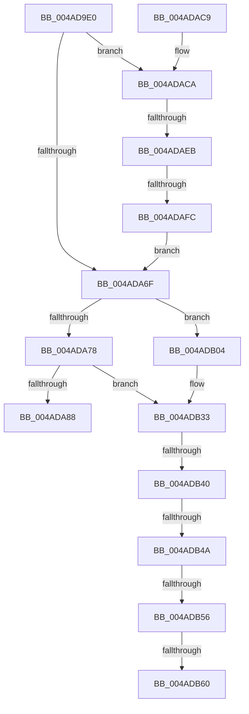

# HalpInterruptEnableNmi

- RVA: `0x004AD9E0`–`0x004ADB65` (길이 `389` bytes)
- VA: `0x00000001404AD9E0`
- 실행 섹션: `.text`
- PDB 이름 있음: `예`; PDB Function 태그: `예`
- unwind 정보 RVA: `0x000B849C`
- 디코드: `95`개 명령, `389/389` bytes 표시
- 미해석 바이트: `0` (있으면 어셈블리에 `.byte`로 보존)

> 이 문서는 커널 이미지의 기계어와 PDB 기호를 분석해 생성했습니다. 4번과 5번은 함수 원형과 자료형을 바이너리 사용 방식에서 추정한 C 해석이며 원본 소스 복구 결과는 아닙니다.

## 1. Dependencies

- 직접 호출 지점: **4**; 고유 호출 대상: **4**
- 직접 호출자로 확인된 함수: **3**
- RIP 상대 이미지 참조: **5**

### Outgoing calls
- `0x004ADA47` → [HalpAcquireHighLevelLock](../2D/HalpAcquireHighLevelLock_function_002D2390.md) (function, `0x002D2390`)
- `0x004ADA95` → [HalpReleaseHighLevelLock](../2D/HalpReleaseHighLevelLock_function_002D1C58.md) (function, `0x002D1C58`)
- `0x004ADAA3` → [_security_check_cookie](../6A/_security_check_cookie_function_006AC640.md) (function, `0x006AC640`)
- `0x004ADB2D` → [KeBugCheckEx](../4F/KeBugCheckEx_function_004FD660.md) (function, `0x004FD660`)

### Direct callers
- [HalpInterruptInitSystem](../../pagelk/B5/HalpInterruptInitSystem_function_00B5D550.md) at `0x00B5D699`
- [HalpPostSleepMP](../../pagelk/B5/HalpPostSleepMP_function_00B5ECC4.md) at `0x00B5EE43`
- [HalpDpPostReplaceInitialization](../../pagelk/B5/HalpDpPostReplaceInitialization_function_00B5FE3C.md) at `0x00B5FF6A`

### Static image references
- `0x004ADA03` → RVA `0x00E0A740` (`.data`; read)
- `0x004ADA14` → RVA `0x00FC19A8` (`.data`; read)
- `0x004ADA59` → RVA `0x00E10200` (`.data`; read)
- `0x004ADA78` → RVA `0x00F90700` (`.data`; read)
- `0x004ADAD9` → RVA `0x00FC3E30` (`.data`; read)

## 2. Other-region calls and transfers

- 다른 실행 섹션으로 향하는 call: **0**
- call이 아닌 외부 분기/꼬리 이동: **7**
  - `0x004ADAE5` → [sub_006FA83C](../6F/Unknown_function_006FA83C.md) (`tail-transfer`)
  - `0x004ADAF6` → [sub_006FA83C](../6F/Unknown_function_006FA83C.md) (`tail-transfer`)
  - `0x004ADB3A` → [sub_006FA83C + 0xC](../6F/Unknown_function_006FA83C.md) (`tail-transfer`)
  - `0x004ADB44` → [sub_006FA83C + 0x102](../6F/Unknown_function_006FA83C.md) (`tail-transfer`)
  - `0x004ADB50` → [sub_006FA83C + 0x7](../6F/Unknown_function_006FA83C.md) (`tail-transfer`)
  - `0x004ADB5A` → [sub_006FA83C + 0x7](../6F/Unknown_function_006FA83C.md) (`tail-transfer`)
  - `0x004ADB60` → [sub_006FA83C + 0x102](../6F/Unknown_function_006FA83C.md) (`tail-transfer`)

## 3. Assembly (complete function range)

```asm
004AD9E0  48 8B C4                        mov rax, rsp
004AD9E3  48 89 58 08                     mov qword ptr [rax + 8], rbx
004AD9E7  48 89 70 10                     mov qword ptr [rax + 0x10], rsi
004AD9EB  48 89 78 18                     mov qword ptr [rax + 0x18], rdi
004AD9EF  55                              push rbp
004AD9F0  41 54                           push r12
004AD9F2  41 55                           push r13
004AD9F4  41 56                           push r14
004AD9F6  41 57                           push r15
004AD9F8  48 8D 68 A1                     lea rbp, [rax - 0x5f]
004AD9FC  48 81 EC D0 00 00 00            sub rsp, 0xd0
004ADA03  48 8B 05 36 CD 95 00            mov rax, qword ptr [rip + 0x95cd36]
004ADA0A  48 33 C4                        xor rax, rsp
004ADA0D  48 89 45 27                     mov qword ptr [rbp + 0x27], rax
004ADA11  0F 57 C0                        xorps xmm0, xmm0
004ADA14  48 8D 0D 8D 3F B1 00            lea rcx, [rip + 0xb13f8d]
004ADA1B  33 C0                           xor eax, eax
004ADA1D  45 33 ED                        xor r13d, r13d
004ADA20  0F 11 45 B7                     movups xmmword ptr [rbp - 0x49], xmm0
004ADA24  89 45 C7                        mov dword ptr [rbp - 0x39], eax
004ADA27  0F 11 45 17                     movups xmmword ptr [rbp + 0x17], xmm0
004ADA2B  4C 89 6D A7                     mov qword ptr [rbp - 0x59], r13
004ADA2F  0F 11 45 CF                     movups xmmword ptr [rbp - 0x31], xmm0
004ADA33  48 89 45 FF                     mov qword ptr [rbp - 1], rax
004ADA37  0F 11 45 DF                     movups xmmword ptr [rbp - 0x21], xmm0
004ADA3B  44 89 6D AF                     mov dword ptr [rbp - 0x51], r13d
004ADA3F  0F 11 45 EF                     movups xmmword ptr [rbp - 0x11], xmm0
004ADA43  0F 11 45 07                     movups xmmword ptr [rbp + 7], xmm0
004ADA47  E8 44 49 E2 FF                  call 0x1402d2390
004ADA4C  65 4C 8B 3C 25 20 00 00 00      mov r15, qword ptr gs:[0x20]
004ADA55  41 8D 75 01                     lea esi, [r13 + 1]
004ADA59  8B 15 A1 27 96 00               mov edx, dword ptr [rip + 0x9627a1]
004ADA5F  44 8A E0                        mov r12b, al
004ADA62  44 8B C2                        mov r8d, edx
004ADA65  45 8B F5                        mov r14d, r13d
004ADA68  41 8B CD                        mov ecx, r13d
004ADA6B  3B CA                           cmp ecx, edx
004ADA6D  72 5B                           jb 0x1404adaca
004ADA6F  44 3B C2                        cmp r8d, edx
004ADA72  0F 84 8C 00 00 00               je 0x1404adb04
004ADA78  48 8B 3D 81 2C AE 00            mov rdi, qword ptr [rip + 0xae2c81]
004ADA7F  48 85 FF                        test rdi, rdi
004ADA82  0F 85 AB 00 00 00               jne 0x1404adb33
004ADA88  41 8B DD                        mov ebx, r13d
004ADA8B  41 8A D4                        mov dl, r12b
004ADA8E  48 8D 0D 13 3F B1 00            lea rcx, [rip + 0xb13f13]
004ADA95  E8 BE 41 E2 FF                  call 0x1402d1c58
004ADA9A  8B C3                           mov eax, ebx
004ADA9C  48 8B 4D 27                     mov rcx, qword ptr [rbp + 0x27]
004ADAA0  48 33 CC                        xor rcx, rsp
004ADAA3  E8 98 EB 1F 00                  call 0x1406ac640
004ADAA8  4C 8D 9C 24 D0 00 00 00         lea r11, [rsp + 0xd0]
004ADAB0  49 8B 5B 30                     mov rbx, qword ptr [r11 + 0x30]
004ADAB4  49 8B 73 38                     mov rsi, qword ptr [r11 + 0x38]
004ADAB8  49 8B 7B 40                     mov rdi, qword ptr [r11 + 0x40]
004ADABC  49 8B E3                        mov rsp, r11
004ADABF  41 5F                           pop r15
004ADAC1  41 5E                           pop r14
004ADAC3  41 5D                           pop r13
004ADAC5  41 5C                           pop r12
004ADAC7  5D                              pop rbp
004ADAC8  C3                              ret
004ADAC9  CC                              int3
004ADACA  41 0F B6 87 D0 00 00 00         movzx eax, byte ptr [r15 + 0xd0]
004ADAD2  44 8B F1                        mov r14d, ecx
004ADAD5  49 C1 E6 06                     shl r14, 6
004ADAD9  4C 03 35 50 63 B1 00            add r14, qword ptr [rip + 0xb16350]
004ADAE0  66 41 39 46 10                  cmp word ptr [r14 + 0x10], ax
004ADAE5  0F 85 51 CD 24 00               jne 0x1406fa83c
004ADAEB  41 8A 87 D1 00 00 00            mov al, byte ptr [r15 + 0xd1]
004ADAF2  41 38 46 12                     cmp byte ptr [r14 + 0x12], al
004ADAF6  0F 85 40 CD 24 00               jne 0x1406fa83c
004ADAFC  44 8B C1                        mov r8d, ecx
004ADAFF  E9 6B FF FF FF                  jmp 0x1404ada6f
004ADB04  45 0F B6 87 D0 00 00 00         movzx r8d, byte ptr [r15 + 0xd0]
004ADB0C  4C 8B CA                        mov r9, rdx
004ADB0F  41 0F B6 87 D1 00 00 00         movzx eax, byte ptr [r15 + 0xd1]
004ADB17  BA 04 01 00 00                  mov edx, 0x104
004ADB1C  49 C1 E0 08                     shl r8, 8
004ADB20  B9 5C 00 00 00                  mov ecx, 0x5c
004ADB25  4C 0B C0                        or r8, rax
004ADB28  4C 89 6C 24 20                  mov qword ptr [rsp + 0x20], r13
004ADB2D  E8 2E FB 04 00                  call 0x1404fd660
004ADB32  CC                              int3
004ADB33  41 8A D5                        mov dl, r13b
004ADB36  44 38 6F 08                     cmp byte ptr [rdi + 8], r13b
004ADB3A  0F 84 08 CD 24 00               je 0x1406fa848
004ADB40  45 38 6E 0D                     cmp byte ptr [r14 + 0xd], r13b
004ADB44  0F 84 F4 CD 24 00               je 0x1406fa93e
004ADB4A  8B 47 0C                        mov eax, dword ptr [rdi + 0xc]
004ADB4D  83 F8 FF                        cmp eax, -1
004ADB50  0F 84 ED CC 24 00               je 0x1406fa843
004ADB56  41 3B 46 04                     cmp eax, dword ptr [r14 + 4]
004ADB5A  0F 84 E3 CC 24 00               je 0x1406fa843
004ADB60  E9 D9 CD 24 00                  jmp 0x1406fa93e
```

## 4. C-style interpretation (structured pseudocode)

```c
__int64 __fastcall HalpInterruptEnableNmi(void)
{
    __int64 result;
    __int64 v_r13;
    __int64 v_r14;
    __int64 v_rsp;
    unsigned __int64 v_stack_m28;
    unsigned __int64 v_stack_mB0;

    *(unsigned __int64 *)(v_rsp + 8) = v_rbx;
    *(unsigned __int64 *)(v_rsp + 16) = v_rsi;
    *(unsigned __int64 *)(v_rsp + 24) = v_rdi;
    v_rsp = (v_rsp) - (208);
    result = (*(unsigned __int64 *)(v_rip + 9817398)) ^ (v_rsp);
    *(unsigned __int64 *)(v_rsp - 95 + 39) = result;
    result = 0;
    v_r13 = 0;
    *(unsigned __int64 *)(v_rsp - 95 - 73) = v_xmm0;
    *(unsigned int *)(v_rsp - 95 - 57) = 0;
    *(unsigned __int64 *)(v_rsp - 95 + 23) = v_xmm0;
    *(unsigned __int64 *)(v_rsp - 95 - 89) = 0;
    *(unsigned __int64 *)(v_rsp - 95 - 49) = v_xmm0;
    *(unsigned __int64 *)(v_rsp - 95 - 1) = 0;
    *(unsigned __int64 *)(v_rsp - 95 - 33) = v_xmm0;
    *(unsigned int *)(v_rsp - 95 - 81) = 0;
    *(unsigned __int64 *)(v_rsp - 95 - 17) = v_xmm0;
    *(unsigned __int64 *)(v_rsp - 95 + 7) = v_xmm0;
    result = HalpAcquireHighLevelLock(v_rip + 11616141, a2, a3, a4);
    if (0 < ((unsigned int)((unsigned int)(*(unsigned int *)(v_rip + 9840545))))) goto loc_004ADACA;
loc_004ADA6F:
    if (((unsigned int)((unsigned int)((unsigned int)((unsigned int)(*(unsigned int *)(v_rip + 9840545)))))) == ((unsigned int)((unsigned int)(*(unsigned int *)(v_rip + 9840545))))) goto loc_004ADB04;
    if (*(unsigned __int64 *)(v_rip + 11414657) != 0) goto loc_004ADB33;
    result = HalpReleaseHighLevelLock(v_rip + 11616019, (unsigned __int8)((unsigned __int8)(result)), (unsigned int)((unsigned int)((unsigned int)(*(unsigned int *)(v_rip + 9840545)))), a4);
    a1 = (*(unsigned __int64 *)(v_rsp - 95 + 39)) ^ (v_rsp);
    result = _security_check_cookie(a1, (unsigned __int8)((unsigned __int8)(result)), (unsigned int)((unsigned int)((unsigned int)(*(unsigned int *)(v_rip + 9840545)))), a4);
    return result;
loc_004ADACA:
    v_r14 = ((unsigned int)((unsigned int)(a1))) << (6);
    v_r14 = (v_r14) + (*(unsigned __int64 *)(v_rip + 11625296));
    goto loc_004ADA6F;
loc_004ADB04:
    a3 = (*(unsigned __int8 *)(*(unsigned __int64 *)(gs_base + (0 + 32)) + 208)) << (8);
    a3 = (a3) | (*(unsigned __int8 *)(*(unsigned __int64 *)(gs_base + (0 + 32)) + 209));
    v_stack_mB0 = 0;
    result = KeBugCheckEx(92, 260, a3, (unsigned __int8)((unsigned __int8)(result)));
loc_004ADB33:
}
```

## 5. (Beta) C Style

```c
void HalpInterruptEnableNmi(void)
{
    int64_t result;
    int64_t local_r13;
    int64_t local_r14;
    int64_t local_rsp;
    uint64_t v_stack_m28;
    uint64_t v_stack_mB0;

    *(uint64_t *)(local_rsp + 0x8) = local_rbx;
    *(uint64_t *)(local_rsp + 0x10) = local_rsi;
    *(uint64_t *)(local_rsp + 0x18) = local_rdi;
    local_rsp = (local_rsp) - (208);
    result = (*(uint64_t *)(v_rip + 0x95CD36)) ^ (local_rsp);
    *(uint64_t *)(local_rsp - 0x5F + 0x27) = result;
    result = 0;
    local_r13 = 0;
    *(uint64_t *)(local_rsp - 0x5F - 0x49) = v_xmm0;
    *(uint32_t *)(local_rsp - 0x5F - 0x39) = 0;
    *(uint64_t *)(local_rsp - 0x5F + 0x17) = v_xmm0;
    *(uint64_t *)(local_rsp - 0x5F - 0x59) = 0;
    *(uint64_t *)(local_rsp - 0x5F - 0x31) = v_xmm0;
    *(uint64_t *)(local_rsp - 0x5F - 0x1) = 0;
    *(uint64_t *)(local_rsp - 0x5F - 0x21) = v_xmm0;
    *(uint32_t *)(local_rsp - 0x5F - 0x51) = 0;
    *(uint64_t *)(local_rsp - 0x5F - 0x11) = v_xmm0;
    *(uint64_t *)(local_rsp - 0x5F + 0x7) = v_xmm0;
    result = HalpAcquireHighLevelLock(v_rip + 11616141, a2, a3, a4);
    if (0 < ((uint32_t)((uint32_t)(*(uint32_t *)(v_rip + 0x9627A1))))) goto loc_004ADACA;
loc_004ADA6F:
    if (((uint32_t)((uint32_t)((uint32_t)((uint32_t)(*(uint32_t *)(v_rip + 0x9627A1)))))) == ((uint32_t)((uint32_t)(*(uint32_t *)(v_rip + 0x9627A1))))) goto loc_004ADB04;
    if (*(uint64_t *)(v_rip + 0xAE2C81) != 0) goto loc_004ADB33;
    result = HalpReleaseHighLevelLock(v_rip + 11616019, (uint8_t)((uint8_t)(result)), (uint32_t)((uint32_t)((uint32_t)(*(uint32_t *)(v_rip + 0x9627A1)))), a4);
    a1 = (*(uint64_t *)(local_rsp - 0x5F + 0x27)) ^ (local_rsp);
    result = _security_check_cookie(a1, (uint8_t)((uint8_t)(result)), (uint32_t)((uint32_t)((uint32_t)(*(uint32_t *)(v_rip + 0x9627A1)))), a4);
    return result;
loc_004ADACA:
    local_r14 = ((uint32_t)((uint32_t)(a1))) << (6);
    local_r14 = (local_r14) + (*(uint64_t *)(v_rip + 0xB16350));
    goto loc_004ADA6F;
loc_004ADB04:
    a3 = (*(uint8_t *)(*(uint64_t *)(gs_base + (0 + 0x20)) + 0xD0)) << (8);
    a3 = (a3) | (*(uint8_t *)(*(uint64_t *)(gs_base + (0 + 0x20)) + 0xD1));
    v_stack_mB0 = 0;
    result = KeBugCheckEx(92, 260, a3, (uint8_t)((uint8_t)(result)));
loc_004ADB33:
}
```

## 6. Execution-region graph

[열기: 2D/3D 그래프와 함수 탐색 컨트롤 패널](../../../control-panel.html?section=text&rva=0x004AD9E0&view=graph)

- 2D 그래프는 위에서 아래로 흐르고, 3D 그래프는 빈 공간을 드래그해 회전합니다. Shift+드래그는 이동, 휠은 확대·축소, 함수 노드 선택은 대상 보고서 이동입니다.

### Static fallback


