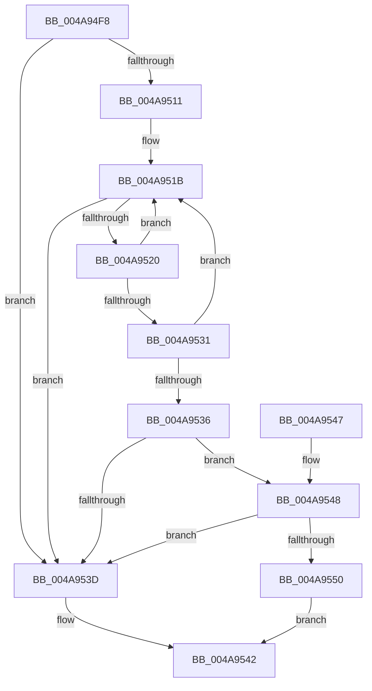

# HalpInterruptLineToGsi

- RVA: `0x004A94F8`–`0x004A9559` (길이 `97` bytes)
- VA: `0x00000001404A94F8`
- 실행 섹션: `.text`
- PDB 이름 있음: `예`; PDB Function 태그: `아니요`
- unwind 정보 RVA: `0x00063CEC`
- 디코드: `34`개 명령, `97/97` bytes 표시
- 미해석 바이트: `0` (있으면 어셈블리에 `.byte`로 보존)

> 이 문서는 커널 이미지의 기계어와 PDB 기호를 분석해 생성했습니다. 4번과 5번은 함수 원형과 자료형을 바이너리 사용 방식에서 추정한 C 해석이며 원본 소스 복구 결과는 아닙니다.

## 1. Dependencies

- 직접 호출 지점: **1**; 고유 호출 대상: **1**
- 직접 호출자로 확인된 함수: **3**
- RIP 상대 이미지 참조: **0**

### Outgoing calls
- `0x004A9507` → [HalpInterruptLookupController](../2D/HalpInterruptLookupController_function_002D20D4.md) (function, `0x002D20D4`)

### Direct callers
- [HalpInterruptConnect](../54/HalpInterruptConnect_function_005426F8.md) at `0x005427DD`
- [HalpTimerConfigureInterrupt](../54/HalpTimerConfigureInterrupt_function_00548AB0.md) at `0x00548E13`
- [HalpTimerUnmapInterrupt](../54/HalpTimerUnmapInterrupt_function_0054A140.md) at `0x0054A238`

### Static image references
- 디코드된 RIP-relative 메모리 참조가 없습니다.

## 2. Other-region calls and transfers

- 다른 실행 섹션으로 향하는 call: **0**
- 별도 외부 분기/꼬리 이동을 확인하지 못했습니다.

## 3. Assembly (complete function range)

```asm
004A94F8  48 83 EC 28                     sub rsp, 0x28
004A94FC  83 0A FF                        or dword ptr [rdx], 0xffffffff
004A94FF  4C 8B D9                        mov r11, rcx
004A9502  8B 09                           mov ecx, dword ptr [rcx]
004A9504  4C 8B D2                        mov r10, rdx
004A9507  E8 C8 8B E2 FF                  call 0x1402d20d4
004A950C  48 85 C0                        test rax, rax
004A950F  74 2C                           je 0x1404a953d
004A9511  4C 8D 88 08 01 00 00            lea r9, [rax + 0x108]
004A9518  4D 8B 01                        mov r8, qword ptr [r9]
004A951B  4D 3B C1                        cmp r8, r9
004A951E  74 1D                           je 0x1404a953d
004A9520  41 8B 43 04                     mov eax, dword ptr [r11 + 4]
004A9524  49 8B C8                        mov rcx, r8
004A9527  4D 8B 00                        mov r8, qword ptr [r8]
004A952A  8B 51 14                        mov edx, dword ptr [rcx + 0x14]
004A952D  3B D0                           cmp edx, eax
004A952F  7F EA                           jg 0x1404a951b
004A9531  39 41 18                        cmp dword ptr [rcx + 0x18], eax
004A9534  7E E5                           jle 0x1404a951b
004A9536  2B C2                           sub eax, edx
004A9538  48 85 C9                        test rcx, rcx
004A953B  75 0B                           jne 0x1404a9548
004A953D  B8 0D 00 00 C0                  mov eax, 0xc000000d
004A9542  48 83 C4 28                     add rsp, 0x28
004A9546  C3                              ret
004A9547  CC                              int3
004A9548  8B 51 1C                        mov edx, dword ptr [rcx + 0x1c]
004A954B  83 FA FF                        cmp edx, -1
004A954E  74 ED                           je 0x1404a953d
004A9550  03 C2                           add eax, edx
004A9552  41 89 02                        mov dword ptr [r10], eax
004A9555  33 C0                           xor eax, eax
004A9557  EB E9                           jmp 0x1404a9542
```

## 4. C-style interpretation (structured pseudocode)

```c
__int64 __fastcall HalpInterruptLineToGsi(__int64 a1, __int64 a2)
{
    __int64 result;
    __int64 v_rsp;

    v_rsp = (v_rsp) - (40);
    result = HalpInterruptLookupController((unsigned int)(*(unsigned int *)(a1)), a2, a3, a4);
    if (result == 0) goto loc_004A953D;
loc_004A951B:
    if ((*(unsigned __int64 *)(result + 264)) == (result + 264)) goto loc_004A953D;
    if (((unsigned int)((unsigned int)(*(unsigned int *)(*(unsigned __int64 *)(result + 264) + 20)))) > ((unsigned int)((unsigned int)(*(unsigned int *)(a1 + 4))))) goto loc_004A951B;
    if ((*(unsigned int *)(*(unsigned __int64 *)(result + 264) + 24)) <= ((unsigned int)((unsigned int)(*(unsigned int *)(a1 + 4))))) goto loc_004A951B;
    result = (unsigned int)(((unsigned int)(*(unsigned int *)(a1 + 4))) - ((unsigned int)((unsigned int)(*(unsigned int *)(*(unsigned __int64 *)(result + 264) + 20)))));
    if (*(unsigned __int64 *)(result + 264) != 0) goto loc_004A9548;
loc_004A953D:
loc_004A9542:
    v_rsp = (v_rsp) + (40);
    return (unsigned int)(0xC000000DULL);
loc_004A9548:
    if (((unsigned int)((unsigned int)(*(unsigned int *)(*(unsigned __int64 *)(result + 264) + 28)))) == -1) goto loc_004A953D;
    result = (unsigned int)(((unsigned int)(0xC000000DULL)) + ((unsigned int)((unsigned int)(*(unsigned int *)(*(unsigned __int64 *)(result + 264) + 28)))));
    *(unsigned int *)(a2) = (unsigned int)(result);
    result = 0;
    goto loc_004A9542;
}
```

## 5. (Beta) C Style

```c
int64_t HalpInterruptLineToGsi(void *Arg1, void *Arg2)
{
    uint8_t *arg1 = (uint8_t *)Arg1;
    uint8_t *arg2 = (uint8_t *)Arg2;

    int64_t result;
    int64_t local_rsp;

    local_rsp = (local_rsp) - (40);
    result = HalpInterruptLookupController((uint32_t)(*(uint32_t *)(arg1)), Arg2, a3, a4);
    if (result == 0) goto loc_004A953D;
loc_004A951B:
    if ((*(uint64_t *)(result + 0x108)) == (result + 264)) goto loc_004A953D;
    if (((uint32_t)((uint32_t)(*(uint32_t *)(*(uint64_t *)(result + 0x108) + 0x14)))) > ((uint32_t)((uint32_t)(*(uint32_t *)(arg1 + 0x4))))) goto loc_004A951B;
    if ((*(uint32_t *)(*(uint64_t *)(result + 0x108) + 0x18)) <= ((uint32_t)((uint32_t)(*(uint32_t *)(arg1 + 0x4))))) goto loc_004A951B;
    result = (uint32_t)(((uint32_t)(*(uint32_t *)(arg1 + 0x4))) - ((uint32_t)((uint32_t)(*(uint32_t *)(*(uint64_t *)(result + 0x108) + 0x14)))));
    if (*(uint64_t *)(result + 0x108) != 0) goto loc_004A9548;
loc_004A953D:
loc_004A9542:
    local_rsp = (local_rsp) + (40);
    return (uint32_t)(0xC000000DULL);
loc_004A9548:
    if (((uint32_t)((uint32_t)(*(uint32_t *)(*(uint64_t *)(result + 0x108) + 0x1C)))) == -1) goto loc_004A953D;
    result = (uint32_t)(((uint32_t)(0xC000000DULL)) + ((uint32_t)((uint32_t)(*(uint32_t *)(*(uint64_t *)(result + 0x108) + 0x1C)))));
    *(uint32_t *)(arg2) = (uint32_t)(result);
    result = 0;
    goto loc_004A9542;
}
```

### 관측된 메모리 오프셋

구조체 형식이 확인되지 않은 접근은 인자 기준의 오프셋으로만 기록했습니다.

| 기준 인자 | 오프셋 표현 | 폭 (bit) | 접근 |
|---|---:|---:|---|
| `Arg1` | `+ 0x0` | `32` | `R` |
| `Arg2` | `+ 0x0` | `32` | `R/W` |

## 6. Execution-region graph

[열기: 2D/3D 그래프와 함수 탐색 컨트롤 패널](../../../control-panel.html?section=text&rva=0x004A94F8&view=graph)

- 2D 그래프는 위에서 아래로 흐르고, 3D 그래프는 빈 공간을 드래그해 회전합니다. Shift+드래그는 이동, 휠은 확대·축소, 함수 노드 선택은 대상 보고서 이동입니다.

### Static fallback


