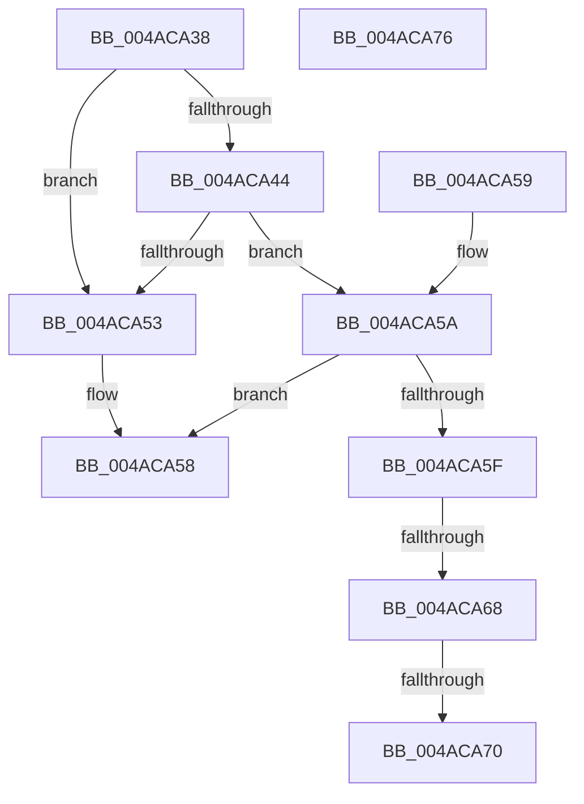

# HalpInterruptModel

- RVA: `0x004ACA38`–`0x004ACA77` (길이 `63` bytes)
- VA: `0x00000001404ACA38`
- 실행 섹션: `.text`
- PDB 이름 있음: `예`; PDB Function 태그: `예`
- unwind 정보 RVA: `0x000DB714`
- 디코드: `19`개 명령, `63/63` bytes 표시
- 미해석 바이트: `0` (있으면 어셈블리에 `.byte`로 보존)

> 이 문서는 커널 이미지의 기계어와 PDB 기호를 분석해 생성했습니다. 4번과 5번은 함수 원형과 자료형을 바이너리 사용 방식에서 추정한 C 해석이며 원본 소스 복구 결과는 아닙니다.

## 1. Dependencies

- 직접 호출 지점: **0**; 고유 호출 대상: **0**
- 직접 호출자로 확인된 함수: **23**
- RIP 상대 이미지 참조: **1**

### Outgoing calls
- 직접 디코드된 call 명령이 없습니다.

### Direct callers
- [HalpInterruptSetDestination](../2D/HalpInterruptSetDestination_function_002D3100.md) at `0x002D31F2`
- [HalQueryMaximumProcessorCount](HalQueryMaximumProcessorCount_function_004AC9A0.md) at `0x004AC9BC`
- [HalpTimerInitSystem](../53/HalpTimerInitSystem_function_0053CB70.md) at `0x0053CC38`
- [HalpTimerInitSystem](../53/HalpTimerInitSystem_function_0053CB70.md) at `0x0053CDBA`
- [HalpTimerInitSystem](../53/HalpTimerInitSystem_function_0053CB70.md) at `0x0053CDD2`
- [HalpInterruptRemap](../54/HalpInterruptRemap_function_00542AE4.md) at `0x00542E56`
- [HalEnumerateProcessors](../54/HalEnumerateProcessors_function_00543240.md) at `0x005432C9`
- [HalpInterruptRegisterDynamicProcessor](../54/HalpInterruptRegisterDynamicProcessor_function_00543870.md) at `0x0054387A`
- [HalpInitializeInterruptsBspLate](../54/HalpInitializeInterruptsBspLate_function_00543D70.md) at `0x00543E17`
- [HalpMmReservePageTablePages](../54/HalpMmReservePageTablePages_function_00544C1C.md) at `0x00544C30`
- [HalStartNextProcessor](../54/HalStartNextProcessor_function_005479B0.md) at `0x005479C7`
- [HalpPrepareForBugcheck](../54/HalpPrepareForBugcheck_function_0054C460.md) at `0x0054C468`
- [HalpSaveAndDisableEnlightenment](../54/HalpSaveAndDisableEnlightenment_function_0054D4D0.md) at `0x0054D4D6`
- [HalpInterruptQueryControllerInfo](../../page/70/HalpInterruptQueryControllerInfo_function_00707310.md) at `0x0070732D`
- [HalpInterruptUnmap](../../page/70/HalpInterruptUnmap_function_00707408.md) at `0x007075D1`
- [HalpGetAcpiStaticNumaTopology](../../page/70/HalpGetAcpiStaticNumaTopology_function_0070B038.md) at `0x0070B03F`
- [HaliAcpiMachineStateInit](../../page/70/HaliAcpiMachineStateInit_function_0070B730.md) at `0x0070B779`
- [HalpQueryAcpiResourceRequirements](../../page/70/HalpQueryAcpiResourceRequirements_function_0070BE28.md) at `0x0070BE4D`
- [HalpDpInitSystem](../../pagelk/B5/HalpDpInitSystem_function_00B5D230.md) at `0x00B5D236`
- [HalpInterruptInitSystem](../../pagelk/B5/HalpInterruptInitSystem_function_00B5D550.md) at `0x00B5D68F`
- [HalpWheaInitSystem](../../pagelk/B5/HalpWheaInitSystem_function_00B5D770.md) at `0x00B5D776`
- [HalpPiix4Detect](../../pagelk/B7/HalpPiix4Detect_function_00B79E00.md) at `0x00B7A05A`
- [HalpMiscGetParameters](../../init/C1/HalpMiscGetParameters_function_00C1FD30.md) at `0x00C1FD51`
- [HalpAcpiIBMExaMatch](../../init/C2/HalpAcpiIBMExaMatch_function_00C258E0.md) at `0x00C258E7`
- [HalpAcpiIBMVigilMatch](../../init/C2/HalpAcpiIBMVigilMatch_function_00C25920.md) at `0x00C25924`

### Static image references
- `0x004ACA38` → RVA `0x00E101F0` (`.data`; read)

## 2. Other-region calls and transfers

- 다른 실행 섹션으로 향하는 call: **0**
- call이 아닌 외부 분기/꼬리 이동: **2**
  - `0x004ACA62` → `0x006FA65F` (`tail-transfer`)
  - `0x004ACA6A` → `0x006FA658` (`tail-transfer`)

## 3. Assembly (complete function range)

```asm
004ACA38  48 8B 0D B1 37 96 00            mov rcx, qword ptr [rip + 0x9637b1]
004ACA3F  48 85 C9                        test rcx, rcx
004ACA42  74 0F                           je 0x1404aca53
004ACA44  8B 89 F0 00 00 00               mov ecx, dword ptr [rcx + 0xf0]
004ACA4A  B8 02 00 00 00                  mov eax, 2
004ACA4F  2B C8                           sub ecx, eax
004ACA51  75 07                           jne 0x1404aca5a
004ACA53  B8 01 00 00 00                  mov eax, 1
004ACA58  C3                              ret
004ACA59  CC                              int3
004ACA5A  83 E9 01                        sub ecx, 1
004ACA5D  74 F9                           je 0x1404aca58
004ACA5F  83 E9 01                        sub ecx, 1
004ACA62  0F 84 F7 DB 24 00               je 0x1406fa65f
004ACA68  3B C8                           cmp ecx, eax
004ACA6A  0F 84 E8 DB 24 00               je 0x1406fa658
004ACA70  B8 00 10 00 00                  mov eax, 0x1000
004ACA75  C3                              ret
004ACA76  CC                              int3
```

## 4. C-style interpretation (structured pseudocode)

```c
__int64 __fastcall HalpInterruptModel(void)
{
    if (*(unsigned __int64 *)(v_rip + 9844657) == 0) goto loc_004ACA53;
    a1 = (unsigned int)(((unsigned int)(*(unsigned int *)(*(unsigned __int64 *)(v_rip + 9844657) + 240))) - (2));
    if (condition_is_not_equal) goto loc_004ACA5A;
loc_004ACA53:
loc_004ACA58:
    return 1;
loc_004ACA5A:
    a1 = (unsigned int)((a1) - (1));
    if (condition_is_equal) goto loc_004ACA58;
    a1 = (unsigned int)((a1) - (1));
    return (unsigned int)(0x1000ULL);
}
```

## 5. (Beta) C Style

```c
void HalpInterruptModel(void)
{
    if (*(uint64_t *)(v_rip + 0x9637B1) == 0) goto loc_004ACA53;
    a1 = (uint32_t)(((uint32_t)(*(uint32_t *)(*(uint64_t *)(v_rip + 0x9637B1) + 0xF0))) - (2));
    if (condition_is_not_equal) goto loc_004ACA5A;
loc_004ACA53:
loc_004ACA58:
    return 1;
loc_004ACA5A:
    a1 = (uint32_t)((a1) - (1));
    if (condition_is_equal) goto loc_004ACA58;
    a1 = (uint32_t)((a1) - (1));
    return (uint32_t)(0x1000ULL);
}
```

## 6. Execution-region graph

[열기: 2D/3D 그래프와 함수 탐색 컨트롤 패널](../../../control-panel.html?section=text&rva=0x004ACA38&view=graph)

- 2D 그래프는 위에서 아래로 흐르고, 3D 그래프는 빈 공간을 드래그해 회전합니다. Shift+드래그는 이동, 휠은 확대·축소, 함수 노드 선택은 대상 보고서 이동입니다.

### Static fallback


