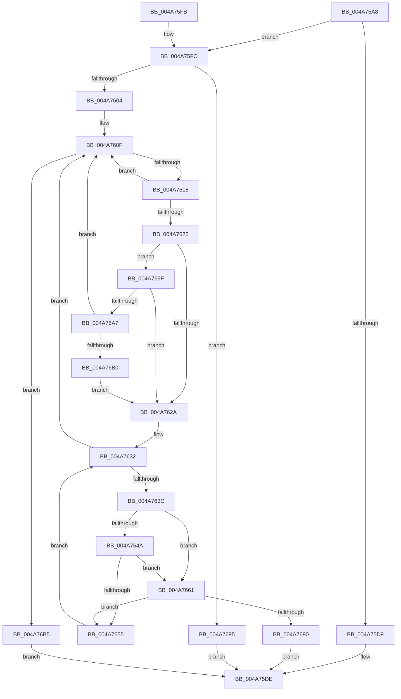

# HalpInterruptRestoreController

- RVA: `0x004A75A8`–`0x004A76BC` (길이 `276` bytes)
- VA: `0x00000001404A75A8`
- 실행 섹션: `.text`
- PDB 이름 있음: `예`; PDB Function 태그: `아니요`
- unwind 정보 RVA: `0x000B7230`
- 디코드: `82`개 명령, `276/276` bytes 표시
- 미해석 바이트: `0` (있으면 어셈블리에 `.byte`로 보존)

> 이 문서는 커널 이미지의 기계어와 PDB 기호를 분석해 생성했습니다. 4번과 5번은 함수 원형과 자료형을 바이너리 사용 방식에서 추정한 C 해석이며 원본 소스 복구 결과는 아닙니다.

## 1. Dependencies

- 직접 호출 지점: **1**; 고유 호출 대상: **1**
- 직접 호출자로 확인된 함수: **3**
- RIP 상대 이미지 참조: **0**

### Outgoing calls
- `0x004A7687` → [HalpInterruptSetLineStateInternal](../2D/HalpInterruptSetLineStateInternal_function_002D2104.md) (function, `0x002D2104`)

### Direct callers
- [HalpInterruptInitializeLocalUnit](../55/HalpInterruptInitializeLocalUnit_function_00557A2C.md) at `0x00557D9C`
- [HalpInterruptPowerChange](../55/HalpInterruptPowerChange_function_00558690.md) at `0x005586DF`
- [HalpInterruptRestoreAllControllerState](../../pagelk/B5/HalpInterruptRestoreAllControllerState_function_00B5C160.md) at `0x00B5C181`

### Static image references
- 디코드된 RIP-relative 메모리 참조가 없습니다.

## 2. Other-region calls and transfers

- 다른 실행 섹션으로 향하는 call: **0**
- 별도 외부 분기/꼬리 이동을 확인하지 못했습니다.

## 3. Assembly (complete function range)

```asm
004A75A8  48 8B C4                        mov rax, rsp
004A75AB  48 89 58 10                     mov qword ptr [rax + 0x10], rbx
004A75AF  48 89 68 18                     mov qword ptr [rax + 0x18], rbp
004A75B3  48 89 70 20                     mov qword ptr [rax + 0x20], rsi
004A75B7  57                              push rdi
004A75B8  41 54                           push r12
004A75BA  41 55                           push r13
004A75BC  41 56                           push r14
004A75BE  41 57                           push r15
004A75C0  48 83 EC 20                     sub rsp, 0x20
004A75C4  48 83 60 08 00                  and qword ptr [rax + 8], 0
004A75C9  44 8A EA                        mov r13b, dl
004A75CC  8B 81 F8 00 00 00               mov eax, dword ptr [rcx + 0xf8]
004A75D2  48 8B E9                        mov rbp, rcx
004A75D5  A8 02                           test al, 2
004A75D7  74 23                           je 0x1404a75fc
004A75D9  B8 01 00 00 C0                  mov eax, 0xc0000001
004A75DE  48 8B 5C 24 58                  mov rbx, qword ptr [rsp + 0x58]
004A75E3  48 8B 6C 24 60                  mov rbp, qword ptr [rsp + 0x60]
004A75E8  48 8B 74 24 68                  mov rsi, qword ptr [rsp + 0x68]
004A75ED  48 83 C4 20                     add rsp, 0x20
004A75F1  41 5F                           pop r15
004A75F3  41 5E                           pop r14
004A75F5  41 5D                           pop r13
004A75F7  41 5C                           pop r12
004A75F9  5F                              pop rdi
004A75FA  C3                              ret
004A75FB  CC                              int3
004A75FC  A8 01                           test al, 1
004A75FE  0F 84 91 00 00 00               je 0x1404a7695
004A7604  4C 8D A1 08 01 00 00            lea r12, [rcx + 0x108]
004A760B  49 8B 3C 24                     mov rdi, qword ptr [r12]
004A760F  49 3B FC                        cmp rdi, r12
004A7612  0F 84 9D 00 00 00               je 0x1404a76b5
004A7618  48 8B DF                        mov rbx, rdi
004A761B  48 8B 3F                        mov rdi, qword ptr [rdi]
004A761E  48 83 7B 28 00                  cmp qword ptr [rbx + 0x28], 0
004A7623  74 EA                           je 0x1404a760f
004A7625  45 84 ED                        test r13b, r13b
004A7628  75 75                           jne 0x1404a769f
004A762A  33 F6                           xor esi, esi
004A762C  45 33 F6                        xor r14d, r14d
004A762F  45 33 FF                        xor r15d, r15d
004A7632  8B 4B 18                        mov ecx, dword ptr [rbx + 0x18]
004A7635  2B 4B 14                        sub ecx, dword ptr [rbx + 0x14]
004A7638  3B F1                           cmp esi, ecx
004A763A  7D D3                           jge 0x1404a760f
004A763C  48 8B 43 28                     mov rax, qword ptr [rbx + 0x28]
004A7640  42 8B 4C 38 0C                  mov ecx, dword ptr [rax + r15 + 0xc]
004A7645  F6 C1 10                        test cl, 0x10
004A7648  75 17                           jne 0x1404a7661
004A764A  48 8B 43 30                     mov rax, qword ptr [rbx + 0x30]
004A764E  41 80 3C 06 00                  cmp byte ptr [r14 + rax], 0
004A7653  75 0C                           jne 0x1404a7661
004A7655  FF C6                           inc esi
004A7657  49 83 C7 38                     add r15, 0x38
004A765B  49 83 C6 10                     add r14, 0x10
004A765F  EB D1                           jmp 0x1404a7632
004A7661  8B 85 00 01 00 00               mov eax, dword ptr [rbp + 0x100]
004A7667  48 8D 54 24 50                  lea rdx, [rsp + 0x50]
004A766C  89 44 24 50                     mov dword ptr [rsp + 0x50], eax
004A7670  8B 4B 14                        mov ecx, dword ptr [rbx + 0x14]
004A7673  03 CE                           add ecx, esi
004A7675  48 63 C6                        movsxd rax, esi
004A7678  89 4C 24 54                     mov dword ptr [rsp + 0x54], ecx
004A767C  48 8B CD                        mov rcx, rbp
004A767F  4C 6B C0 38                     imul r8, rax, 0x38
004A7683  4C 03 43 28                     add r8, qword ptr [rbx + 0x28]
004A7687  E8 78 AA E2 FF                  call 0x1402d2104
004A768C  85 C0                           test eax, eax
004A768E  79 C5                           jns 0x1404a7655
004A7690  E9 49 FF FF FF                  jmp 0x1404a75de
004A7695  B8 84 01 00 C0                  mov eax, 0xc0000184
004A769A  E9 3F FF FF FF                  jmp 0x1404a75de
004A769F  8B 43 20                        mov eax, dword ptr [rbx + 0x20]
004A76A2  83 F8 03                        cmp eax, 3
004A76A5  74 83                           je 0x1404a762a
004A76A7  83 F8 05                        cmp eax, 5
004A76AA  0F 85 5F FF FF FF               jne 0x1404a760f
004A76B0  E9 75 FF FF FF                  jmp 0x1404a762a
004A76B5  33 C0                           xor eax, eax
004A76B7  E9 22 FF FF FF                  jmp 0x1404a75de
```

## 4. C-style interpretation (structured pseudocode)

```c
__int64 __fastcall HalpInterruptRestoreController(__int64 a1, unsigned __int8 a2)
{
    __int64 result;
    __int64 v_r14;
    __int64 v_r15;
    __int64 v_rsi;
    __int64 v_rsp;
    unsigned __int64 v_stack_p10;
    unsigned __int64 v_stack_p18;
    unsigned __int64 v_stack_p20;
    unsigned __int64 v_stack_p50;
    unsigned int v_stack_p54;

    *(unsigned __int64 *)(v_rsp + 16) = v_rbx;
    *(unsigned __int64 *)(v_rsp + 24) = v_rbp;
    *(unsigned __int64 *)(v_rsp + 32) = v_rsi;
    v_rsp = (v_rsp) - (32);
    if ((((unsigned __int8)((unsigned int)(*(unsigned int *)(a1 + 248)))) & (2)) == 0) goto loc_004A75FC;
loc_004A75DE:
    v_rsp = (v_rsp) + (32);
    return (unsigned int)(0xC0000001ULL);
loc_004A75FC:
    if ((((unsigned __int8)((unsigned int)(0xC0000001ULL))) & (1)) == 0) goto loc_004A7695;
loc_004A760F:
    if ((*(unsigned __int64 *)(a1 + 264)) == (a1 + 264)) goto loc_004A76B5;
    if ((*(unsigned __int64 *)(*(unsigned __int64 *)(a1 + 264) + 40)) == 0) goto loc_004A760F;
    if (a2 != 0) goto loc_004A769F;
loc_004A762A:
    v_rsi = 0;
    v_r14 = 0;
    v_r15 = 0;
loc_004A7632:
    a1 = (unsigned int)(((unsigned int)(*(unsigned int *)(*(unsigned __int64 *)(a1 + 264) + 24))) - (*(unsigned int *)(*(unsigned __int64 *)(a1 + 264) + 20)));
    if (0 >= ((unsigned int)(a1))) goto loc_004A760F;
    if ((((unsigned __int8)((unsigned int)(*(unsigned int *)(*(unsigned __int64 *)(*(unsigned __int64 *)(a1 + 264) + 40) + v_r15 * 1 + 12)))) & (16)) != 0) goto loc_004A7661;
    if ((*(unsigned __int8 *)(v_r14 + *(unsigned __int64 *)(*(unsigned __int64 *)(a1 + 264) + 48) * 1)) != 0) goto loc_004A7661;
loc_004A7655:
    v_rsi = (unsigned int)((v_rsi) + 1);
    v_r15 = (v_r15) + (56);
    v_r14 = (v_r14) + (16);
    goto loc_004A7632;
loc_004A7661:
    v_stack_p50 = (unsigned int)((unsigned int)(*(unsigned int *)(v_stack_p18 + 256)));
    a1 = (unsigned int)(((unsigned int)(*(unsigned int *)(*(unsigned __int64 *)(a1 + 264) + 20))) + ((unsigned int)(v_rsi)));
    v_stack_p54 = (unsigned int)(a1);
    a3 = (a3) * ((int)((unsigned int)(v_rsi)));
    a3 = (a3) + (*(unsigned __int64 *)(*(unsigned __int64 *)(a1 + 264) + 40));
    result = HalpInterruptSetLineStateInternal(v_stack_p18, v_stack_p50, a3, a4);
    if (!sign_flag) goto loc_004A7655;
    goto loc_004A75DE;
loc_004A7695:
    goto loc_004A75DE;
loc_004A769F:
    if (((unsigned int)((unsigned int)(*(unsigned int *)(*(unsigned __int64 *)(a1 + 264) + 32)))) == 3) goto loc_004A762A;
    if (((unsigned int)((unsigned int)(*(unsigned int *)(*(unsigned __int64 *)(a1 + 264) + 32)))) != 5) goto loc_004A760F;
    goto loc_004A762A;
loc_004A76B5:
    result = 0;
    goto loc_004A75DE;
}
```

## 5. (Beta) C Style

```c
int64_t HalpInterruptRestoreController(void *Arg1, uint8_t Arg2)
{
    uint8_t *arg1 = (uint8_t *)Arg1;

    int64_t result;
    int64_t local_r14;
    int64_t local_r15;
    int64_t local_rsi;
    int64_t local_rsp;
    uint64_t v_stack_p10;
    uint64_t v_stack_p18;
    uint64_t v_stack_p20;
    uint64_t v_stack_p50;
    uint32_t v_stack_p54;

    *(uint64_t *)(local_rsp + 0x10) = local_rbx;
    *(uint64_t *)(local_rsp + 0x18) = local_rbp;
    *(uint64_t *)(local_rsp + 0x20) = local_rsi;
    local_rsp = (local_rsp) - (32);
    if ((((uint8_t)((uint32_t)(*(uint32_t *)(arg1 + 0xF8)))) & (2)) == 0) goto loc_004A75FC;
loc_004A75DE:
    local_rsp = (local_rsp) + (32);
    return (uint32_t)(0xC0000001ULL);
loc_004A75FC:
    if ((((uint8_t)((uint32_t)(0xC0000001ULL))) & (1)) == 0) goto loc_004A7695;
loc_004A760F:
    if ((*(uint64_t *)(arg1 + 0x108)) == (Arg1 + 264)) goto loc_004A76B5;
    if ((*(uint64_t *)(*(uint64_t *)(arg1 + 0x108) + 0x28)) == 0) goto loc_004A760F;
    if (Arg2 != 0) goto loc_004A769F;
loc_004A762A:
    local_rsi = 0;
    local_r14 = 0;
    local_r15 = 0;
loc_004A7632:
    Arg1 = (uint32_t)(((uint32_t)(*(uint32_t *)(*(uint64_t *)(arg1 + 0x108) + 0x18))) - (*(uint32_t *)(*(uint64_t *)(arg1 + 0x108) + 0x14)));
    if (0 >= ((uint32_t)(Arg1))) goto loc_004A760F;
    if ((((uint8_t)((uint32_t)(*(uint32_t *)(*(uint64_t *)(*(uint64_t *)(arg1 + 0x108) + 0x28) + local_r15 * 1 + 0xC)))) & (16)) != 0) goto loc_004A7661;
    if ((*(uint8_t *)(local_r14 + *(uint64_t *)(*(uint64_t *)(arg1 + 0x108) + 0x30) * 1)) != 0) goto loc_004A7661;
loc_004A7655:
    local_rsi = (uint32_t)((local_rsi) + 1);
    local_r15 = (local_r15) + (56);
    local_r14 = (local_r14) + (16);
    goto loc_004A7632;
loc_004A7661:
    v_stack_p50 = (uint32_t)((uint32_t)(*(uint32_t *)(v_stack_p18 + 0x100)));
    Arg1 = (uint32_t)(((uint32_t)(*(uint32_t *)(*(uint64_t *)(arg1 + 0x108) + 0x14))) + ((uint32_t)(local_rsi)));
    v_stack_p54 = (uint32_t)(Arg1);
    a3 = (a3) * ((int32_t)((uint32_t)(local_rsi)));
    a3 = (a3) + (*(uint64_t *)(*(uint64_t *)(arg1 + 0x108) + 0x28));
    result = HalpInterruptSetLineStateInternal(v_stack_p18, v_stack_p50, a3, a4);
    if (!sign_flag) goto loc_004A7655;
    goto loc_004A75DE;
loc_004A7695:
    goto loc_004A75DE;
loc_004A769F:
    if (((uint32_t)((uint32_t)(*(uint32_t *)(*(uint64_t *)(arg1 + 0x108) + 0x20)))) == 3) goto loc_004A762A;
    if (((uint32_t)((uint32_t)(*(uint32_t *)(*(uint64_t *)(arg1 + 0x108) + 0x20)))) != 5) goto loc_004A760F;
    goto loc_004A762A;
loc_004A76B5:
    result = 0;
    goto loc_004A75DE;
}
```

### 관측된 메모리 오프셋

구조체 형식이 확인되지 않은 접근은 인자 기준의 오프셋으로만 기록했습니다.

| 기준 인자 | 오프셋 표현 | 폭 (bit) | 접근 |
|---|---:|---:|---|
| `Arg1` | `+ 0x0` | `64` | `R` |
| `Arg1` | `+ 0xF8` | `32` | `R` |
| `Arg1` | `+ 0x100` | `32` | `R` |
| `Arg1` | `+ 0x108` | `64` | `R` |

## 6. Execution-region graph

[열기: 2D/3D 그래프와 함수 탐색 컨트롤 패널](../../../control-panel.html?section=text&rva=0x004A75A8&view=graph)

- 2D 그래프는 위에서 아래로 흐르고, 3D 그래프는 빈 공간을 드래그해 회전합니다. Shift+드래그는 이동, 휠은 확대·축소, 함수 노드 선택은 대상 보고서 이동입니다.

### Static fallback


