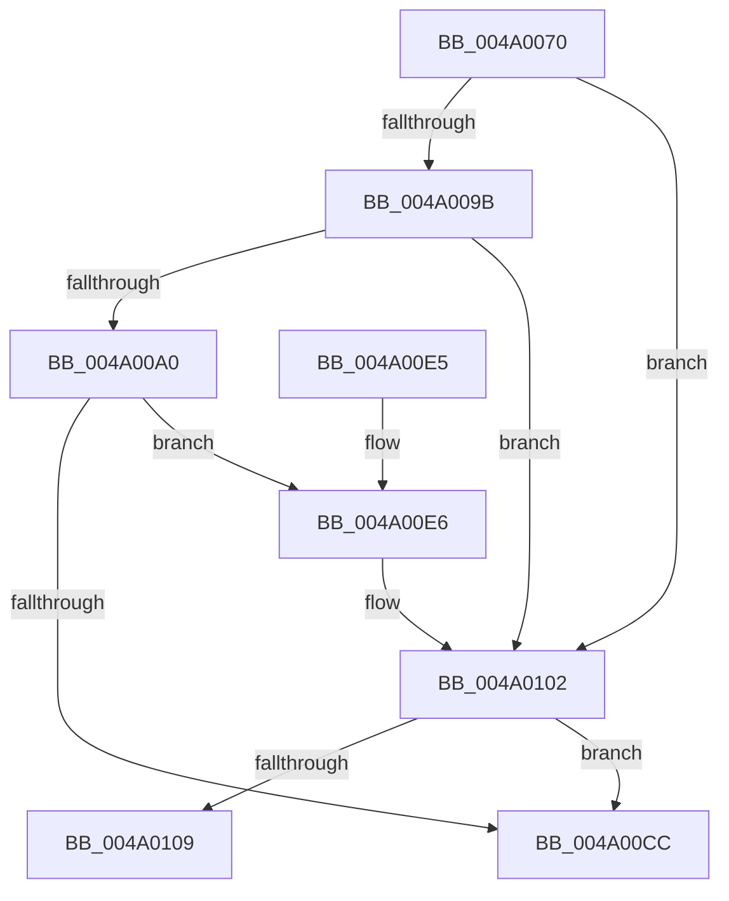

# HalpIommuDomainUnmapIdentityRange

- RVA: `0x004A0070`–`0x004A010E` (길이 `158` bytes)
- VA: `0x00000001404A0070`
- 실행 섹션: `.text`
- PDB 이름 있음: `예`; PDB Function 태그: `예`
- unwind 정보 RVA: `0x00097940`
- 디코드: `47`개 명령, `158/158` bytes 표시
- 미해석 바이트: `0` (있으면 어셈블리에 `.byte`로 보존)

> 이 문서는 커널 이미지의 기계어와 PDB 기호를 분석해 생성했습니다. 4번과 5번은 함수 원형과 자료형을 바이너리 사용 방식에서 추정한 C 해석이며 원본 소스 복구 결과는 아닙니다.

## 1. Dependencies

- 직접 호출 지점: **2**; 고유 호출 대상: **2**
- 직접 호출자로 확인된 함수: **2**
- RIP 상대 이미지 참조: **2**

### Outgoing calls
- `0x004A00C3` → [guard_dispatch_icall](../6B/guard_dispatch_icall_function_006BAAD0.md) (function, `0x006BAAD0`)
- `0x004A00FC` → [KeBugCheckEx](../4F/KeBugCheckEx_function_004FD660.md) (function, `0x004FD660`)

### Direct callers
- [IommuUnmapIdentityRangeEx](../30/IommuUnmapIdentityRangeEx_function_00306F80.md) at `0x0030703E`
- [IommuUnmapIdentityRange](../56/IommuUnmapIdentityRange_function_00568660.md) at `0x005686AF`

### Static image references
- `0x004A008D` → RVA `0x00FC1710` (`.data`; read)
- `0x004A00AF` → RVA `0x00FC1E40` (`.data`; read)

## 2. Other-region calls and transfers

- 다른 실행 섹션으로 향하는 call: **0**
- call이 아닌 외부 분기/꼬리 이동: **1**
  - `0x004A0109` → [sub_006F85EE](../6F/Unknown_function_006F85EE.md) (`tail-transfer`)

## 3. Assembly (complete function range)

```asm
004A0070  4C 8B DC                        mov r11, rsp
004A0073  49 89 5B 08                     mov qword ptr [r11 + 8], rbx
004A0077  49 89 6B 10                     mov qword ptr [r11 + 0x10], rbp
004A007B  49 89 73 18                     mov qword ptr [r11 + 0x18], rsi
004A007F  57                              push rdi
004A0080  41 56                           push r14
004A0082  41 57                           push r15
004A0084  48 83 EC 40                     sub rsp, 0x40
004A0088  33 C0                           xor eax, eax
004A008A  49 8B F8                        mov rdi, r8
004A008D  38 05 7D 16 B2 00               cmp byte ptr [rip + 0xb2167d], al
004A0093  4C 8B F2                        mov r14, rdx
004A0096  48 8B F1                        mov rsi, rcx
004A0099  74 67                           je 0x1404a0102
004A009B  38 41 34                        cmp byte ptr [rcx + 0x34], al
004A009E  75 62                           jne 0x1404a0102
004A00A0  49 21 43 20                     and qword ptr [r11 + 0x20], rax
004A00A4  8B 41 30                        mov eax, dword ptr [rcx + 0x30]
004A00A7  49 8D 4B 20                     lea rcx, [r11 + 0x20]
004A00AB  89 44 24 78                     mov dword ptr [rsp + 0x78], eax
004A00AF  48 8B 05 8A 1D B2 00            mov rax, qword ptr [rip + 0xb21d8a]
004A00B6  4D 89 43 D8                     mov qword ptr [r11 - 0x28], r8
004A00BA  4D 8D 43 D8                     lea r8, [r11 - 0x28]
004A00BE  C6 44 24 7C 00                  mov byte ptr [rsp + 0x7c], 0
004A00C3  E8 08 AA 21 00                  call 0x1406baad0
004A00C8  85 C0                           test eax, eax
004A00CA  78 1A                           js 0x1404a00e6
004A00CC  48 8B 5C 24 60                  mov rbx, qword ptr [rsp + 0x60]
004A00D1  48 8B 6C 24 68                  mov rbp, qword ptr [rsp + 0x68]
004A00D6  48 8B 74 24 70                  mov rsi, qword ptr [rsp + 0x70]
004A00DB  48 83 C4 40                     add rsp, 0x40
004A00DF  41 5F                           pop r15
004A00E1  41 5E                           pop r14
004A00E3  5F                              pop rdi
004A00E4  C3                              ret
004A00E5  CC                              int3
004A00E6  48 83 64 24 20 00               and qword ptr [rsp + 0x20], 0
004A00EC  4C 8B CE                        mov r9, rsi
004A00EF  4C 63 C0                        movsxd r8, eax
004A00F2  BA 01 00 00 00                  mov edx, 1
004A00F7  B9 D9 01 00 00                  mov ecx, 0x1d9
004A00FC  E8 5F D5 05 00                  call 0x1404fd660
004A0101  CC                              int3
004A0102  33 C9                           xor ecx, ecx
004A0104  48 85 FF                        test rdi, rdi
004A0107  74 C3                           je 0x1404a00cc
004A0109  E9 E0 84 25 00                  jmp 0x1406f85ee
```

## 4. C-style interpretation (structured pseudocode)

```c
__int64 __fastcall HalpIommuDomainUnmapIdentityRange(__int64 a1, __int64 a2, __int64 a3)
{
    __int64 result;
    __int64 v_rsp;
    unsigned __int64 v_stack_p10;
    unsigned __int64 v_stack_p18;
    unsigned int v_stack_p20;
    unsigned __int8 v_stack_p24;
    unsigned __int64 v_stack_p8;

    *(unsigned __int64 *)(v_rsp + 8) = v_rbx;
    *(unsigned __int64 *)(v_rsp + 16) = v_rbp;
    *(unsigned __int64 *)(v_rsp + 24) = v_rsi;
    v_rsp = (v_rsp) - (64);
    result = 0;
    if ((*(unsigned __int8 *)(v_rip + 11671165)) == 0) goto loc_004A0102;
    if ((*(unsigned __int8 *)(a1 + 52)) != 0) goto loc_004A0102;
    v_stack_p20 = (unsigned int)((unsigned int)(*(unsigned int *)(a1 + 48)));
    *(unsigned __int64 *)(v_rsp - 40) = a3;
    v_stack_p24 = 0;
    result = guard_dispatch_icall(v_rsp + 32, a2, v_rsp - 40, a4);
    if (sign_flag) goto loc_004A00E6;
loc_004A00CC:
    v_rsp = (v_rsp) + (64);
    return result;
loc_004A00E6:
    result = KeBugCheckEx(473, 1, (int)((unsigned int)(result)), v_stack_p18);
loc_004A0102:
    a1 = 0;
    if (a3 == 0) goto loc_004A00CC;
}
```

## 5. (Beta) C Style

```c
int64_t HalpIommuDomainUnmapIdentityRange(void *Arg1, int64_t Arg2, int64_t Arg3)
{
    uint8_t *arg1 = (uint8_t *)Arg1;

    int64_t result;
    int64_t local_rsp;
    uint64_t v_stack_p10;
    uint64_t v_stack_p18;
    uint32_t v_stack_p20;
    uint8_t v_stack_p24;
    uint64_t v_stack_p8;

    *(uint64_t *)(local_rsp + 0x8) = local_rbx;
    *(uint64_t *)(local_rsp + 0x10) = local_rbp;
    *(uint64_t *)(local_rsp + 0x18) = local_rsi;
    local_rsp = (local_rsp) - (64);
    result = 0;
    if ((*(uint8_t *)(v_rip + 0xB2167D)) == 0) goto loc_004A0102;
    if ((*(uint8_t *)(arg1 + 0x34)) != 0) goto loc_004A0102;
    v_stack_p20 = (uint32_t)((uint32_t)(*(uint32_t *)(arg1 + 0x30)));
    *(uint64_t *)(local_rsp - 0x28) = Arg3;
    v_stack_p24 = 0;
    result = guard_dispatch_icall(local_rsp + 32, Arg2, local_rsp - 40, a4);
    if (sign_flag) goto loc_004A00E6;
loc_004A00CC:
    local_rsp = (local_rsp) + (64);
    return result;
loc_004A00E6:
    result = KeBugCheckEx(473, 1, (int32_t)((uint32_t)(result)), v_stack_p18);
loc_004A0102:
    Arg1 = 0;
    if (Arg3 == 0) goto loc_004A00CC;
}
```

### 관측된 메모리 오프셋

구조체 형식이 확인되지 않은 접근은 인자 기준의 오프셋으로만 기록했습니다.

| 기준 인자 | 오프셋 표현 | 폭 (bit) | 접근 |
|---|---:|---:|---|
| `Arg1` | `+ 0x30` | `32` | `R` |
| `Arg1` | `+ 0x34` | `8` | `R` |

## 6. Execution-region graph

[열기: 2D/3D 그래프와 함수 탐색 컨트롤 패널](../../../control-panel.html?section=text&rva=0x004A0070&view=graph)

- 2D 그래프는 위에서 아래로 흐르고, 3D 그래프는 빈 공간을 드래그해 회전합니다. Shift+드래그는 이동, 휠은 확대·축소, 함수 노드 선택은 대상 보고서 이동입니다.

### Static fallback


