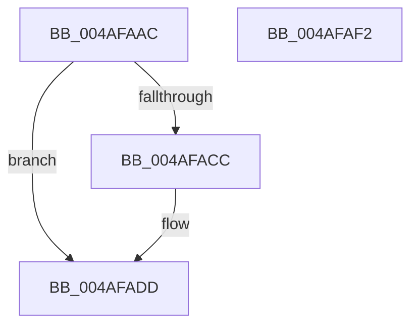

# HalpIsMicrosoftCompatibleHvLoaded

- RVA: `0x004AFAAC`–`0x004AFAF3` (길이 `71` bytes)
- VA: `0x00000001404AFAAC`
- 실행 섹션: `.text`
- PDB 이름 있음: `예`; PDB Function 태그: `아니요`
- unwind 정보 RVA: `0x000AB2E4`
- 디코드: `22`개 명령, `71/71` bytes 표시
- 미해석 바이트: `0` (있으면 어셈블리에 `.byte`로 보존)

> 이 문서는 커널 이미지의 기계어와 PDB 기호를 분석해 생성했습니다. 4번과 5번은 함수 원형과 자료형을 바이너리 사용 방식에서 추정한 C 해석이며 원본 소스 복구 결과는 아닙니다.

## 1. Dependencies

- 직접 호출 지점: **2**; 고유 호출 대상: **2**
- 직접 호출자로 확인된 함수: **15**
- RIP 상대 이미지 참조: **1**

### Outgoing calls
- `0x004AFAC3` → [HalpIsHvPresent](HalpIsHvPresent_function_004AFA10.md) (function, `0x004AFA10`)
- `0x004AFAE7` → [_security_check_cookie](../6A/_security_check_cookie_function_006AC640.md) (function, `0x006AC640`)

### Direct callers
- [HalpArtAvailable](HalpArtAvailable_function_004AF870.md) at `0x004AF933`
- [HalpCmcStartPolling](../4F/HalpCmcStartPolling_function_004F8D40.md) at `0x004F8D46`
- [HalpIsPartitionCpuManager](../4F/HalpIsPartitionCpuManager_function_004F8DEC.md) at `0x004F8E04`
- [HalpInterruptGetX2ApicPolicy](../54/HalpInterruptGetX2ApicPolicy_function_005440B4.md) at `0x005440E6`
- [HalpHvIsFrequencyAvailable](../54/HalpHvIsFrequencyAvailable_function_0054C2B4.md) at `0x0054C2C9`
- [HalpProcGetFeatureBits](../54/HalpProcGetFeatureBits_function_0054E890.md) at `0x0054E941`
- [HalpWdatDiscover](../56/HalpWdatDiscover_function_005609A8.md) at `0x00560A22`
- [HalpHvWatchdogDiscover](../56/HalpHvWatchdogDiscover_function_00561C60.md) at `0x00561C8D`
- [HalSocRequestConfigurationData](../56/HalSocRequestConfigurationData_function_00562ADC.md) at `0x00562BA1`
- [HalSocRequestConfigurationData](../56/HalSocRequestConfigurationData_function_00562ADC.md) at `0x00562BB2`
- [HalSocRequestConfigurationData](../56/HalSocRequestConfigurationData_function_00562ADC.md) at `0x00562BF8`
- [HalpTimerIsHypervisorReferenceAvailable](../56/HalpTimerIsHypervisorReferenceAvailable_function_00562CDC.md) at `0x00562CF1`
- [HaliCompleteAcpiAPSleep](../56/HaliCompleteAcpiAPSleep_function_0056B320.md) at `0x0056B374`
- [HalpInterruptGetIrtInfo](../../page/70/HalpInterruptGetIrtInfo_function_00707784.md) at `0x007077B9`
- [HalpLoadMicrocode](../../page/70/HalpLoadMicrocode_function_0070B200.md) at `0x0070B23A`
- [HalpInitializeProfiling](../../pagelk/B5/HalpInitializeProfiling_function_00B5EF00.md) at `0x00B5F044`
- [HalpMiscGetParameters](../../init/C1/HalpMiscGetParameters_function_00C1FD30.md) at `0x00C1FF7A`
- [HalpMiscGetParameters](../../init/C1/HalpMiscGetParameters_function_00C1FD30.md) at `0x00C1FFFD`

### Static image references
- `0x004AFAB2` → RVA `0x00E0A740` (`.data`; read)

## 2. Other-region calls and transfers

- 다른 실행 섹션으로 향하는 call: **0**
- 별도 외부 분기/꼬리 이동을 확인하지 못했습니다.

## 3. Assembly (complete function range)

```asm
004AFAAC  40 53                           push rbx
004AFAAE  48 83 EC 40                     sub rsp, 0x40
004AFAB2  48 8B 05 87 AC 95 00            mov rax, qword ptr [rip + 0x95ac87]
004AFAB9  48 33 C4                        xor rax, rsp
004AFABC  48 89 44 24 30                  mov qword ptr [rsp + 0x30], rax
004AFAC1  32 DB                           xor bl, bl
004AFAC3  E8 48 FF FF FF                  call 0x1404afa10
004AFAC8  84 C0                           test al, al
004AFACA  74 11                           je 0x1404afadd
004AFACC  33 C9                           xor ecx, ecx
004AFACE  B8 01 00 00 40                  mov eax, 0x40000001
004AFAD3  0F A2                           cpuid
004AFAD5  3D 48 76 23 31                  cmp eax, 0x31237648
004AFADA  0F 94 C3                        sete bl
004AFADD  8A C3                           mov al, bl
004AFADF  48 8B 4C 24 30                  mov rcx, qword ptr [rsp + 0x30]
004AFAE4  48 33 CC                        xor rcx, rsp
004AFAE7  E8 54 CB 1F 00                  call 0x1406ac640
004AFAEC  48 83 C4 40                     add rsp, 0x40
004AFAF0  5B                              pop rbx
004AFAF1  C3                              ret
004AFAF2  CC                              int3
```

## 4. C-style interpretation (structured pseudocode)

```c
__int64 __fastcall HalpIsMicrosoftCompatibleHvLoaded(int a1)
{
    __int64 result;
    __int64 v_rbx;
    __int64 v_rsp;
    unsigned __int64 v_stack_m18;

    v_rsp = (v_rsp) - (64);
    result = (*(unsigned __int64 *)(v_rip + 9809031)) ^ (v_rsp);
    v_stack_m18 = result;
    v_rbx = 0;
    result = HalpIsHvPresent(a1, a2, a3, a4);
    if ((unsigned __int8)(result) != 0) {
        a1 = 0;
        result = 0x40000001ULL;
        v_rbx = (((unsigned int)(result)) == 0x31237648ULL) ? 1 : 0;
    }
    a1 = (v_stack_m18) ^ (v_rsp);
    result = _security_check_cookie(a1, a2, a3, a4);
    v_rsp = (v_rsp) + (64);
    return result;
}
```

## 5. (Beta) C Style

```c
int64_t HalpIsMicrosoftCompatibleHvLoaded(int32_t Arg1)
{
    int64_t result;
    int64_t local_rbx;
    int64_t local_rsp;
    uint64_t v_stack_m18;

    local_rsp = (local_rsp) - (64);
    result = (*(uint64_t *)(v_rip + 0x95AC87)) ^ (local_rsp);
    v_stack_m18 = result;
    local_rbx = 0;
    result = HalpIsHvPresent(Arg1, a2, a3, a4);
    if ((uint8_t)(result) != 0) {
        Arg1 = 0;
        result = 0x40000001ULL;
        local_rbx = (((uint32_t)(result)) == 0x31237648ULL) ? 1 : 0;
    }
    Arg1 = (v_stack_m18) ^ (local_rsp);
    result = _security_check_cookie(Arg1, a2, a3, a4);
    local_rsp = (local_rsp) + (64);
    return result;
}
```

## 6. Execution-region graph

[열기: 2D/3D 그래프와 함수 탐색 컨트롤 패널](../../../control-panel.html?section=text&rva=0x004AFAAC&view=graph)

- 2D 그래프는 위에서 아래로 흐르고, 3D 그래프는 빈 공간을 드래그해 회전합니다. Shift+드래그는 이동, 휠은 확대·축소, 함수 노드 선택은 대상 보고서 이동입니다.

### Static fallback


