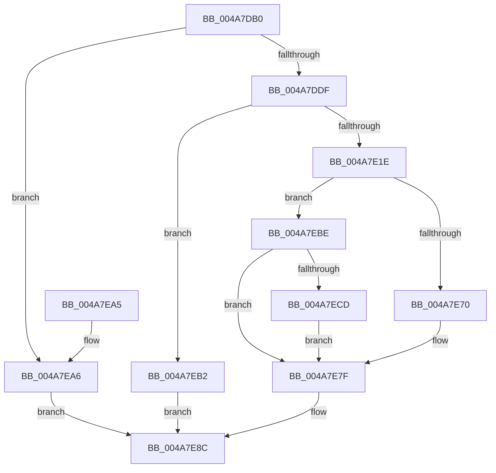

# HalpIumGetNextVariableName

- RVA: `0x004A7DB0`–`0x004A7EE4` (길이 `308` bytes)
- VA: `0x00000001404A7DB0`
- 실행 섹션: `.text`
- PDB 이름 있음: `예`; PDB Function 태그: `아니요`
- unwind 정보 RVA: `0x000B7400`
- 디코드: `76`개 명령, `308/308` bytes 표시
- 미해석 바이트: `0` (있으면 어셈블리에 `.byte`로 보존)

> 이 문서는 커널 이미지의 기계어와 PDB 기호를 분석해 생성했습니다. 4번과 5번은 함수 원형과 자료형을 바이너리 사용 방식에서 추정한 C 해석이며 원본 소스 복구 결과는 아닙니다.

## 1. Dependencies

- 직접 호출 지점: **5**; 고유 호출 대상: **4**
- 직접 호출자로 확인된 함수: **0**
- RIP 상대 이미지 참조: **1**

### Outgoing calls
- `0x004A7E0D` → [ExAllocatePool2](../../poolcode/B8/ExAllocatePool2_function_00B820F0.md) (function, `0x00B820F0`)
- `0x004A7E2C` → [memcpy](../6C/memcpy_function_006C6840.md) (function, `0x006C6840`)
- `0x004A7E54` → [guard_dispatch_icall](../6B/guard_dispatch_icall_function_006BAAD0.md) (function, `0x006BAAD0`)
- `0x004A7E7A` → [memcpy](../6C/memcpy_function_006C6840.md) (function, `0x006C6840`)
- `0x004A7E84` → [ExFreePoolWithTag](../../poolcode/B8/ExFreePoolWithTag_function_00B82870.md) (function, `0x00B82870`)

### Direct callers
- 이 함수 시작 RVA로 연결되는 직접 call은 확인되지 않았습니다. 간접 호출은 완전히 역산할 수 없습니다.

### Static image references
- `0x004A7DC8` → RVA `0x00FC1D50` (`.data`; read)

## 2. Other-region calls and transfers

- 다른 실행 섹션으로 향하는 call: **2**
  - `0x004A7E0D` → [ExAllocatePool2](../../poolcode/B8/ExAllocatePool2_function_00B820F0.md) (`.text` → `POOLCODE`)
  - `0x004A7E84` → [ExFreePoolWithTag](../../poolcode/B8/ExFreePoolWithTag_function_00B82870.md) (`.text` → `POOLCODE`)
- 별도 외부 분기/꼬리 이동을 확인하지 못했습니다.

## 3. Assembly (complete function range)

```asm
004A7DB0  48 89 5C 24 08                  mov qword ptr [rsp + 8], rbx
004A7DB5  48 89 6C 24 10                  mov qword ptr [rsp + 0x10], rbp
004A7DBA  48 89 74 24 18                  mov qword ptr [rsp + 0x18], rsi
004A7DBF  57                              push rdi
004A7DC0  41 56                           push r14
004A7DC2  41 57                           push r15
004A7DC4  48 83 EC 30                     sub rsp, 0x30
004A7DC8  48 83 3D 80 9F B1 00 00         cmp qword ptr [rip + 0xb19f80], 0
004A7DD0  4D 8B F8                        mov r15, r8
004A7DD3  4C 8B F2                        mov r14, rdx
004A7DD6  48 8B F1                        mov rsi, rcx
004A7DD9  0F 84 C7 00 00 00               je 0x1404a7ea6
004A7DDF  48 8B 01                        mov rax, qword ptr [rcx]
004A7DE2  41 B8 53 6B 46 77               mov r8d, 0x77466b53
004A7DE8  B9 E0 9F 1F 00                  mov ecx, 0x1f9fe0
004A7DED  48 3B C1                        cmp rax, rcx
004A7DF0  48 0F 42 C8                     cmovb rcx, rax
004A7DF4  48 89 0E                        mov qword ptr [rsi], rcx
004A7DF7  48 8D A9 1F 10 00 00            lea rbp, [rcx + 0x101f]
004A7DFE  B9 40 00 00 00                  mov ecx, 0x40
004A7E03  48 81 E5 00 F0 FF FF            and rbp, 0xfffffffffffff000
004A7E0A  48 8B D5                        mov rdx, rbp
004A7E0D  E8 DE A2 6D 00                  call 0x140b820f0
004A7E12  48 8B F8                        mov rdi, rax
004A7E15  48 85 C0                        test rax, rax
004A7E18  0F 84 94 00 00 00               je 0x1404a7eb2
004A7E1E  48 8D 48 20                     lea rcx, [rax + 0x20]
004A7E22  49 8B D6                        mov rdx, r14
004A7E25  48 89 48 08                     mov qword ptr [rax + 8], rcx
004A7E29  4C 8B 06                        mov r8, qword ptr [rsi]
004A7E2C  E8 0F EA 21 00                  call 0x1406c6840
004A7E31  48 8B 06                        mov rax, qword ptr [rsi]
004A7E34  45 33 C9                        xor r9d, r9d
004A7E37  48 89 07                        mov qword ptr [rdi], rax
004A7E3A  4C 8B C5                        mov r8, rbp
004A7E3D  41 0F 10 07                     movups xmm0, xmmword ptr [r15]
004A7E41  48 8B D7                        mov rdx, rdi
004A7E44  41 8D 49 04                     lea ecx, [r9 + 4]
004A7E48  F3 0F 7F 47 10                  movdqu xmmword ptr [rdi + 0x10], xmm0
004A7E4D  48 8B 05 FC 9E B1 00            mov rax, qword ptr [rip + 0xb19efc]
004A7E54  E8 77 2C 21 00                  call 0x1406baad0
004A7E59  48 8B 0F                        mov rcx, qword ptr [rdi]
004A7E5C  48 8B D8                        mov rbx, rax
004A7E5F  48 89 0E                        mov qword ptr [rsi], rcx
004A7E62  0F 10 47 10                     movups xmm0, xmmword ptr [rdi + 0x10]
004A7E66  F3 41 0F 7F 07                  movdqu xmmword ptr [r15], xmm0
004A7E6B  48 85 C0                        test rax, rax
004A7E6E  75 4E                           jne 0x1404a7ebe
004A7E70  4C 8B 06                        mov r8, qword ptr [rsi]
004A7E73  49 8B CE                        mov rcx, r14
004A7E76  48 8B 57 08                     mov rdx, qword ptr [rdi + 8]
004A7E7A  E8 C1 E9 21 00                  call 0x1406c6840
004A7E7F  33 D2                           xor edx, edx
004A7E81  48 8B CF                        mov rcx, rdi
004A7E84  E8 E7 A9 6D 00                  call 0x140b82870
004A7E89  48 8B C3                        mov rax, rbx
004A7E8C  48 8B 5C 24 50                  mov rbx, qword ptr [rsp + 0x50]
004A7E91  48 8B 6C 24 58                  mov rbp, qword ptr [rsp + 0x58]
004A7E96  48 8B 74 24 60                  mov rsi, qword ptr [rsp + 0x60]
004A7E9B  48 83 C4 30                     add rsp, 0x30
004A7E9F  41 5F                           pop r15
004A7EA1  41 5E                           pop r14
004A7EA3  5F                              pop rdi
004A7EA4  C3                              ret
004A7EA5  CC                              int3
004A7EA6  48 B8 03 00 00 00 00 00 00 80   movabs rax, 0x8000000000000003
004A7EB0  EB DA                           jmp 0x1404a7e8c
004A7EB2  48 B8 09 00 00 00 00 00 00 80   movabs rax, 0x8000000000000009
004A7EBC  EB CE                           jmp 0x1404a7e8c
004A7EBE  48 B8 05 00 00 00 00 00 00 80   movabs rax, 0x8000000000000005
004A7EC8  48 3B D8                        cmp rbx, rax
004A7ECB  75 B2                           jne 0x1404a7e7f
004A7ECD  48 81 FD 00 A0 1F 00            cmp rbp, 0x1fa000
004A7ED4  48 B8 04 00 00 00 00 00 00 80   movabs rax, 0x8000000000000004
004A7EDE  48 0F 44 D8                     cmove rbx, rax
004A7EE2  EB 9B                           jmp 0x1404a7e7f
```

## 4. C-style interpretation (structured pseudocode)

```c
__int64 __fastcall HalpIumGetNextVariableName(__int64 a1, __int64 a2, __int64 a3, int a4)
{
    __int64 result;
    __int64 v_rbp;
    __int64 v_rbx;
    __int64 v_rsp;
    unsigned __int64 v_stack_p10;
    unsigned __int64 v_stack_p18;
    unsigned __int64 v_stack_p8;

    v_stack_p8 = v_rbx;
    v_stack_p10 = v_rbp;
    v_stack_p18 = v_rsi;
    v_rsp = (v_rsp) - (48);
    if ((*(unsigned __int64 *)(v_rip + 11640704)) == 0) goto loc_004A7EA6;
    a1 = (unsigned int)(0x1F9FE0ULL);
    if ((*(unsigned __int64 *)(a1)) < ((unsigned int)(0x1F9FE0ULL))) { a1 = *(unsigned __int64 *)(a1); }
    *(unsigned __int64 *)(a1) = a1;
    v_rbp = (a1 + 4127) & (0xFFFFFFFFFFFFF000ULL);
    result = ExAllocatePool2(64, v_rbp, (unsigned int)(0x77466B53ULL), a4);
    if (result == 0) goto loc_004A7EB2;
    *(unsigned __int64 *)(result + 8) = result + 32;
    result = memcpy(result + 32, a2, *(unsigned __int64 *)(a1), a4);
    a4 = 0;
    *(unsigned __int64 *)(result) = *(unsigned __int64 *)(a1);
    *(unsigned __int64 *)(result + 16) = v_xmm0;
    result = guard_dispatch_icall(a4 + 4, result, v_rbp, a4);
    *(unsigned __int64 *)(a1) = *(unsigned __int64 *)(result);
    *(unsigned __int64 *)(a3) = v_xmm0;
    if (result != 0) goto loc_004A7EBE;
    result = memcpy(a2, *(unsigned __int64 *)(result + 8), *(unsigned __int64 *)(a1), a4);
loc_004A7E7F:
    a2 = 0;
    result = ExFreePoolWithTag(result, a2, *(unsigned __int64 *)(a1), a4);
loc_004A7E8C:
    v_rsp = (v_rsp) + (48);
    return result;
loc_004A7EA6:
    goto loc_004A7E8C;
loc_004A7EB2:
    goto loc_004A7E8C;
loc_004A7EBE:
    if (v_stack_p8 != result) goto loc_004A7E7F;
    v_rbx = v_stack_p8;
    if (v_stack_p10 == 0x1FA000ULL) { v_rbx = result; }
    goto loc_004A7E7F;
}
```

## 5. (Beta) C Style

```c
int64_t HalpIumGetNextVariableName(void *Arg1, int64_t Arg2, void *Arg3, int32_t Arg4)
{
    uint8_t *arg1 = (uint8_t *)Arg1;
    uint8_t *arg3 = (uint8_t *)Arg3;

    int64_t result;
    int64_t local_rbp;
    int64_t local_rbx;
    int64_t local_rsp;
    uint64_t v_stack_p10;
    uint64_t v_stack_p18;
    uint64_t v_stack_p8;

    v_stack_p8 = local_rbx;
    v_stack_p10 = local_rbp;
    v_stack_p18 = local_rsi;
    local_rsp = (local_rsp) - (48);
    if ((*(uint64_t *)(v_rip + 0xB19F80)) == 0) goto loc_004A7EA6;
    Arg1 = (uint32_t)(0x1F9FE0ULL);
    if ((*(uint64_t *)(arg1)) < ((uint32_t)(0x1F9FE0ULL))) { Arg1 = *(uint64_t *)(arg1); }
    *(void **)(arg1) = Arg1;
    local_rbp = (Arg1 + 4127) & (0xFFFFFFFFFFFFF000ULL);
    result = ExAllocatePool2(64, local_rbp, (uint32_t)(0x77466B53ULL), Arg4);
    if (result == 0) goto loc_004A7EB2;
    *(uint64_t *)(result + 0x8) = result + 32;
    result = memcpy(result + 32, Arg2, *(uint64_t *)(arg1), Arg4);
    Arg4 = 0;
    *(uint64_t *)(result) = *(uint64_t *)(arg1);
    *(uint64_t *)(result + 0x10) = v_xmm0;
    result = guard_dispatch_icall(Arg4 + 4, result, local_rbp, Arg4);
    *(uint64_t *)(arg1) = *(uint64_t *)(result);
    *(uint64_t *)(arg3) = v_xmm0;
    if (result != 0) goto loc_004A7EBE;
    result = memcpy(Arg2, *(uint64_t *)(result + 0x8), *(uint64_t *)(arg1), Arg4);
loc_004A7E7F:
    Arg2 = 0;
    result = ExFreePoolWithTag(result, Arg2, *(uint64_t *)(arg1), Arg4);
loc_004A7E8C:
    local_rsp = (local_rsp) + (48);
    return result;
loc_004A7EA6:
    goto loc_004A7E8C;
loc_004A7EB2:
    goto loc_004A7E8C;
loc_004A7EBE:
    if (v_stack_p8 != result) goto loc_004A7E7F;
    local_rbx = v_stack_p8;
    if (v_stack_p10 == 0x1FA000ULL) { local_rbx = result; }
    goto loc_004A7E7F;
}
```

### 관측된 메모리 오프셋

구조체 형식이 확인되지 않은 접근은 인자 기준의 오프셋으로만 기록했습니다.

| 기준 인자 | 오프셋 표현 | 폭 (bit) | 접근 |
|---|---:|---:|---|
| `Arg1` | `+ 0x0` | `64` | `R` |
| `Arg1` | `+ 0x0` | `64` | `W` |
| `Arg3` | `+ 0x0` | `128` | `R` |
| `Arg3` | `+ 0x0` | `128` | `W` |

## 6. Execution-region graph

[열기: 2D/3D 그래프와 함수 탐색 컨트롤 패널](../../../control-panel.html?section=text&rva=0x004A7DB0&view=graph)

- 2D 그래프는 위에서 아래로 흐르고, 3D 그래프는 빈 공간을 드래그해 회전합니다. Shift+드래그는 이동, 휠은 확대·축소, 함수 노드 선택은 대상 보고서 이동입니다.

### Static fallback


