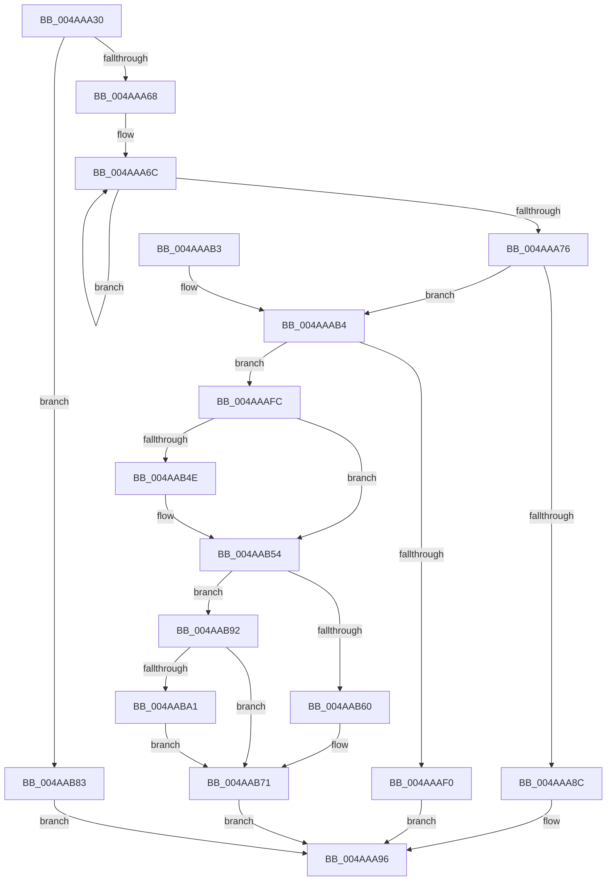

# HalpIumGetVariable

- RVA: `0x004AAA30`–`0x004AABB8` (길이 `392` bytes)
- VA: `0x00000001404AAA30`
- 실행 섹션: `.text`
- PDB 이름 있음: `예`; PDB Function 태그: `아니요`
- unwind 정보 RVA: `0x000B7CE4`
- 디코드: `99`개 명령, `392/392` bytes 표시
- 미해석 바이트: `0` (있으면 어셈블리에 `.byte`로 보존)

> 이 문서는 커널 이미지의 기계어와 PDB 기호를 분석해 생성했습니다. 4번과 5번은 함수 원형과 자료형을 바이너리 사용 방식에서 추정한 C 해석이며 원본 소스 복구 결과는 아닙니다.

## 1. Dependencies

- 직접 호출 지점: **5**; 고유 호출 대상: **4**
- 직접 호출자로 확인된 함수: **0**
- RIP 상대 이미지 참조: **1**

### Outgoing calls
- `0x004AAAE3` → [ExAllocatePool2](../../poolcode/B8/ExAllocatePool2_function_00B820F0.md) (function, `0x00B820F0`)
- `0x004AAB09` → [memcpy](../6C/memcpy_function_006C6840.md) (function, `0x006C6840`)
- `0x004AAB41` → [guard_dispatch_icall](../6B/guard_dispatch_icall_function_006BAAD0.md) (function, `0x006BAAD0`)
- `0x004AAB6C` → [memcpy](../6C/memcpy_function_006C6840.md) (function, `0x006C6840`)
- `0x004AAB76` → [ExFreePoolWithTag](../../poolcode/B8/ExFreePoolWithTag_function_00B82870.md) (function, `0x00B82870`)

### Direct callers
- 이 함수 시작 RVA로 연결되는 직접 call은 확인되지 않았습니다. 간접 호출은 완전히 역산할 수 없습니다.

### Static image references
- `0x004AAA52` → RVA `0x00FC1D50` (`.data`; read)

## 2. Other-region calls and transfers

- 다른 실행 섹션으로 향하는 call: **2**
  - `0x004AAAE3` → [ExAllocatePool2](../../poolcode/B8/ExAllocatePool2_function_00B820F0.md) (`.text` → `POOLCODE`)
  - `0x004AAB76` → [ExFreePoolWithTag](../../poolcode/B8/ExFreePoolWithTag_function_00B82870.md) (`.text` → `POOLCODE`)
- 별도 외부 분기/꼬리 이동을 확인하지 못했습니다.

## 3. Assembly (complete function range)

```asm
004AAA30  48 89 5C 24 08                  mov qword ptr [rsp + 8], rbx
004AAA35  48 89 6C 24 10                  mov qword ptr [rsp + 0x10], rbp
004AAA3A  48 89 74 24 18                  mov qword ptr [rsp + 0x18], rsi
004AAA3F  57                              push rdi
004AAA40  41 54                           push r12
004AAA42  41 55                           push r13
004AAA44  41 56                           push r14
004AAA46  41 57                           push r15
004AAA48  48 83 EC 30                     sub rsp, 0x30
004AAA4C  45 33 ED                        xor r13d, r13d
004AAA4F  4D 8B F1                        mov r14, r9
004AAA52  4C 39 2D F7 72 B1 00            cmp qword ptr [rip + 0xb172f7], r13
004AAA59  4D 8B F8                        mov r15, r8
004AAA5C  4C 8B E2                        mov r12, rdx
004AAA5F  48 8B E9                        mov rbp, rcx
004AAA62  0F 84 1B 01 00 00               je 0x1404aab83
004AAA68  48 83 C8 FF                     or rax, 0xffffffffffffffff
004AAA6C  48 FF C0                        inc rax
004AAA6F  66 44 39 2C 41                  cmp word ptr [rcx + rax*2], r13w
004AAA74  75 F6                           jne 0x1404aaa6c
004AAA76  48 8D 1C 45 02 00 00 00         lea rbx, [rax*2 + 2]
004AAA7E  B8 00 A0 1F 00                  mov eax, 0x1fa000
004AAA83  48 8D 53 38                     lea rdx, [rbx + 0x38]
004AAA87  48 3B D0                        cmp rdx, rax
004AAA8A  72 28                           jb 0x1404aaab4
004AAA8C  48 B8 04 00 00 00 00 00 00 80   movabs rax, 0x8000000000000004
004AAA96  48 8B 5C 24 60                  mov rbx, qword ptr [rsp + 0x60]
004AAA9B  48 8B 6C 24 68                  mov rbp, qword ptr [rsp + 0x68]
004AAAA0  48 8B 74 24 70                  mov rsi, qword ptr [rsp + 0x70]
004AAAA5  48 83 C4 30                     add rsp, 0x30
004AAAA9  41 5F                           pop r15
004AAAAB  41 5E                           pop r14
004AAAAD  41 5D                           pop r13
004AAAAF  41 5C                           pop r12
004AAAB1  5F                              pop rdi
004AAAB2  C3                              ret
004AAAB3  CC                              int3
004AAAB4  49 8B 09                        mov rcx, qword ptr [r9]
004AAAB7  48 2B C2                        sub rax, rdx
004AAABA  48 3B C8                        cmp rcx, rax
004AAABD  41 B8 53 6B 46 77               mov r8d, 0x77466b53
004AAAC3  48 0F 43 C8                     cmovae rcx, rax
004AAAC7  49 89 09                        mov qword ptr [r9], rcx
004AAACA  48 8D B1 FF 0F 00 00            lea rsi, [rcx + 0xfff]
004AAAD1  B9 40 00 00 00                  mov ecx, 0x40
004AAAD6  48 03 F2                        add rsi, rdx
004AAAD9  48 81 E6 00 F0 FF FF            and rsi, 0xfffffffffffff000
004AAAE0  48 8B D6                        mov rdx, rsi
004AAAE3  E8 08 76 6D 00                  call 0x140b820f0
004AAAE8  48 8B F8                        mov rdi, rax
004AAAEB  48 85 C0                        test rax, rax
004AAAEE  75 0C                           jne 0x1404aaafc
004AAAF0  48 B8 09 00 00 00 00 00 00 80   movabs rax, 0x8000000000000009
004AAAFA  EB 9A                           jmp 0x1404aaa96
004AAAFC  48 8D 48 38                     lea rcx, [rax + 0x38]
004AAB00  4C 8B C3                        mov r8, rbx
004AAB03  48 8B D5                        mov rdx, rbp
004AAB06  48 89 08                        mov qword ptr [rax], rcx
004AAB09  E8 32 BD 21 00                  call 0x1406c6840
004AAB0E  48 8B 0F                        mov rcx, qword ptr [rdi]
004AAB11  45 33 C9                        xor r9d, r9d
004AAB14  48 89 5F 08                     mov qword ptr [rdi + 8], rbx
004AAB18  48 03 CB                        add rcx, rbx
004AAB1B  41 0F 10 04 24                  movups xmm0, xmmword ptr [r12]
004AAB20  48 89 4F 30                     mov qword ptr [rdi + 0x30], rcx
004AAB24  4C 8B C6                        mov r8, rsi
004AAB27  48 8B D7                        mov rdx, rdi
004AAB2A  41 8D 49 03                     lea ecx, [r9 + 3]
004AAB2E  F3 0F 7F 47 10                  movdqu xmmword ptr [rdi + 0x10], xmm0
004AAB33  49 8B 06                        mov rax, qword ptr [r14]
004AAB36  48 89 47 28                     mov qword ptr [rdi + 0x28], rax
004AAB3A  48 8B 05 0F 72 B1 00            mov rax, qword ptr [rip + 0xb1720f]
004AAB41  E8 8A FF 20 00                  call 0x1406baad0
004AAB46  48 8B D8                        mov rbx, rax
004AAB49  4D 85 FF                        test r15, r15
004AAB4C  74 06                           je 0x1404aab54
004AAB4E  8B 4F 20                        mov ecx, dword ptr [rdi + 0x20]
004AAB51  41 89 0F                        mov dword ptr [r15], ecx
004AAB54  4C 8B 47 28                     mov r8, qword ptr [rdi + 0x28]
004AAB58  4D 89 06                        mov qword ptr [r14], r8
004AAB5B  48 85 DB                        test rbx, rbx
004AAB5E  75 32                           jne 0x1404aab92
004AAB60  48 8B 57 30                     mov rdx, qword ptr [rdi + 0x30]
004AAB64  48 8B 8C 24 80 00 00 00         mov rcx, qword ptr [rsp + 0x80]
004AAB6C  E8 CF BC 21 00                  call 0x1406c6840
004AAB71  33 D2                           xor edx, edx
004AAB73  48 8B CF                        mov rcx, rdi
004AAB76  E8 F5 7C 6D 00                  call 0x140b82870
004AAB7B  48 8B C3                        mov rax, rbx
004AAB7E  E9 13 FF FF FF                  jmp 0x1404aaa96
004AAB83  48 B8 03 00 00 00 00 00 00 80   movabs rax, 0x8000000000000003
004AAB8D  E9 04 FF FF FF                  jmp 0x1404aaa96
004AAB92  48 B8 05 00 00 00 00 00 00 80   movabs rax, 0x8000000000000005
004AAB9C  48 3B D8                        cmp rbx, rax
004AAB9F  75 D0                           jne 0x1404aab71
004AABA1  48 81 FE 00 A0 1F 00            cmp rsi, 0x1fa000
004AABA8  48 B8 04 00 00 00 00 00 00 80   movabs rax, 0x8000000000000004
004AABB2  48 0F 44 D8                     cmove rbx, rax
004AABB6  EB B9                           jmp 0x1404aab71
```

## 4. C-style interpretation (structured pseudocode)

```c
__int64 __fastcall HalpIumGetVariable(__int64 a1, __int64 a2, __int64 a3, __int64 a4, __int64 a5)
{
    __int64 result;
    __int64 v_r13;
    __int64 v_rbx;
    __int64 v_rsi;
    __int64 v_rsp;
    unsigned __int64 v_stack_p10;
    unsigned __int64 v_stack_p18;
    unsigned __int64 v_stack_p8;

    v_stack_p8 = v_rbx;
    v_stack_p10 = v_rbp;
    v_stack_p18 = v_rsi;
    v_rsp = (v_rsp) - (48);
    v_r13 = 0;
    if ((*(unsigned __int64 *)(v_rip + 11629303)) == 0) goto loc_004AAB83;
    result = (result) | (-1);
loc_004AAA6C:
    result = (result) + 1;
    if ((*(unsigned __int16 *)(a1 + result * 2)) != 0) goto loc_004AAA6C;
    if ((result * 2 + 2 + 56) < ((unsigned int)(0x1FA000ULL))) goto loc_004AAAB4;
loc_004AAA96:
    v_rsp = (v_rsp) + (48);
    return (unsigned int)(0x1FA000ULL);
loc_004AAAB4:
    result = ((unsigned int)(0x1FA000ULL)) - (result * 2 + 2 + 56);
    a1 = *(unsigned __int64 *)(a4);
    if ((*(unsigned __int64 *)(a4)) >= result) { a1 = result; }
    *(unsigned __int64 *)(a4) = a1;
    v_rsi = (a1 + 4095) + (result * 2 + 2 + 56);
    v_rsi = (v_rsi) & (0xFFFFFFFFFFFFF000ULL);
    result = ExAllocatePool2(64, v_rsi, (unsigned int)(0x77466B53ULL), a4);
    if (result != 0) goto loc_004AAAFC;
    goto loc_004AAA96;
loc_004AAAFC:
    *(unsigned __int64 *)(result) = result + 56;
    result = memcpy(result + 56, v_stack_p10, v_stack_p8, a4);
    a4 = 0;
    *(unsigned __int64 *)(result + 8) = v_stack_p8;
    a1 = (*(unsigned __int64 *)(result)) + (v_stack_p8);
    *(unsigned __int64 *)(result + 48) = a1;
    *(unsigned __int64 *)(result + 16) = v_xmm0;
    *(unsigned __int64 *)(result + 40) = *(unsigned __int64 *)(a4);
    result = guard_dispatch_icall(a4 + 3, result, v_rsi, a4);
    if (a3 != 0) {
        a1 = *(unsigned int *)(result + 32);
        *(unsigned int *)(a3) = (unsigned int)(a1);
    }
    *(unsigned __int64 *)(a4) = *(unsigned __int64 *)(result + 40);
    if (result != 0) goto loc_004AAB92;
    result = memcpy(a5, *(unsigned __int64 *)(result + 48), *(unsigned __int64 *)(result + 40), a4);
loc_004AAB71:
    a2 = 0;
    result = ExFreePoolWithTag(result, a2, *(unsigned __int64 *)(result + 40), a4);
    goto loc_004AAA96;
loc_004AAB83:
    goto loc_004AAA96;
loc_004AAB92:
    if (result != result) goto loc_004AAB71;
    v_rbx = result;
    if (v_rsi == 0x1FA000ULL) { v_rbx = result; }
    goto loc_004AAB71;
}
```

## 5. (Beta) C Style

```c
int64_t HalpIumGetVariable(void *Arg1, void *Arg2, int64_t Arg3, void *Arg4, int64_t Arg5)
{
    uint8_t *arg1 = (uint8_t *)Arg1;
    uint8_t *arg2 = (uint8_t *)Arg2;
    uint8_t *arg4 = (uint8_t *)Arg4;

    int64_t result;
    int64_t local_r13;
    int64_t local_rbx;
    int64_t local_rsi;
    int64_t local_rsp;
    uint64_t v_stack_p10;
    uint64_t v_stack_p18;
    uint64_t v_stack_p8;

    v_stack_p8 = local_rbx;
    v_stack_p10 = local_rbp;
    v_stack_p18 = local_rsi;
    local_rsp = (local_rsp) - (48);
    local_r13 = 0;
    if ((*(uint64_t *)(v_rip + 0xB172F7)) == 0) goto loc_004AAB83;
    result = (result) | (-1);
loc_004AAA6C:
    result = (result) + 1;
    if ((*(uint16_t *)(arg1 + result * 2)) != 0) goto loc_004AAA6C;
    if ((result * 2 + 2 + 56) < ((uint32_t)(0x1FA000ULL))) goto loc_004AAAB4;
loc_004AAA96:
    local_rsp = (local_rsp) + (48);
    return (uint32_t)(0x1FA000ULL);
loc_004AAAB4:
    result = ((uint32_t)(0x1FA000ULL)) - (result * 2 + 2 + 56);
    Arg1 = *(uint64_t *)(arg4);
    if ((*(uint64_t *)(arg4)) >= result) { Arg1 = result; }
    *(void **)(arg4) = Arg1;
    local_rsi = (Arg1 + 4095) + (result * 2 + 2 + 56);
    local_rsi = (local_rsi) & (0xFFFFFFFFFFFFF000ULL);
    result = ExAllocatePool2(64, local_rsi, (uint32_t)(0x77466B53ULL), Arg4);
    if (result != 0) goto loc_004AAAFC;
    goto loc_004AAA96;
loc_004AAAFC:
    *(uint64_t *)(result) = result + 56;
    result = memcpy(result + 56, v_stack_p10, v_stack_p8, Arg4);
    Arg4 = 0;
    *(uint64_t *)(result + 0x8) = v_stack_p8;
    Arg1 = (*(uint64_t *)(result)) + (v_stack_p8);
    *(void **)(result + 0x30) = Arg1;
    *(uint64_t *)(result + 0x10) = v_xmm0;
    *(uint64_t *)(result + 0x28) = *(uint64_t *)(arg4);
    result = guard_dispatch_icall(Arg4 + 3, result, local_rsi, Arg4);
    if (Arg3 != 0) {
        Arg1 = *(uint32_t *)(result + 0x20);
        *(uint32_t *)(Arg3) = (uint32_t)(Arg1);
    }
    *(uint64_t *)(arg4) = *(uint64_t *)(result + 0x28);
    if (result != 0) goto loc_004AAB92;
    result = memcpy(Arg5, *(uint64_t *)(result + 0x30), *(uint64_t *)(result + 0x28), Arg4);
loc_004AAB71:
    Arg2 = 0;
    result = ExFreePoolWithTag(result, Arg2, *(uint64_t *)(result + 0x28), Arg4);
    goto loc_004AAA96;
loc_004AAB83:
    goto loc_004AAA96;
loc_004AAB92:
    if (result != result) goto loc_004AAB71;
    local_rbx = result;
    if (local_rsi == 0x1FA000ULL) { local_rbx = result; }
    goto loc_004AAB71;
}
```

### 관측된 메모리 오프셋

구조체 형식이 확인되지 않은 접근은 인자 기준의 오프셋으로만 기록했습니다.

| 기준 인자 | 오프셋 표현 | 폭 (bit) | 접근 |
|---|---:|---:|---|
| `Arg1` | `+ 0x0 + rax*2` | `16` | `R` |
| `Arg2` | `+ 0x0` | `128` | `R` |
| `Arg4` | `+ 0x0` | `64` | `R` |
| `Arg4` | `+ 0x0` | `64` | `W` |

## 6. Execution-region graph

[열기: 2D/3D 그래프와 함수 탐색 컨트롤 패널](../../../control-panel.html?section=text&rva=0x004AAA30&view=graph)

- 2D 그래프는 위에서 아래로 흐르고, 3D 그래프는 빈 공간을 드래그해 회전합니다. Shift+드래그는 이동, 휠은 확대·축소, 함수 노드 선택은 대상 보고서 이동입니다.

### Static fallback


