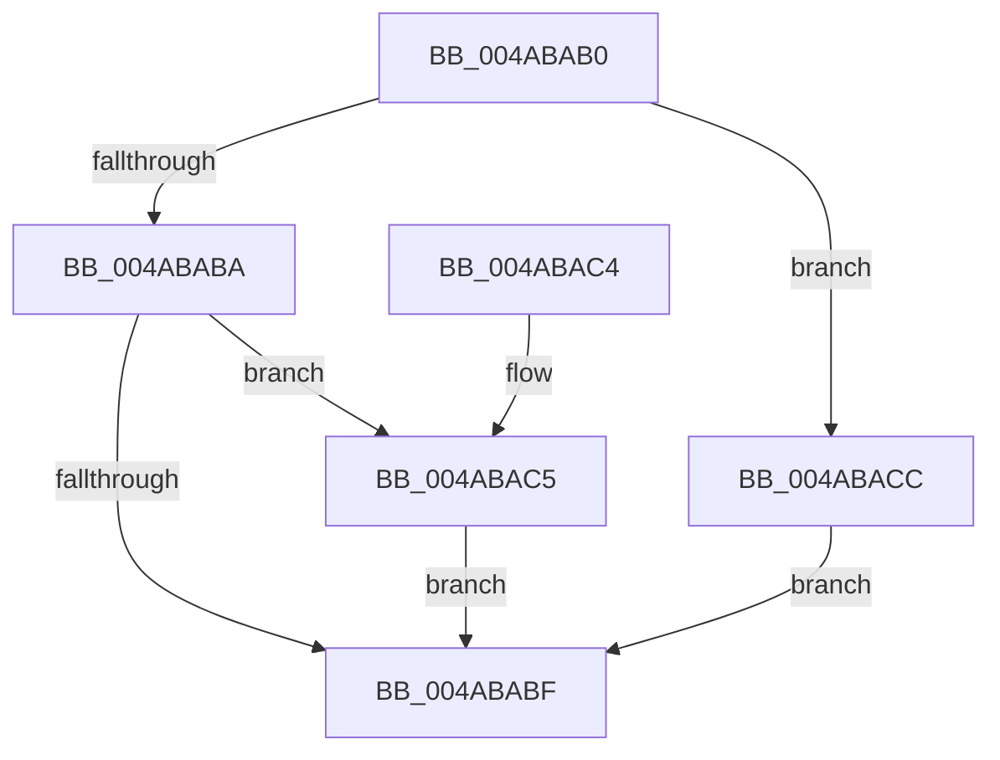

# HalpPowerEarlyRestore

- RVA: `0x004ABAB0`–`0x004ABAE2` (길이 `50` bytes)
- VA: `0x00000001404ABAB0`
- 실행 섹션: `.text`
- PDB 이름 있음: `예`; PDB Function 태그: `아니요`
- unwind 정보 RVA: `0x000AD68C`
- 디코드: `15`개 명령, `50/50` bytes 표시
- 미해석 바이트: `0` (있으면 어셈블리에 `.byte`로 보존)

> 이 문서는 커널 이미지의 기계어와 PDB 기호를 분석해 생성했습니다. 4번과 5번은 함수 원형과 자료형을 바이너리 사용 방식에서 추정한 C 해석이며 원본 소스 복구 결과는 아닙니다.

## 1. Dependencies

- 직접 호출 지점: **1**; 고유 호출 대상: **1**
- 직접 호출자로 확인된 함수: **0**
- RIP 상대 이미지 참조: **3**

### Outgoing calls
- `0x004ABAC5` → [HalpReenableAcpi](../../pagelk/B7/HalpReenableAcpi_function_00B7AE78.md) (function, `0x00B7AE78`)

### Direct callers
- 이 함수 시작 RVA로 연결되는 직접 call은 확인되지 않았습니다. 간접 호출은 완전히 역산할 수 없습니다.

### Static image references
- `0x004ABACC` → RVA `0x00FC3E80` (`.data`; write)
- `0x004ABAD3` → RVA `0x00FC3EC8` (`.data`; write)
- `0x004ABADA` → RVA `0x00FC2180` (`.data`; write)

## 2. Other-region calls and transfers

- 다른 실행 섹션으로 향하는 call: **1**
  - `0x004ABAC5` → [HalpReenableAcpi](../../pagelk/B7/HalpReenableAcpi_function_00B7AE78.md) (`.text` → `PAGELK`)
- 별도 외부 분기/꼬리 이동을 확인하지 못했습니다.

## 3. Assembly (complete function range)

```asm
004ABAB0  48 83 EC 28                     sub rsp, 0x28
004ABAB4  33 C0                           xor eax, eax
004ABAB6  85 C9                           test ecx, ecx
004ABAB8  74 12                           je 0x1404abacc
004ABABA  83 F9 01                        cmp ecx, 1
004ABABD  74 06                           je 0x1404abac5
004ABABF  48 83 C4 28                     add rsp, 0x28
004ABAC3  C3                              ret
004ABAC4  CC                              int3
004ABAC5  E8 AE F3 6C 00                  call 0x140b7ae78
004ABACA  EB F3                           jmp 0x1404ababf
004ABACC  48 89 05 AD 83 B1 00            mov qword ptr [rip + 0xb183ad], rax
004ABAD3  48 89 05 EE 83 B1 00            mov qword ptr [rip + 0xb183ee], rax
004ABADA  89 05 A0 66 B1 00               mov dword ptr [rip + 0xb166a0], eax
004ABAE0  EB DD                           jmp 0x1404ababf
```

## 4. C-style interpretation (structured pseudocode)

```c
__int64 __fastcall HalpPowerEarlyRestore(int a1)
{
    __int64 result;
    __int64 v_rsp;

    v_rsp = (v_rsp) - (40);
    result = 0;
    if (a1 == 0) goto loc_004ABACC;
    if (a1 == 1) goto loc_004ABAC5;
loc_004ABABF:
    v_rsp = (v_rsp) + (40);
    return result;
loc_004ABAC5:
    result = HalpReenableAcpi(a1, a2, a3, a4);
    goto loc_004ABABF;
loc_004ABACC:
    *(unsigned __int64 *)(v_rip + 11633581) = result;
    *(unsigned __int64 *)(v_rip + 11633646) = result;
    *(unsigned int *)(v_rip + 11626144) = (unsigned int)(result);
    goto loc_004ABABF;
}
```

## 5. (Beta) C Style

```c
int64_t HalpPowerEarlyRestore(int32_t Arg1)
{
    int64_t result;
    int64_t local_rsp;

    local_rsp = (local_rsp) - (40);
    result = 0;
    if (Arg1 == 0) goto loc_004ABACC;
    if (Arg1 == 1) goto loc_004ABAC5;
loc_004ABABF:
    local_rsp = (local_rsp) + (40);
    return result;
loc_004ABAC5:
    result = HalpReenableAcpi(Arg1, a2, a3, a4);
    goto loc_004ABABF;
loc_004ABACC:
    *(uint64_t *)(v_rip + 0xB183AD) = result;
    *(uint64_t *)(v_rip + 0xB183EE) = result;
    *(uint32_t *)(v_rip + 0xB166A0) = (uint32_t)(result);
    goto loc_004ABABF;
}
```

## 6. Execution-region graph

[열기: 2D/3D 그래프와 함수 탐색 컨트롤 패널](../../../control-panel.html?section=text&rva=0x004ABAB0&view=graph)

- 2D 그래프는 위에서 아래로 흐르고, 3D 그래프는 빈 공간을 드래그해 회전합니다. Shift+드래그는 이동, 휠은 확대·축소, 함수 노드 선택은 대상 보고서 이동입니다.

### Static fallback


