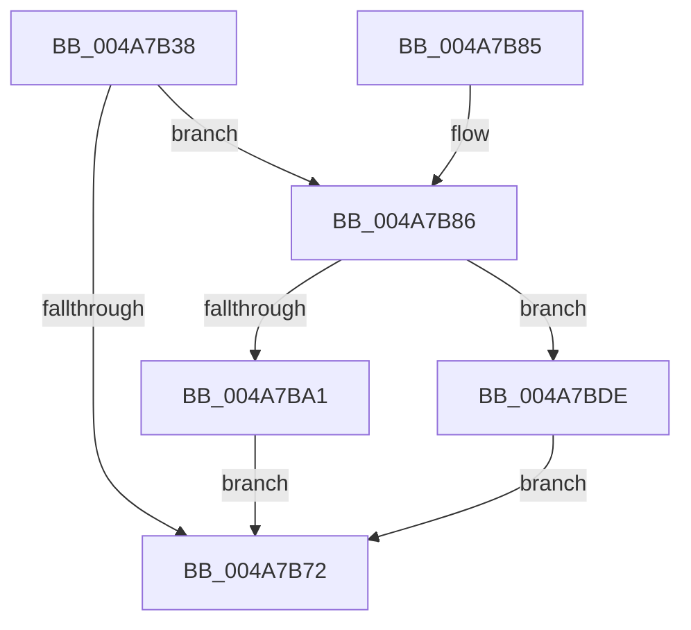

# HalpQueueMapBufferWorker

- RVA: `0x004A7B38`–`0x004A7BE4` (길이 `172` bytes)
- VA: `0x00000001404A7B38`
- 실행 섹션: `.text`
- PDB 이름 있음: `예`; PDB Function 태그: `아니요`
- unwind 정보 RVA: `0x000B73C4`
- 디코드: `48`개 명령, `172/172` bytes 표시
- 미해석 바이트: `0` (있으면 어셈블리에 `.byte`로 보존)

> 이 문서는 커널 이미지의 기계어와 PDB 기호를 분석해 생성했습니다. 4번과 5번은 함수 원형과 자료형을 바이너리 사용 방식에서 추정한 C 해석이며 원본 소스 복구 결과는 아닙니다.

## 1. Dependencies

- 직접 호출 지점: **2**; 고유 호출 대상: **2**
- 직접 호출자로 확인된 함수: **5**
- RIP 상대 이미지 참조: **2**

### Outgoing calls
- `0x004A7B94` → [ExAllocatePool2](../../poolcode/B8/ExAllocatePool2_function_00B820F0.md) (function, `0x00B820F0`)
- `0x004A7BD7` → [ExQueueWorkItem](../2F/ExQueueWorkItem_function_002F9520.md) (function, `0x002F9520`)

### Direct callers
- [HalpAllocateDmaResourcesInternal](../3D/HalpAllocateDmaResourcesInternal_function_003DA7C4.md) at `0x003DA97D`
- [HalAllocateAdapterChannelV2](../3D/HalAllocateAdapterChannelV2_function_003DC714.md) at `0x003DC8C9`
- [sub_003DD598](../3D/Unknown_function_003DD598.md) at `0x003DD6A4`
- [IoFreeAdapterChannelV2](../3D/IoFreeAdapterChannelV2_function_003DE3B0.md) at `0x003DE4BF`
- [HalpDmaProcessMapRegisterQueueV2](../3D/HalpDmaProcessMapRegisterQueueV2_function_003DF50C.md) at `0x003DF5BE`

### Static image references
- `0x004A7B50` → RVA `0x00FC3E90` (`.data`; read)
- `0x004A7BA5` → RVA `0x004C09B0` (`HalpGrowMapBufferWorker`; read)

## 2. Other-region calls and transfers

- 다른 실행 섹션으로 향하는 call: **1**
  - `0x004A7B94` → [ExAllocatePool2](../../poolcode/B8/ExAllocatePool2_function_00B820F0.md) (`.text` → `POOLCODE`)
- 별도 외부 분기/꼬리 이동을 확인하지 못했습니다.

## 3. Assembly (complete function range)

```asm
004A7B38  48 89 5C 24 10                  mov qword ptr [rsp + 0x10], rbx
004A7B3D  48 89 6C 24 18                  mov qword ptr [rsp + 0x18], rbp
004A7B42  56                              push rsi
004A7B43  57                              push rdi
004A7B44  41 56                           push r14
004A7B46  48 83 EC 20                     sub rsp, 0x20
004A7B4A  8A 81 BA 01 00 00               mov al, byte ptr [rcx + 0x1ba]
004A7B50  48 8D 2D 39 C3 B1 00            lea rbp, [rip + 0xb1c339]
004A7B57  F6 D8                           neg al
004A7B59  8B F2                           mov esi, edx
004A7B5B  48 8B F9                        mov rdi, rcx
004A7B5E  48 1B DB                        sbb rbx, rbx
004A7B61  83 E3 04                        and ebx, 4
004A7B64  33 C0                           xor eax, eax
004A7B66  44 8D 70 01                     lea r14d, [rax + 1]
004A7B6A  F0 44 0F B1 34 2B               lock cmpxchg dword ptr [rbx + rbp], r14d
004A7B70  74 14                           je 0x1404a7b86
004A7B72  48 8B 5C 24 48                  mov rbx, qword ptr [rsp + 0x48]
004A7B77  48 8B 6C 24 50                  mov rbp, qword ptr [rsp + 0x50]
004A7B7C  48 83 C4 20                     add rsp, 0x20
004A7B80  41 5E                           pop r14
004A7B82  5F                              pop rdi
004A7B83  5E                              pop rsi
004A7B84  C3                              ret
004A7B85  CC                              int3
004A7B86  BA 38 00 00 00                  mov edx, 0x38
004A7B8B  41 B8 48 61 6C 44               mov r8d, 0x446c6148
004A7B91  8D 4A 0A                        lea ecx, [rdx + 0xa]
004A7B94  E8 57 A5 6D 00                  call 0x140b820f0
004A7B99  48 8B C8                        mov rcx, rax
004A7B9C  48 85 C0                        test rax, rax
004A7B9F  74 3D                           je 0x1404a7bde
004A7BA1  48 83 21 00                     and qword ptr [rcx], 0
004A7BA5  48 8D 05 04 8E 01 00            lea rax, [rip + 0x18e04]
004A7BAC  48 89 41 10                     mov qword ptr [rcx + 0x10], rax
004A7BB0  41 8B D6                        mov edx, r14d
004A7BB3  48 89 49 18                     mov qword ptr [rcx + 0x18], rcx
004A7BB7  48 8B 87 A0 00 00 00            mov rax, qword ptr [rdi + 0xa0]
004A7BBE  48 89 41 20                     mov qword ptr [rcx + 0x20], rax
004A7BC2  89 71 2C                        mov dword ptr [rcx + 0x2c], esi
004A7BC5  8A 87 BA 01 00 00               mov al, byte ptr [rdi + 0x1ba]
004A7BCB  88 41 28                        mov byte ptr [rcx + 0x28], al
004A7BCE  8B 87 9C 00 00 00               mov eax, dword ptr [rdi + 0x9c]
004A7BD4  89 41 30                        mov dword ptr [rcx + 0x30], eax
004A7BD7  E8 44 19 E5 FF                  call 0x1402f9520
004A7BDC  EB 94                           jmp 0x1404a7b72
004A7BDE  83 24 2B 00                     and dword ptr [rbx + rbp], 0
004A7BE2  EB 8E                           jmp 0x1404a7b72
```

## 4. C-style interpretation (structured pseudocode)

```c
__int64 __fastcall HalpQueueMapBufferWorker(__int64 a1, int a2)
{
    __int64 result;
    __int64 v_rbx;
    __int64 v_rsp;
    unsigned __int64 v_stack_p10;
    unsigned __int64 v_stack_p18;

    v_stack_p10 = v_rbx;
    v_stack_p18 = v_rbp;
    v_rsp = (v_rsp) - (32);
    result = (unsigned __int8)(-(*(unsigned __int8 *)(a1 + 442)));
    v_rbx = (unsigned int)((v_rbx) & (4));
    result = 0;
    if (condition_is_equal) goto loc_004A7B86;
loc_004A7B72:
    v_rsp = (v_rsp) + (32);
    return result;
loc_004A7B86:
    result = ExAllocatePool2(56 + 10, 56, (unsigned int)(0x446C6148ULL), a4);
    if (result == 0) goto loc_004A7BDE;
    *(unsigned __int64 *)(result + 16) = v_rip + 101892;
    *(unsigned __int64 *)(result + 24) = result;
    *(unsigned __int64 *)(result + 32) = *(unsigned __int64 *)(a1 + 160);
    *(unsigned int *)(result + 44) = (unsigned int)((unsigned int)(a2));
    *(unsigned __int8 *)(result + 40) = (unsigned __int8)(*(unsigned __int8 *)(a1 + 442));
    *(unsigned int *)(result + 48) = (unsigned int)((unsigned int)(*(unsigned int *)(a1 + 156)));
    result = ExQueueWorkItem(result, (unsigned int)((unsigned int)(result + 1)), (unsigned int)(0x446C6148ULL), a4);
    goto loc_004A7B72;
loc_004A7BDE:
    goto loc_004A7B72;
}
```

## 5. (Beta) C Style

```c
int64_t HalpQueueMapBufferWorker(void *Arg1, int32_t Arg2)
{
    uint8_t *arg1 = (uint8_t *)Arg1;

    int64_t result;
    int64_t local_rbx;
    int64_t local_rsp;
    uint64_t v_stack_p10;
    uint64_t v_stack_p18;

    v_stack_p10 = local_rbx;
    v_stack_p18 = local_rbp;
    local_rsp = (local_rsp) - (32);
    result = (uint8_t)(-(*(uint8_t *)(arg1 + 0x1BA)));
    local_rbx = (uint32_t)((local_rbx) & (4));
    result = 0;
    if (condition_is_equal) goto loc_004A7B86;
loc_004A7B72:
    local_rsp = (local_rsp) + (32);
    return result;
loc_004A7B86:
    result = ExAllocatePool2(56 + 10, 56, (uint32_t)(0x446C6148ULL), a4);
    if (result == 0) goto loc_004A7BDE;
    *(uint64_t *)(result + 0x10) = v_rip + 101892;
    *(uint64_t *)(result + 0x18) = result;
    *(uint64_t *)(result + 0x20) = *(uint64_t *)(arg1 + 0xA0);
    *(uint32_t *)(result + 0x2C) = (uint32_t)((uint32_t)(Arg2));
    *(uint8_t *)(result + 0x28) = (uint8_t)(*(uint8_t *)(arg1 + 0x1BA));
    *(uint32_t *)(result + 0x30) = (uint32_t)((uint32_t)(*(uint32_t *)(arg1 + 0x9C)));
    result = ExQueueWorkItem(result, (uint32_t)((uint32_t)(result + 1)), (uint32_t)(0x446C6148ULL), a4);
    goto loc_004A7B72;
loc_004A7BDE:
    goto loc_004A7B72;
}
```

### 관측된 메모리 오프셋

구조체 형식이 확인되지 않은 접근은 인자 기준의 오프셋으로만 기록했습니다.

| 기준 인자 | 오프셋 표현 | 폭 (bit) | 접근 |
|---|---:|---:|---|
| `Arg1` | `+ 0x9C` | `32` | `R` |
| `Arg1` | `+ 0xA0` | `64` | `R` |
| `Arg1` | `+ 0x1BA` | `8` | `R` |

## 6. Execution-region graph

[열기: 2D/3D 그래프와 함수 탐색 컨트롤 패널](../../../control-panel.html?section=text&rva=0x004A7B38&view=graph)

- 2D 그래프는 위에서 아래로 흐르고, 3D 그래프는 빈 공간을 드래그해 회전합니다. Shift+드래그는 이동, 휠은 확대·축소, 함수 노드 선택은 대상 보고서 이동입니다.

### Static fallback


