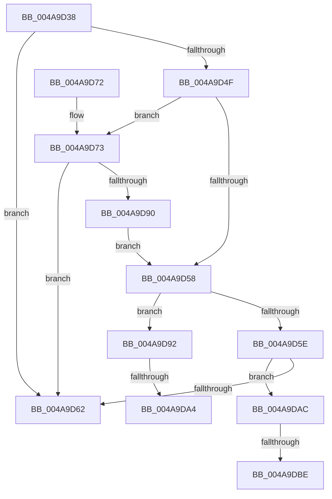

# HalpReadGenericErrorInfo

- RVA: `0x004A9D38`–`0x004A9DC6` (길이 `142` bytes)
- VA: `0x00000001404A9D38`
- 실행 섹션: `.text`
- PDB 이름 있음: `예`; PDB Function 태그: `예`
- unwind 정보 RVA: `0x000B7B98`
- 디코드: `42`개 명령, `142/142` bytes 표시
- 미해석 바이트: `0` (있으면 어셈블리에 `.byte`로 보존)

> 이 문서는 커널 이미지의 기계어와 PDB 기호를 분석해 생성했습니다. 4번과 5번은 함수 원형과 자료형을 바이너리 사용 방식에서 추정한 C 해석이며 원본 소스 복구 결과는 아닙니다.

## 1. Dependencies

- 직접 호출 지점: **3**; 고유 호출 대상: **2**
- 직접 호출자로 확인된 함수: **1**
- RIP 상대 이미지 참조: **0**

### Outgoing calls
- `0x004A9D7F` → [MmMapIoSpaceEx](../32/MmMapIoSpaceEx_function_00327830.md) (function, `0x00327830`)
- `0x004A9D95` → [HalpExtractGenericErrorData](../55/HalpExtractGenericErrorData_function_00555B34.md) (function, `0x00555B34`)
- `0x004A9DAF` → [HalpExtractGenericErrorData](../55/HalpExtractGenericErrorData_function_00555B34.md) (function, `0x00555B34`)

### Direct callers
- [HalpCheckAndReportGhes](HalpCheckAndReportGhes_function_004A9CDC.md) at `0x004A9CEB`

### Static image references
- 디코드된 RIP-relative 메모리 참조가 없습니다.

## 2. Other-region calls and transfers

- 다른 실행 섹션으로 향하는 call: **0**
- call이 아닌 외부 분기/꼬리 이동: **4**
  - `0x004A9D9E` → [sub_006FA020](../6F/Unknown_function_006FA020.md) (`tail-transfer`)
  - `0x004A9DA7` → [sub_006FA020 + 0x3](../6F/Unknown_function_006FA020.md) (`tail-transfer`)
  - `0x004A9DB8` → [sub_006FA020](../6F/Unknown_function_006FA020.md) (`tail-transfer`)
  - `0x004A9DC1` → [sub_006FA020 + 0x3](../6F/Unknown_function_006FA020.md) (`tail-transfer`)

## 3. Assembly (complete function range)

```asm
004A9D38  48 89 5C 24 08                  mov qword ptr [rsp + 8], rbx
004A9D3D  57                              push rdi
004A9D3E  48 83 EC 20                     sub rsp, 0x20
004A9D42  48 8B F9                        mov rdi, rcx
004A9D45  48 8B 49 28                     mov rcx, qword ptr [rcx + 0x28]
004A9D49  48 83 39 FF                     cmp qword ptr [rcx], -1
004A9D4D  74 13                           je 0x1404a9d62
004A9D4F  48 8B 5F 38                     mov rbx, qword ptr [rdi + 0x38]
004A9D53  48 85 DB                        test rbx, rbx
004A9D56  74 1B                           je 0x1404a9d73
004A9D58  8B 03                           mov eax, dword ptr [rbx]
004A9D5A  A8 02                           test al, 2
004A9D5C  75 34                           jne 0x1404a9d92
004A9D5E  A8 01                           test al, 1
004A9D60  75 4A                           jne 0x1404a9dac
004A9D62  B8 25 02 00 C0                  mov eax, 0xc0000225
004A9D67  48 8B 5C 24 30                  mov rbx, qword ptr [rsp + 0x30]
004A9D6C  48 83 C4 20                     add rsp, 0x20
004A9D70  5F                              pop rdi
004A9D71  C3                              ret
004A9D72  CC                              int3
004A9D73  8B 57 30                        mov edx, dword ptr [rdi + 0x30]
004A9D76  41 B8 04 02 00 00               mov r8d, 0x204
004A9D7C  48 8B 09                        mov rcx, qword ptr [rcx]
004A9D7F  E8 AC DA E7 FF                  call 0x140327830
004A9D84  48 89 47 38                     mov qword ptr [rdi + 0x38], rax
004A9D88  48 8B D8                        mov rbx, rax
004A9D8B  48 85 C0                        test rax, rax
004A9D8E  74 D2                           je 0x1404a9d62
004A9D90  EB C6                           jmp 0x1404a9d58
004A9D92  48 8B CF                        mov rcx, rdi
004A9D95  E8 9A BD 0A 00                  call 0x140555b34
004A9D9A  83 7F 60 0C                     cmp dword ptr [rdi + 0x60], 0xc
004A9D9E  0F 84 7C 02 25 00               je 0x1406fa020
004A9DA4  83 23 FD                        and dword ptr [rbx], 0xfffffffd
004A9DA7  E9 77 02 25 00                  jmp 0x1406fa023
004A9DAC  48 8B CF                        mov rcx, rdi
004A9DAF  E8 80 BD 0A 00                  call 0x140555b34
004A9DB4  83 7F 60 0C                     cmp dword ptr [rdi + 0x60], 0xc
004A9DB8  0F 84 62 02 25 00               je 0x1406fa020
004A9DBE  83 23 FE                        and dword ptr [rbx], 0xfffffffe
004A9DC1  E9 5D 02 25 00                  jmp 0x1406fa023
```

## 4. C-style interpretation (structured pseudocode)

```c
__int64 __fastcall HalpReadGenericErrorInfo(__int64 a1)
{
    __int64 result;
    __int64 v_rsp;
    unsigned __int64 v_stack_p8;

    v_stack_p8 = v_rbx;
    v_rsp = (v_rsp) - (32);
    if ((*(unsigned __int64 *)(*(unsigned __int64 *)(a1 + 40))) == -1) goto loc_004A9D62;
    if (*(unsigned __int64 *)(a1 + 56) == 0) goto loc_004A9D73;
loc_004A9D58:
    if ((((unsigned __int8)((unsigned int)(*(unsigned int *)(*(unsigned __int64 *)(a1 + 56))))) & (2)) != 0) goto loc_004A9D92;
    if ((((unsigned __int8)((unsigned int)(*(unsigned int *)(*(unsigned __int64 *)(a1 + 56))))) & (1)) != 0) goto loc_004A9DAC;
loc_004A9D62:
    v_rsp = (v_rsp) + (32);
    return (unsigned int)(0xC0000225ULL);
loc_004A9D73:
    result = MmMapIoSpaceEx(*(unsigned __int64 *)(*(unsigned __int64 *)(a1 + 40)), (unsigned int)(*(unsigned int *)(a1 + 48)), 516, a4);
    *(unsigned __int64 *)(a1 + 56) = result;
    if (result == 0) goto loc_004A9D62;
    goto loc_004A9D58;
loc_004A9D92:
    result = HalpExtractGenericErrorData(a1, (unsigned int)(*(unsigned int *)(a1 + 48)), 516, a4);
loc_004A9DAC:
    result = HalpExtractGenericErrorData(a1, (unsigned int)(*(unsigned int *)(a1 + 48)), 516, a4);
}
```

## 5. (Beta) C Style

```c
int64_t HalpReadGenericErrorInfo(void *Arg1)
{
    uint8_t *arg1 = (uint8_t *)Arg1;

    int64_t result;
    int64_t local_rsp;
    uint64_t v_stack_p8;

    v_stack_p8 = local_rbx;
    local_rsp = (local_rsp) - (32);
    if ((*(uint64_t *)(*(uint64_t *)(arg1 + 0x28))) == -1) goto loc_004A9D62;
    if (*(uint64_t *)(arg1 + 0x38) == 0) goto loc_004A9D73;
loc_004A9D58:
    if ((((uint8_t)((uint32_t)(*(uint32_t *)(*(uint64_t *)(arg1 + 0x38))))) & (2)) != 0) goto loc_004A9D92;
    if ((((uint8_t)((uint32_t)(*(uint32_t *)(*(uint64_t *)(arg1 + 0x38))))) & (1)) != 0) goto loc_004A9DAC;
loc_004A9D62:
    local_rsp = (local_rsp) + (32);
    return (uint32_t)(0xC0000225ULL);
loc_004A9D73:
    result = MmMapIoSpaceEx(*(uint64_t *)(*(uint64_t *)(arg1 + 0x28)), (uint32_t)(*(uint32_t *)(arg1 + 0x30)), 516, a4);
    *(uint64_t *)(arg1 + 0x38) = result;
    if (result == 0) goto loc_004A9D62;
    goto loc_004A9D58;
loc_004A9D92:
    result = HalpExtractGenericErrorData(Arg1, (uint32_t)(*(uint32_t *)(arg1 + 0x30)), 516, a4);
loc_004A9DAC:
    result = HalpExtractGenericErrorData(Arg1, (uint32_t)(*(uint32_t *)(arg1 + 0x30)), 516, a4);
}
```

### 관측된 메모리 오프셋

구조체 형식이 확인되지 않은 접근은 인자 기준의 오프셋으로만 기록했습니다.

| 기준 인자 | 오프셋 표현 | 폭 (bit) | 접근 |
|---|---:|---:|---|
| `Arg1` | `+ 0x28` | `64` | `R` |
| `Arg1` | `+ 0x30` | `32` | `R` |
| `Arg1` | `+ 0x38` | `64` | `R` |
| `Arg1` | `+ 0x38` | `64` | `W` |
| `Arg1` | `+ 0x60` | `32` | `R` |

## 6. Execution-region graph

[열기: 2D/3D 그래프와 함수 탐색 컨트롤 패널](../../../control-panel.html?section=text&rva=0x004A9D38&view=graph)

- 2D 그래프는 위에서 아래로 흐르고, 3D 그래프는 빈 공간을 드래그해 회전합니다. Shift+드래그는 이동, 휠은 확대·축소, 함수 노드 선택은 대상 보고서 이동입니다.

### Static fallback


