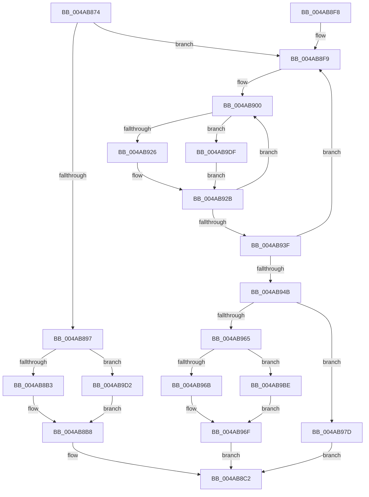

# HalpTimerCalibratePerformanceCounter

- RVA: `0x004AB874`–`0x004AB9EC` (길이 `376` bytes)
- VA: `0x00000001404AB874`
- 실행 섹션: `.text`
- PDB 이름 있음: `예`; PDB Function 태그: `아니요`
- unwind 정보 RVA: `0x0006F4DC`
- 디코드: `93`개 명령, `376/376` bytes 표시
- 미해석 바이트: `0` (있으면 어셈블리에 `.byte`로 보존)

> 이 문서는 커널 이미지의 기계어와 PDB 기호를 분석해 생성했습니다. 4번과 5번은 함수 원형과 자료형을 바이너리 사용 방식에서 추정한 C 해석이며 원본 소스 복구 결과는 아닙니다.

## 1. Dependencies

- 직접 호출 지점: **7**; 고유 호출 대상: **5**
- 직접 호출자로 확인된 함수: **4**
- RIP 상대 이미지 참조: **2**

### Outgoing calls
- `0x004AB897` → [HalpTimerGetInternalData](../20/HalpTimerGetInternalData_function_00209500.md) (function, `0x00209500`)
- `0x004AB8B3` → [HalpHvCounterQueryCounter](../37/HalpHvCounterQueryCounter_function_00378F50.md) (function, `0x00378F50`)
- `0x004AB8DC` → [HalpTimerPropagateQpcBiasUpdate](HalpTimerPropagateQpcBiasUpdate_function_004AB9F4.md) (function, `0x004AB9F4`)
- `0x004AB90A` → [HalpTimerGetInternalData](../20/HalpTimerGetInternalData_function_00209500.md) (function, `0x00209500`)
- `0x004AB926` → [HalpHpetQueryCounter](../37/HalpHpetQueryCounter_function_00379660.md) (function, `0x00379660`)
- `0x004AB9D5` → [guard_dispatch_icall](../6B/guard_dispatch_icall_function_006BAAD0.md) (function, `0x006BAAD0`)
- `0x004AB9E2` → [guard_dispatch_icall](../6B/guard_dispatch_icall_function_006BAAD0.md) (function, `0x006BAAD0`)

### Direct callers
- [HalpTimerRestorePerformanceCounter](HalpTimerRestorePerformanceCounter_function_004AB768.md) at `0x004AB84A`
- [HalCalibratePerformanceCounter](../53/HalCalibratePerformanceCounter_function_0053C010.md) at `0x0053C0B2`
- [HalCalibratePerformanceCounter](../53/HalCalibratePerformanceCounter_function_0053C010.md) at `0x0053C0DB`
- [HalpTimerInitialize](../53/HalpTimerInitialize_function_0053CF38.md) at `0x0053CFB5`
- [HalpTimerPerformanceCounterPowerChange](../54/HalpTimerPerformanceCounterPowerChange_function_00549738.md) at `0x00549927`
- [HalpTimerPerformanceCounterPowerChange](../54/HalpTimerPerformanceCounterPowerChange_function_00549738.md) at `0x00549D6F`

### Static image references
- `0x004AB8A0` → RVA `0x00378F50` (`HalpHvCounterQueryCounter`; read)
- `0x004AB913` → RVA `0x00379660` (`HalpHpetQueryCounter`; read)

## 2. Other-region calls and transfers

- 다른 실행 섹션으로 향하는 call: **0**
- 별도 외부 분기/꼬리 이동을 확인하지 못했습니다.

## 3. Assembly (complete function range)

```asm
004AB874  48 89 5C 24 08                  mov qword ptr [rsp + 8], rbx
004AB879  48 89 6C 24 10                  mov qword ptr [rsp + 0x10], rbp
004AB87E  48 89 74 24 18                  mov qword ptr [rsp + 0x18], rsi
004AB883  57                              push rdi
004AB884  48 83 EC 20                     sub rsp, 0x20
004AB888  83 B9 DC 00 00 00 40            cmp dword ptr [rcx + 0xdc], 0x40
004AB88F  48 8B EA                        mov rbp, rdx
004AB892  48 8B F9                        mov rdi, rcx
004AB895  75 62                           jne 0x1404ab8f9
004AB897  E8 64 DC D5 FF                  call 0x140209500
004AB89C  48 8B 51 70                     mov rdx, qword ptr [rcx + 0x70]
004AB8A0  48 8D 0D A9 D6 EC FF            lea rcx, [rip - 0x132957]
004AB8A7  48 3B D1                        cmp rdx, rcx
004AB8AA  48 8B C8                        mov rcx, rax
004AB8AD  0F 85 1F 01 00 00               jne 0x1404ab9d2
004AB8B3  E8 98 D6 EC FF                  call 0x140378f50
004AB8B8  48 8B B7 D0 00 00 00            mov rsi, qword ptr [rdi + 0xd0]
004AB8BF  48 8B D0                        mov rdx, rax
004AB8C2  48 8B 87 D0 00 00 00            mov rax, qword ptr [rdi + 0xd0]
004AB8C9  48 8B CF                        mov rcx, rdi
004AB8CC  48 2B C6                        sub rax, rsi
004AB8CF  48 2B C2                        sub rax, rdx
004AB8D2  48 03 C5                        add rax, rbp
004AB8D5  48 89 87 D0 00 00 00            mov qword ptr [rdi + 0xd0], rax
004AB8DC  E8 13 01 00 00                  call 0x1404ab9f4
004AB8E1  48 8B 5C 24 30                  mov rbx, qword ptr [rsp + 0x30]
004AB8E6  33 C0                           xor eax, eax
004AB8E8  48 8B 6C 24 38                  mov rbp, qword ptr [rsp + 0x38]
004AB8ED  48 8B 74 24 40                  mov rsi, qword ptr [rsp + 0x40]
004AB8F2  48 83 C4 20                     add rsp, 0x20
004AB8F6  5F                              pop rdi
004AB8F7  C3                              ret
004AB8F8  CC                              int3
004AB8F9  48 8B B7 D0 00 00 00            mov rsi, qword ptr [rdi + 0xd0]
004AB900  48 8B 9F C8 00 00 00            mov rbx, qword ptr [rdi + 0xc8]
004AB907  48 8B CF                        mov rcx, rdi
004AB90A  E8 F1 DB D5 FF                  call 0x140209500
004AB90F  48 8B 57 70                     mov rdx, qword ptr [rdi + 0x70]
004AB913  48 8D 0D 46 DD EC FF            lea rcx, [rip - 0x1322ba]
004AB91A  48 3B D1                        cmp rdx, rcx
004AB91D  48 8B C8                        mov rcx, rax
004AB920  0F 85 B9 00 00 00               jne 0x1404ab9df
004AB926  E8 35 DD EC FF                  call 0x140379660
004AB92B  4C 8B D8                        mov r11, rax
004AB92E  F0 83 0C 24 00                  lock or dword ptr [rsp], 0
004AB933  48 8B 87 C8 00 00 00            mov rax, qword ptr [rdi + 0xc8]
004AB93A  48 3B D8                        cmp rbx, rax
004AB93D  75 C1                           jne 0x1404ab900
004AB93F  48 8B 8F D0 00 00 00            mov rcx, qword ptr [rdi + 0xd0]
004AB946  48 3B F1                        cmp rsi, rcx
004AB949  75 AE                           jne 0x1404ab8f9
004AB94B  44 8B 87 DC 00 00 00            mov r8d, dword ptr [rdi + 0xdc]
004AB952  41 8D 48 FF                     lea ecx, [r8 - 1]
004AB956  0F B6 D1                        movzx edx, cl
004AB959  49 8B CB                        mov rcx, r11
004AB95C  48 33 CB                        xor rcx, rbx
004AB95F  48 0F A3 D1                     bt rcx, rdx
004AB963  72 18                           jb 0x1404ab97d
004AB965  41 83 F8 40                     cmp r8d, 0x40
004AB969  75 53                           jne 0x1404ab9be
004AB96B  48 83 CA FF                     or rdx, 0xffffffffffffffff
004AB96F  48 F7 D2                        not rdx
004AB972  48 23 D3                        and rdx, rbx
004AB975  49 0B D3                        or rdx, r11
004AB978  E9 45 FF FF FF                  jmp 0x1404ab8c2
004AB97D  49 83 CA FF                     or r10, 0xffffffffffffffff
004AB981  41 8B C8                        mov ecx, r8d
004AB984  41 B9 01 00 00 00               mov r9d, 1
004AB98A  49 D3 E1                        shl r9, cl
004AB98D  41 83 F8 40                     cmp r8d, 0x40
004AB991  49 8D 49 FF                     lea rcx, [r9 - 1]
004AB995  4C 0F 45 D1                     cmovne r10, rcx
004AB999  4C 23 D3                        and r10, rbx
004AB99C  49 8B CA                        mov rcx, r10
004AB99F  48 33 CB                        xor rcx, rbx
004AB9A2  49 0B CB                        or rcx, r11
004AB9A5  4D 3B DA                        cmp r11, r10
004AB9A8  4A 8D 14 09                     lea rdx, [rcx + r9]
004AB9AC  48 0F 43 D1                     cmovae rdx, rcx
004AB9B0  F0 48 0F B1 97 C8 00 00 00      lock cmpxchg qword ptr [rdi + 0xc8], rdx
004AB9B9  E9 04 FF FF FF                  jmp 0x1404ab8c2
004AB9BE  41 B9 01 00 00 00               mov r9d, 1
004AB9C4  41 8B C8                        mov ecx, r8d
004AB9C7  41 8B D1                        mov edx, r9d
004AB9CA  48 D3 E2                        shl rdx, cl
004AB9CD  49 2B D1                        sub rdx, r9
004AB9D0  EB 9D                           jmp 0x1404ab96f
004AB9D2  48 8B C2                        mov rax, rdx
004AB9D5  E8 F6 F0 20 00                  call 0x1406baad0
004AB9DA  E9 D9 FE FF FF                  jmp 0x1404ab8b8
004AB9DF  48 8B C2                        mov rax, rdx
004AB9E2  E8 E9 F0 20 00                  call 0x1406baad0
004AB9E7  E9 3F FF FF FF                  jmp 0x1404ab92b
```

## 4. C-style interpretation (structured pseudocode)

```c
__int64 __fastcall HalpTimerCalibratePerformanceCounter(__int64 a1, __int64 a2)
{
    __int64 result;
    __int64 v_r10;
    __int64 v_rsp;
    unsigned int v_stack_p0;
    unsigned __int64 v_stack_p10;
    unsigned __int64 v_stack_p18;
    unsigned __int64 v_stack_p8;

    v_stack_p8 = v_rbx;
    v_stack_p10 = v_rbp;
    v_stack_p18 = v_rsi;
    v_rsp = (v_rsp) - (32);
    if ((*(unsigned int *)(a1 + 220)) != 64) goto loc_004AB8F9;
    result = HalpTimerGetInternalData(a1, a2, a3, a4);
    if ((*(unsigned __int64 *)(a1 + 112)) != (v_rip - 1255767)) goto loc_004AB9D2;
    result = HalpHvCounterQueryCounter(result, *(unsigned __int64 *)(a1 + 112), a3, a4);
loc_004AB8B8:
loc_004AB8C2:
    result = (*(unsigned __int64 *)(a1 + 208)) - (*(unsigned __int64 *)(a1 + 208));
    result = (result) - (result);
    result = (result) + (a2);
    *(unsigned __int64 *)(a1 + 208) = result;
    result = HalpTimerPropagateQpcBiasUpdate(a1, result, a3, a4);
    result = 0;
    v_rsp = (v_rsp) + (32);
    return result;
loc_004AB8F9:
loc_004AB900:
    result = HalpTimerGetInternalData(a1, result, a3, a4);
    if ((*(unsigned __int64 *)(a1 + 112)) != (v_rip - 1254074)) goto loc_004AB9DF;
    result = HalpHpetQueryCounter(result, *(unsigned __int64 *)(a1 + 112), a3, a4);
loc_004AB92B:
    if ((*(unsigned __int64 *)(a1 + 200)) != (*(unsigned __int64 *)(a1 + 200))) goto loc_004AB900;
    if ((*(unsigned __int64 *)(a1 + 208)) != (*(unsigned __int64 *)(a1 + 208))) goto loc_004AB8F9;
    a1 = (result) ^ (*(unsigned __int64 *)(a1 + 200));
    if (condition_is_below) goto loc_004AB97D;
    if (((unsigned int)((unsigned int)(*(unsigned int *)(a1 + 220)))) != 64) goto loc_004AB9BE;
    a2 = ((unsigned __int8)((unsigned int)(*(unsigned int *)(a1 + 220)) - 1)) | (-1);
loc_004AB96F:
    a2 = ~(a2);
    a2 = (a2) & (*(unsigned __int64 *)(a1 + 200));
    a2 = (a2) | (result);
    goto loc_004AB8C2;
loc_004AB97D:
    v_r10 = (v_r10) | (-1);
    a4 = (1) << ((unsigned __int8)((unsigned int)((unsigned int)((unsigned int)(*(unsigned int *)(a1 + 220))))));
    if (((unsigned int)((unsigned int)(*(unsigned int *)(a1 + 220)))) != 64) { v_r10 = a4 - 1; }
    v_r10 = (v_r10) & (*(unsigned __int64 *)(a1 + 200));
    a1 = (v_r10) ^ (*(unsigned __int64 *)(a1 + 200));
    a1 = (a1) | (result);
    a2 = a1 + a4 * 1;
    if (result >= v_r10) { a2 = a1; }
    goto loc_004AB8C2;
loc_004AB9BE:
    a2 = (1) << ((unsigned __int8)((unsigned int)((unsigned int)((unsigned int)(*(unsigned int *)(a1 + 220))))));
    a2 = (a2) - (1);
    goto loc_004AB96F;
loc_004AB9D2:
    result = guard_dispatch_icall((unsigned int)((unsigned int)((unsigned int)(*(unsigned int *)(a1 + 220)))), a2, (unsigned int)(*(unsigned int *)(a1 + 220)), 1);
    goto loc_004AB8B8;
loc_004AB9DF:
    result = guard_dispatch_icall((unsigned int)((unsigned int)((unsigned int)(*(unsigned int *)(a1 + 220)))), a2, (unsigned int)(*(unsigned int *)(a1 + 220)), 1);
    goto loc_004AB92B;
}
```

## 5. (Beta) C Style

```c
int64_t HalpTimerCalibratePerformanceCounter(void *Arg1, int64_t Arg2)
{
    uint8_t *arg1 = (uint8_t *)Arg1;

    int64_t result;
    int64_t local_r10;
    int64_t local_rsp;
    uint32_t v_stack_p0;
    uint64_t v_stack_p10;
    uint64_t v_stack_p18;
    uint64_t v_stack_p8;

    v_stack_p8 = local_rbx;
    v_stack_p10 = local_rbp;
    v_stack_p18 = local_rsi;
    local_rsp = (local_rsp) - (32);
    if ((*(uint32_t *)(arg1 + 0xDC)) != 64) goto loc_004AB8F9;
    result = HalpTimerGetInternalData(Arg1, Arg2, a3, a4);
    if ((*(uint64_t *)(arg1 + 0x70)) != (v_rip - 1255767)) goto loc_004AB9D2;
    result = HalpHvCounterQueryCounter(result, *(uint64_t *)(arg1 + 0x70), a3, a4);
loc_004AB8B8:
loc_004AB8C2:
    result = (*(uint64_t *)(arg1 + 0xD0)) - (*(uint64_t *)(arg1 + 0xD0));
    result = (result) - (result);
    result = (result) + (Arg2);
    *(uint64_t *)(arg1 + 0xD0) = result;
    result = HalpTimerPropagateQpcBiasUpdate(Arg1, result, a3, a4);
    result = 0;
    local_rsp = (local_rsp) + (32);
    return result;
loc_004AB8F9:
loc_004AB900:
    result = HalpTimerGetInternalData(Arg1, result, a3, a4);
    if ((*(uint64_t *)(arg1 + 0x70)) != (v_rip - 1254074)) goto loc_004AB9DF;
    result = HalpHpetQueryCounter(result, *(uint64_t *)(arg1 + 0x70), a3, a4);
loc_004AB92B:
    if ((*(uint64_t *)(arg1 + 0xC8)) != (*(uint64_t *)(arg1 + 0xC8))) goto loc_004AB900;
    if ((*(uint64_t *)(arg1 + 0xD0)) != (*(uint64_t *)(arg1 + 0xD0))) goto loc_004AB8F9;
    Arg1 = (result) ^ (*(uint64_t *)(arg1 + 0xC8));
    if (condition_is_below) goto loc_004AB97D;
    if (((uint32_t)((uint32_t)(*(uint32_t *)(arg1 + 0xDC)))) != 64) goto loc_004AB9BE;
    Arg2 = ((uint8_t)((uint32_t)(*(uint32_t *)(arg1 + 0xDC)) - 1)) | (-1);
loc_004AB96F:
    Arg2 = ~(Arg2);
    Arg2 = (Arg2) & (*(uint64_t *)(arg1 + 0xC8));
    Arg2 = (Arg2) | (result);
    goto loc_004AB8C2;
loc_004AB97D:
    local_r10 = (local_r10) | (-1);
    a4 = (1) << ((uint8_t)((uint32_t)((uint32_t)((uint32_t)(*(uint32_t *)(arg1 + 0xDC))))));
    if (((uint32_t)((uint32_t)(*(uint32_t *)(arg1 + 0xDC)))) != 64) { local_r10 = a4 - 1; }
    local_r10 = (local_r10) & (*(uint64_t *)(arg1 + 0xC8));
    Arg1 = (local_r10) ^ (*(uint64_t *)(arg1 + 0xC8));
    Arg1 = (Arg1) | (result);
    Arg2 = Arg1 + a4 * 1;
    if (result >= local_r10) { Arg2 = Arg1; }
    goto loc_004AB8C2;
loc_004AB9BE:
    Arg2 = (1) << ((uint8_t)((uint32_t)((uint32_t)((uint32_t)(*(uint32_t *)(arg1 + 0xDC))))));
    Arg2 = (Arg2) - (1);
    goto loc_004AB96F;
loc_004AB9D2:
    result = guard_dispatch_icall((uint32_t)((uint32_t)((uint32_t)(*(uint32_t *)(arg1 + 0xDC)))), Arg2, (uint32_t)(*(uint32_t *)(arg1 + 0xDC)), 1);
    goto loc_004AB8B8;
loc_004AB9DF:
    result = guard_dispatch_icall((uint32_t)((uint32_t)((uint32_t)(*(uint32_t *)(arg1 + 0xDC)))), Arg2, (uint32_t)(*(uint32_t *)(arg1 + 0xDC)), 1);
    goto loc_004AB92B;
}
```

### 관측된 메모리 오프셋

구조체 형식이 확인되지 않은 접근은 인자 기준의 오프셋으로만 기록했습니다.

| 기준 인자 | 오프셋 표현 | 폭 (bit) | 접근 |
|---|---:|---:|---|
| `Arg1` | `+ 0x70` | `64` | `R` |
| `Arg1` | `+ 0xC8` | `64` | `R` |
| `Arg1` | `+ 0xD0` | `64` | `R` |
| `Arg1` | `+ 0xD0` | `64` | `W` |
| `Arg1` | `+ 0xDC` | `32` | `R` |

## 6. Execution-region graph

[열기: 2D/3D 그래프와 함수 탐색 컨트롤 패널](../../../control-panel.html?section=text&rva=0x004AB874&view=graph)

- 2D 그래프는 위에서 아래로 흐르고, 3D 그래프는 빈 공간을 드래그해 회전합니다. Shift+드래그는 이동, 휠은 확대·축소, 함수 노드 선택은 대상 보고서 이동입니다.

### Static fallback


