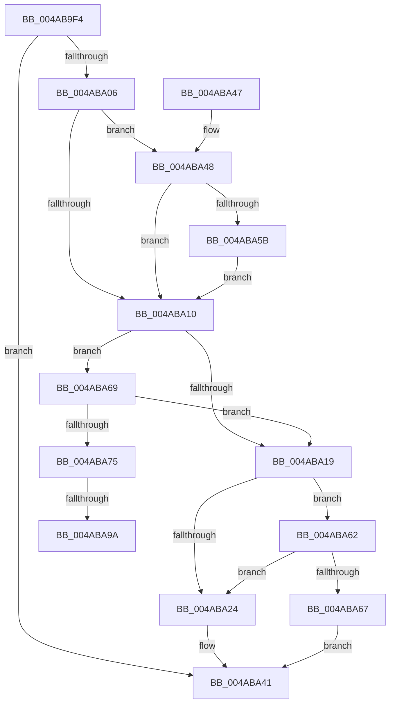

# HalpTimerPropagateQpcBiasUpdate

- RVA: `0x004AB9F4`–`0x004ABAA2` (길이 `174` bytes)
- VA: `0x00000001404AB9F4`
- 실행 섹션: `.text`
- PDB 이름 있음: `예`; PDB Function 태그: `예`
- unwind 정보 RVA: `0x000B8060`
- 디코드: `43`개 명령, `174/174` bytes 표시
- 미해석 바이트: `0` (있으면 어셈블리에 `.byte`로 보존)

> 이 문서는 커널 이미지의 기계어와 PDB 기호를 분석해 생성했습니다. 4번과 5번은 함수 원형과 자료형을 바이너리 사용 방식에서 추정한 C 해석이며 원본 소스 복구 결과는 아닙니다.

## 1. Dependencies

- 직접 호출 지점: **2**; 고유 호출 대상: **2**
- 직접 호출자로 확인된 함수: **3**
- RIP 상대 이미지 참조: **4**

### Outgoing calls
- `0x004ABA5B` → [guard_dispatch_icall](../6B/guard_dispatch_icall_function_006BAAD0.md) (function, `0x006BAAD0`)
- `0x004ABA8C` → [HalpTimerScaleCounter](../37/HalpTimerScaleCounter_function_0037B354.md) (function, `0x0037B354`)

### Direct callers
- [HalpTimerCalibratePerformanceCounter](HalpTimerCalibratePerformanceCounter_function_004AB874.md) at `0x004AB8DC`
- [HalpTimerInitSystem](../53/HalpTimerInitSystem_function_0053CB70.md) at `0x0053CECA`
- [HalpTimerSelectRoles](../53/HalpTimerSelectRoles_function_0053D4B0.md) at `0x0053D577`

### Static image references
- `0x004AB9FA` → RVA `0x00FC3FD0` (`.data`; read)
- `0x004ABA06` → RVA `0x00FC1DF0` (`.data`; read)
- `0x004ABA33` → RVA `0x00FC5008` (`ALMOSTRO`; read)
- `0x004ABA4F` → RVA `0x00FC1DE8` (`.data`; read)

## 2. Other-region calls and transfers

- 다른 실행 섹션으로 향하는 call: **0**
- call이 아닌 외부 분기/꼬리 이동: **2**
  - `0x004ABA94` → [sub_006FA5DC](../6F/Unknown_function_006FA5DC.md) (`tail-transfer`)
  - `0x004ABA9D` → [sub_006FA5DC](../6F/Unknown_function_006FA5DC.md) (`tail-transfer`)

## 3. Assembly (complete function range)

```asm
004AB9F4  40 53                           push rbx
004AB9F6  48 83 EC 20                     sub rsp, 0x20
004AB9FA  48 3B 0D CF 85 B1 00            cmp rcx, qword ptr [rip + 0xb185cf]
004ABA01  48 8B D9                        mov rbx, rcx
004ABA04  75 3B                           jne 0x1404aba41
004ABA06  48 83 3D E2 63 B1 00 00         cmp qword ptr [rip + 0xb163e2], 0
004ABA0E  74 38                           je 0x1404aba48
004ABA10  83 BB E4 00 00 00 05            cmp dword ptr [rbx + 0xe4], 5
004ABA17  74 50                           je 0x1404aba69
004ABA19  8B 83 E4 00 00 00               mov eax, dword ptr [rbx + 0xe4]
004ABA1F  83 F8 08                        cmp eax, 8
004ABA22  75 3E                           jne 0x1404aba62
004ABA24  48 8B 83 D0 00 00 00            mov rax, qword ptr [rbx + 0xd0]
004ABA2B  48 89 44 24 30                  mov qword ptr [rsp + 0x30], rax
004ABA30  48 8B C8                        mov rcx, rax
004ABA33  48 8B 05 CE 95 B1 00            mov rax, qword ptr [rip + 0xb195ce]
004ABA3A  48 89 88 B8 03 00 00            mov qword ptr [rax + 0x3b8], rcx
004ABA41  48 83 C4 20                     add rsp, 0x20
004ABA45  5B                              pop rbx
004ABA46  C3                              ret
004ABA47  CC                              int3
004ABA48  48 8B 89 D0 00 00 00            mov rcx, qword ptr [rcx + 0xd0]
004ABA4F  48 8B 05 92 63 B1 00            mov rax, qword ptr [rip + 0xb16392]
004ABA56  48 85 C0                        test rax, rax
004ABA59  74 B5                           je 0x1404aba10
004ABA5B  E8 70 F0 20 00                  call 0x1406baad0
004ABA60  EB AE                           jmp 0x1404aba10
004ABA62  83 F8 0B                        cmp eax, 0xb
004ABA65  74 BD                           je 0x1404aba24
004ABA67  EB D8                           jmp 0x1404aba41
004ABA69  48 8B 93 C0 00 00 00            mov rdx, qword ptr [rbx + 0xc0]
004ABA70  48 85 D2                        test rdx, rdx
004ABA73  74 A4                           je 0x1404aba19
004ABA75  4C 8B 9B D0 00 00 00            mov r11, qword ptr [rbx + 0xd0]
004ABA7C  41 B8 80 96 98 00               mov r8d, 0x989680
004ABA82  49 8B CB                        mov rcx, r11
004ABA85  48 F7 D9                        neg rcx
004ABA88  49 0F 48 CB                     cmovs rcx, r11
004ABA8C  E8 C3 F8 EC FF                  call 0x14037b354
004ABA91  4D 85 DB                        test r11, r11
004ABA94  0F 89 42 EB 24 00               jns 0x1406fa5dc
004ABA9A  48 F7 D8                        neg rax
004ABA9D  E9 3A EB 24 00                  jmp 0x1406fa5dc
```

## 4. C-style interpretation (structured pseudocode)

```c
__int64 __fastcall HalpTimerPropagateQpcBiasUpdate(__int64 a1)
{
    __int64 result;
    __int64 v_rsp;
    unsigned __int64 v_stack_p8;

    v_rsp = (v_rsp) - (32);
    if (a1 != (*(unsigned __int64 *)(v_rip + 11634127))) goto loc_004ABA41;
    if ((*(unsigned __int64 *)(v_rip + 11625442)) == 0) goto loc_004ABA48;
loc_004ABA10:
    if ((*(unsigned int *)(a1 + 228)) == 5) goto loc_004ABA69;
loc_004ABA19:
    if (((unsigned int)((unsigned int)(*(unsigned int *)(a1 + 228)))) != 8) goto loc_004ABA62;
loc_004ABA24:
    v_stack_p8 = *(unsigned __int64 *)(a1 + 208);
    *(unsigned __int64 *)(*(unsigned __int64 *)(v_rip + 11638222) + 952) = *(unsigned __int64 *)(a1 + 208);
loc_004ABA41:
    v_rsp = (v_rsp) + (32);
    return *(unsigned __int64 *)(v_rip + 11638222);
loc_004ABA48:
    if (*(unsigned __int64 *)(v_rip + 11625362) == 0) goto loc_004ABA10;
    result = guard_dispatch_icall(*(unsigned __int64 *)(*(unsigned __int64 *)(a1 + 208) + 208), a2, a3, a4);
    goto loc_004ABA10;
loc_004ABA62:
    if (((unsigned int)(result)) == 11) goto loc_004ABA24;
    goto loc_004ABA41;
loc_004ABA69:
    if (*(unsigned __int64 *)(a1 + 192) == 0) goto loc_004ABA19;
    a1 = -(*(unsigned __int64 *)(a1 + 208));
    if (sign_flag) { a1 = *(unsigned __int64 *)(a1 + 208); }
    result = HalpTimerScaleCounter(a1, *(unsigned __int64 *)(a1 + 192), (unsigned int)(0x989680ULL), a4);
    result = -(result);
}
```

## 5. (Beta) C Style

```c
int64_t HalpTimerPropagateQpcBiasUpdate(int64_t Arg1)
{
    int64_t result;
    int64_t local_rsp;
    uint64_t v_stack_p8;

    local_rsp = (local_rsp) - (32);
    if (Arg1 != (*(uint64_t *)(v_rip + 0xB185CF))) goto loc_004ABA41;
    if ((*(uint64_t *)(v_rip + 0xB163E2)) == 0) goto loc_004ABA48;
loc_004ABA10:
    if ((*(uint32_t *)(Arg1 + 0xE4)) == 5) goto loc_004ABA69;
loc_004ABA19:
    if (((uint32_t)((uint32_t)(*(uint32_t *)(Arg1 + 0xE4)))) != 8) goto loc_004ABA62;
loc_004ABA24:
    v_stack_p8 = *(uint64_t *)(Arg1 + 0xD0);
    *(uint64_t *)(*(uint64_t *)(v_rip + 0xB195CE) + 0x3B8) = *(uint64_t *)(Arg1 + 0xD0);
loc_004ABA41:
    local_rsp = (local_rsp) + (32);
    return *(uint64_t *)(v_rip + 0xB195CE);
loc_004ABA48:
    if (*(uint64_t *)(v_rip + 0xB16392) == 0) goto loc_004ABA10;
    result = guard_dispatch_icall(*(uint64_t *)(*(uint64_t *)(Arg1 + 0xD0) + 0xD0), a2, a3, a4);
    goto loc_004ABA10;
loc_004ABA62:
    if (((uint32_t)(result)) == 11) goto loc_004ABA24;
    goto loc_004ABA41;
loc_004ABA69:
    if (*(uint64_t *)(Arg1 + 0xC0) == 0) goto loc_004ABA19;
    Arg1 = -(*(uint64_t *)(Arg1 + 0xD0));
    if (sign_flag) { Arg1 = *(uint64_t *)(Arg1 + 0xD0); }
    result = HalpTimerScaleCounter(Arg1, *(uint64_t *)(Arg1 + 0xC0), (uint32_t)(0x989680ULL), a4);
    result = -(result);
}
```

## 6. Execution-region graph

[열기: 2D/3D 그래프와 함수 탐색 컨트롤 패널](../../../control-panel.html?section=text&rva=0x004AB9F4&view=graph)

- 2D 그래프는 위에서 아래로 흐르고, 3D 그래프는 빈 공간을 드래그해 회전합니다. Shift+드래그는 이동, 휠은 확대·축소, 함수 노드 선택은 대상 보고서 이동입니다.

### Static fallback


