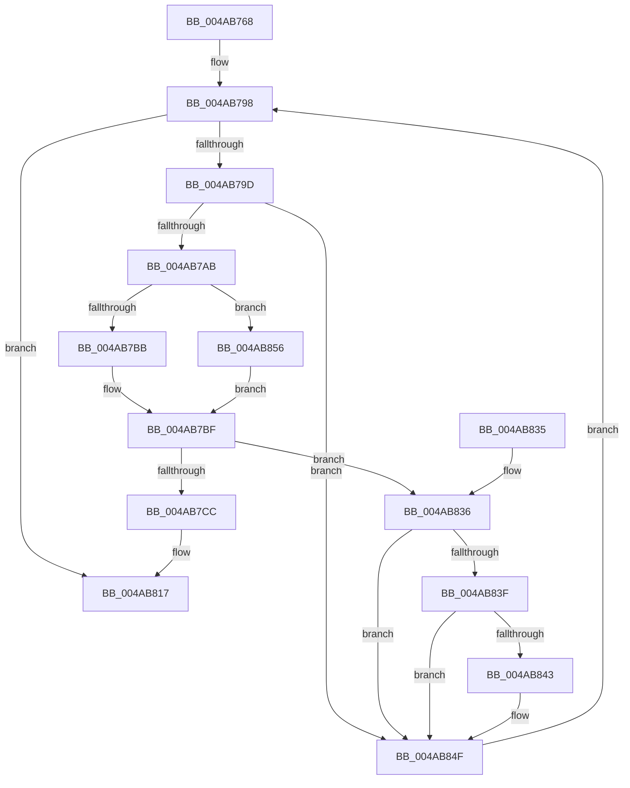

# HalpTimerRestorePerformanceCounter

- RVA: `0x004AB768`–`0x004AB86D` (길이 `261` bytes)
- VA: `0x00000001404AB768`
- 실행 섹션: `.text`
- PDB 이름 있음: `예`; PDB Function 태그: `아니요`
- unwind 정보 RVA: `0x000B804C`
- 디코드: `60`개 명령, `261/261` bytes 표시
- 미해석 바이트: `0` (있으면 어셈블리에 `.byte`로 보존)

> 이 문서는 커널 이미지의 기계어와 PDB 기호를 분석해 생성했습니다. 4번과 5번은 함수 원형과 자료형을 바이너리 사용 방식에서 추정한 C 해석이며 원본 소스 복구 결과는 아닙니다.

## 1. Dependencies

- 직접 호출 지점: **4**; 고유 호출 대상: **4**
- 직접 호출자로 확인된 함수: **1**
- RIP 상대 이미지 참조: **5**

### Outgoing calls
- `0x004AB7C3` → [guard_dispatch_icall](../6B/guard_dispatch_icall_function_006BAAD0.md) (function, `0x006BAAD0`)
- `0x004AB811` → [KeBugCheckEx](../4F/KeBugCheckEx_function_004FD660.md) (function, `0x004FD660`)
- `0x004AB819` → [KeQueryPerformanceCounter](../37/KeQueryPerformanceCounter_function_0037E7E0.md) (function, `0x0037E7E0`)
- `0x004AB84A` → [HalpTimerCalibratePerformanceCounter](HalpTimerCalibratePerformanceCounter_function_004AB874.md) (function, `0x004AB874`)

### Direct callers
- [HalpAcpiPostSleep](../../pagelk/B7/HalpAcpiPostSleep_function_00B79990.md) at `0x00B79AC4`

### Static image references
- `0x004AB778` → RVA `0x00FC3FD0` (`.data`; read)
- `0x004AB78D` → RVA `0x00FC4140` (`.data`; read)
- `0x004AB7D8` → RVA `0x0001BE98` (`.rdata`; read)
- `0x004AB7F0` → RVA `0x00E10358` (`.data`; write)
- `0x004AB828` → RVA `0x00FC4030` (`.data`; write)

## 2. Other-region calls and transfers

- 다른 실행 섹션으로 향하는 call: **0**
- 별도 외부 분기/꼬리 이동을 확인하지 못했습니다.

## 3. Assembly (complete function range)

```asm
004AB768  4C 8B DC                        mov r11, rsp
004AB76B  49 89 5B 08                     mov qword ptr [r11 + 8], rbx
004AB76F  49 89 73 10                     mov qword ptr [r11 + 0x10], rsi
004AB773  57                              push rdi
004AB774  48 83 EC 40                     sub rsp, 0x40
004AB778  48 8B 05 51 88 B1 00            mov rax, qword ptr [rip + 0xb18851]
004AB77F  33 FF                           xor edi, edi
004AB781  65 8B 34 25 A4 01 00 00         mov esi, dword ptr gs:[0x1a4]
004AB789  49 89 43 E8                     mov qword ptr [r11 - 0x18], rax
004AB78D  48 8B 05 AC 89 B1 00            mov rax, qword ptr [rip + 0xb189ac]
004AB794  49 89 43 F0                     mov qword ptr [r11 - 0x10], rax
004AB798  83 FF 02                        cmp edi, 2
004AB79B  73 7A                           jae 0x1404ab817
004AB79D  48 8B 5C FC 30                  mov rbx, qword ptr [rsp + rdi*8 + 0x30]
004AB7A2  48 85 DB                        test rbx, rbx
004AB7A5  0F 84 A4 00 00 00               je 0x1404ab84f
004AB7AB  F7 83 E0 00 00 00 00 00 01 00   test dword ptr [rbx + 0xe0], 0x10000
004AB7B5  0F 85 9B 00 00 00               jne 0x1404ab856
004AB7BB  48 8B 4B 48                     mov rcx, qword ptr [rbx + 0x48]
004AB7BF  48 8B 43 68                     mov rax, qword ptr [rbx + 0x68]
004AB7C3  E8 08 F3 20 00                  call 0x1406baad0
004AB7C8  85 C0                           test eax, eax
004AB7CA  79 6A                           jns 0x1404ab836
004AB7CC  41 B9 0F 00 00 00               mov r9d, 0xf
004AB7D2  89 83 00 01 00 00               mov dword ptr [rbx + 0x100], eax
004AB7D8  48 8D 0D B9 06 B7 FF            lea rcx, [rip - 0x48f947]
004AB7DF  48 98                           cdqe
004AB7E1  48 89 8B 08 01 00 00            mov qword ptr [rbx + 0x108], rcx
004AB7E8  4C 8B C3                        mov r8, rbx
004AB7EB  BA 10 01 00 00                  mov edx, 0x110
004AB7F0  44 89 0D 61 4B 96 00            mov dword ptr [rip + 0x964b61], r9d
004AB7F7  41 8D 49 4D                     lea ecx, [r9 + 0x4d]
004AB7FB  44 89 8B FC 00 00 00            mov dword ptr [rbx + 0xfc], r9d
004AB802  C7 83 10 01 00 00 E0 08 00 00   mov dword ptr [rbx + 0x110], 0x8e0
004AB80C  48 89 44 24 20                  mov qword ptr [rsp + 0x20], rax
004AB811  E8 4A 1E 05 00                  call 0x1404fd660
004AB816  CC                              int3
004AB817  33 C9                           xor ecx, ecx
004AB819  E8 C2 2F ED FF                  call 0x14037e7e0
004AB81E  48 8B 5C 24 50                  mov rbx, qword ptr [rsp + 0x50]
004AB823  48 8B 74 24 58                  mov rsi, qword ptr [rsp + 0x58]
004AB828  48 89 05 01 88 B1 00            mov qword ptr [rip + 0xb18801], rax
004AB82F  48 83 C4 40                     add rsp, 0x40
004AB833  5F                              pop rdi
004AB834  C3                              ret
004AB835  CC                              int3
004AB836  83 BB E4 00 00 00 05            cmp dword ptr [rbx + 0xe4], 5
004AB83D  74 10                           je 0x1404ab84f
004AB83F  85 F6                           test esi, esi
004AB841  75 0C                           jne 0x1404ab84f
004AB843  48 8B 53 10                     mov rdx, qword ptr [rbx + 0x10]
004AB847  48 8B CB                        mov rcx, rbx
004AB84A  E8 25 00 00 00                  call 0x1404ab874
004AB84F  FF C7                           inc edi
004AB851  E9 42 FF FF FF                  jmp 0x1404ab798
004AB856  65 8B 04 25 A4 01 00 00         mov eax, dword ptr gs:[0x1a4]
004AB85E  0F AF 43 50                     imul eax, dword ptr [rbx + 0x50]
004AB862  8B C8                           mov ecx, eax
004AB864  48 03 4B 48                     add rcx, qword ptr [rbx + 0x48]
004AB868  E9 52 FF FF FF                  jmp 0x1404ab7bf
```

## 4. C-style interpretation (structured pseudocode)

```c
__int64 __fastcall HalpTimerRestorePerformanceCounter(void)
{
    __int64 result;
    __int64 v_rdi;
    __int64 v_rsp;
    unsigned __int64 v_stack_m28;
    unsigned __int64 v_stack_p10;
    unsigned __int64 v_stack_p8;

    *(unsigned __int64 *)(v_rsp + 8) = v_rbx;
    *(unsigned __int64 *)(v_rsp + 16) = v_rsi;
    v_rsp = (v_rsp) - (64);
    v_rdi = 0;
    *(unsigned __int64 *)(v_rsp - 24) = *(unsigned __int64 *)(v_rip + 11634769);
    *(unsigned __int64 *)(v_rsp - 16) = *(unsigned __int64 *)(v_rip + 11635116);
loc_004AB798:
    if (0 >= 2) goto loc_004AB817;
    if (*(unsigned __int64 *)(v_rsp + v_rdi * 8 + 48) == 0) goto loc_004AB84F;
    if (((*(unsigned int *)(*(unsigned __int64 *)(v_rsp + v_rdi * 8 + 48) + 224)) & (0x10000ULL)) != 0) goto loc_004AB856;
loc_004AB7BF:
    result = guard_dispatch_icall(*(unsigned __int64 *)(*(unsigned __int64 *)(v_rsp + v_rdi * 8 + 48) + 72), a2, a3, a4);
    if (!sign_flag) goto loc_004AB836;
    *(unsigned int *)(*(unsigned __int64 *)(v_rsp + v_rdi * 8 + 48) + 256) = (unsigned int)(result);
    *(unsigned __int64 *)(*(unsigned __int64 *)(v_rsp + v_rdi * 8 + 48) + 264) = v_rip - 4782407;
    *(unsigned int *)(v_rip + 9849697) = 15;
    *(unsigned int *)(*(unsigned __int64 *)(v_rsp + v_rdi * 8 + 48) + 252) = 15;
    *(unsigned int *)(*(unsigned __int64 *)(v_rsp + v_rdi * 8 + 48) + 272) = 0x8E0ULL;
    v_stack_m28 = result;
    result = KeBugCheckEx(15 + 77, 272, *(unsigned __int64 *)(v_rsp + v_rdi * 8 + 48), 15);
loc_004AB817:
    a1 = 0;
    result = KeQueryPerformanceCounter(a1, 272, *(unsigned __int64 *)(v_rsp + v_rdi * 8 + 48), 15);
    *(unsigned __int64 *)(v_rip + 11634689) = result;
    v_rsp = (v_rsp) + (64);
    return result;
loc_004AB836:
    if ((*(unsigned int *)(v_stack_p8 + 228)) == 5) goto loc_004AB84F;
    if ((unsigned int)(v_stack_p10) == 0) {
        a2 = *(unsigned __int64 *)(v_stack_p8 + 16);
        a1 = v_stack_p8;
        result = HalpTimerCalibratePerformanceCounter(a1, a2, *(unsigned __int64 *)(v_rsp + v_rdi * 8 + 48), 15);
    }
    v_rdi = (unsigned int)((v_rdi) + 1);
    goto loc_004AB798;
loc_004AB856:
    result = (unsigned int)(((unsigned int)(*(unsigned int *)(gs_base + (0 + 420)))) * (*(unsigned int *)(v_stack_p8 + 80)));
    a1 = ((unsigned int)((unsigned int)(result))) + (*(unsigned __int64 *)(v_stack_p8 + 72));
    goto loc_004AB7BF;
}
```

## 5. (Beta) C Style

```c
void HalpTimerRestorePerformanceCounter(void)
{
    int64_t result;
    int64_t local_rdi;
    int64_t local_rsp;
    uint64_t v_stack_m28;
    uint64_t v_stack_p10;
    uint64_t v_stack_p8;

    *(uint64_t *)(local_rsp + 0x8) = local_rbx;
    *(uint64_t *)(local_rsp + 0x10) = local_rsi;
    local_rsp = (local_rsp) - (64);
    local_rdi = 0;
    *(uint64_t *)(local_rsp - 0x18) = *(uint64_t *)(v_rip + 0xB18851);
    *(uint64_t *)(local_rsp - 0x10) = *(uint64_t *)(v_rip + 0xB189AC);
loc_004AB798:
    if (0 >= 2) goto loc_004AB817;
    if (*(uint64_t *)(local_rsp + local_rdi * 8 + 0x30) == 0) goto loc_004AB84F;
    if (((*(uint32_t *)(*(uint64_t *)(local_rsp + local_rdi * 8 + 0x30) + 0xE0)) & (0x10000ULL)) != 0) goto loc_004AB856;
loc_004AB7BF:
    result = guard_dispatch_icall(*(uint64_t *)(*(uint64_t *)(local_rsp + local_rdi * 8 + 0x30) + 0x48), a2, a3, a4);
    if (!sign_flag) goto loc_004AB836;
    *(uint32_t *)(*(uint64_t *)(local_rsp + local_rdi * 8 + 0x30) + 0x100) = (uint32_t)(result);
    *(uint64_t *)(*(uint64_t *)(local_rsp + local_rdi * 8 + 0x30) + 0x108) = v_rip - 4782407;
    *(uint32_t *)(v_rip + 0x964B61) = 15;
    *(uint32_t *)(*(uint64_t *)(local_rsp + local_rdi * 8 + 0x30) + 0xFC) = 15;
    *(uint32_t *)(*(uint64_t *)(local_rsp + local_rdi * 8 + 0x30) + 0x110) = 0x8E0ULL;
    v_stack_m28 = result;
    result = KeBugCheckEx(15 + 77, 272, *(uint64_t *)(local_rsp + local_rdi * 8 + 0x30), 15);
loc_004AB817:
    a1 = 0;
    result = KeQueryPerformanceCounter(a1, 272, *(uint64_t *)(local_rsp + local_rdi * 8 + 0x30), 15);
    *(uint64_t *)(v_rip + 0xB18801) = result;
    local_rsp = (local_rsp) + (64);
    return result;
loc_004AB836:
    if ((*(uint32_t *)(v_stack_p8 + 0xE4)) == 5) goto loc_004AB84F;
    if ((uint32_t)(v_stack_p10) == 0) {
        a2 = *(uint64_t *)(v_stack_p8 + 0x10);
        a1 = v_stack_p8;
        result = HalpTimerCalibratePerformanceCounter(a1, a2, *(uint64_t *)(local_rsp + local_rdi * 8 + 0x30), 15);
    }
    local_rdi = (uint32_t)((local_rdi) + 1);
    goto loc_004AB798;
loc_004AB856:
    result = (uint32_t)(((uint32_t)(*(uint32_t *)(gs_base + (0 + 0x1A4)))) * (*(uint32_t *)(v_stack_p8 + 0x50)));
    a1 = ((uint32_t)((uint32_t)(result))) + (*(uint64_t *)(v_stack_p8 + 0x48));
    goto loc_004AB7BF;
}
```

## 6. Execution-region graph

[열기: 2D/3D 그래프와 함수 탐색 컨트롤 패널](../../../control-panel.html?section=text&rva=0x004AB768&view=graph)

- 2D 그래프는 위에서 아래로 흐르고, 3D 그래프는 빈 공간을 드래그해 회전합니다. Shift+드래그는 이동, 휠은 확대·축소, 함수 노드 선택은 대상 보고서 이동입니다.

### Static fallback


