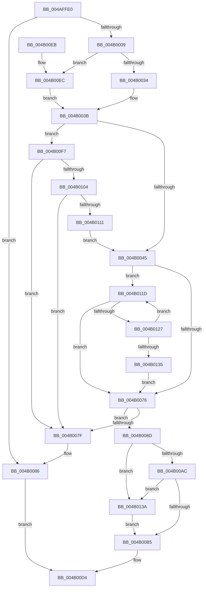

# HalpVpptArmTimer

- RVA: `0x004AFFE0`–`0x004B0144` (길이 `356` bytes)
- VA: `0x00000001404AFFE0`
- 실행 섹션: `.text`
- PDB 이름 있음: `예`; PDB Function 태그: `아니요`
- unwind 정보 RVA: `0x000B88B8`
- 디코드: `91`개 명령, `356/356` bytes 표시
- 미해석 바이트: `0` (있으면 어셈블리에 `.byte`로 보존)

> 이 문서는 커널 이미지의 기계어와 PDB 기호를 분석해 생성했습니다. 4번과 5번은 함수 원형과 자료형을 바이너리 사용 방식에서 추정한 C 해석이며 원본 소스 복구 결과는 아닙니다.

## 1. Dependencies

- 직접 호출 지점: **4**; 고유 호출 대상: **4**
- 직접 호출자로 확인된 함수: **0**
- RIP 상대 이미지 참조: **4**

### Outgoing calls
- `0x004B0010` → [HalpAcquireHighLevelLock](../2D/HalpAcquireHighLevelLock_function_002D2390.md) (function, `0x002D2390`)
- `0x004B004A` → [RtlGetInterruptTimePrecise](../20/RtlGetInterruptTimePrecise_function_0020A4C0.md) (function, `0x0020A4C0`)
- `0x004B00CD` → [HalpReleaseHighLevelLock](../2D/HalpReleaseHighLevelLock_function_002D1C58.md) (function, `0x002D1C58`)
- `0x004B013A` → [HalpVpptUpdatePhysicalTimer](../2D/HalpVpptUpdatePhysicalTimer_function_002D23D8.md) (function, `0x002D23D8`)

### Direct callers
- 이 함수 시작 RVA로 연결되는 직접 call은 확인되지 않았습니다. 간접 호출은 완전히 역산할 수 없습니다.

### Static image references
- `0x004B0009` → RVA `0x00FC2290` (`.data`; read)
- `0x004B0015` → RVA `0x00FC2298` (`.data`; write)
- `0x004B001B` → RVA `0x00FC2260` (`.data`; read)
- `0x004B00C7` → RVA `0x00FC2298` (`.data`; read)

## 2. Other-region calls and transfers

- 다른 실행 섹션으로 향하는 call: **0**
- 별도 외부 분기/꼬리 이동을 확인하지 못했습니다.

## 3. Assembly (complete function range)

```asm
004AFFE0  48 89 5C 24 10                  mov qword ptr [rsp + 0x10], rbx
004AFFE5  48 89 6C 24 18                  mov qword ptr [rsp + 0x18], rbp
004AFFEA  56                              push rsi
004AFFEB  57                              push rdi
004AFFEC  41 54                           push r12
004AFFEE  41 56                           push r14
004AFFF0  41 57                           push r15
004AFFF2  48 83 EC 20                     sub rsp, 0x20
004AFFF6  8D 42 FF                        lea eax, [rdx - 1]
004AFFF9  4D 8B F8                        mov r15, r8
004AFFFC  44 8B F2                        mov r14d, edx
004AFFFF  48 8B D9                        mov rbx, rcx
004B0002  A9 FD FF FF FF                  test eax, 0xfffffffd
004B0007  75 7D                           jne 0x1404b0086
004B0009  48 8D 0D 80 22 B1 00            lea rcx, [rip + 0xb12280]
004B0010  E8 7B 23 E2 FF                  call 0x1402d2390
004B0015  88 05 7D 22 B1 00               mov byte ptr [rip + 0xb1227d], al
004B001B  4C 8D 25 3E 22 B1 00            lea r12, [rip + 0xb1223e]
004B0022  48 8B 05 37 22 B1 00            mov rax, qword ptr [rip + 0xb12237]
004B0029  33 FF                           xor edi, edi
004B002B  49 3B C4                        cmp rax, r12
004B002E  0F 84 B8 00 00 00               je 0x1404b00ec
004B0034  48 8B 68 20                     mov rbp, qword ptr [rax + 0x20]
004B0038  8B 70 10                        mov esi, dword ptr [rax + 0x10]
004B003B  40 38 7B 18                     cmp byte ptr [rbx + 0x18], dil
004B003F  0F 85 B2 00 00 00               jne 0x1404b00f7
004B0045  48 8D 4C 24 50                  lea rcx, [rsp + 0x50]
004B004A  E8 71 A4 D5 FF                  call 0x14020a4c0
004B004F  41 83 FE 03                     cmp r14d, 3
004B0053  49 8B CC                        mov rcx, r12
004B0056  49 0F 45 FF                     cmovne rdi, r15
004B005A  4E 8D 04 38                     lea r8, [rax + r15]
004B005E  4C 89 43 20                     mov qword ptr [rbx + 0x20], r8
004B0062  48 89 7B 28                     mov qword ptr [rbx + 0x28], rdi
004B0066  48 8B 15 F3 21 B1 00            mov rdx, qword ptr [rip + 0xb121f3]
004B006D  49 3B D4                        cmp rdx, r12
004B0070  0F 85 A7 00 00 00               jne 0x1404b011d
004B0076  48 8B 01                        mov rax, qword ptr [rcx]
004B0079  48 39 48 08                     cmp qword ptr [rax + 8], rcx
004B007D  74 0E                           je 0x1404b008d
004B007F  B9 03 00 00 00                  mov ecx, 3
004B0084  CD 29                           int 0x29
004B0086  B8 BB 00 00 C0                  mov eax, 0xc00000bb
004B008B  EB 47                           jmp 0x1404b00d4
004B008D  48 89 03                        mov qword ptr [rbx], rax
004B0090  48 89 4B 08                     mov qword ptr [rbx + 8], rcx
004B0094  48 89 58 08                     mov qword ptr [rax + 8], rbx
004B0098  48 89 19                        mov qword ptr [rcx], rbx
004B009B  48 8B 05 BE 21 B1 00            mov rax, qword ptr [rip + 0xb121be]
004B00A2  48 39 68 20                     cmp qword ptr [rax + 0x20], rbp
004B00A6  0F 85 8E 00 00 00               jne 0x1404b013a
004B00AC  39 70 10                        cmp dword ptr [rax + 0x10], esi
004B00AF  0F 85 85 00 00 00               jne 0x1404b013a
004B00B5  C7 43 14 02 00 00 00            mov dword ptr [rbx + 0x14], 2
004B00BC  48 8D 0D CD 21 B1 00            lea rcx, [rip + 0xb121cd]
004B00C3  C6 43 18 01                     mov byte ptr [rbx + 0x18], 1
004B00C7  8A 15 CB 21 B1 00               mov dl, byte ptr [rip + 0xb121cb]
004B00CD  E8 86 1B E2 FF                  call 0x1402d1c58
004B00D2  33 C0                           xor eax, eax
004B00D4  48 8B 5C 24 58                  mov rbx, qword ptr [rsp + 0x58]
004B00D9  48 8B 6C 24 60                  mov rbp, qword ptr [rsp + 0x60]
004B00DE  48 83 C4 20                     add rsp, 0x20
004B00E2  41 5F                           pop r15
004B00E4  41 5E                           pop r14
004B00E6  41 5C                           pop r12
004B00E8  5F                              pop rdi
004B00E9  5E                              pop rsi
004B00EA  C3                              ret
004B00EB  CC                              int3
004B00EC  48 8B EF                        mov rbp, rdi
004B00EF  83 CE FF                        or esi, 0xffffffff
004B00F2  E9 44 FF FF FF                  jmp 0x1404b003b
004B00F7  48 8B 0B                        mov rcx, qword ptr [rbx]
004B00FA  48 39 59 08                     cmp qword ptr [rcx + 8], rbx
004B00FE  0F 85 7B FF FF FF               jne 0x1404b007f
004B0104  48 8B 43 08                     mov rax, qword ptr [rbx + 8]
004B0108  48 39 18                        cmp qword ptr [rax], rbx
004B010B  0F 85 6E FF FF FF               jne 0x1404b007f
004B0111  48 89 08                        mov qword ptr [rax], rcx
004B0114  48 89 41 08                     mov qword ptr [rcx + 8], rax
004B0118  E9 28 FF FF FF                  jmp 0x1404b0045
004B011D  4C 3B 42 20                     cmp r8, qword ptr [rdx + 0x20]
004B0121  0F 82 4F FF FF FF               jb 0x1404b0076
004B0127  48 8B 02                        mov rax, qword ptr [rdx]
004B012A  48 8B CA                        mov rcx, rdx
004B012D  48 8B D0                        mov rdx, rax
004B0130  49 3B C4                        cmp rax, r12
004B0133  75 E8                           jne 0x1404b011d
004B0135  E9 3C FF FF FF                  jmp 0x1404b0076
004B013A  E8 99 22 E2 FF                  call 0x1402d23d8
004B013F  E9 71 FF FF FF                  jmp 0x1404b00b5
```

## 4. C-style interpretation (structured pseudocode)

```c
__int64 __fastcall HalpVpptArmTimer(__int64 a1, __int64 a2, __int64 a3)
{
    __int64 result;
    __int64 v_rdi;
    __int64 v_rsi;
    __int64 v_rsp;
    unsigned __int64 v_stack_p10;
    unsigned __int64 v_stack_p18;
    unsigned __int64 v_stack_p8;

    v_stack_p10 = v_rbx;
    v_stack_p18 = v_rbp;
    v_rsp = (v_rsp) - (32);
    if ((((unsigned int)(a2 - 1)) & (0xFFFFFFFDULL)) != 0) goto loc_004B0086;
    result = HalpAcquireHighLevelLock(v_rip + 11608704, a2, a3, a4);
    *(unsigned __int8 *)(v_rip + 11608701) = (unsigned __int8)(result);
    v_rdi = 0;
    if ((*(unsigned __int64 *)(v_rip + 11608631)) == (v_rip + 11608638)) goto loc_004B00EC;
loc_004B003B:
    if ((*(unsigned __int8 *)(a1 + 24)) != 0) goto loc_004B00F7;
loc_004B0045:
    result = RtlGetInterruptTimePrecise(v_stack_p8, a2, a3, a4);
    if (((unsigned int)((unsigned int)((unsigned int)(a2)))) != 3) { v_rdi = a3; }
    *(unsigned __int64 *)(a1 + 32) = result + a3 * 1;
    *(unsigned __int64 *)(a1 + 40) = v_rdi;
    if ((*(unsigned __int64 *)(v_rip + 11608563)) != (v_rip + 11608638)) goto loc_004B011D;
loc_004B0076:
    if ((*(unsigned __int64 *)(*(unsigned __int64 *)(v_rip + 11608638) + 8)) == (v_rip + 11608638)) goto loc_004B008D;
loc_004B007F:
loc_004B0086:
    goto loc_004B00D4;
loc_004B008D:
    *(unsigned __int64 *)(a1) = (unsigned int)(0xC00000BBULL);
    *(unsigned __int64 *)(a1 + 8) = 3;
    *(unsigned __int64 *)((unsigned int)(0xC00000BBULL) + 8) = a1;
    *(unsigned __int64 *)(3) = a1;
    if ((*(unsigned __int64 *)(*(unsigned __int64 *)(v_rip + 11608510) + 32)) != (*(unsigned __int64 *)(*(unsigned __int64 *)(v_rip + 11608631) + 32))) goto loc_004B013A;
    if ((*(unsigned int *)(*(unsigned __int64 *)(v_rip + 11608510) + 16)) != ((unsigned int)((unsigned int)(*(unsigned int *)(*(unsigned __int64 *)(v_rip + 11608631) + 16))))) goto loc_004B013A;
loc_004B00B5:
    *(unsigned int *)(a1 + 20) = 2;
    *(unsigned __int8 *)(a1 + 24) = 1;
    result = HalpReleaseHighLevelLock(v_rip + 11608525, *(unsigned __int8 *)(v_rip + 11608523), result + a3 * 1, a4);
    result = 0;
loc_004B00D4:
    v_rsp = (v_rsp) + (32);
    return result;
loc_004B00EC:
    v_rsi = (unsigned int)(((unsigned int)(*(unsigned int *)(*(unsigned __int64 *)(v_rip + 11608631) + 16))) | (0xFFFFFFFFULL));
    goto loc_004B003B;
loc_004B00F7:
    if ((*(unsigned __int64 *)(*(unsigned __int64 *)(v_stack_p10) + 8)) != v_stack_p10) goto loc_004B007F;
    if ((*(unsigned __int64 *)(*(unsigned __int64 *)(v_stack_p10 + 8))) != v_stack_p10) goto loc_004B007F;
    *(unsigned __int64 *)(*(unsigned __int64 *)(v_stack_p10 + 8)) = *(unsigned __int64 *)(v_stack_p10);
    *(unsigned __int64 *)(*(unsigned __int64 *)(v_stack_p10) + 8) = *(unsigned __int64 *)(v_stack_p10 + 8);
    goto loc_004B0045;
loc_004B011D:
    if ((result + a3 * 1) < (*(unsigned __int64 *)(*(unsigned __int8 *)(v_rip + 11608523) + 32))) goto loc_004B0076;
    if ((*(unsigned __int64 *)(*(unsigned __int8 *)(v_rip + 11608523))) != (v_rip + 11608638)) goto loc_004B011D;
    goto loc_004B0076;
loc_004B013A:
    result = HalpVpptUpdatePhysicalTimer(*(unsigned __int8 *)(v_rip + 11608523), *(unsigned __int64 *)(*(unsigned __int8 *)(v_rip + 11608523)), result + a3 * 1, a4);
    goto loc_004B00B5;
}
```

## 5. (Beta) C Style

```c
int64_t HalpVpptArmTimer(void *Arg1, void *Arg2, int64_t Arg3)
{
    uint8_t *arg1 = (uint8_t *)Arg1;
    uint8_t *arg2 = (uint8_t *)Arg2;

    int64_t result;
    int64_t local_rdi;
    int64_t local_rsi;
    int64_t local_rsp;
    uint64_t v_stack_p10;
    uint64_t v_stack_p18;
    uint64_t v_stack_p8;

    v_stack_p10 = local_rbx;
    v_stack_p18 = local_rbp;
    local_rsp = (local_rsp) - (32);
    if ((((uint32_t)(Arg2 - 1)) & (0xFFFFFFFDULL)) != 0) goto loc_004B0086;
    result = HalpAcquireHighLevelLock(v_rip + 11608704, Arg2, Arg3, a4);
    *(uint8_t *)(v_rip + 0xB1227D) = (uint8_t)(result);
    local_rdi = 0;
    if ((*(uint64_t *)(v_rip + 0xB12237)) == (v_rip + 11608638)) goto loc_004B00EC;
loc_004B003B:
    if ((*(uint8_t *)(arg1 + 0x18)) != 0) goto loc_004B00F7;
loc_004B0045:
    result = RtlGetInterruptTimePrecise(v_stack_p8, Arg2, Arg3, a4);
    if (((uint32_t)((uint32_t)((uint32_t)(Arg2)))) != 3) { local_rdi = Arg3; }
    *(uint64_t *)(arg1 + 0x20) = result + Arg3 * 1;
    *(uint64_t *)(arg1 + 0x28) = local_rdi;
    if ((*(uint64_t *)(v_rip + 0xB121F3)) != (v_rip + 11608638)) goto loc_004B011D;
loc_004B0076:
    if ((*(uint64_t *)(*(uint64_t *)(v_rip + 0xB1223E) + 0x8)) == (v_rip + 11608638)) goto loc_004B008D;
loc_004B007F:
loc_004B0086:
    goto loc_004B00D4;
loc_004B008D:
    *(uint64_t *)(arg1) = (uint32_t)(0xC00000BBULL);
    *(uint64_t *)(arg1 + 0x8) = 3;
    *(void **)((uint32_t)(0xC00000BBULL) + 0x8) = Arg1;
    *(void **)(3) = Arg1;
    if ((*(uint64_t *)(*(uint64_t *)(v_rip + 0xB121BE) + 0x20)) != (*(uint64_t *)(*(uint64_t *)(v_rip + 0xB12237) + 0x20))) goto loc_004B013A;
    if ((*(uint32_t *)(*(uint64_t *)(v_rip + 0xB121BE) + 0x10)) != ((uint32_t)((uint32_t)(*(uint32_t *)(*(uint64_t *)(v_rip + 0xB12237) + 0x10))))) goto loc_004B013A;
loc_004B00B5:
    *(uint32_t *)(arg1 + 0x14) = 2;
    *(uint8_t *)(arg1 + 0x18) = 1;
    result = HalpReleaseHighLevelLock(v_rip + 11608525, *(uint8_t *)(v_rip + 0xB121CB), result + Arg3 * 1, a4);
    result = 0;
loc_004B00D4:
    local_rsp = (local_rsp) + (32);
    return result;
loc_004B00EC:
    local_rsi = (uint32_t)(((uint32_t)(*(uint32_t *)(*(uint64_t *)(v_rip + 0xB12237) + 0x10))) | (0xFFFFFFFFULL));
    goto loc_004B003B;
loc_004B00F7:
    if ((*(uint64_t *)(*(uint64_t *)(v_stack_p10) + 0x8)) != v_stack_p10) goto loc_004B007F;
    if ((*(uint64_t *)(*(uint64_t *)(v_stack_p10 + 0x8))) != v_stack_p10) goto loc_004B007F;
    *(uint64_t *)(*(uint64_t *)(v_stack_p10 + 0x8)) = *(uint64_t *)(v_stack_p10);
    *(uint64_t *)(*(uint64_t *)(v_stack_p10) + 0x8) = *(uint64_t *)(v_stack_p10 + 0x8);
    goto loc_004B0045;
loc_004B011D:
    if ((result + Arg3 * 1) < (*(uint64_t *)(*(uint8_t *)(v_rip + 0xB121CB) + 0x20))) goto loc_004B0076;
    if ((*(uint64_t *)(*(uint8_t *)(v_rip + 0xB121CB))) != (v_rip + 11608638)) goto loc_004B011D;
    goto loc_004B0076;
loc_004B013A:
    result = HalpVpptUpdatePhysicalTimer(*(uint8_t *)(v_rip + 0xB121CB), *(uint64_t *)(*(uint8_t *)(v_rip + 0xB121CB)), result + Arg3 * 1, a4);
    goto loc_004B00B5;
}
```

### 관측된 메모리 오프셋

구조체 형식이 확인되지 않은 접근은 인자 기준의 오프셋으로만 기록했습니다.

| 기준 인자 | 오프셋 표현 | 폭 (bit) | 접근 |
|---|---:|---:|---|
| `Arg1` | `+ 0x0` | `64` | `R` |
| `Arg1` | `+ 0x0` | `64` | `W` |
| `Arg1` | `+ 0x8` | `64` | `R` |
| `Arg1` | `+ 0x8` | `64` | `W` |
| `Arg1` | `+ 0x14` | `32` | `W` |
| `Arg1` | `+ 0x18` | `8` | `R` |
| `Arg1` | `+ 0x18` | `8` | `W` |
| `Arg1` | `+ 0x20` | `64` | `W` |
| `Arg1` | `+ 0x28` | `64` | `W` |
| `Arg2` | `- 0x1` | `32` | `R` |

## 6. Execution-region graph

[열기: 2D/3D 그래프와 함수 탐색 컨트롤 패널](../../../control-panel.html?section=text&rva=0x004AFFE0&view=graph)

- 2D 그래프는 위에서 아래로 흐르고, 3D 그래프는 빈 공간을 드래그해 회전합니다. Shift+드래그는 이동, 휠은 확대·축소, 함수 노드 선택은 대상 보고서 이동입니다.

### Static fallback


