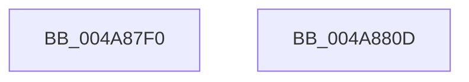

# HalpcGetCmosDataByType

- RVA: `0x004A87F0`–`0x004A880E` (길이 `30` bytes)
- VA: `0x00000001404A87F0`
- 실행 섹션: `.text`
- PDB 이름 있음: `예`; PDB Function 태그: `아니요`
- unwind 정보 RVA: `0x0005D2F4`
- 디코드: `10`개 명령, `30/30` bytes 표시
- 미해석 바이트: `0` (있으면 어셈블리에 `.byte`로 보존)

> 이 문서는 커널 이미지의 기계어와 PDB 기호를 분석해 생성했습니다. 4번과 5번은 함수 원형과 자료형을 바이너리 사용 방식에서 추정한 C 해석이며 원본 소스 복구 결과는 아닙니다.

## 1. Dependencies

- 직접 호출 지점: **1**; 고유 호출 대상: **1**
- 직접 호출자로 확인된 함수: **0**
- RIP 상대 이미지 참조: **0**

### Outgoing calls
- `0x004A8803` → [HalpCmosRangeHandler](HalpCmosRangeHandler_function_004A8814.md) (function, `0x004A8814`)

### Direct callers
- 이 함수 시작 RVA로 연결되는 직접 call은 확인되지 않았습니다. 간접 호출은 완전히 역산할 수 없습니다.

### Static image references
- 디코드된 RIP-relative 메모리 참조가 없습니다.

## 2. Other-region calls and transfers

- 다른 실행 섹션으로 향하는 call: **0**
- 별도 외부 분기/꼬리 이동을 확인하지 못했습니다.

## 3. Assembly (complete function range)

```asm
004A87F0  48 83 EC 38                     sub rsp, 0x38
004A87F4  44 89 4C 24 20                  mov dword ptr [rsp + 0x20], r9d
004A87F9  4D 8B C8                        mov r9, r8
004A87FC  44 8B C2                        mov r8d, edx
004A87FF  8B D1                           mov edx, ecx
004A8801  33 C9                           xor ecx, ecx
004A8803  E8 0C 00 00 00                  call 0x1404a8814
004A8808  48 83 C4 38                     add rsp, 0x38
004A880C  C3                              ret
004A880D  CC                              int3
```

## 4. C-style interpretation (structured pseudocode)

```c
__int64 __fastcall HalpcGetCmosDataByType(int a1, int a2, __int64 a3, int a4)
{
    __int64 result;
    __int64 v_rsp;
    unsigned int v_stack_m18;

    v_rsp = (v_rsp) - (56);
    v_stack_m18 = a4;
    a1 = 0;
    result = HalpCmosRangeHandler(a1, (unsigned int)(a1), (unsigned int)(a2), a3);
    v_rsp = (v_rsp) + (56);
    return result;
}
```

## 5. (Beta) C Style

```c
int64_t HalpcGetCmosDataByType(int32_t Arg1, int32_t Arg2, int64_t Arg3, int32_t Arg4)
{
    int64_t result;
    int64_t local_rsp;
    uint32_t v_stack_m18;

    local_rsp = (local_rsp) - (56);
    v_stack_m18 = Arg4;
    Arg1 = 0;
    result = HalpCmosRangeHandler(Arg1, (uint32_t)(Arg1), (uint32_t)(Arg2), Arg3);
    local_rsp = (local_rsp) + (56);
    return result;
}
```

## 6. Execution-region graph

[열기: 2D/3D 그래프와 함수 탐색 컨트롤 패널](../../../control-panel.html?section=text&rva=0x004A87F0&view=graph)

- 2D 그래프는 위에서 아래로 흐르고, 3D 그래프는 빈 공간을 드래그해 회전합니다. Shift+드래그는 이동, 휠은 확대·축소, 함수 노드 선택은 대상 보고서 이동입니다.

### Static fallback


