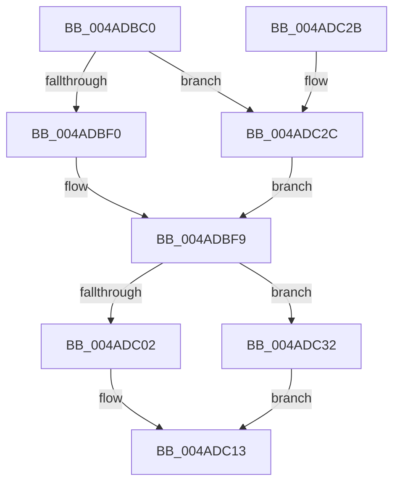

# HviGetHardwareFeatures

- RVA: `0x004ADBC0`–`0x004ADC3B` (길이 `123` bytes)
- VA: `0x00000001404ADBC0`
- 실행 섹션: `.text`
- PDB 이름 있음: `예`; PDB Function 태그: `아니요`
- unwind 정보 RVA: `0x000B84D8`
- 디코드: `39`개 명령, `123/123` bytes 표시
- 미해석 바이트: `0` (있으면 어셈블리에 `.byte`로 보존)

> 이 문서는 커널 이미지의 기계어와 PDB 기호를 분석해 생성했습니다. 4번과 5번은 함수 원형과 자료형을 바이너리 사용 방식에서 추정한 C 해석이며 원본 소스 복구 결과는 아닙니다.

## 1. Dependencies

- 직접 호출 지점: **2**; 고유 호출 대상: **2**
- 직접 호출자로 확인된 함수: **10**
- RIP 상대 이미지 참조: **1**

### Outgoing calls
- `0x004ADBE4` → [HviIsAnyHypervisorPresent](HviIsAnyHypervisorPresent_function_004ADC50.md) (function, `0x004ADC50`)
- `0x004ADC1B` → [_security_check_cookie](../6A/_security_check_cookie_function_006AC640.md) (function, `0x006AC640`)

### Direct callers
- [HalpWdatDiscover](../56/HalpWdatDiscover_function_005609A8.md) at `0x00560A37`
- [HvlGetSystemPasidCapabilities](../58/HvlGetSystemPasidCapabilities_function_00588520.md) at `0x0058862C`
- [HvlpDetermineEnlightenments](../58/HvlpDetermineEnlightenments_function_0058CC9C.md) at `0x0058CD23`
- [HvipApertureDetectParameters](../60/HvipApertureDetectParameters_function_0060268C.md) at `0x00602706`
- [HvlQueryDetailInfo](../../page/71/HvlQueryDetailInfo_function_00717BDC.md) at `0x00717C72`
- [HvlQueryVsmProtectionInfo](../../page/A9/HvlQueryVsmProtectionInfo_function_00A96E30.md) at `0x00A96F0D`
- [HalpIommuInitializeAll](../../pagelk/B7/HalpIommuInitializeAll_function_00B7A684.md) at `0x00B7A6F5`
- [HalpInterruptInitDiscard](../../init/C2/HalpInterruptInitDiscard_function_00C20194.md) at `0x00C201E6`
- [HalpIommuInitDiscard](../../init/C2/HalpIommuInitDiscard_function_00C203F8.md) at `0x00C205BA`
- [EtwpTraceSystemInitialization](../../init/C4/EtwpTraceSystemInitialization_function_00C4E720.md) at `0x00C4E93C`

### Static image references
- `0x004ADBCA` → RVA `0x00E0A740` (`.data`; read)

## 2. Other-region calls and transfers

- 다른 실행 섹션으로 향하는 call: **0**
- 별도 외부 분기/꼬리 이동을 확인하지 못했습니다.

## 3. Assembly (complete function range)

```asm
004ADBC0  48 89 5C 24 10                  mov qword ptr [rsp + 0x10], rbx
004ADBC5  57                              push rdi
004ADBC6  48 83 EC 40                     sub rsp, 0x40
004ADBCA  48 8B 05 6F CB 95 00            mov rax, qword ptr [rip + 0x95cb6f]
004ADBD1  48 33 C4                        xor rax, rsp
004ADBD4  48 89 44 24 30                  mov qword ptr [rsp + 0x30], rax
004ADBD9  0F 57 C0                        xorps xmm0, xmm0
004ADBDC  48 8B F9                        mov rdi, rcx
004ADBDF  0F 11 44 24 20                  movups xmmword ptr [rsp + 0x20], xmm0
004ADBE4  E8 67 00 00 00                  call 0x1404adc50
004ADBE9  45 33 C0                        xor r8d, r8d
004ADBEC  84 C0                           test al, al
004ADBEE  74 3C                           je 0x1404adc2c
004ADBF0  B8 00 00 00 40                  mov eax, 0x40000000
004ADBF5  33 C9                           xor ecx, ecx
004ADBF7  0F A2                           cpuid
004ADBF9  B9 06 00 00 40                  mov ecx, 0x40000006
004ADBFE  3B C1                           cmp eax, ecx
004ADC00  72 30                           jb 0x1404adc32
004ADC02  8B C1                           mov eax, ecx
004ADC04  33 C9                           xor ecx, ecx
004ADC06  0F A2                           cpuid
004ADC08  89 07                           mov dword ptr [rdi], eax
004ADC0A  89 5F 04                        mov dword ptr [rdi + 4], ebx
004ADC0D  89 4F 08                        mov dword ptr [rdi + 8], ecx
004ADC10  89 57 0C                        mov dword ptr [rdi + 0xc], edx
004ADC13  48 8B 4C 24 30                  mov rcx, qword ptr [rsp + 0x30]
004ADC18  48 33 CC                        xor rcx, rsp
004ADC1B  E8 20 EA 1F 00                  call 0x1406ac640
004ADC20  48 8B 5C 24 58                  mov rbx, qword ptr [rsp + 0x58]
004ADC25  48 83 C4 40                     add rsp, 0x40
004ADC29  5F                              pop rdi
004ADC2A  C3                              ret
004ADC2B  CC                              int3
004ADC2C  8B 44 24 20                     mov eax, dword ptr [rsp + 0x20]
004ADC30  EB C7                           jmp 0x1404adbf9
004ADC32  4C 89 07                        mov qword ptr [rdi], r8
004ADC35  4C 89 47 08                     mov qword ptr [rdi + 8], r8
004ADC39  EB D8                           jmp 0x1404adc13
```

## 4. C-style interpretation (structured pseudocode)

```c
__int64 __fastcall HviGetHardwareFeatures(__int64 a1, int a2, int a3)
{
    __int64 result;
    __int64 v_rsp;
    unsigned __int64 v_stack_m18;
    unsigned __int64 v_stack_m28;
    unsigned __int64 v_stack_p10;
    unsigned int v_stack_p20;

    v_stack_p10 = v_rbx;
    v_rsp = (v_rsp) - (64);
    result = (*(unsigned __int64 *)(v_rip + 9816943)) ^ (v_rsp);
    v_stack_m18 = result;
    v_stack_m28 = v_xmm0;
    result = HviIsAnyHypervisorPresent(a1, a2, a3, a4);
    a3 = 0;
    if ((unsigned __int8)(result) == 0) goto loc_004ADC2C;
    a1 = 0;
loc_004ADBF9:
    if (((unsigned int)((unsigned int)(0x40000000ULL))) < ((unsigned int)((unsigned int)(0x40000006ULL)))) goto loc_004ADC32;
    a1 = 0;
    *(unsigned int *)(a1) = (unsigned int)((unsigned int)((unsigned int)((unsigned int)(0x40000006ULL))));
    *(unsigned int *)(a1 + 4) = (unsigned int)(v_rbx);
    *(unsigned int *)(a1 + 8) = 0;
    *(unsigned int *)(a1 + 12) = a2;
loc_004ADC13:
    a1 = (v_stack_m18) ^ (v_rsp);
    result = _security_check_cookie(a1, a2, a3, a4);
    v_rsp = (v_rsp) + (64);
    return result;
loc_004ADC2C:
    goto loc_004ADBF9;
loc_004ADC32:
    *(unsigned __int64 *)(a1) = 0;
    *(unsigned __int64 *)(a1 + 8) = 0;
    goto loc_004ADC13;
}
```

## 5. (Beta) C Style

```c
int64_t HviGetHardwareFeatures(void *Arg1, int32_t Arg2, int32_t Arg3)
{
    uint8_t *arg1 = (uint8_t *)Arg1;

    int64_t result;
    int64_t local_rsp;
    uint64_t v_stack_m18;
    uint64_t v_stack_m28;
    uint64_t v_stack_p10;
    uint32_t v_stack_p20;

    v_stack_p10 = local_rbx;
    local_rsp = (local_rsp) - (64);
    result = (*(uint64_t *)(v_rip + 0x95CB6F)) ^ (local_rsp);
    v_stack_m18 = result;
    v_stack_m28 = v_xmm0;
    result = HviIsAnyHypervisorPresent(Arg1, Arg2, Arg3, a4);
    Arg3 = 0;
    if ((uint8_t)(result) == 0) goto loc_004ADC2C;
    Arg1 = 0;
loc_004ADBF9:
    if (((uint32_t)((uint32_t)(0x40000000ULL))) < ((uint32_t)((uint32_t)(0x40000006ULL)))) goto loc_004ADC32;
    Arg1 = 0;
    *(uint32_t *)(arg1) = (uint32_t)((uint32_t)((uint32_t)((uint32_t)(0x40000006ULL))));
    *(uint32_t *)(arg1 + 0x4) = (uint32_t)(local_rbx);
    *(uint32_t *)(arg1 + 0x8) = 0;
    *(uint32_t *)(arg1 + 0xC) = Arg2;
loc_004ADC13:
    Arg1 = (v_stack_m18) ^ (local_rsp);
    result = _security_check_cookie(Arg1, Arg2, Arg3, a4);
    local_rsp = (local_rsp) + (64);
    return result;
loc_004ADC2C:
    goto loc_004ADBF9;
loc_004ADC32:
    *(uint64_t *)(arg1) = 0;
    *(uint64_t *)(arg1 + 0x8) = 0;
    goto loc_004ADC13;
}
```

### 관측된 메모리 오프셋

구조체 형식이 확인되지 않은 접근은 인자 기준의 오프셋으로만 기록했습니다.

| 기준 인자 | 오프셋 표현 | 폭 (bit) | 접근 |
|---|---:|---:|---|
| `Arg1` | `+ 0x0` | `32` | `W` |
| `Arg1` | `+ 0x0` | `64` | `W` |
| `Arg1` | `+ 0x4` | `32` | `W` |
| `Arg1` | `+ 0x8` | `32` | `W` |
| `Arg1` | `+ 0x8` | `64` | `W` |
| `Arg1` | `+ 0xC` | `32` | `W` |

## 6. Execution-region graph

[열기: 2D/3D 그래프와 함수 탐색 컨트롤 패널](../../../control-panel.html?section=text&rva=0x004ADBC0&view=graph)

- 2D 그래프는 위에서 아래로 흐르고, 3D 그래프는 빈 공간을 드래그해 회전합니다. Shift+드래그는 이동, 휠은 확대·축소, 함수 노드 선택은 대상 보고서 이동입니다.

### Static fallback


