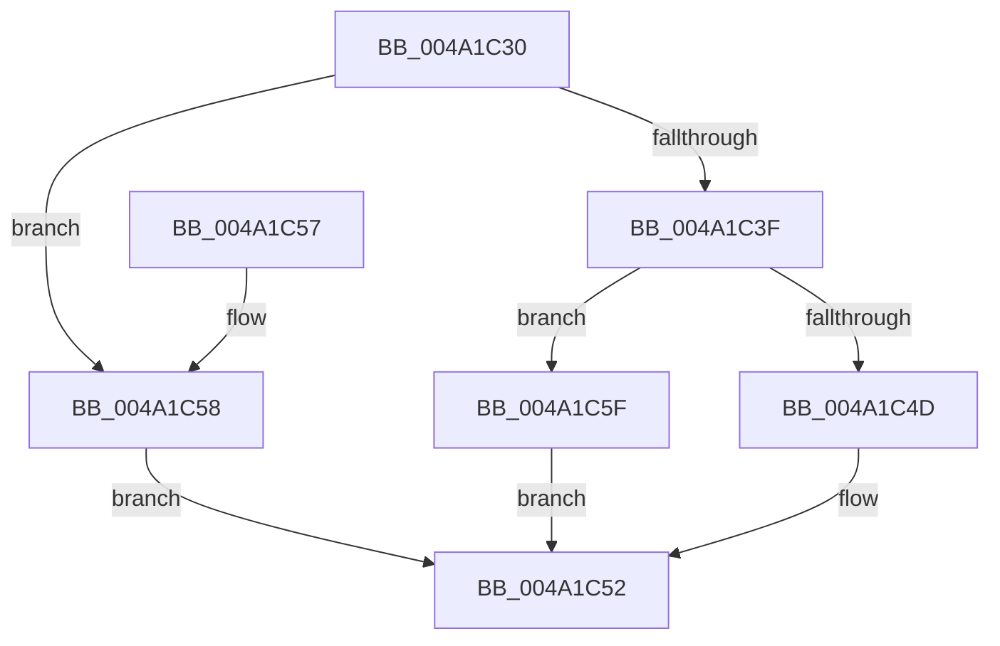

# HvlFlushPasid

- RVA: `0x004A1C30`–`0x004A1C66` (길이 `54` bytes)
- VA: `0x00000001404A1C30`
- 실행 섹션: `.text`
- PDB 이름 있음: `예`; PDB Function 태그: `아니요`
- unwind 정보 RVA: `0x000AC384`
- 디코드: `16`개 명령, `54/54` bytes 표시
- 미해석 바이트: `0` (있으면 어셈블리에 `.byte`로 보존)

> 이 문서는 커널 이미지의 기계어와 PDB 기호를 분석해 생성했습니다. 4번과 5번은 함수 원형과 자료형을 바이너리 사용 방식에서 추정한 C 해석이며 원본 소스 복구 결과는 아닙니다.

## 1. Dependencies

- 직접 호출 지점: **3**; 고유 호출 대상: **3**
- 직접 호출자로 확인된 함수: **0**
- RIP 상대 이미지 참조: **0**

### Outgoing calls
- `0x004A1C4D` → [HvlpFastFlushPasidAddressList](HvlpFastFlushPasidAddressList_function_004A1C6C.md) (function, `0x004A1C6C`)
- `0x004A1C58` → [HvlpFlushPasidAddressSpace](HvlpFlushPasidAddressSpace_function_004A1D60.md) (function, `0x004A1D60`)
- `0x004A1C5F` → [HvlpSlowFlushPasidAddressList](../58/HvlpSlowFlushPasidAddressList_function_00589EE4.md) (function, `0x00589EE4`)

### Direct callers
- 이 함수 시작 RVA로 연결되는 직접 call은 확인되지 않았습니다. 간접 호출은 완전히 역산할 수 없습니다.

### Static image references
- 디코드된 RIP-relative 메모리 참조가 없습니다.

## 2. Other-region calls and transfers

- 다른 실행 섹션으로 향하는 call: **0**
- 별도 외부 분기/꼬리 이동을 확인하지 못했습니다.

## 3. Assembly (complete function range)

```asm
004A1C30  48 83 EC 38                     sub rsp, 0x38
004A1C34  41 8D 40 FF                     lea eax, [r8 - 1]
004A1C38  3D FD 01 00 00                  cmp eax, 0x1fd
004A1C3D  77 19                           ja 0x1404a1c58
004A1C3F  8A 44 24 60                     mov al, byte ptr [rsp + 0x60]
004A1C43  88 44 24 20                     mov byte ptr [rsp + 0x20], al
004A1C47  41 83 F8 0C                     cmp r8d, 0xc
004A1C4B  77 12                           ja 0x1404a1c5f
004A1C4D  E8 1A 00 00 00                  call 0x1404a1c6c
004A1C52  48 83 C4 38                     add rsp, 0x38
004A1C56  C3                              ret
004A1C57  CC                              int3
004A1C58  E8 03 01 00 00                  call 0x1404a1d60
004A1C5D  EB F3                           jmp 0x1404a1c52
004A1C5F  E8 80 82 0E 00                  call 0x140589ee4
004A1C64  EB EC                           jmp 0x1404a1c52
```

## 4. C-style interpretation (structured pseudocode)

```c
__int64 __fastcall HvlFlushPasid(__int64 a1, __int64 a2, __int64 a3, __int64 a4, unsigned __int8 a5)
{
    __int64 result;
    __int64 v_rsp;
    unsigned __int8 v_stack_m18;

    v_rsp = (v_rsp) - (56);
    if (((unsigned int)(a3 - 1)) > 509) goto loc_004A1C58;
    v_stack_m18 = a5;
    if (((unsigned int)(a3)) > 12) goto loc_004A1C5F;
    result = HvlpFastFlushPasidAddressList(a1, a2, a3, a4);
loc_004A1C52:
    v_rsp = (v_rsp) + (56);
    return result;
loc_004A1C58:
    result = HvlpFlushPasidAddressSpace(a1, a2, a3, a4);
    goto loc_004A1C52;
loc_004A1C5F:
    result = HvlpSlowFlushPasidAddressList(a1, a2, a3, a4);
    goto loc_004A1C52;
}
```

## 5. (Beta) C Style

```c
int64_t HvlFlushPasid(int64_t Arg1, int64_t Arg2, void *Arg3, int64_t Arg4, uint8_t Arg5)
{
    uint8_t *arg3 = (uint8_t *)Arg3;

    int64_t result;
    int64_t local_rsp;
    uint8_t v_stack_m18;

    local_rsp = (local_rsp) - (56);
    if (((uint32_t)(Arg3 - 1)) > 509) goto loc_004A1C58;
    v_stack_m18 = Arg5;
    if (((uint32_t)(Arg3)) > 12) goto loc_004A1C5F;
    result = HvlpFastFlushPasidAddressList(Arg1, Arg2, Arg3, Arg4);
loc_004A1C52:
    local_rsp = (local_rsp) + (56);
    return result;
loc_004A1C58:
    result = HvlpFlushPasidAddressSpace(Arg1, Arg2, Arg3, Arg4);
    goto loc_004A1C52;
loc_004A1C5F:
    result = HvlpSlowFlushPasidAddressList(Arg1, Arg2, Arg3, Arg4);
    goto loc_004A1C52;
}
```

### 관측된 메모리 오프셋

구조체 형식이 확인되지 않은 접근은 인자 기준의 오프셋으로만 기록했습니다.

| 기준 인자 | 오프셋 표현 | 폭 (bit) | 접근 |
|---|---:|---:|---|
| `Arg3` | `- 0x1` | `32` | `R` |

## 6. Execution-region graph

[열기: 2D/3D 그래프와 함수 탐색 컨트롤 패널](../../../control-panel.html?section=text&rva=0x004A1C30&view=graph)

- 2D 그래프는 위에서 아래로 흐르고, 3D 그래프는 빈 공간을 드래그해 회전합니다. Shift+드래그는 이동, 휠은 확대·축소, 함수 노드 선택은 대상 보고서 이동입니다.

### Static fallback


