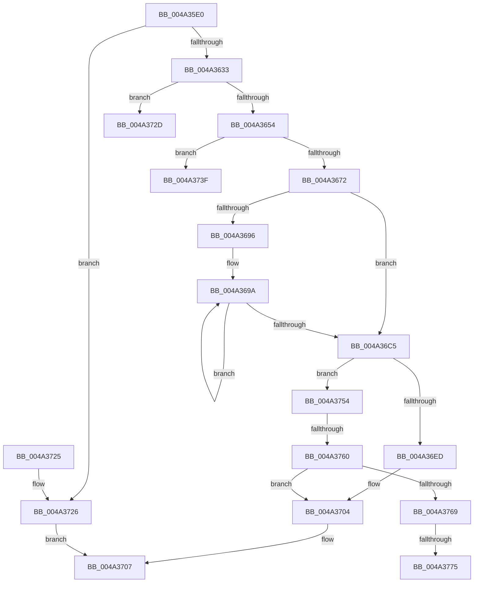

# HvlLpWriteMultipleMsr

- RVA: `0x004A35E0`–`0x004A3786` (길이 `422` bytes)
- VA: `0x00000001404A35E0`
- 실행 섹션: `.text`
- PDB 이름 있음: `예`; PDB Function 태그: `예`
- unwind 정보 RVA: `0x000B63B4`
- 디코드: `113`개 명령, `422/422` bytes 표시
- 미해석 바이트: `0` (있으면 어셈블리에 `.byte`로 보존)

> 이 문서는 커널 이미지의 기계어와 PDB 기호를 분석해 생성했습니다. 4번과 5번은 함수 원형과 자료형을 바이너리 사용 방식에서 추정한 C 해석이며 원본 소스 복구 결과는 아닙니다.

## 1. Dependencies

- 직접 호출 지점: **6**; 고유 호출 대상: **5**
- 직접 호출자로 확인된 함수: **0**
- RIP 상대 이미지 참조: **2**

### Outgoing calls
- `0x004A3664` → [ExpInterlockedPopEntrySList](../6B/ExpInterlockedPopEntrySList_function_006BA570.md) (function, `0x006BA570`)
- `0x004A36CF` → [HvcallInitiateHypercall](../31/HvcallInitiateHypercall_function_00313630.md) (function, `0x00313630`)
- `0x004A36FF` → [ExpInterlockedPushEntrySList](../6B/ExpInterlockedPushEntrySList_function_006BA5B0.md) (function, `0x006BA5B0`)
- `0x004A3734` → [KeDisableInterrupts](../21/KeDisableInterrupts_function_00217BE0.md) (function, `0x00217BE0`)
- `0x004A3746` → [KeDisableInterrupts](../21/KeDisableInterrupts_function_00217BE0.md) (function, `0x00217BE0`)
- `0x004A377B` → [KiLowerIrqlProcessIrqlFlags](../4F/KiLowerIrqlProcessIrqlFlags_function_004F5698.md) (function, `0x004F5698`)

### Direct callers
- 이 함수 시작 RVA로 연결되는 직접 call은 확인되지 않았습니다. 간접 호출은 완전히 역산할 수 없습니다.

### Static image references
- `0x004A3646` → RVA `0x00FC6A90` (`ALMOSTRO`; read)
- `0x004A3769` → RVA `0x00FC6D20` (`ALMOSTRO`; read)

## 2. Other-region calls and transfers

- 다른 실행 섹션으로 향하는 call: **0**
- call이 아닌 외부 분기/꼬리 이동: **5**
  - `0x004A373A` → [sub_006F9072](../6F/Unknown_function_006F9072.md) (`tail-transfer`)
  - `0x004A374F` → [sub_006F9072](../6F/Unknown_function_006F9072.md) (`tail-transfer`)
  - `0x004A375A` → [sub_006F9072 + 0x2F](../6F/Unknown_function_006F9072.md) (`tail-transfer`)
  - `0x004A376F` → [sub_006F9072 + 0x26](../6F/Unknown_function_006F9072.md) (`tail-transfer`)
  - `0x004A3781` → [sub_006F9072 + 0x26](../6F/Unknown_function_006F9072.md) (`tail-transfer`)

## 3. Assembly (complete function range)

```asm
004A35E0  48 8B C4                        mov rax, rsp
004A35E3  48 89 58 10                     mov qword ptr [rax + 0x10], rbx
004A35E7  48 89 70 18                     mov qword ptr [rax + 0x18], rsi
004A35EB  48 89 78 20                     mov qword ptr [rax + 0x20], rdi
004A35EF  89 48 08                        mov dword ptr [rax + 8], ecx
004A35F2  55                              push rbp
004A35F3  41 54                           push r12
004A35F5  41 55                           push r13
004A35F7  41 56                           push r14
004A35F9  41 57                           push r15
004A35FB  48 8B EC                        mov rbp, rsp
004A35FE  48 83 EC 50                     sub rsp, 0x50
004A3602  33 C0                           xor eax, eax
004A3604  44 8B F2                        mov r14d, edx
004A3607  48 89 45 E8                     mov qword ptr [rbp - 0x18], rax
004A360B  0F 57 C0                        xorps xmm0, xmm0
004A360E  89 45 F0                        mov dword ptr [rbp - 0x10], eax
004A3611  4D 8B E0                        mov r12, r8
004A3614  8B C2                           mov eax, edx
004A3616  4D 8B F9                        mov r15, r9
004A3619  48 C1 E0 05                     shl rax, 5
004A361D  44 8B C1                        mov r8d, ecx
004A3620  44 8B EA                        mov r13d, edx
004A3623  0F 11 45 D8                     movups xmmword ptr [rbp - 0x28], xmm0
004A3627  48 3D 00 10 00 00               cmp rax, 0x1000
004A362D  0F 87 F3 00 00 00               ja 0x1404a3726
004A3633  41 8B C6                        mov eax, r14d
004A3636  48 C7 45 D0 89 00 00 00         mov qword ptr [rbp - 0x30], 0x89
004A363E  25 FF 0F 00 00                  and eax, 0xfff
004A3643  89 45 D4                        mov dword ptr [rbp - 0x2c], eax
004A3646  8B 05 44 34 B2 00               mov eax, dword ptr [rip + 0xb23444]
004A364C  A8 08                           test al, 8
004A364E  0F 84 D9 00 00 00               je 0x1404a372d
004A3654  65 48 8B 1C 25 20 00 00 00      mov rbx, qword ptr gs:[0x20]
004A365D  48 8D 8B C0 8B 00 00            lea rcx, [rbx + 0x8bc0]
004A3664  E8 07 6F 21 00                  call 0x1406ba570
004A3669  48 85 C0                        test rax, rax
004A366C  0F 84 CD 00 00 00               je 0x1404a373f
004A3672  44 8B 45 30                     mov r8d, dword ptr [rbp + 0x30]
004A3676  BE 01 00 00 00                  mov esi, 1
004A367B  89 75 D8                        mov dword ptr [rbp - 0x28], esi
004A367E  48 8B F8                        mov rdi, rax
004A3681  48 89 5D E0                     mov qword ptr [rbp - 0x20], rbx
004A3685  48 89 45 E8                     mov qword ptr [rbp - 0x18], rax
004A3689  48 8B 58 10                     mov rbx, qword ptr [rax + 0x10]
004A368D  48 89 5D F0                     mov qword ptr [rbp - 0x10], rbx
004A3691  45 85 F6                        test r14d, r14d
004A3694  74 2F                           je 0x1404a36c5
004A3696  48 8D 48 08                     lea rcx, [rax + 8]
004A369A  44 89 41 F8                     mov dword ptr [rcx - 8], r8d
004A369E  C7 41 FC 01 00 01 00            mov dword ptr [rcx - 4], 0x10001
004A36A5  41 8B 04 24                     mov eax, dword ptr [r12]
004A36A9  4D 8D 64 24 04                  lea r12, [r12 + 4]
004A36AE  89 01                           mov dword ptr [rcx], eax
004A36B0  48 8D 49 20                     lea rcx, [rcx + 0x20]
004A36B4  49 8B 07                        mov rax, qword ptr [r15]
004A36B7  4D 8D 7F 08                     lea r15, [r15 + 8]
004A36BB  48 89 41 E8                     mov qword ptr [rcx - 0x18], rax
004A36BF  49 83 ED 01                     sub r13, 1
004A36C3  75 D5                           jne 0x1404a369a
004A36C5  48 8B 4D D0                     mov rcx, qword ptr [rbp - 0x30]
004A36C9  45 33 C0                        xor r8d, r8d
004A36CC  48 8B D3                        mov rdx, rbx
004A36CF  E8 5C FF E6 FF                  call 0x140313630
004A36D4  33 D2                           xor edx, edx
004A36D6  B9 01 00 00 C0                  mov ecx, 0xc0000001
004A36DB  66 85 C0                        test ax, ax
004A36DE  44 8B F2                        mov r14d, edx
004A36E1  44 0F 45 F1                     cmovne r14d, ecx
004A36E5  8B CA                           mov ecx, edx
004A36E7  40 F6 C6 01                     test sil, 1
004A36EB  74 67                           je 0x1404a3754
004A36ED  48 8B 4D E0                     mov rcx, qword ptr [rbp - 0x20]
004A36F1  48 8B D7                        mov rdx, rdi
004A36F4  48 81 C1 C0 8B 00 00            add rcx, 0x8bc0
004A36FB  48 89 5F 10                     mov qword ptr [rdi + 0x10], rbx
004A36FF  E8 AC 6E 21 00                  call 0x1406ba5b0
004A3704  41 8B C6                        mov eax, r14d
004A3707  4C 8D 5C 24 50                  lea r11, [rsp + 0x50]
004A370C  49 8B 5B 38                     mov rbx, qword ptr [r11 + 0x38]
004A3710  49 8B 73 40                     mov rsi, qword ptr [r11 + 0x40]
004A3714  49 8B 7B 48                     mov rdi, qword ptr [r11 + 0x48]
004A3718  49 8B E3                        mov rsp, r11
004A371B  41 5F                           pop r15
004A371D  41 5E                           pop r14
004A371F  41 5D                           pop r13
004A3721  41 5C                           pop r12
004A3723  5D                              pop rbp
004A3724  C3                              ret
004A3725  CC                              int3
004A3726  B8 0D 00 00 C0                  mov eax, 0xc000000d
004A372B  EB DA                           jmp 0x1404a3707
004A372D  C7 45 D8 04 00 00 00            mov dword ptr [rbp - 0x28], 4
004A3734  E8 A7 44 D7 FF                  call 0x140217be0
004A3739  90                              nop
004A373A  E9 33 59 25 00                  jmp 0x1406f9072
004A373F  C7 45 D8 04 00 00 00            mov dword ptr [rbp - 0x28], 4
004A3746  E8 95 44 D7 FF                  call 0x140217be0
004A374B  44 8B 45 30                     mov r8d, dword ptr [rbp + 0x30]
004A374F  E9 1E 59 25 00                  jmp 0x1406f9072
004A3754  41 B0 02                        mov r8b, 2
004A3757  41 84 F0                        test r8b, sil
004A375A  0F 84 41 59 25 00               je 0x1406f90a1
004A3760  0F B6 5D E0                     movzx ebx, byte ptr [rbp - 0x20]
004A3764  41 3A D8                        cmp bl, r8b
004A3767  73 9B                           jae 0x1404a3704
004A3769  39 15 B1 35 B2 00               cmp dword ptr [rip + 0xb235b1], edx
004A376F  0F 84 23 59 25 00               je 0x1406f9098
004A3775  44 0F 20 C1                     mov rcx, cr8
004A3779  8A D3                           mov dl, bl
004A377B  E8 18 1F 05 00                  call 0x1404f5698
004A3780  90                              nop
004A3781  E9 12 59 25 00                  jmp 0x1406f9098
```

## 4. C-style interpretation (structured pseudocode)

```c
__int64 __fastcall HvlLpWriteMultipleMsr(int a1, int a2, __int64 a3, __int64 a4)
{
    __int64 result;
    __int64 v_r13;
    __int64 v_r14;
    __int64 v_rsp;
    unsigned __int64 v_stack_m28;
    unsigned int v_stack_m38;
    unsigned __int64 v_stack_m40;
    unsigned __int64 v_stack_m48;
    unsigned __int64 v_stack_m50;
    unsigned int v_stack_m54;
    unsigned __int64 v_stack_m58;
    unsigned int v_stack_p8;

    *(unsigned __int64 *)(v_rsp + 16) = v_rbx;
    *(unsigned __int64 *)(v_rsp + 24) = v_rsi;
    *(unsigned __int64 *)(v_rsp + 32) = v_rdi;
    *(unsigned int *)(v_rsp + 8) = a1;
    v_rsp = (v_rsp) - (80);
    result = 0;
    v_stack_m40 = 0;
    v_stack_m38 = 0;
    result = ((unsigned int)(a2)) << (5);
    v_stack_m50 = v_xmm0;
    if (result > 0x1000ULL) goto loc_004A3726;
    v_stack_m58 = 137;
    result = (unsigned int)(((unsigned int)((unsigned int)((unsigned int)(a2)))) & (0xFFFULL));
    v_stack_m54 = (unsigned int)(result);
    if ((((unsigned __int8)((unsigned int)(*(unsigned int *)(v_rip + 11678788)))) & (8)) == 0) goto loc_004A372D;
    result = ExpInterlockedPopEntrySList(*(unsigned __int64 *)(gs_base + (0 + 32)) + 35776, a2, (unsigned int)(a1), a4);
    if (result == 0) goto loc_004A373F;
    v_stack_m50 = 1;
    v_stack_m48 = *(unsigned __int64 *)(gs_base + (0 + 32));
    v_stack_m40 = result;
    v_stack_m38 = *(unsigned __int64 *)(result + 16);
    if ((unsigned int)((unsigned int)(a2)) == 0) goto loc_004A36C5;
loc_004A369A:
    *(unsigned int *)(result + 8 - 8) = (unsigned int)((unsigned int)(v_stack_p8));
    *(unsigned int *)(result + 8 - 4) = 0x10001ULL;
    *(unsigned int *)(result + 8) = (unsigned int)((unsigned int)(*(unsigned int *)(a3)));
    *(unsigned __int64 *)(result + 8 + 32 - 24) = *(unsigned __int64 *)(a4);
    v_r13 = ((unsigned int)(a2)) - (1);
    if (condition_is_not_equal) goto loc_004A369A;
loc_004A36C5:
    a3 = 0;
    result = HvcallInitiateHypercall(v_stack_m58, *(unsigned __int64 *)(result + 16), a3, a4);
    a2 = 0;
    v_r14 = 0;
    if ((unsigned __int16)(result) != 0) { v_r14 = (unsigned int)((unsigned int)(0xC0000001ULL)); }
    if (1 == 0) goto loc_004A3754;
    a1 = (v_stack_m48) + (0x8BC0ULL);
    *(unsigned __int64 *)(result + 16) = *(unsigned __int64 *)(result + 16);
    result = ExpInterlockedPushEntrySList(a1, result, a3, a4);
loc_004A3704:
loc_004A3707:
    return (unsigned int)((unsigned int)(v_r14));
loc_004A3726:
    goto loc_004A3707;
loc_004A372D:
    v_stack_m50 = 4;
    result = KeDisableInterrupts(a1, result, a3, a4);
loc_004A373F:
    v_stack_m50 = 4;
    result = KeDisableInterrupts(a1, result, a3, a4);
loc_004A3754:
    if (((unsigned __int8)(v_stack_m48)) >= 2) goto loc_004A3704;
    result = KiLowerIrqlProcessIrqlFlags(v_cr8, (unsigned __int8)(v_stack_m48), 2, a4);
}
```

## 5. (Beta) C Style

```c
int64_t HvlLpWriteMultipleMsr(int32_t Arg1, int32_t Arg2, void *Arg3, void *Arg4)
{
    uint8_t *arg3 = (uint8_t *)Arg3;
    uint8_t *arg4 = (uint8_t *)Arg4;

    int64_t result;
    int64_t local_r13;
    int64_t local_r14;
    int64_t local_rsp;
    uint64_t v_stack_m28;
    uint32_t v_stack_m38;
    uint64_t v_stack_m40;
    uint64_t v_stack_m48;
    uint64_t v_stack_m50;
    uint32_t v_stack_m54;
    uint64_t v_stack_m58;
    uint32_t v_stack_p8;

    *(uint64_t *)(local_rsp + 0x10) = local_rbx;
    *(uint64_t *)(local_rsp + 0x18) = local_rsi;
    *(uint64_t *)(local_rsp + 0x20) = local_rdi;
    *(uint32_t *)(local_rsp + 0x8) = Arg1;
    local_rsp = (local_rsp) - (80);
    result = 0;
    v_stack_m40 = 0;
    v_stack_m38 = 0;
    result = ((uint32_t)(Arg2)) << (5);
    v_stack_m50 = v_xmm0;
    if (result > 0x1000ULL) goto loc_004A3726;
    v_stack_m58 = 137;
    result = (uint32_t)(((uint32_t)((uint32_t)((uint32_t)(Arg2)))) & (0xFFFULL));
    v_stack_m54 = (uint32_t)(result);
    if ((((uint8_t)((uint32_t)(*(uint32_t *)(v_rip + 0xB23444)))) & (8)) == 0) goto loc_004A372D;
    result = ExpInterlockedPopEntrySList(*(uint64_t *)(gs_base + (0 + 0x20)) + 35776, Arg2, (uint32_t)(Arg1), Arg4);
    if (result == 0) goto loc_004A373F;
    v_stack_m50 = 1;
    v_stack_m48 = *(uint64_t *)(gs_base + (0 + 0x20));
    v_stack_m40 = result;
    v_stack_m38 = *(uint64_t *)(result + 0x10);
    if ((uint32_t)((uint32_t)(Arg2)) == 0) goto loc_004A36C5;
loc_004A369A:
    *(uint32_t *)(result + 0x8 - 0x8) = (uint32_t)((uint32_t)(v_stack_p8));
    *(uint32_t *)(result + 0x8 - 0x4) = 0x10001ULL;
    *(uint32_t *)(result + 0x8) = (uint32_t)((uint32_t)(*(uint32_t *)(arg3)));
    *(uint64_t *)(result + 0x8 + 0x20 - 0x18) = *(uint64_t *)(arg4);
    local_r13 = ((uint32_t)(Arg2)) - (1);
    if (condition_is_not_equal) goto loc_004A369A;
loc_004A36C5:
    Arg3 = 0;
    result = HvcallInitiateHypercall(v_stack_m58, *(uint64_t *)(result + 0x10), Arg3, Arg4);
    Arg2 = 0;
    local_r14 = 0;
    if ((uint16_t)(result) != 0) { local_r14 = (uint32_t)((uint32_t)(0xC0000001ULL)); }
    if (1 == 0) goto loc_004A3754;
    Arg1 = (v_stack_m48) + (0x8BC0ULL);
    *(uint64_t *)(result + 0x10) = *(uint64_t *)(result + 0x10);
    result = ExpInterlockedPushEntrySList(Arg1, result, Arg3, Arg4);
loc_004A3704:
loc_004A3707:
    return (uint32_t)((uint32_t)(local_r14));
loc_004A3726:
    goto loc_004A3707;
loc_004A372D:
    v_stack_m50 = 4;
    result = KeDisableInterrupts(Arg1, result, Arg3, Arg4);
loc_004A373F:
    v_stack_m50 = 4;
    result = KeDisableInterrupts(Arg1, result, Arg3, Arg4);
loc_004A3754:
    if (((uint8_t)(v_stack_m48)) >= 2) goto loc_004A3704;
    result = KiLowerIrqlProcessIrqlFlags(v_cr8, (uint8_t)(v_stack_m48), 2, Arg4);
}
```

### 관측된 메모리 오프셋

구조체 형식이 확인되지 않은 접근은 인자 기준의 오프셋으로만 기록했습니다.

| 기준 인자 | 오프셋 표현 | 폭 (bit) | 접근 |
|---|---:|---:|---|
| `Arg3` | `+ 0x0` | `32` | `R` |
| `Arg3` | `+ 0x4` | `64` | `R` |
| `Arg4` | `+ 0x0` | `64` | `R` |
| `Arg4` | `+ 0x8` | `64` | `R` |

## 6. Execution-region graph

[열기: 2D/3D 그래프와 함수 탐색 컨트롤 패널](../../../control-panel.html?section=text&rva=0x004A35E0&view=graph)

- 2D 그래프는 위에서 아래로 흐르고, 3D 그래프는 빈 공간을 드래그해 회전합니다. Shift+드래그는 이동, 휠은 확대·축소, 함수 노드 선택은 대상 보고서 이동입니다.

### Static fallback


