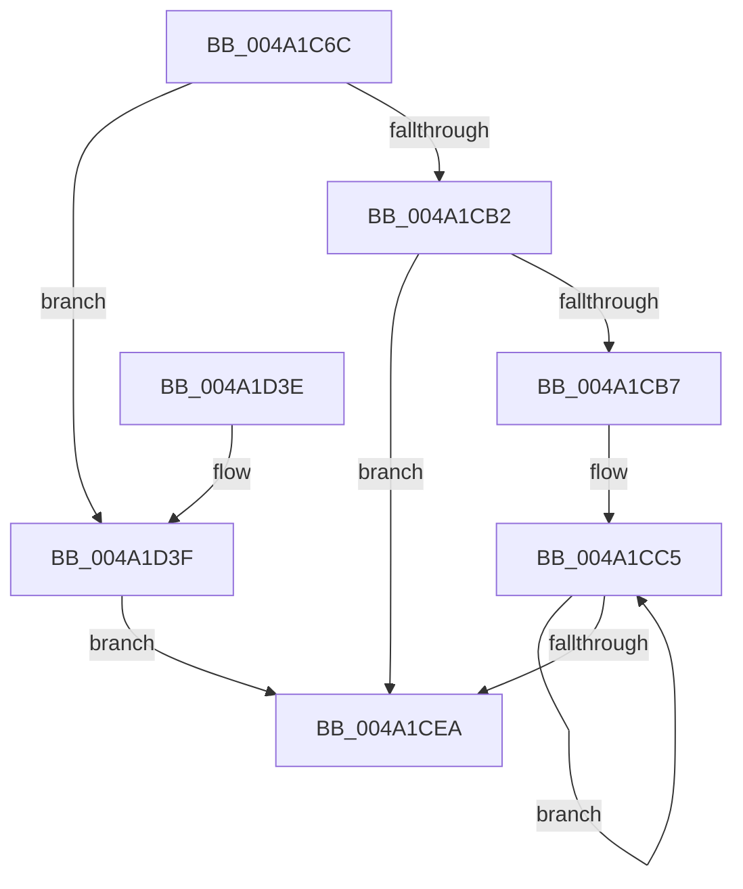

# HvlpFastFlushPasidAddressList

- RVA: `0x004A1C6C`–`0x004A1D5A` (길이 `238` bytes)
- VA: `0x00000001404A1C6C`
- 실행 섹션: `.text`
- PDB 이름 있음: `예`; PDB Function 태그: `아니요`
- unwind 정보 RVA: `0x000B5CC4`
- 디코드: `55`개 명령, `238/238` bytes 표시
- 미해석 바이트: `0` (있으면 어셈블리에 `.byte`로 보존)

> 이 문서는 커널 이미지의 기계어와 PDB 기호를 분석해 생성했습니다. 4번과 5번은 함수 원형과 자료형을 바이너리 사용 방식에서 추정한 C 해석이며 원본 소스 복구 결과는 아닙니다.

## 1. Dependencies

- 직접 호출 지점: **3**; 고유 호출 대상: **3**
- 직접 호출자로 확인된 함수: **1**
- RIP 상대 이미지 참조: **1**

### Outgoing calls
- `0x004A1D18` → [HvcallFastExtended](../31/HvcallFastExtended_function_003130E0.md) (function, `0x003130E0`)
- `0x004A1D28` → [_security_check_cookie](../6A/_security_check_cookie_function_006AC640.md) (function, `0x006AC640`)
- `0x004A1D4E` → [memcpy](../6C/memcpy_function_006C6840.md) (function, `0x006C6840`)

### Direct callers
- [HvlFlushPasid](HvlFlushPasid_function_004A1C30.md) at `0x004A1C4D`

### Static image references
- `0x004A1C7B` → RVA `0x00E0A740` (`.data`; read)

## 2. Other-region calls and transfers

- 다른 실행 섹션으로 향하는 call: **0**
- 별도 외부 분기/꼬리 이동을 확인하지 못했습니다.

## 3. Assembly (complete function range)

```asm
004A1C6C  4C 8B DC                        mov r11, rsp
004A1C6F  49 89 5B 08                     mov qword ptr [r11 + 8], rbx
004A1C73  57                              push rdi
004A1C74  48 81 EC C0 00 00 00            sub rsp, 0xc0
004A1C7B  48 8B 05 BE 8A 96 00            mov rax, qword ptr [rip + 0x968abe]
004A1C82  48 33 C4                        xor rax, rsp
004A1C85  48 89 84 24 B0 00 00 00         mov qword ptr [rsp + 0xb0], rax
004A1C8D  49 83 63 80 00                  and qword ptr [r11 - 0x80], 0
004A1C92  80 BC 24 F0 00 00 00 00         cmp byte ptr [rsp + 0xf0], 0
004A1C9A  41 8B D8                        mov ebx, r8d
004A1C9D  89 4C 24 44                     mov dword ptr [rsp + 0x44], ecx
004A1CA1  89 54 24 40                     mov dword ptr [rsp + 0x40], edx
004A1CA5  8D 3C DD 10 00 00 00            lea edi, [rbx*8 + 0x10]
004A1CAC  0F 85 8D 00 00 00               jne 0x1404a1d3f
004A1CB2  45 85 C0                        test r8d, r8d
004A1CB5  74 33                           je 0x1404a1cea
004A1CB7  49 8D 43 88                     lea rax, [r11 - 0x78]
004A1CBB  44 8B C3                        mov r8d, ebx
004A1CBE  4C 2B C8                        sub r9, rax
004A1CC1  49 8D 53 88                     lea rdx, [r11 - 0x78]
004A1CC5  49 8B 04 11                     mov rax, qword ptr [r9 + rdx]
004A1CC9  48 8B C8                        mov rcx, rax
004A1CCC  81 E1 00 0C 00 00               and ecx, 0xc00
004A1CD2  48 03 C8                        add rcx, rax
004A1CD5  25 00 08 00 00                  and eax, 0x800
004A1CDA  48 0B C8                        or rcx, rax
004A1CDD  48 89 0A                        mov qword ptr [rdx], rcx
004A1CE0  48 8D 52 08                     lea rdx, [rdx + 8]
004A1CE4  49 83 E8 01                     sub r8, 1
004A1CE8  75 DB                           jne 0x1404a1cc5
004A1CEA  83 64 24 20 00                  and dword ptr [rsp + 0x20], 0
004A1CEF  48 8D 54 24 40                  lea rdx, [rsp + 0x40]
004A1CF4  48 C7 44 24 30 A1 00 00 00      mov qword ptr [rsp + 0x30], 0xa1
004A1CFD  81 E3 FF 0F 00 00               and ebx, 0xfff
004A1D03  0F BA 6C 24 30 10               bts dword ptr [rsp + 0x30], 0x10
004A1D09  45 33 C9                        xor r9d, r9d
004A1D0C  89 5C 24 34                     mov dword ptr [rsp + 0x34], ebx
004A1D10  44 8B C7                        mov r8d, edi
004A1D13  48 8B 4C 24 30                  mov rcx, qword ptr [rsp + 0x30]
004A1D18  E8 C3 13 E7 FF                  call 0x1403130e0
004A1D1D  48 8B 8C 24 B0 00 00 00         mov rcx, qword ptr [rsp + 0xb0]
004A1D25  48 33 CC                        xor rcx, rsp
004A1D28  E8 13 A9 20 00                  call 0x1406ac640
004A1D2D  48 8B 9C 24 D0 00 00 00         mov rbx, qword ptr [rsp + 0xd0]
004A1D35  48 81 C4 C0 00 00 00            add rsp, 0xc0
004A1D3C  5F                              pop rdi
004A1D3D  C3                              ret
004A1D3E  CC                              int3
004A1D3F  4C 8B C3                        mov r8, rbx
004A1D42  48 8D 4C 24 50                  lea rcx, [rsp + 0x50]
004A1D47  49 C1 E0 03                     shl r8, 3
004A1D4B  49 8B D1                        mov rdx, r9
004A1D4E  E8 ED 4A 22 00                  call 0x1406c6840
004A1D53  83 4C 24 48 01                  or dword ptr [rsp + 0x48], 1
004A1D58  EB 90                           jmp 0x1404a1cea
```

## 4. C-style interpretation (structured pseudocode)

```c
__int64 __fastcall HvlpFastFlushPasidAddressList(int a1, int a2, int a3, __int64 a4, unsigned __int8 a5)
{
    __int64 result;
    __int64 v_rbx;
    __int64 v_rsp;
    unsigned __int64 v_stack_m18;
    unsigned int v_stack_m84;
    unsigned int v_stack_m88;
    unsigned int v_stack_m94;
    unsigned __int64 v_stack_m98;
    unsigned int v_stack_mA8;
    unsigned int v_stack_p48;
    unsigned __int64 v_stack_p50;
    unsigned __int64 v_stack_p8;

    *(unsigned __int64 *)(v_rsp + 8) = v_rbx;
    v_rsp = (v_rsp) - (192);
    result = (*(unsigned __int64 *)(v_rip + 9865918)) ^ (v_rsp);
    v_stack_m18 = result;
    v_stack_m84 = a1;
    v_stack_m88 = a2;
    if (a5 != 0) goto loc_004A1D3F;
    if (a3 == 0) goto loc_004A1CEA;
    a4 = (a4) - (v_rsp - 120);
loc_004A1CC5:
    a1 = (unsigned int)((*(unsigned __int64 *)(a4 + v_rsp - 120 * 1)) & (0xC00ULL));
    a1 = (a1) + (*(unsigned __int64 *)(a4 + v_rsp - 120 * 1));
    result = (unsigned int)((*(unsigned __int64 *)(a4 + v_rsp - 120 * 1)) & (0x800ULL));
    a1 = (a1) | (result);
    *(unsigned __int64 *)(v_rsp - 120) = a1;
    a3 = ((unsigned int)((unsigned int)((unsigned int)(a3)))) - (1);
    if (condition_is_not_equal) goto loc_004A1CC5;
loc_004A1CEA:
    v_stack_m98 = 161;
    v_rbx = (unsigned int)(((unsigned int)(a3)) & (0xFFFULL));
    a4 = 0;
    v_stack_m94 = (unsigned int)(v_rbx);
    result = HvcallFastExtended(v_stack_m98, v_stack_m88, (unsigned int)((unsigned int)((unsigned int)(a3) * 8 + 16)), a4);
    a1 = (v_stack_m18) ^ (v_rsp);
    result = _security_check_cookie(a1, v_stack_m88, (unsigned int)((unsigned int)((unsigned int)(a3) * 8 + 16)), a4);
    v_rsp = (v_rsp) + (192);
    return result;
loc_004A1D3F:
    a3 = (v_stack_p8) << (3);
    result = memcpy(v_stack_p50, 0, a3, a4);
    goto loc_004A1CEA;
}
```

## 5. (Beta) C Style

```c
int64_t HvlpFastFlushPasidAddressList(int32_t Arg1, int32_t Arg2, int32_t Arg3, void *Arg4, uint8_t Arg5)
{
    uint8_t *arg4 = (uint8_t *)Arg4;

    int64_t result;
    int64_t local_rbx;
    int64_t local_rsp;
    uint64_t v_stack_m18;
    uint32_t v_stack_m84;
    uint32_t v_stack_m88;
    uint32_t v_stack_m94;
    uint64_t v_stack_m98;
    uint32_t v_stack_mA8;
    uint32_t v_stack_p48;
    uint64_t v_stack_p50;
    uint64_t v_stack_p8;

    *(uint64_t *)(local_rsp + 0x8) = local_rbx;
    local_rsp = (local_rsp) - (192);
    result = (*(uint64_t *)(v_rip + 0x968ABE)) ^ (local_rsp);
    v_stack_m18 = result;
    v_stack_m84 = Arg1;
    v_stack_m88 = Arg2;
    if (Arg5 != 0) goto loc_004A1D3F;
    if (Arg3 == 0) goto loc_004A1CEA;
    Arg4 = (Arg4) - (local_rsp - 120);
loc_004A1CC5:
    Arg1 = (uint32_t)((*(uint64_t *)(arg4 + local_rsp - 0x78 * 1)) & (0xC00ULL));
    Arg1 = (Arg1) + (*(uint64_t *)(arg4 + local_rsp - 0x78 * 1));
    result = (uint32_t)((*(uint64_t *)(arg4 + local_rsp - 0x78 * 1)) & (0x800ULL));
    Arg1 = (Arg1) | (result);
    *(uint64_t *)(local_rsp - 0x78) = Arg1;
    Arg3 = ((uint32_t)((uint32_t)((uint32_t)(Arg3)))) - (1);
    if (condition_is_not_equal) goto loc_004A1CC5;
loc_004A1CEA:
    v_stack_m98 = 161;
    local_rbx = (uint32_t)(((uint32_t)(Arg3)) & (0xFFFULL));
    Arg4 = 0;
    v_stack_m94 = (uint32_t)(local_rbx);
    result = HvcallFastExtended(v_stack_m98, v_stack_m88, (uint32_t)((uint32_t)((uint32_t)(Arg3) * 8 + 16)), Arg4);
    Arg1 = (v_stack_m18) ^ (local_rsp);
    result = _security_check_cookie(Arg1, v_stack_m88, (uint32_t)((uint32_t)((uint32_t)(Arg3) * 8 + 16)), Arg4);
    local_rsp = (local_rsp) + (192);
    return result;
loc_004A1D3F:
    Arg3 = (v_stack_p8) << (3);
    result = memcpy(v_stack_p50, 0, Arg3, Arg4);
    goto loc_004A1CEA;
}
```

### 관측된 메모리 오프셋

구조체 형식이 확인되지 않은 접근은 인자 기준의 오프셋으로만 기록했습니다.

| 기준 인자 | 오프셋 표현 | 폭 (bit) | 접근 |
|---|---:|---:|---|
| `Arg4` | `+ 0x0 + rdx*1` | `64` | `R` |

## 6. Execution-region graph

[열기: 2D/3D 그래프와 함수 탐색 컨트롤 패널](../../../control-panel.html?section=text&rva=0x004A1C6C&view=graph)

- 2D 그래프는 위에서 아래로 흐르고, 3D 그래프는 빈 공간을 드래그해 회전합니다. Shift+드래그는 이동, 휠은 확대·축소, 함수 노드 선택은 대상 보고서 이동입니다.

### Static fallback


