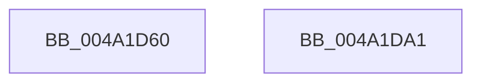

# HvlpFlushPasidAddressSpace

- RVA: `0x004A1D60`–`0x004A1DA2` (길이 `66` bytes)
- VA: `0x00000001404A1D60`
- 실행 섹션: `.text`
- PDB 이름 있음: `예`; PDB Function 태그: `아니요`
- unwind 정보 RVA: `0x00082420`
- 디코드: `16`개 명령, `66/66` bytes 표시
- 미해석 바이트: `0` (있으면 어셈블리에 `.byte`로 보존)

> 이 문서는 커널 이미지의 기계어와 PDB 기호를 분석해 생성했습니다. 4번과 5번은 함수 원형과 자료형을 바이너리 사용 방식에서 추정한 C 해석이며 원본 소스 복구 결과는 아닙니다.

## 1. Dependencies

- 직접 호출 지점: **1**; 고유 호출 대상: **1**
- 직접 호출자로 확인된 함수: **2**
- RIP 상대 이미지 참조: **0**

### Outgoing calls
- `0x004A1D97` → [HvcallFastExtended](../31/HvcallFastExtended_function_003130E0.md) (function, `0x003130E0`)

### Direct callers
- [HvlFlushPasid](HvlFlushPasid_function_004A1C30.md) at `0x004A1C58`
- [HvlpSlowFlushPasidAddressList](../58/HvlpSlowFlushPasidAddressList_function_00589EE4.md) at `0x00589F37`

### Static image references
- 디코드된 RIP-relative 메모리 참조가 없습니다.

## 2. Other-region calls and transfers

- 다른 실행 섹션으로 향하는 call: **0**
- 별도 외부 분기/꼬리 이동을 확인하지 못했습니다.

## 3. Assembly (complete function range)

```asm
004A1D60  48 8B C4                        mov rax, rsp
004A1D63  48 83 EC 48                     sub rsp, 0x48
004A1D67  48 83 60 F0 00                  and qword ptr [rax - 0x10], 0
004A1D6C  45 33 C9                        xor r9d, r9d
004A1D6F  83 60 D8 00                     and dword ptr [rax - 0x28], 0
004A1D73  48 C7 44 24 60 A0 00 00 00      mov qword ptr [rsp + 0x60], 0xa0
004A1D7C  89 48 EC                        mov dword ptr [rax - 0x14], ecx
004A1D7F  89 50 E8                        mov dword ptr [rax - 0x18], edx
004A1D82  45 8D 41 10                     lea r8d, [r9 + 0x10]
004A1D86  C7 44 24 60 A0 00 01 00         mov dword ptr [rsp + 0x60], 0x100a0
004A1D8E  48 8D 50 E8                     lea rdx, [rax - 0x18]
004A1D92  48 8B 4C 24 60                  mov rcx, qword ptr [rsp + 0x60]
004A1D97  E8 44 13 E7 FF                  call 0x1403130e0
004A1D9C  48 83 C4 48                     add rsp, 0x48
004A1DA0  C3                              ret
004A1DA1  CC                              int3
```

## 4. C-style interpretation (structured pseudocode)

```c
__int64 __fastcall HvlpFlushPasidAddressSpace(int a1, int a2, __int64 a3, int a4)
{
    __int64 result;
    __int64 v_rsp;
    unsigned __int64 v_stack_p18;

    v_rsp = (v_rsp) - (72);
    a4 = 0;
    v_stack_p18 = 160;
    *(unsigned int *)(v_rsp - 20) = a1;
    *(unsigned int *)(v_rsp - 24) = a2;
    v_stack_p18 = 0x100A0ULL;
    result = HvcallFastExtended(v_stack_p18, v_rsp - 24, a4 + 16, a4);
    v_rsp = (v_rsp) + (72);
    return result;
}
```

## 5. (Beta) C Style

```c
int64_t HvlpFlushPasidAddressSpace(int32_t Arg1, int32_t Arg2, int64_t Arg3, int32_t Arg4)
{
    int64_t result;
    int64_t local_rsp;
    uint64_t v_stack_p18;

    local_rsp = (local_rsp) - (72);
    Arg4 = 0;
    v_stack_p18 = 160;
    *(uint32_t *)(local_rsp - 0x14) = Arg1;
    *(uint32_t *)(local_rsp - 0x18) = Arg2;
    v_stack_p18 = 0x100A0ULL;
    result = HvcallFastExtended(v_stack_p18, local_rsp - 24, Arg4 + 16, Arg4);
    local_rsp = (local_rsp) + (72);
    return result;
}
```

## 6. Execution-region graph

[열기: 2D/3D 그래프와 함수 탐색 컨트롤 패널](../../../control-panel.html?section=text&rva=0x004A1D60&view=graph)

- 2D 그래프는 위에서 아래로 흐르고, 3D 그래프는 빈 공간을 드래그해 회전합니다. Shift+드래그는 이동, 휠은 확대·축소, 함수 노드 선택은 대상 보고서 이동입니다.

### Static fallback


