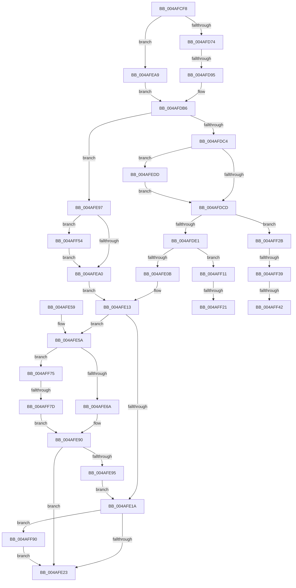

# HvlpSlowFlushListTbEx

- RVA: `0x004AFCF8`–`0x004AFFA3` (길이 `683` bytes)
- VA: `0x00000001404AFCF8`
- 실행 섹션: `.text`
- PDB 이름 있음: `예`; PDB Function 태그: `예`
- unwind 정보 RVA: `0x000B887C`
- 디코드: `171`개 명령, `683/683` bytes 표시
- 미해석 바이트: `0` (있으면 어셈블리에 `.byte`로 보존)

> 이 문서는 커널 이미지의 기계어와 PDB 기호를 분석해 생성했습니다. 4번과 5번은 함수 원형과 자료형을 바이너리 사용 방식에서 추정한 C 해석이며 원본 소스 복구 결과는 아닙니다.

## 1. Dependencies

- 직접 호출 지점: **10**; 고유 호출 대상: **10**
- 직접 호출자로 확인된 함수: **1**
- RIP 상대 이미지 참조: **2**

### Outgoing calls
- `0x004AFD84` → [ExpInterlockedPopEntrySList](../6B/ExpInterlockedPopEntrySList_function_006BA570.md) (function, `0x006BA570`)
- `0x004AFDFD` → [HvlpCopyFlushVaList](../31/HvlpCopyFlushVaList_function_00313CC0.md) (function, `0x00313CC0`)
- `0x004AFE27` → [HvlpReleaseHypercallPage](../31/HvlpReleaseHypercallPage_function_00313480.md) (function, `0x00313480`)
- `0x004AFE33` → [_security_check_cookie](../6A/_security_check_cookie_function_006AC640.md) (function, `0x006AC640`)
- `0x004AFE87` → [VslSlowFlushSecureRangeList](../31/VslSlowFlushSecureRangeList_function_00314D44.md) (function, `0x00314D44`)
- `0x004AFEB0` → [KeDisableInterrupts](../21/KeDisableInterrupts_function_00217BE0.md) (function, `0x00217BE0`)
- `0x004AFEF9` → [HvlpAffinityToHvProcessorSet](../30/HvlpAffinityToHvProcessorSet_function_003068F4.md) (function, `0x003068F4`)
- `0x004AFF49` → [memcpy](../6C/memcpy_function_006C6840.md) (function, `0x006C6840`)
- `0x004AFF83` → [HvlpSecureFlushLargeRangeList](../6A/HvlpSecureFlushLargeRangeList_function_006A7C38.md) (function, `0x006A7C38`)
- `0x004AFF99` → [HvcallInitiateHypercall](../31/HvcallInitiateHypercall_function_00313630.md) (function, `0x00313630`)

### Direct callers
- [HvlpFlushRangeListTbEx](../30/HvlpFlushRangeListTbEx_function_00306670.md) at `0x00306750`

### Static image references
- `0x004AFD1B` → RVA `0x00E0A740` (`.data`; read)
- `0x004AFD49` → RVA `0x00FC6A90` (`ALMOSTRO`; read)

## 2. Other-region calls and transfers

- 다른 실행 섹션으로 향하는 call: **0**
- call이 아닌 외부 분기/꼬리 이동: **7**
  - `0x004AFD8F` → [sub_006FB0BC](../6F/Unknown_function_006FB0BC.md) (`tail-transfer`)
  - `0x004AFF1B` → [sub_006FB0BC + 0x62](../6F/Unknown_function_006FB0BC.md) (`tail-transfer`)
  - `0x004AFF26` → [sub_006FB0BC + 0x62](../6F/Unknown_function_006FB0BC.md) (`tail-transfer`)
  - `0x004AFF33` → [sub_006FB0BC + 0xD3](../6F/Unknown_function_006FB0BC.md) (`tail-transfer`)
  - `0x004AFF3C` → [sub_006FB0BC + 0xA3](../6F/Unknown_function_006FB0BC.md) (`tail-transfer`)
  - `0x004AFF4F` → [sub_006FB0BC + 0xA3](../6F/Unknown_function_006FB0BC.md) (`tail-transfer`)
  - `0x004AFF77` → [sub_006FB0BC + 0xFF](../6F/Unknown_function_006FB0BC.md) (`tail-transfer`)

## 3. Assembly (complete function range)

```asm
004AFCF8  48 8B C4                        mov rax, rsp
004AFCFB  48 89 58 08                     mov qword ptr [rax + 8], rbx
004AFCFF  48 89 70 18                     mov qword ptr [rax + 0x18], rsi
004AFD03  48 89 78 20                     mov qword ptr [rax + 0x20], rdi
004AFD07  55                              push rbp
004AFD08  41 54                           push r12
004AFD0A  41 55                           push r13
004AFD0C  41 56                           push r14
004AFD0E  41 57                           push r15
004AFD10  48 8D 68 B9                     lea rbp, [rax - 0x47]
004AFD14  48 81 EC C0 00 00 00            sub rsp, 0xc0
004AFD1B  48 8B 05 1E AA 95 00            mov rax, qword ptr [rip + 0x95aa1e]
004AFD22  48 33 C4                        xor rax, rsp
004AFD25  48 89 45 0F                     mov qword ptr [rbp + 0xf], rax
004AFD29  48 8B 45 77                     mov rax, qword ptr [rbp + 0x77]
004AFD2D  33 FF                           xor edi, edi
004AFD2F  48 89 45 C7                     mov qword ptr [rbp - 0x39], rax
004AFD33  45 8A E1                        mov r12b, r9b
004AFD36  33 C0                           xor eax, eax
004AFD38  44 89 45 A3                     mov dword ptr [rbp - 0x5d], r8d
004AFD3C  45 33 C9                        xor r9d, r9d
004AFD3F  48 89 45 B7                     mov qword ptr [rbp - 0x49], rax
004AFD43  45 33 C0                        xor r8d, r8d
004AFD46  89 45 BF                        mov dword ptr [rbp - 0x41], eax
004AFD49  8B 05 41 6D B1 00               mov eax, dword ptr [rip + 0xb16d41]
004AFD4F  44 8D 7F 01                     lea r15d, [rdi + 1]
004AFD53  48 89 55 97                     mov qword ptr [rbp - 0x69], rdx
004AFD57  0F 57 C0                        xorps xmm0, xmm0
004AFD5A  44 89 4D 93                     mov dword ptr [rbp - 0x6d], r9d
004AFD5E  4C 8B D2                        mov r10, rdx
004AFD61  44 89 45 9F                     mov dword ptr [rbp - 0x61], r8d
004AFD65  4C 8B E9                        mov r13, rcx
004AFD68  0F 11 45 A7                     movups xmmword ptr [rbp - 0x59], xmm0
004AFD6C  A8 08                           test al, 8
004AFD6E  0F 84 35 01 00 00               je 0x1404afea9
004AFD74  65 48 8B 1C 25 20 00 00 00      mov rbx, qword ptr gs:[0x20]
004AFD7D  48 8D 8B C0 8B 00 00            lea rcx, [rbx + 0x8bc0]
004AFD84  E8 E7 A7 20 00                  call 0x1406ba570
004AFD89  48 8B F0                        mov rsi, rax
004AFD8C  48 85 C0                        test rax, rax
004AFD8F  0F 84 27 B3 24 00               je 0x1406fb0bc
004AFD95  48 89 5D AF                     mov qword ptr [rbp - 0x51], rbx
004AFD99  45 8B F7                        mov r14d, r15d
004AFD9C  48 8B 58 10                     mov rbx, qword ptr [rax + 0x10]
004AFDA0  48 89 5D BF                     mov qword ptr [rbp - 0x41], rbx
004AFDA4  44 89 7D A7                     mov dword ptr [rbp - 0x59], r15d
004AFDA8  48 89 45 B7                     mov qword ptr [rbp - 0x49], rax
004AFDAC  4C 8B 55 97                     mov r10, qword ptr [rbp - 0x69]
004AFDB0  44 8B CF                        mov r9d, edi
004AFDB3  44 8B C7                        mov r8d, edi
004AFDB6  B9 02 00 00 00                  mov ecx, 2
004AFDBB  44 84 F1                        test cl, r14b
004AFDBE  0F 85 D3 00 00 00               jne 0x1404afe97
004AFDC4  45 84 E4                        test r12b, r12b
004AFDC7  0F 85 10 01 00 00               jne 0x1404afedd
004AFDCD  8B 4D 7F                        mov ecx, dword ptr [rbp + 0x7f]
004AFDD0  49 8D 14 C8                     lea rdx, [r8 + rcx*8]
004AFDD4  48 81 FA 00 10 00 00            cmp rdx, 0x1000
004AFDDB  0F 87 4A 01 00 00               ja 0x1404aff2b
004AFDE1  4C 8B 6D C7                     mov r13, qword ptr [rbp - 0x39]
004AFDE5  4D 8D 0C 30                     lea r9, [r8 + rsi]
004AFDE9  44 8B 05 A0 6C B1 00            mov r8d, dword ptr [rip + 0xb16ca0]
004AFDF0  49 8B D5                        mov rdx, r13
004AFDF3  8B 4D 6F                        mov ecx, dword ptr [rbp + 0x6f]
004AFDF6  41 C1 E8 0D                     shr r8d, 0xd
004AFDFA  45 22 C7                        and r8b, r15b
004AFDFD  E8 BE 3E E6 FF                  call 0x140313cc0
004AFE02  45 84 E4                        test r12b, r12b
004AFE05  0F 85 06 01 00 00               jne 0x1404aff11
004AFE0B  45 32 FF                        xor r15b, r15b
004AFE0E  B9 02 00 00 00                  mov ecx, 2
004AFE13  8B 45 A3                        mov eax, dword ptr [rbp - 0x5d]
004AFE16  85 C0                           test eax, eax
004AFE18  75 40                           jne 0x1404afe5a
004AFE1A  45 84 E4                        test r12b, r12b
004AFE1D  0F 85 6D 01 00 00               jne 0x1404aff90
004AFE23  48 8D 4D A7                     lea rcx, [rbp - 0x59]
004AFE27  E8 54 36 E6 FF                  call 0x140313480
004AFE2C  48 8B 4D 0F                     mov rcx, qword ptr [rbp + 0xf]
004AFE30  48 33 CC                        xor rcx, rsp
004AFE33  E8 08 C8 1F 00                  call 0x1406ac640
004AFE38  4C 8D 9C 24 C0 00 00 00         lea r11, [rsp + 0xc0]
004AFE40  49 8B 5B 30                     mov rbx, qword ptr [r11 + 0x30]
004AFE44  49 8B 73 40                     mov rsi, qword ptr [r11 + 0x40]
004AFE48  49 8B 7B 48                     mov rdi, qword ptr [r11 + 0x48]
004AFE4C  49 8B E3                        mov rsp, r11
004AFE4F  41 5F                           pop r15
004AFE51  41 5E                           pop r14
004AFE53  41 5D                           pop r13
004AFE55  41 5C                           pop r12
004AFE57  5D                              pop rbp
004AFE58  C3                              ret
004AFE59  CC                              int3
004AFE5A  45 32 F6                        xor r14b, r14b
004AFE5D  44 88 75 8F                     mov byte ptr [rbp - 0x71], r14b
004AFE61  45 84 FF                        test r15b, r15b
004AFE64  0F 85 0B 01 00 00               jne 0x1404aff75
004AFE6A  44 8B 4D 7F                     mov r9d, dword ptr [rbp + 0x7f]
004AFE6E  48 8D 4D 8F                     lea rcx, [rbp - 0x71]
004AFE72  48 89 4C 24 28                  mov qword ptr [rsp + 0x28], rcx
004AFE77  44 8B C0                        mov r8d, eax
004AFE7A  8B 4D 9F                        mov ecx, dword ptr [rbp - 0x61]
004AFE7D  48 8B D6                        mov rdx, rsi
004AFE80  89 4C 24 20                     mov dword ptr [rsp + 0x20], ecx
004AFE84  48 8B CB                        mov rcx, rbx
004AFE87  E8 B8 4E E6 FF                  call 0x140314d44
004AFE8C  44 8A 75 8F                     mov r14b, byte ptr [rbp - 0x71]
004AFE90  45 84 F6                        test r14b, r14b
004AFE93  75 8E                           jne 0x1404afe23
004AFE95  EB 83                           jmp 0x1404afe1a
004AFE97  45 84 E4                        test r12b, r12b
004AFE9A  0F 85 B4 00 00 00               jne 0x1404aff54
004AFEA0  4C 8B 6D C7                     mov r13, qword ptr [rbp - 0x39]
004AFEA4  E9 6A FF FF FF                  jmp 0x1404afe13
004AFEA9  C7 45 A7 04 00 00 00            mov dword ptr [rbp - 0x59], 4
004AFEB0  E8 2B 7D D6 FF                  call 0x140217be0
004AFEB5  88 45 AF                        mov byte ptr [rbp - 0x51], al
004AFEB8  65 48 8B 04 25 20 00 00 00      mov rax, qword ptr gs:[0x20]
004AFEC1  44 8B 75 A7                     mov r14d, dword ptr [rbp - 0x59]
004AFEC5  44 89 7D B3                     mov dword ptr [rbp - 0x4d], r15d
004AFEC9  48 8B B0 00 8C 00 00            mov rsi, qword ptr [rax + 0x8c00]
004AFED0  48 8B 5E 10                     mov rbx, qword ptr [rsi + 0x10]
004AFED4  48 89 5D BF                     mov qword ptr [rbp - 0x41], rbx
004AFED8  E9 D9 FE FF FF                  jmp 0x1404afdb6
004AFEDD  49 8B 45 00                     mov rax, qword ptr [r13]
004AFEE1  48 8D 56 10                     lea rdx, [rsi + 0x10]
004AFEE5  48 89 06                        mov qword ptr [rsi], rax
004AFEE8  41 B8 E0 0F 00 00               mov r8d, 0xfe0
004AFEEE  49 8B 45 08                     mov rax, qword ptr [r13 + 8]
004AFEF2  49 8B CA                        mov rcx, r10
004AFEF5  48 89 46 08                     mov qword ptr [rsi + 8], rax
004AFEF9  E8 F6 69 E5 FF                  call 0x1403068f4
004AFEFE  44 8B C8                        mov r9d, eax
004AFF01  89 45 93                        mov dword ptr [rbp - 0x6d], eax
004AFF04  44 8D 40 20                     lea r8d, [rax + 0x20]
004AFF08  44 89 45 9F                     mov dword ptr [rbp - 0x61], r8d
004AFF0C  E9 BC FE FF FF                  jmp 0x1404afdcd
004AFF11  F7 05 75 6B B1 00 00 20 00 00   test dword ptr [rip + 0xb16b75], 0x2000
004AFF1B  0F 85 FD B1 24 00               jne 0x1406fb11e
004AFF21  48 83 4E 08 08                  or qword ptr [rsi + 8], 8
004AFF26  E9 F3 B1 24 00                  jmp 0x1406fb11e
004AFF2B  B9 02 00 00 00                  mov ecx, 2
004AFF30  39 4D A3                        cmp dword ptr [rbp - 0x5d], ecx
004AFF33  0F 85 56 B2 24 00               jne 0x1406fb18f
004AFF39  45 84 E4                        test r12b, r12b
004AFF3C  0F 84 1D B2 24 00               je 0x1406fb15f
004AFF42  48 8B D6                        mov rdx, rsi
004AFF45  48 8D 4D CF                     lea rcx, [rbp - 0x31]
004AFF49  E8 F2 68 21 00                  call 0x1406c6840
004AFF4E  90                              nop
004AFF4F  E9 0B B2 24 00                  jmp 0x1406fb15f
004AFF54  49 8B 45 00                     mov rax, qword ptr [r13]
004AFF58  48 89 06                        mov qword ptr [rsi], rax
004AFF5B  49 8B 45 08                     mov rax, qword ptr [r13 + 8]
004AFF5F  48 89 46 08                     mov qword ptr [rsi + 8], rax
004AFF63  48 21 7E 18                     and qword ptr [rsi + 0x18], rdi
004AFF67  BF 13 00 00 00                  mov edi, 0x13
004AFF6C  4C 89 7E 10                     mov qword ptr [rsi + 0x10], r15
004AFF70  E9 2B FF FF FF                  jmp 0x1404afea0
004AFF75  3B C1                           cmp eax, ecx
004AFF77  0F 85 3E B2 24 00               jne 0x1406fb1bb
004AFF7D  8B 55 6F                        mov edx, dword ptr [rbp + 0x6f]
004AFF80  4D 8B C5                        mov r8, r13
004AFF83  E8 B0 7C 1F 00                  call 0x1406a7c38
004AFF88  44 8A F0                        mov r14b, al
004AFF8B  E9 00 FF FF FF                  jmp 0x1404afe90
004AFF90  45 33 C0                        xor r8d, r8d
004AFF93  48 8B D3                        mov rdx, rbx
004AFF96  48 8B CF                        mov rcx, rdi
004AFF99  E8 92 36 E6 FF                  call 0x140313630
004AFF9E  E9 80 FE FF FF                  jmp 0x1404afe23
```

## 4. C-style interpretation (structured pseudocode)

```c
__int64 __fastcall HvlpSlowFlushListTbEx(__int64 a1, __int64 a2, int a3, int a4)
{
    __int64 result;
    __int64 v_r14;
    __int64 v_r15;
    __int64 v_rdi;
    __int64 v_rsp;
    unsigned __int64 v_stack_m28;
    unsigned __int64 v_stack_m98;
    unsigned int v_stack_mA0;

    *(unsigned __int64 *)(v_rsp + 8) = v_rbx;
    *(unsigned __int64 *)(v_rsp + 24) = v_rsi;
    *(unsigned __int64 *)(v_rsp + 32) = v_rdi;
    v_rsp = (v_rsp) - (192);
    result = (*(unsigned __int64 *)(v_rip + 9808414)) ^ (v_rsp);
    *(unsigned __int64 *)(v_rsp - 71 + 15) = result;
    v_rdi = 0;
    *(unsigned __int64 *)(v_rsp - 71 - 57) = *(unsigned __int64 *)(v_rsp - 71 + 119);
    result = 0;
    *(unsigned int *)(v_rsp - 71 - 93) = a3;
    a4 = 0;
    *(unsigned __int64 *)(v_rsp - 71 - 73) = 0;
    a3 = 0;
    *(unsigned int *)(v_rsp - 71 - 65) = 0;
    *(unsigned __int64 *)(v_rsp - 71 - 105) = a2;
    *(unsigned int *)(v_rsp - 71 - 109) = 0;
    *(unsigned int *)(v_rsp - 71 - 97) = 0;
    *(unsigned __int64 *)(v_rsp - 71 - 89) = v_xmm0;
    if ((((unsigned __int8)((unsigned int)(*(unsigned int *)(v_rip + 11627841)))) & (8)) == 0) goto loc_004AFEA9;
    result = ExpInterlockedPopEntrySList(*(unsigned __int64 *)(gs_base + (0 + 32)) + 35776, a2, a3, a4);
    *(unsigned __int64 *)(v_rsp - 71 - 81) = *(unsigned __int64 *)(gs_base + (0 + 32));
    *(unsigned __int64 *)(v_rsp - 71 - 65) = *(unsigned __int64 *)(result + 16);
    *(unsigned int *)(v_rsp - 71 - 89) = (unsigned int)(v_rdi + 1);
    *(unsigned __int64 *)(v_rsp - 71 - 73) = result;
loc_004AFDB6:
    if (((2) & ((unsigned __int8)((unsigned int)((unsigned int)(v_rdi + 1))))) != 0) goto loc_004AFE97;
    if ((unsigned __int8)((unsigned __int8)(a4)) != 0) goto loc_004AFEDD;
loc_004AFDCD:
    if ((0 + (unsigned int)(*(unsigned int *)(v_rsp - 71 + 127)) * 8) > 0x1000ULL) goto loc_004AFF2B;
    a3 = (unsigned int)(((unsigned int)(*(unsigned int *)(v_rip + 11627680))) >> (13));
    a3 = (unsigned __int8)((a3) & ((unsigned __int8)(v_rdi + 1)));
    result = HvlpCopyFlushVaList((unsigned int)(*(unsigned int *)(v_rsp - 71 + 111)), *(unsigned __int64 *)(v_rsp - 71 - 57), a3, 0 + result * 1);
    if ((unsigned __int8)((unsigned __int8)(a4)) != 0) goto loc_004AFF11;
    v_r15 = 0;
loc_004AFE13:
    if ((unsigned int)((unsigned int)(*(unsigned int *)(v_rsp - 71 - 93))) != 0) goto loc_004AFE5A;
loc_004AFE1A:
    if ((unsigned __int8)((unsigned __int8)(a4)) != 0) goto loc_004AFF90;
loc_004AFE23:
    result = HvlpReleaseHypercallPage(v_rsp - 71 - 89, *(unsigned __int64 *)(v_rsp - 71 - 57), a3, 0 + result * 1);
    a1 = (*(unsigned __int64 *)(v_rsp - 71 + 15)) ^ (v_rsp);
    result = _security_check_cookie(a1, *(unsigned __int64 *)(v_rsp - 71 - 57), a3, 0 + result * 1);
    return result;
loc_004AFE5A:
    v_r14 = 0;
    *(unsigned __int8 *)(v_rsp - 71 - 113) = 0;
    if (0 != 0) goto loc_004AFF75;
    v_stack_m98 = v_rsp - 71 - 113;
    v_stack_mA0 = (unsigned int)((unsigned int)(*(unsigned int *)(v_rsp - 71 - 97)));
    result = VslSlowFlushSecureRangeList(*(unsigned __int64 *)(v_stack_m28 + 48), *(unsigned __int64 *)(v_stack_m28 + 64), (unsigned int)((unsigned int)(result)), (unsigned int)(*(unsigned int *)(v_rsp - 71 + 127)));
loc_004AFE90:
    if ((unsigned __int8)(*(unsigned __int8 *)(v_rsp - 71 - 113)) != 0) goto loc_004AFE23;
    goto loc_004AFE1A;
loc_004AFE97:
    if ((unsigned __int8)((unsigned __int8)(a4)) != 0) goto loc_004AFF54;
loc_004AFEA0:
    goto loc_004AFE13;
loc_004AFEA9:
    *(unsigned int *)(v_rsp - 71 - 89) = 4;
    result = KeDisableInterrupts(*(unsigned __int64 *)(v_stack_m28 + 48), *(unsigned __int64 *)(v_stack_m28 + 64), (unsigned int)((unsigned int)(result)), (unsigned int)(*(unsigned int *)(v_rsp - 71 + 127)));
    *(unsigned __int8 *)(v_rsp - 71 - 81) = (unsigned __int8)(result);
    *(unsigned int *)(v_rsp - 71 - 77) = 0;
    *(unsigned __int64 *)(v_rsp - 71 - 65) = *(unsigned __int64 *)(*(unsigned __int64 *)(*(unsigned __int64 *)(gs_base + (0 + 32)) + 35840) + 16);
    goto loc_004AFDB6;
loc_004AFEDD:
    *(unsigned __int64 *)(*(unsigned __int64 *)(*(unsigned __int64 *)(gs_base + (0 + 32)) + 35840)) = *(unsigned __int64 *)(*(unsigned __int64 *)(v_rsp - 71 - 57));
    *(unsigned __int64 *)(*(unsigned __int64 *)(*(unsigned __int64 *)(gs_base + (0 + 32)) + 35840) + 8) = *(unsigned __int64 *)(*(unsigned __int64 *)(v_rsp - 71 - 57) + 8);
    result = HvlpAffinityToHvProcessorSet(*(unsigned __int64 *)(v_rsp - 71 - 105), *(unsigned __int64 *)(*(unsigned __int64 *)(gs_base + (0 + 32)) + 35840) + 16, (unsigned int)(0xFE0ULL), (unsigned int)(*(unsigned int *)(v_rsp - 71 + 127)));
    *(unsigned int *)(v_rsp - 71 - 109) = (unsigned int)(result);
    *(unsigned int *)(v_rsp - 71 - 97) = (unsigned int)(result + 32);
    goto loc_004AFDCD;
loc_004AFF11:
loc_004AFF2B:
    result = memcpy(v_rsp - 71 - 49, *(unsigned __int64 *)(*(unsigned __int64 *)(gs_base + (0 + 32)) + 35840), result + 32, (unsigned int)((unsigned int)(result)));
loc_004AFF54:
    *(unsigned __int64 *)(*(unsigned __int64 *)(*(unsigned __int64 *)(gs_base + (0 + 32)) + 35840)) = *(unsigned __int64 *)(*(unsigned __int64 *)(v_rsp - 71 - 57));
    *(unsigned __int64 *)(*(unsigned __int64 *)(*(unsigned __int64 *)(gs_base + (0 + 32)) + 35840) + 8) = *(unsigned __int64 *)(*(unsigned __int64 *)(v_rsp - 71 - 57) + 8);
    *(unsigned __int64 *)(*(unsigned __int64 *)(*(unsigned __int64 *)(gs_base + (0 + 32)) + 35840) + 16) = 0;
    goto loc_004AFEA0;
loc_004AFF75:
    result = HvlpSecureFlushLargeRangeList(v_rsp - 71 - 49, (unsigned int)(*(unsigned int *)(v_rsp - 71 + 111)), *(unsigned __int64 *)(v_rsp - 71 - 57), (unsigned int)((unsigned int)(result)));
    goto loc_004AFE90;
loc_004AFF90:
    a3 = 0;
    result = HvcallInitiateHypercall(19, *(unsigned __int64 *)(*(unsigned __int64 *)(*(unsigned __int64 *)(gs_base + (0 + 32)) + 35840) + 16), a3, (unsigned int)((unsigned int)(result)));
    goto loc_004AFE23;
}
```

## 5. (Beta) C Style

```c
int64_t HvlpSlowFlushListTbEx(void *Arg1, int64_t Arg2, int32_t Arg3, int32_t Arg4)
{
    uint8_t *arg1 = (uint8_t *)Arg1;

    int64_t result;
    int64_t local_r14;
    int64_t local_r15;
    int64_t local_rdi;
    int64_t local_rsp;
    uint64_t v_stack_m28;
    uint64_t v_stack_m98;
    uint32_t v_stack_mA0;

    *(uint64_t *)(local_rsp + 0x8) = local_rbx;
    *(uint64_t *)(local_rsp + 0x18) = local_rsi;
    *(uint64_t *)(local_rsp + 0x20) = local_rdi;
    local_rsp = (local_rsp) - (192);
    result = (*(uint64_t *)(v_rip + 0x95AA1E)) ^ (local_rsp);
    *(uint64_t *)(local_rsp - 0x47 + 0xF) = result;
    local_rdi = 0;
    *(uint64_t *)(local_rsp - 0x47 - 0x39) = *(uint64_t *)(local_rsp - 0x47 + 0x77);
    result = 0;
    *(uint32_t *)(local_rsp - 0x47 - 0x5D) = Arg3;
    Arg4 = 0;
    *(uint64_t *)(local_rsp - 0x47 - 0x49) = 0;
    Arg3 = 0;
    *(uint32_t *)(local_rsp - 0x47 - 0x41) = 0;
    *(uint64_t *)(local_rsp - 0x47 - 0x69) = Arg2;
    *(uint32_t *)(local_rsp - 0x47 - 0x6D) = 0;
    *(uint32_t *)(local_rsp - 0x47 - 0x61) = 0;
    *(uint64_t *)(local_rsp - 0x47 - 0x59) = v_xmm0;
    if ((((uint8_t)((uint32_t)(*(uint32_t *)(v_rip + 0xB16D41)))) & (8)) == 0) goto loc_004AFEA9;
    result = ExpInterlockedPopEntrySList(*(uint64_t *)(gs_base + (0 + 0x20)) + 35776, Arg2, Arg3, Arg4);
    *(uint64_t *)(local_rsp - 0x47 - 0x51) = *(uint64_t *)(gs_base + (0 + 0x20));
    *(uint64_t *)(local_rsp - 0x47 - 0x41) = *(uint64_t *)(result + 0x10);
    *(uint32_t *)(local_rsp - 0x47 - 0x59) = (uint32_t)(local_rdi + 1);
    *(uint64_t *)(local_rsp - 0x47 - 0x49) = result;
loc_004AFDB6:
    if (((2) & ((uint8_t)((uint32_t)((uint32_t)(local_rdi + 1))))) != 0) goto loc_004AFE97;
    if ((uint8_t)((uint8_t)(Arg4)) != 0) goto loc_004AFEDD;
loc_004AFDCD:
    if ((0 + (uint32_t)(*(uint32_t *)(local_rsp - 0x47 + 0x7F)) * 8) > 0x1000ULL) goto loc_004AFF2B;
    Arg3 = (uint32_t)(((uint32_t)(*(uint32_t *)(v_rip + 0xB16CA0))) >> (13));
    Arg3 = (uint8_t)((Arg3) & ((uint8_t)(local_rdi + 1)));
    result = HvlpCopyFlushVaList((uint32_t)(*(uint32_t *)(local_rsp - 0x47 + 0x6F)), *(uint64_t *)(local_rsp - 0x47 - 0x39), Arg3, 0 + result * 1);
    if ((uint8_t)((uint8_t)(Arg4)) != 0) goto loc_004AFF11;
    local_r15 = 0;
loc_004AFE13:
    if ((uint32_t)((uint32_t)(*(uint32_t *)(local_rsp - 0x47 - 0x5D))) != 0) goto loc_004AFE5A;
loc_004AFE1A:
    if ((uint8_t)((uint8_t)(Arg4)) != 0) goto loc_004AFF90;
loc_004AFE23:
    result = HvlpReleaseHypercallPage(local_rsp - 71 - 89, *(uint64_t *)(local_rsp - 0x47 - 0x39), Arg3, 0 + result * 1);
    Arg1 = (*(uint64_t *)(local_rsp - 0x47 + 0xF)) ^ (local_rsp);
    result = _security_check_cookie(Arg1, *(uint64_t *)(local_rsp - 0x47 - 0x39), Arg3, 0 + result * 1);
    return result;
loc_004AFE5A:
    local_r14 = 0;
    *(uint8_t *)(local_rsp - 0x47 - 0x71) = 0;
    if (0 != 0) goto loc_004AFF75;
    v_stack_m98 = local_rsp - 71 - 113;
    v_stack_mA0 = (uint32_t)((uint32_t)(*(uint32_t *)(local_rsp - 0x47 - 0x61)));
    result = VslSlowFlushSecureRangeList(*(uint64_t *)(v_stack_m28 + 0x30), *(uint64_t *)(v_stack_m28 + 0x40), (uint32_t)((uint32_t)(result)), (uint32_t)(*(uint32_t *)(local_rsp - 0x47 + 0x7F)));
loc_004AFE90:
    if ((uint8_t)(*(uint8_t *)(local_rsp - 0x47 - 0x71)) != 0) goto loc_004AFE23;
    goto loc_004AFE1A;
loc_004AFE97:
    if ((uint8_t)((uint8_t)(Arg4)) != 0) goto loc_004AFF54;
loc_004AFEA0:
    goto loc_004AFE13;
loc_004AFEA9:
    *(uint32_t *)(local_rsp - 0x47 - 0x59) = 4;
    result = KeDisableInterrupts(*(uint64_t *)(v_stack_m28 + 0x30), *(uint64_t *)(v_stack_m28 + 0x40), (uint32_t)((uint32_t)(result)), (uint32_t)(*(uint32_t *)(local_rsp - 0x47 + 0x7F)));
    *(uint8_t *)(local_rsp - 0x47 - 0x51) = (uint8_t)(result);
    *(uint32_t *)(local_rsp - 0x47 - 0x4D) = 0;
    *(uint64_t *)(local_rsp - 0x47 - 0x41) = *(uint64_t *)(*(uint64_t *)(*(uint64_t *)(gs_base + (0 + 0x20)) + 0x8C00) + 0x10);
    goto loc_004AFDB6;
loc_004AFEDD:
    *(uint64_t *)(*(uint64_t *)(*(uint64_t *)(gs_base + (0 + 0x20)) + 0x8C00)) = *(uint64_t *)(*(uint64_t *)(local_rsp - 0x47 - 0x39));
    *(uint64_t *)(*(uint64_t *)(*(uint64_t *)(gs_base + (0 + 0x20)) + 0x8C00) + 0x8) = *(uint64_t *)(*(uint64_t *)(local_rsp - 0x47 - 0x39) + 0x8);
    result = HvlpAffinityToHvProcessorSet(*(uint64_t *)(local_rsp - 0x47 - 0x69), *(uint64_t *)(*(uint64_t *)(gs_base + (0 + 0x20)) + 0x8C00) + 16, (uint32_t)(0xFE0ULL), (uint32_t)(*(uint32_t *)(local_rsp - 0x47 + 0x7F)));
    *(uint32_t *)(local_rsp - 0x47 - 0x6D) = (uint32_t)(result);
    *(uint32_t *)(local_rsp - 0x47 - 0x61) = (uint32_t)(result + 32);
    goto loc_004AFDCD;
loc_004AFF11:
loc_004AFF2B:
    result = memcpy(local_rsp - 71 - 49, *(uint64_t *)(*(uint64_t *)(gs_base + (0 + 0x20)) + 0x8C00), result + 32, (uint32_t)((uint32_t)(result)));
loc_004AFF54:
    *(uint64_t *)(*(uint64_t *)(*(uint64_t *)(gs_base + (0 + 0x20)) + 0x8C00)) = *(uint64_t *)(*(uint64_t *)(local_rsp - 0x47 - 0x39));
    *(uint64_t *)(*(uint64_t *)(*(uint64_t *)(gs_base + (0 + 0x20)) + 0x8C00) + 0x8) = *(uint64_t *)(*(uint64_t *)(local_rsp - 0x47 - 0x39) + 0x8);
    *(uint64_t *)(*(uint64_t *)(*(uint64_t *)(gs_base + (0 + 0x20)) + 0x8C00) + 0x10) = 0;
    goto loc_004AFEA0;
loc_004AFF75:
    result = HvlpSecureFlushLargeRangeList(local_rsp - 71 - 49, (uint32_t)(*(uint32_t *)(local_rsp - 0x47 + 0x6F)), *(uint64_t *)(local_rsp - 0x47 - 0x39), (uint32_t)((uint32_t)(result)));
    goto loc_004AFE90;
loc_004AFF90:
    Arg3 = 0;
    result = HvcallInitiateHypercall(19, *(uint64_t *)(*(uint64_t *)(*(uint64_t *)(gs_base + (0 + 0x20)) + 0x8C00) + 0x10), Arg3, (uint32_t)((uint32_t)(result)));
    goto loc_004AFE23;
}
```

### 관측된 메모리 오프셋

구조체 형식이 확인되지 않은 접근은 인자 기준의 오프셋으로만 기록했습니다.

| 기준 인자 | 오프셋 표현 | 폭 (bit) | 접근 |
|---|---:|---:|---|
| `Arg1` | `+ 0x0` | `64` | `R` |
| `Arg1` | `+ 0x8` | `64` | `R` |

## 6. Execution-region graph

[열기: 2D/3D 그래프와 함수 탐색 컨트롤 패널](../../../control-panel.html?section=text&rva=0x004AFCF8&view=graph)

- 2D 그래프는 위에서 아래로 흐르고, 3D 그래프는 빈 공간을 드래그해 회전합니다. Shift+드래그는 이동, 휠은 확대·축소, 함수 노드 선택은 대상 보고서 이동입니다.

### Static fallback


