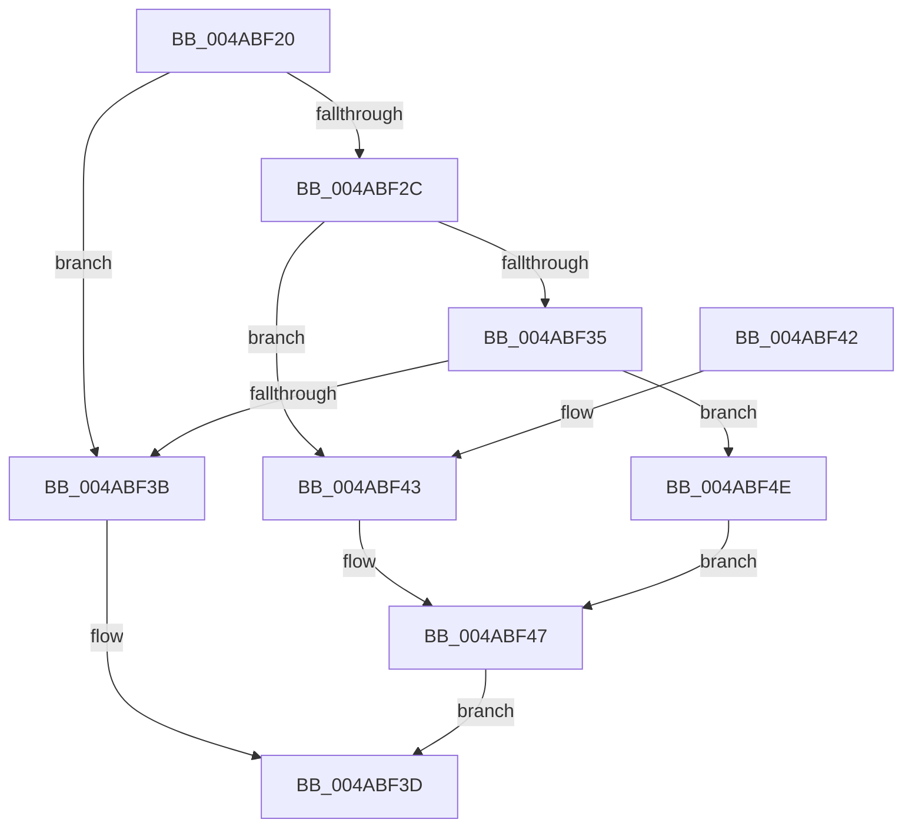

# IoAllocateErrorLogEntry

- RVA: `0x004ABF20`–`0x004ABF55` (길이 `53` bytes)
- VA: `0x00000001404ABF20`
- 실행 섹션: `.text`
- PDB 이름 있음: `예`; PDB Function 태그: `아니요`
- unwind 정보 RVA: `0x0007A1AC`
- 디코드: `19`개 명령, `53/53` bytes 표시
- 미해석 바이트: `0` (있으면 어셈블리에 `.byte`로 보존)

> 이 문서는 커널 이미지의 기계어와 PDB 기호를 분석해 생성했습니다. 4번과 5번은 함수 원형과 자료형을 바이너리 사용 방식에서 추정한 C 해석이며 원본 소스 복구 결과는 아닙니다.

## 1. Dependencies

- 직접 호출 지점: **1**; 고유 호출 대상: **1**
- 직접 호출자로 확인된 함수: **3**
- RIP 상대 이미지 참조: **0**

### Outgoing calls
- `0x004ABF47` → [IopAllocateErrorLogEntry](IopAllocateErrorLogEntry_function_004ABF5C.md) (function, `0x004ABF5C`)

### Direct callers
- [IopDisassociateThreadIrp](../59/IopDisassociateThreadIrp_function_0059708C.md) at `0x00597206`
- [DifIoAllocateErrorLogEntryWrapper](../62/DifIoAllocateErrorLogEntryWrapper_function_006276C0.md) at `0x00627794`
- [FsRtlLogCcFlushError](../../page/AC/FsRtlLogCcFlushError_function_00ACA170.md) at `0x00ACA2E8`

### Static image references
- 디코드된 RIP-relative 메모리 참조가 없습니다.

## 2. Other-region calls and transfers

- 다른 실행 섹션으로 향하는 call: **0**
- 별도 외부 분기/꼬리 이동을 확인하지 못했습니다.

## 3. Assembly (complete function range)

```asm
004ABF20  48 83 EC 28                     sub rsp, 0x28
004ABF24  44 8A C2                        mov r8b, dl
004ABF27  48 85 C9                        test rcx, rcx
004ABF2A  74 0F                           je 0x1404abf3b
004ABF2C  0F B7 01                        movzx eax, word ptr [rcx]
004ABF2F  66 83 F8 03                     cmp ax, 3
004ABF33  74 0E                           je 0x1404abf43
004ABF35  66 83 F8 04                     cmp ax, 4
004ABF39  74 13                           je 0x1404abf4e
004ABF3B  33 C0                           xor eax, eax
004ABF3D  48 83 C4 28                     add rsp, 0x28
004ABF41  C3                              ret
004ABF42  CC                              int3
004ABF43  48 8B 51 08                     mov rdx, qword ptr [rcx + 8]
004ABF47  E8 10 00 00 00                  call 0x1404abf5c
004ABF4C  EB EF                           jmp 0x1404abf3d
004ABF4E  48 8B D1                        mov rdx, rcx
004ABF51  33 C9                           xor ecx, ecx
004ABF53  EB F2                           jmp 0x1404abf47
```

## 4. C-style interpretation (structured pseudocode)

```c
__int64 __fastcall IoAllocateErrorLogEntry(__int64 a1, unsigned __int8 a2)
{
    __int64 result;
    __int64 v_rsp;

    v_rsp = (v_rsp) - (40);
    if (a1 == 0) goto loc_004ABF3B;
    if (((unsigned __int16)(*(unsigned __int16 *)(a1))) == 3) goto loc_004ABF43;
    if (((unsigned __int16)(*(unsigned __int16 *)(a1))) == 4) goto loc_004ABF4E;
loc_004ABF3B:
    result = 0;
loc_004ABF3D:
    v_rsp = (v_rsp) + (40);
    return result;
loc_004ABF43:
loc_004ABF47:
    result = IopAllocateErrorLogEntry(a1, *(unsigned __int64 *)(a1 + 8), a2, a4);
    goto loc_004ABF3D;
loc_004ABF4E:
    a1 = 0;
    goto loc_004ABF47;
}
```

## 5. (Beta) C Style

```c
int64_t IoAllocateErrorLogEntry(int64_t Arg1, uint8_t Arg2)
{
    int64_t result;
    int64_t local_rsp;

    local_rsp = (local_rsp) - (40);
    if (Arg1 == 0) goto loc_004ABF3B;
    if (((uint16_t)(*(uint16_t *)(Arg1))) == 3) goto loc_004ABF43;
    if (((uint16_t)(*(uint16_t *)(Arg1))) == 4) goto loc_004ABF4E;
loc_004ABF3B:
    result = 0;
loc_004ABF3D:
    local_rsp = (local_rsp) + (40);
    return result;
loc_004ABF43:
loc_004ABF47:
    result = IopAllocateErrorLogEntry(Arg1, *(uint64_t *)(Arg1 + 0x8), Arg2, a4);
    goto loc_004ABF3D;
loc_004ABF4E:
    Arg1 = 0;
    goto loc_004ABF47;
}
```

## 6. Execution-region graph

[열기: 2D/3D 그래프와 함수 탐색 컨트롤 패널](../../../control-panel.html?section=text&rva=0x004ABF20&view=graph)

- 2D 그래프는 위에서 아래로 흐르고, 3D 그래프는 빈 공간을 드래그해 회전합니다. Shift+드래그는 이동, 휠은 확대·축소, 함수 노드 선택은 대상 보고서 이동입니다.

### Static fallback


