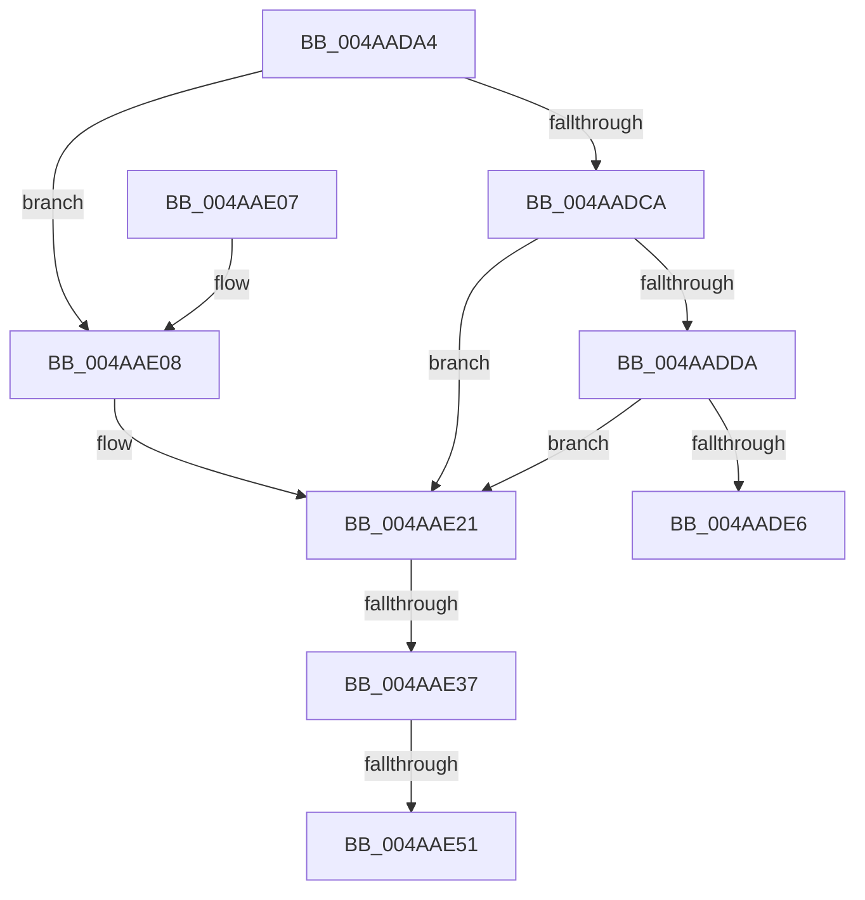

# IoGetDeviceInstanceName

- RVA: `0x004AADA4`–`0x004AAE6F` (길이 `203` bytes)
- VA: `0x00000001404AADA4`
- 실행 섹션: `.text`
- PDB 이름 있음: `예`; PDB Function 태그: `예`
- unwind 정보 RVA: `0x000B7E80`
- 디코드: `53`개 명령, `203/203` bytes 표시
- 미해석 바이트: `0` (있으면 어셈블리에 `.byte`로 보존)

> 이 문서는 커널 이미지의 기계어와 PDB 기호를 분석해 생성했습니다. 4번과 5번은 함수 원형과 자료형을 바이너리 사용 방식에서 추정한 C 해석이며 원본 소스 복구 결과는 아닙니다.

## 1. Dependencies

- 직접 호출 지점: **6**; 고유 호출 대상: **3**
- 직접 호출자로 확인된 함수: **3**
- RIP 상대 이미지 참조: **0**

### Outgoing calls
- `0x004AADED` → [PnpConcatenateUnicodeStrings](../../page/95/PnpConcatenateUnicodeStrings_function_00951ED0.md) (function, `0x00951ED0`)
- `0x004AAE1B` → [KeBugCheckEx](../4F/KeBugCheckEx_function_004FD660.md) (function, `0x004FD660`)
- `0x004AAE25` → [IoAddTriageDumpDataBlock](../42/IoAddTriageDumpDataBlock_function_00428374.md) (function, `0x00428374`)
- `0x004AAE3B` → [IoAddTriageDumpDataBlock](../42/IoAddTriageDumpDataBlock_function_00428374.md) (function, `0x00428374`)
- `0x004AAE53` → [IoAddTriageDumpDataBlock](../42/IoAddTriageDumpDataBlock_function_00428374.md) (function, `0x00428374`)
- `0x004AAE64` → [IoAddTriageDumpDataBlock](../42/IoAddTriageDumpDataBlock_function_00428374.md) (function, `0x00428374`)

### Direct callers
- [WmipTranslatePDOInstanceNames](../../page/9E/WmipTranslatePDOInstanceNames_function_009E2F0C.md) at `0x009E3073`
- [WmipTranslatePDOInstanceNames](../../page/9E/WmipTranslatePDOInstanceNames_function_009E2F0C.md) at `0x009E31A4`
- [WmipGetGuidObjectInstanceInfo](../../page/A8/WmipGetGuidObjectInstanceInfo_function_00A87470.md) at `0x00A874A9`
- [sub_00B3C216](../../page/B3/Unknown_function_00B3C216.md) at `0x00B3C346`
- [sub_00B3C216](../../page/B3/Unknown_function_00B3C216.md) at `0x00B3C3CE`

### Static image references
- 디코드된 RIP-relative 메모리 참조가 없습니다.

## 2. Other-region calls and transfers

- 다른 실행 섹션으로 향하는 call: **1**
  - `0x004AADED` → [PnpConcatenateUnicodeStrings](../../page/95/PnpConcatenateUnicodeStrings_function_00951ED0.md) (`.text` → `PAGE`)
- call이 아닌 외부 분기/꼬리 이동: **3**
  - `0x004AAE31` → [sub_006FA442](../6F/Unknown_function_006FA442.md) (`tail-transfer`)
  - `0x004AAE4B` → [sub_006FA442](../6F/Unknown_function_006FA442.md) (`tail-transfer`)
  - `0x004AAE6A` → [sub_006FA442](../6F/Unknown_function_006FA442.md) (`tail-transfer`)

## 3. Assembly (complete function range)

```asm
004AADA4  48 89 5C 24 08                  mov qword ptr [rsp + 8], rbx
004AADA9  48 89 6C 24 10                  mov qword ptr [rsp + 0x10], rbp
004AADAE  48 89 74 24 18                  mov qword ptr [rsp + 0x18], rsi
004AADB3  57                              push rdi
004AADB4  48 83 EC 30                     sub rsp, 0x30
004AADB8  33 F6                           xor esi, esi
004AADBA  4C 8B C2                        mov r8, rdx
004AADBD  48 8B D9                        mov rbx, rcx
004AADC0  BD 02 00 00 00                  mov ebp, 2
004AADC5  48 85 C9                        test rcx, rcx
004AADC8  74 3E                           je 0x1404aae08
004AADCA  48 8B 81 38 01 00 00            mov rax, qword ptr [rcx + 0x138]
004AADD1  48 8B 50 28                     mov rdx, qword ptr [rax + 0x28]
004AADD5  48 85 D2                        test rdx, rdx
004AADD8  74 47                           je 0x1404aae21
004AADDA  F7 82 8C 01 00 00 00 00 02 00   test dword ptr [rdx + 0x18c], 0x20000
004AADE4  75 3B                           jne 0x1404aae21
004AADE6  48 83 C2 28                     add rdx, 0x28
004AADEA  49 8B C8                        mov rcx, r8
004AADED  E8 DE 70 4A 00                  call 0x140951ed0
004AADF2  48 8B 5C 24 40                  mov rbx, qword ptr [rsp + 0x40]
004AADF7  48 8B 6C 24 48                  mov rbp, qword ptr [rsp + 0x48]
004AADFC  48 8B 74 24 50                  mov rsi, qword ptr [rsp + 0x50]
004AAE01  48 83 C4 30                     add rsp, 0x30
004AAE05  5F                              pop rdi
004AAE06  C3                              ret
004AAE07  CC                              int3
004AAE08  45 33 C9                        xor r9d, r9d
004AAE0B  48 89 74 24 20                  mov qword ptr [rsp + 0x20], rsi
004AAE10  4C 8B C3                        mov r8, rbx
004AAE13  48 8B D5                        mov rdx, rbp
004AAE16  B9 CA 00 00 00                  mov ecx, 0xca
004AAE1B  E8 40 28 05 00                  call 0x1404fd660
004AAE20  CC                              int3
004AAE21  0F B7 51 02                     movzx edx, word ptr [rcx + 2]
004AAE25  E8 4A D5 F7 FF                  call 0x140428374
004AAE2A  48 8B 4B 08                     mov rcx, qword ptr [rbx + 8]
004AAE2E  48 85 C9                        test rcx, rcx
004AAE31  0F 84 0B F6 24 00               je 0x1406fa442
004AAE37  0F BF 51 02                     movsx edx, word ptr [rcx + 2]
004AAE3B  E8 34 D5 F7 FF                  call 0x140428374
004AAE40  48 8B 4B 08                     mov rcx, qword ptr [rbx + 8]
004AAE44  48 83 C1 38                     add rcx, 0x38
004AAE48  66 39 31                        cmp word ptr [rcx], si
004AAE4B  0F 84 F1 F5 24 00               je 0x1406fa442
004AAE51  8B D5                           mov edx, ebp
004AAE53  E8 1C D5 F7 FF                  call 0x140428374
004AAE58  48 8B 4B 08                     mov rcx, qword ptr [rbx + 8]
004AAE5C  0F B7 51 38                     movzx edx, word ptr [rcx + 0x38]
004AAE60  48 8B 49 40                     mov rcx, qword ptr [rcx + 0x40]
004AAE64  E8 0B D5 F7 FF                  call 0x140428374
004AAE69  90                              nop
004AAE6A  E9 D3 F5 24 00                  jmp 0x1406fa442
```

## 4. C-style interpretation (structured pseudocode)

```c
__int64 __fastcall IoGetDeviceInstanceName(__int64 a1, __int64 a2, __int64 a3, int a4)
{
    __int64 result;
    __int64 v_rsi;
    __int64 v_rsp;
    unsigned __int64 v_stack_p10;
    unsigned __int64 v_stack_p18;
    unsigned __int64 v_stack_p20;
    unsigned __int64 v_stack_p8;

    v_stack_p8 = v_rbx;
    v_stack_p10 = v_rbp;
    v_stack_p18 = v_rsi;
    v_rsp = (v_rsp) - (48);
    v_rsi = 0;
    if (a1 == 0) goto loc_004AAE08;
    if (*(unsigned __int64 *)(*(unsigned __int64 *)(a1 + 312) + 40) == 0) goto loc_004AAE21;
    if (((*(unsigned int *)(*(unsigned __int64 *)(*(unsigned __int64 *)(a1 + 312) + 40) + 396)) & (0x20000ULL)) != 0) goto loc_004AAE21;
    a2 = (*(unsigned __int64 *)(*(unsigned __int64 *)(a1 + 312) + 40)) + (40);
    result = PnpConcatenateUnicodeStrings(a2, a2, a2, a4);
    v_rsp = (v_rsp) + (48);
    return result;
loc_004AAE08:
    a4 = 0;
    v_stack_p20 = v_stack_p18;
    result = KeBugCheckEx(202, v_stack_p10, v_stack_p8, a4);
loc_004AAE21:
    result = IoAddTriageDumpDataBlock(202, *(unsigned __int16 *)(202 + 2), v_stack_p8, a4);
    result = IoAddTriageDumpDataBlock(*(unsigned __int64 *)(v_stack_p8 + 8), (__int16)(*(unsigned __int16 *)(*(unsigned __int64 *)(v_stack_p8 + 8) + 2)), v_stack_p8, a4);
    a1 = (*(unsigned __int64 *)(v_stack_p8 + 8)) + (56);
    result = IoAddTriageDumpDataBlock(a1, (unsigned int)((unsigned int)(v_stack_p10)), v_stack_p8, a4);
    result = IoAddTriageDumpDataBlock(*(unsigned __int64 *)(*(unsigned __int64 *)(v_stack_p8 + 8) + 64), *(unsigned __int16 *)(*(unsigned __int64 *)(v_stack_p8 + 8) + 56), v_stack_p8, a4);
}
```

## 5. (Beta) C Style

```c
int64_t IoGetDeviceInstanceName(void *Arg1, int64_t Arg2, int64_t Arg3, int32_t Arg4)
{
    uint8_t *arg1 = (uint8_t *)Arg1;

    int64_t result;
    int64_t local_rsi;
    int64_t local_rsp;
    uint64_t v_stack_p10;
    uint64_t v_stack_p18;
    uint64_t v_stack_p20;
    uint64_t v_stack_p8;

    v_stack_p8 = local_rbx;
    v_stack_p10 = local_rbp;
    v_stack_p18 = local_rsi;
    local_rsp = (local_rsp) - (48);
    local_rsi = 0;
    if (Arg1 == NULL) goto loc_004AAE08;
    if (*(uint64_t *)(*(uint64_t *)(arg1 + 0x138) + 0x28) == 0) goto loc_004AAE21;
    if (((*(uint32_t *)(*(uint64_t *)(*(uint64_t *)(arg1 + 0x138) + 0x28) + 0x18C)) & (0x20000ULL)) != 0) goto loc_004AAE21;
    Arg2 = (*(uint64_t *)(*(uint64_t *)(arg1 + 0x138) + 0x28)) + (40);
    result = PnpConcatenateUnicodeStrings(Arg2, Arg2, Arg2, Arg4);
    local_rsp = (local_rsp) + (48);
    return result;
loc_004AAE08:
    Arg4 = 0;
    v_stack_p20 = v_stack_p18;
    result = KeBugCheckEx(202, v_stack_p10, v_stack_p8, Arg4);
loc_004AAE21:
    result = IoAddTriageDumpDataBlock(202, *(uint16_t *)(202 + 0x2), v_stack_p8, Arg4);
    result = IoAddTriageDumpDataBlock(*(uint64_t *)(v_stack_p8 + 0x8), (int16_t)(*(uint16_t *)(*(uint64_t *)(v_stack_p8 + 0x8) + 0x2)), v_stack_p8, Arg4);
    Arg1 = (*(uint64_t *)(v_stack_p8 + 0x8)) + (56);
    result = IoAddTriageDumpDataBlock(Arg1, (uint32_t)((uint32_t)(v_stack_p10)), v_stack_p8, Arg4);
    result = IoAddTriageDumpDataBlock(*(uint64_t *)(*(uint64_t *)(v_stack_p8 + 0x8) + 0x40), *(uint16_t *)(*(uint64_t *)(v_stack_p8 + 0x8) + 0x38), v_stack_p8, Arg4);
}
```

### 관측된 메모리 오프셋

구조체 형식이 확인되지 않은 접근은 인자 기준의 오프셋으로만 기록했습니다.

| 기준 인자 | 오프셋 표현 | 폭 (bit) | 접근 |
|---|---:|---:|---|
| `Arg1` | `+ 0x8` | `64` | `R` |

## 6. Execution-region graph

[열기: 2D/3D 그래프와 함수 탐색 컨트롤 패널](../../../control-panel.html?section=text&rva=0x004AADA4&view=graph)

- 2D 그래프는 위에서 아래로 흐르고, 3D 그래프는 빈 공간을 드래그해 회전합니다. Shift+드래그는 이동, 휠은 확대·축소, 함수 노드 선택은 대상 보고서 이동입니다.

### Static fallback


