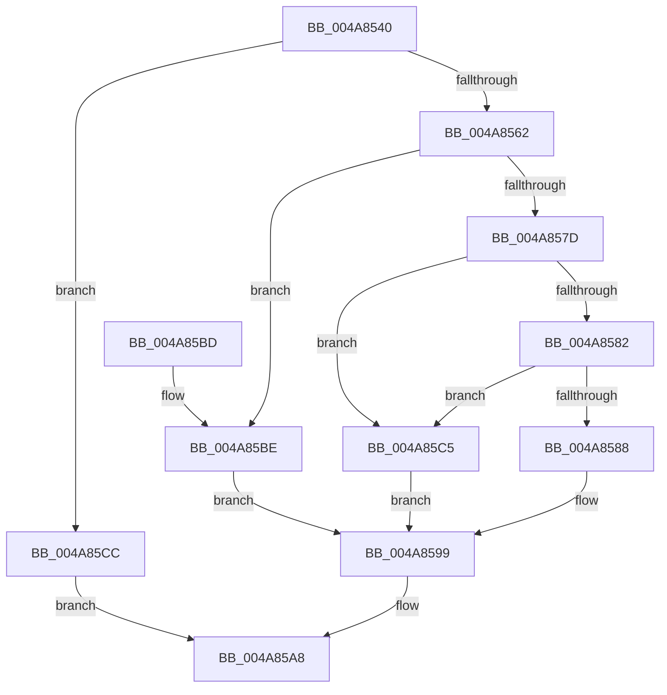

# IoGetDiskDeviceObject

- RVA: `0x004A8540`–`0x004A85D3` (길이 `147` bytes)
- VA: `0x00000001404A8540`
- 실행 섹션: `.text`
- PDB 이름 있음: `예`; PDB Function 태그: `아니요`
- unwind 정보 RVA: `0x00090A1C`
- 디코드: `42`개 명령, `147/147` bytes 표시
- 미해석 바이트: `0` (있으면 어셈블리에 `.byte`로 보존)

> 이 문서는 커널 이미지의 기계어와 PDB 기호를 분석해 생성했습니다. 4번과 5번은 함수 원형과 자료형을 바이너리 사용 방식에서 추정한 C 해석이며 원본 소스 복구 결과는 아닙니다.

## 1. Dependencies

- 직접 호출 지점: **3**; 고유 호출 대상: **3**
- 직접 호출자로 확인된 함수: **1**
- RIP 상대 이미지 참조: **0**

### Outgoing calls
- `0x004A8565` → [KeAcquireQueuedSpinLock](../27/KeAcquireQueuedSpinLock_function_00273D80.md) (function, `0x00273D80`)
- `0x004A8594` → [ObfReferenceObjectWithTag](../21/ObfReferenceObjectWithTag_function_00210710.md) (function, `0x00210710`)
- `0x004A85A1` → [KeReleaseQueuedSpinLock](../27/KeReleaseQueuedSpinLock_function_00272540.md) (function, `0x00272540`)

### Direct callers
- [sub_006ECEEA](../6E/Unknown_function_006ECEEA.md) at `0x006ECF64`

### Static image references
- 디코드된 RIP-relative 메모리 참조가 없습니다.

## 2. Other-region calls and transfers

- 다른 실행 섹션으로 향하는 call: **0**
- 별도 외부 분기/꼬리 이동을 확인하지 못했습니다.

## 3. Assembly (complete function range)

```asm
004A8540  48 89 5C 24 08                  mov qword ptr [rsp + 8], rbx
004A8545  48 89 6C 24 10                  mov qword ptr [rsp + 0x10], rbp
004A854A  48 89 74 24 18                  mov qword ptr [rsp + 0x18], rsi
004A854F  57                              push rdi
004A8550  48 83 EC 20                     sub rsp, 0x20
004A8554  33 DB                           xor ebx, ebx
004A8556  48 8B F2                        mov rsi, rdx
004A8559  48 8B F9                        mov rdi, rcx
004A855C  48 39 59 38                     cmp qword ptr [rcx + 0x38], rbx
004A8560  75 6A                           jne 0x1404a85cc
004A8562  8D 4B 09                        lea ecx, [rbx + 9]
004A8565  E8 16 B8 DC FF                  call 0x140273d80
004A856A  40 8A E8                        mov bpl, al
004A856D  48 8B 87 38 01 00 00            mov rax, qword ptr [rdi + 0x138]
004A8574  48 8B 48 48                     mov rcx, qword ptr [rax + 0x48]
004A8578  48 85 C9                        test rcx, rcx
004A857B  74 41                           je 0x1404a85be
004A857D  39 59 1C                        cmp dword ptr [rcx + 0x1c], ebx
004A8580  74 43                           je 0x1404a85c5
004A8582  F6 41 04 01                     test byte ptr [rcx + 4], 1
004A8586  74 3D                           je 0x1404a85c5
004A8588  48 8B 49 10                     mov rcx, qword ptr [rcx + 0x10]
004A858C  BA 44 66 6C 74                  mov edx, 0x746c6644
004A8591  48 89 0E                        mov qword ptr [rsi], rcx
004A8594  E8 77 81 D6 FF                  call 0x140210710
004A8599  40 8A D5                        mov dl, bpl
004A859C  B9 09 00 00 00                  mov ecx, 9
004A85A1  E8 9A 9F DC FF                  call 0x140272540
004A85A6  8B C3                           mov eax, ebx
004A85A8  48 8B 5C 24 30                  mov rbx, qword ptr [rsp + 0x30]
004A85AD  48 8B 6C 24 38                  mov rbp, qword ptr [rsp + 0x38]
004A85B2  48 8B 74 24 40                  mov rsi, qword ptr [rsp + 0x40]
004A85B7  48 83 C4 20                     add rsp, 0x20
004A85BB  5F                              pop rdi
004A85BC  C3                              ret
004A85BD  CC                              int3
004A85BE  BB 0D 00 00 C0                  mov ebx, 0xc000000d
004A85C3  EB D4                           jmp 0x1404a8599
004A85C5  BB 6E 02 00 C0                  mov ebx, 0xc000026e
004A85CA  EB CD                           jmp 0x1404a8599
004A85CC  B8 0D 00 00 C0                  mov eax, 0xc000000d
004A85D1  EB D5                           jmp 0x1404a85a8
```

## 4. C-style interpretation (structured pseudocode)

```c
__int64 __fastcall IoGetDiskDeviceObject(__int64 a1, __int64 a2)
{
    __int64 result;
    __int64 v_rbx;
    __int64 v_rsp;
    unsigned __int64 v_stack_p10;
    unsigned __int64 v_stack_p18;
    unsigned __int64 v_stack_p8;

    v_stack_p8 = v_rbx;
    v_stack_p10 = v_rbp;
    v_stack_p18 = v_rsi;
    v_rsp = (v_rsp) - (32);
    v_rbx = 0;
    if ((*(unsigned __int64 *)(a1 + 56)) != 0) goto loc_004A85CC;
    result = KeAcquireQueuedSpinLock(v_rbx + 9, a2, a3, a4);
    if (*(unsigned __int64 *)(*(unsigned __int64 *)(a1 + 312) + 72) == 0) goto loc_004A85BE;
    if ((*(unsigned int *)(*(unsigned __int64 *)(*(unsigned __int64 *)(a1 + 312) + 72) + 28)) == 0) goto loc_004A85C5;
    if (((*(unsigned __int8 *)(*(unsigned __int64 *)(*(unsigned __int64 *)(a1 + 312) + 72) + 4)) & (1)) == 0) goto loc_004A85C5;
    *(unsigned __int64 *)(a2) = *(unsigned __int64 *)(*(unsigned __int64 *)(*(unsigned __int64 *)(a1 + 312) + 72) + 16);
    result = ObfReferenceObjectWithTag(*(unsigned __int64 *)(*(unsigned __int64 *)(*(unsigned __int64 *)(a1 + 312) + 72) + 16), (unsigned int)(0x746C6644ULL), a3, a4);
loc_004A8599:
    result = KeReleaseQueuedSpinLock(9, (unsigned __int8)((unsigned __int8)(result)), a3, a4);
loc_004A85A8:
    v_rsp = (v_rsp) + (32);
    return 0;
loc_004A85BE:
    goto loc_004A8599;
loc_004A85C5:
    goto loc_004A8599;
loc_004A85CC:
    goto loc_004A85A8;
}
```

## 5. (Beta) C Style

```c
int64_t IoGetDiskDeviceObject(void *Arg1, void *Arg2)
{
    uint8_t *arg1 = (uint8_t *)Arg1;
    uint8_t *arg2 = (uint8_t *)Arg2;

    int64_t result;
    int64_t local_rbx;
    int64_t local_rsp;
    uint64_t v_stack_p10;
    uint64_t v_stack_p18;
    uint64_t v_stack_p8;

    v_stack_p8 = local_rbx;
    v_stack_p10 = local_rbp;
    v_stack_p18 = local_rsi;
    local_rsp = (local_rsp) - (32);
    local_rbx = 0;
    if ((*(uint64_t *)(arg1 + 0x38)) != 0) goto loc_004A85CC;
    result = KeAcquireQueuedSpinLock(local_rbx + 9, Arg2, a3, a4);
    if (*(uint64_t *)(*(uint64_t *)(arg1 + 0x138) + 0x48) == 0) goto loc_004A85BE;
    if ((*(uint32_t *)(*(uint64_t *)(*(uint64_t *)(arg1 + 0x138) + 0x48) + 0x1C)) == 0) goto loc_004A85C5;
    if (((*(uint8_t *)(*(uint64_t *)(*(uint64_t *)(arg1 + 0x138) + 0x48) + 0x4)) & (1)) == 0) goto loc_004A85C5;
    *(uint64_t *)(arg2) = *(uint64_t *)(*(uint64_t *)(*(uint64_t *)(arg1 + 0x138) + 0x48) + 0x10);
    result = ObfReferenceObjectWithTag(*(uint64_t *)(*(uint64_t *)(*(uint64_t *)(arg1 + 0x138) + 0x48) + 0x10), (uint32_t)(0x746C6644ULL), a3, a4);
loc_004A8599:
    result = KeReleaseQueuedSpinLock(9, (uint8_t)((uint8_t)(result)), a3, a4);
loc_004A85A8:
    local_rsp = (local_rsp) + (32);
    return 0;
loc_004A85BE:
    goto loc_004A8599;
loc_004A85C5:
    goto loc_004A8599;
loc_004A85CC:
    goto loc_004A85A8;
}
```

### 관측된 메모리 오프셋

구조체 형식이 확인되지 않은 접근은 인자 기준의 오프셋으로만 기록했습니다.

| 기준 인자 | 오프셋 표현 | 폭 (bit) | 접근 |
|---|---:|---:|---|
| `Arg1` | `+ 0x38` | `64` | `R` |
| `Arg1` | `+ 0x138` | `64` | `R` |
| `Arg2` | `+ 0x0` | `64` | `W` |

## 6. Execution-region graph

[열기: 2D/3D 그래프와 함수 탐색 컨트롤 패널](../../../control-panel.html?section=text&rva=0x004A8540&view=graph)

- 2D 그래프는 위에서 아래로 흐르고, 3D 그래프는 빈 공간을 드래그해 회전합니다. Shift+드래그는 이동, 휠은 확대·축소, 함수 노드 선택은 대상 보고서 이동입니다.

### Static fallback


