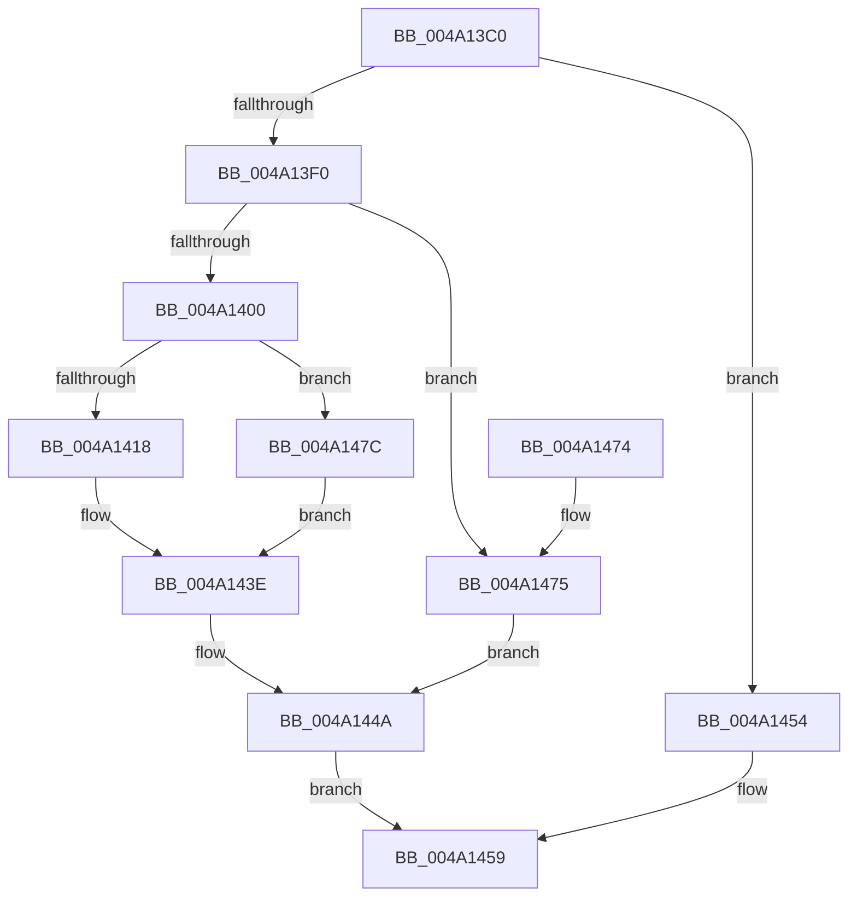

# IoNotifyQuotaState

- RVA: `0x004A13C0`–`0x004A1483` (길이 `195` bytes)
- VA: `0x00000001404A13C0`
- 실행 섹션: `.text`
- PDB 이름 있음: `예`; PDB Function 태그: `아니요`
- unwind 정보 RVA: `0x00096E04`
- 디코드: `55`개 명령, `195/195` bytes 표시
- 미해석 바이트: `0` (있으면 어셈블리에 `.byte`로 보존)

> 이 문서는 커널 이미지의 기계어와 PDB 기호를 분석해 생성했습니다. 4번과 5번은 함수 원형과 자료형을 바이너리 사용 방식에서 추정한 C 해석이며 원본 소스 복구 결과는 아닙니다.

## 1. Dependencies

- 직접 호출 지점: **7**; 고유 호출 대상: **7**
- 직접 호출자로 확인된 함수: **0**
- RIP 상대 이미지 참조: **0**

### Outgoing calls
- `0x004A13E1` → [IopFindDiskIoAttribution](../34/IopFindDiskIoAttribution_function_00349670.md) (function, `0x00349670`)
- `0x004A13F7` → [ExAcquireRundownProtection](../21/ExAcquireRundownProtection_function_00216620.md) (function, `0x00216620`)
- `0x004A140F` → [ObReferenceObjectSafeWithTag](../21/ObReferenceObjectSafeWithTag_function_00210EE0.md) (function, `0x00210EE0`)
- `0x004A142C` → [PsIoRateControlOverQuotaNotify](PsIoRateControlOverQuotaNotify_function_004A148C.md) (function, `0x004A148C`)
- `0x004A1439` → [ObfDereferenceObjectWithTag](../2F/ObfDereferenceObjectWithTag_function_002F78E0.md) (function, `0x002F78E0`)
- `0x004A1445` → [ExReleaseRundownProtection](../34/ExReleaseRundownProtection_function_00349E80.md) (function, `0x00349E80`)
- `0x004A144D` → [IoDiskIoAttributionDereference](../34/IoDiskIoAttributionDereference_function_00349978.md) (function, `0x00349978`)

### Direct callers
- 이 함수 시작 RVA로 연결되는 직접 call은 확인되지 않았습니다. 간접 호출은 완전히 역산할 수 없습니다.

### Static image references
- 디코드된 RIP-relative 메모리 참조가 없습니다.

## 2. Other-region calls and transfers

- 다른 실행 섹션으로 향하는 call: **0**
- 별도 외부 분기/꼬리 이동을 확인하지 못했습니다.

## 3. Assembly (complete function range)

```asm
004A13C0  48 89 5C 24 08                  mov qword ptr [rsp + 8], rbx
004A13C5  48 89 6C 24 10                  mov qword ptr [rsp + 0x10], rbp
004A13CA  48 89 74 24 18                  mov qword ptr [rsp + 0x18], rsi
004A13CF  57                              push rdi
004A13D0  41 56                           push r14
004A13D2  41 57                           push r15
004A13D4  48 83 EC 30                     sub rsp, 0x30
004A13D8  41 8B E9                        mov ebp, r9d
004A13DB  45 8B F0                        mov r14d, r8d
004A13DE  44 8B FA                        mov r15d, edx
004A13E1  E8 8A 82 EA FF                  call 0x140349670
004A13E6  33 DB                           xor ebx, ebx
004A13E8  48 8B F8                        mov rdi, rax
004A13EB  48 85 C0                        test rax, rax
004A13EE  74 64                           je 0x1404a1454
004A13F0  48 8D 88 A8 00 00 00            lea rcx, [rax + 0xa8]
004A13F7  E8 24 52 D7 FF                  call 0x140216620
004A13FC  84 C0                           test al, al
004A13FE  74 75                           je 0x1404a1475
004A1400  48 8B B7 A0 00 00 00            mov rsi, qword ptr [rdi + 0xa0]
004A1407  BA 44 66 6C 74                  mov edx, 0x746c6644
004A140C  48 8B CE                        mov rcx, rsi
004A140F  E8 CC FA D6 FF                  call 0x140210ee0
004A1414  84 C0                           test al, al
004A1416  74 64                           je 0x1404a147c
004A1418  8B 44 24 70                     mov eax, dword ptr [rsp + 0x70]
004A141C  44 8B CD                        mov r9d, ebp
004A141F  45 8B C6                        mov r8d, r14d
004A1422  89 44 24 20                     mov dword ptr [rsp + 0x20], eax
004A1426  41 8B D7                        mov edx, r15d
004A1429  48 8B CE                        mov rcx, rsi
004A142C  E8 5B 00 00 00                  call 0x1404a148c
004A1431  BA 44 66 6C 74                  mov edx, 0x746c6644
004A1436  48 8B CE                        mov rcx, rsi
004A1439  E8 A2 64 E5 FF                  call 0x1402f78e0
004A143E  48 8D 8F A8 00 00 00            lea rcx, [rdi + 0xa8]
004A1445  E8 36 8A EA FF                  call 0x140349e80
004A144A  48 8B CF                        mov rcx, rdi
004A144D  E8 26 85 EA FF                  call 0x140349978
004A1452  EB 05                           jmp 0x1404a1459
004A1454  BB 25 02 00 C0                  mov ebx, 0xc0000225
004A1459  48 8B 6C 24 58                  mov rbp, qword ptr [rsp + 0x58]
004A145E  8B C3                           mov eax, ebx
004A1460  48 8B 5C 24 50                  mov rbx, qword ptr [rsp + 0x50]
004A1465  48 8B 74 24 60                  mov rsi, qword ptr [rsp + 0x60]
004A146A  48 83 C4 30                     add rsp, 0x30
004A146E  41 5F                           pop r15
004A1470  41 5E                           pop r14
004A1472  5F                              pop rdi
004A1473  C3                              ret
004A1474  CC                              int3
004A1475  BB 89 01 00 C0                  mov ebx, 0xc0000189
004A147A  EB CE                           jmp 0x1404a144a
004A147C  BB 89 01 00 C0                  mov ebx, 0xc0000189
004A1481  EB BB                           jmp 0x1404a143e
```

## 4. C-style interpretation (structured pseudocode)

```c
__int64 __fastcall IoNotifyQuotaState(__int64 a1, int a2, int a3, int a4, unsigned int a5)
{
    __int64 result;
    __int64 v_rbx;
    __int64 v_rsp;
    unsigned int v_stack_m28;
    unsigned __int64 v_stack_p10;
    unsigned __int64 v_stack_p18;
    unsigned __int64 v_stack_p8;

    v_stack_p8 = v_rbx;
    v_stack_p10 = v_rbp;
    v_stack_p18 = v_rsi;
    v_rsp = (v_rsp) - (48);
    result = IopFindDiskIoAttribution(a1, a2, a3, a4);
    v_rbx = 0;
    if (result == 0) goto loc_004A1454;
    result = ExAcquireRundownProtection(result + 168, a2, a3, a4);
    if ((unsigned __int8)(result) == 0) goto loc_004A1475;
    result = ObReferenceObjectSafeWithTag(*(unsigned __int64 *)(result + 160), (unsigned int)(0x746C6644ULL), a3, a4);
    if ((unsigned __int8)(result) == 0) goto loc_004A147C;
    v_stack_m28 = (unsigned int)((unsigned int)(a5));
    result = PsIoRateControlOverQuotaNotify(*(unsigned __int64 *)(result + 160), (unsigned int)((unsigned int)((unsigned int)(a2))), (unsigned int)((unsigned int)((unsigned int)(a3))), (unsigned int)((unsigned int)((unsigned int)(a4))));
    result = ObfDereferenceObjectWithTag(*(unsigned __int64 *)(result + 160), (unsigned int)(0x746C6644ULL), (unsigned int)((unsigned int)((unsigned int)(a3))), (unsigned int)((unsigned int)((unsigned int)(a4))));
loc_004A143E:
    result = ExReleaseRundownProtection(result + 168, (unsigned int)(0x746C6644ULL), (unsigned int)((unsigned int)((unsigned int)(a3))), (unsigned int)((unsigned int)((unsigned int)(a4))));
loc_004A144A:
    result = IoDiskIoAttributionDereference(result, (unsigned int)(0x746C6644ULL), (unsigned int)((unsigned int)((unsigned int)(a3))), (unsigned int)((unsigned int)((unsigned int)(a4))));
    goto loc_004A1459;
loc_004A1454:
loc_004A1459:
    v_rsp = (v_rsp) + (48);
    return (unsigned int)((unsigned int)((unsigned int)(0xC0000225ULL)));
loc_004A1475:
    goto loc_004A144A;
loc_004A147C:
    goto loc_004A143E;
}
```

## 5. (Beta) C Style

```c
int64_t IoNotifyQuotaState(int64_t Arg1, int32_t Arg2, int32_t Arg3, int32_t Arg4, uint32_t Arg5)
{
    int64_t result;
    int64_t local_rbx;
    int64_t local_rsp;
    uint32_t v_stack_m28;
    uint64_t v_stack_p10;
    uint64_t v_stack_p18;
    uint64_t v_stack_p8;

    v_stack_p8 = local_rbx;
    v_stack_p10 = local_rbp;
    v_stack_p18 = local_rsi;
    local_rsp = (local_rsp) - (48);
    result = IopFindDiskIoAttribution(Arg1, Arg2, Arg3, Arg4);
    local_rbx = 0;
    if (result == 0) goto loc_004A1454;
    result = ExAcquireRundownProtection(result + 168, Arg2, Arg3, Arg4);
    if ((uint8_t)(result) == 0) goto loc_004A1475;
    result = ObReferenceObjectSafeWithTag(*(uint64_t *)(result + 0xA0), (uint32_t)(0x746C6644ULL), Arg3, Arg4);
    if ((uint8_t)(result) == 0) goto loc_004A147C;
    v_stack_m28 = (uint32_t)((uint32_t)(Arg5));
    result = PsIoRateControlOverQuotaNotify(*(uint64_t *)(result + 0xA0), (uint32_t)((uint32_t)((uint32_t)(Arg2))), (uint32_t)((uint32_t)((uint32_t)(Arg3))), (uint32_t)((uint32_t)((uint32_t)(Arg4))));
    result = ObfDereferenceObjectWithTag(*(uint64_t *)(result + 0xA0), (uint32_t)(0x746C6644ULL), (uint32_t)((uint32_t)((uint32_t)(Arg3))), (uint32_t)((uint32_t)((uint32_t)(Arg4))));
loc_004A143E:
    result = ExReleaseRundownProtection(result + 168, (uint32_t)(0x746C6644ULL), (uint32_t)((uint32_t)((uint32_t)(Arg3))), (uint32_t)((uint32_t)((uint32_t)(Arg4))));
loc_004A144A:
    result = IoDiskIoAttributionDereference(result, (uint32_t)(0x746C6644ULL), (uint32_t)((uint32_t)((uint32_t)(Arg3))), (uint32_t)((uint32_t)((uint32_t)(Arg4))));
    goto loc_004A1459;
loc_004A1454:
loc_004A1459:
    local_rsp = (local_rsp) + (48);
    return (uint32_t)((uint32_t)((uint32_t)(0xC0000225ULL)));
loc_004A1475:
    goto loc_004A144A;
loc_004A147C:
    goto loc_004A143E;
}
```

## 6. Execution-region graph

[열기: 2D/3D 그래프와 함수 탐색 컨트롤 패널](../../../control-panel.html?section=text&rva=0x004A13C0&view=graph)

- 2D 그래프는 위에서 아래로 흐르고, 3D 그래프는 빈 공간을 드래그해 회전합니다. Shift+드래그는 이동, 휠은 확대·축소, 함수 노드 선택은 대상 보고서 이동입니다.

### Static fallback


