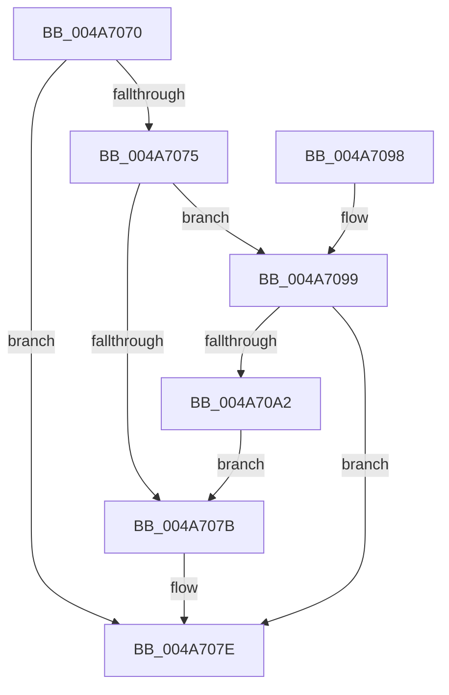

# IoSizeOfIrpEx

- RVA: `0x004A7070`–`0x004A70A4` (길이 `52` bytes)
- VA: `0x00000001404A7070`
- 실행 섹션: `.text`
- PDB 이름 있음: `예`; PDB Function 태그: `아니요`
- unwind 정보 RVA: `0x000DB714`
- 디코드: `17`개 명령, `52/52` bytes 표시
- 미해석 바이트: `0` (있으면 어셈블리에 `.byte`로 보존)

> 이 문서는 커널 이미지의 기계어와 PDB 기호를 분석해 생성했습니다. 4번과 5번은 함수 원형과 자료형을 바이너리 사용 방식에서 추정한 C 해석이며 원본 소스 복구 결과는 아닙니다.

## 1. Dependencies

- 직접 호출 지점: **0**; 고유 호출 대상: **0**
- 직접 호출자로 확인된 함수: **0**
- RIP 상대 이미지 참조: **0**

### Outgoing calls
- 직접 디코드된 call 명령이 없습니다.

### Direct callers
- 이 함수 시작 RVA로 연결되는 직접 call은 확인되지 않았습니다. 간접 호출은 완전히 역산할 수 없습니다.

### Static image references
- 디코드된 RIP-relative 메모리 참조가 없습니다.

## 2. Other-region calls and transfers

- 다른 실행 섹션으로 향하는 call: **0**
- 별도 외부 분기/꼬리 이동을 확인하지 못했습니다.

## 3. Assembly (complete function range)

```asm
004A7070  48 85 C9                        test rcx, rcx
004A7073  74 09                           je 0x1404a707e
004A7075  48 83 F9 FF                     cmp rcx, -1
004A7079  75 1E                           jne 0x1404a7099
004A707B  80 C2 02                        add dl, 2
004A707E  0F BE C2                        movsx eax, dl
004A7081  0F B7 C8                        movzx ecx, ax
004A7084  66 C1 E1 03                     shl cx, 3
004A7088  66 03 C1                        add ax, cx
004A708B  B9 D0 00 00 00                  mov ecx, 0xd0
004A7090  66 C1 E0 03                     shl ax, 3
004A7094  66 03 C1                        add ax, cx
004A7097  C3                              ret
004A7098  CC                              int3
004A7099  F7 41 30 00 00 00 08            test dword ptr [rcx + 0x30], 0x8000000
004A70A0  74 DC                           je 0x1404a707e
004A70A2  EB D7                           jmp 0x1404a707b
```

## 4. C-style interpretation (structured pseudocode)

```c
__int64 __fastcall IoSizeOfIrpEx(__int64 a1, unsigned __int8 a2)
{
    __int64 result;

    if (a1 == 0) goto loc_004A707E;
    if (a1 != -1) goto loc_004A7099;
loc_004A707B:
    a2 = (unsigned __int8)((a2) + (2));
loc_004A707E:
    a1 = (unsigned __int16)(((unsigned __int16)((__int8)(a2))) << (3));
    result = (unsigned __int16)(((__int8)(a2)) + ((unsigned __int16)(a1)));
    result = (unsigned __int16)((result) << (3));
    result = (unsigned __int16)((result) + (208));
    return result;
loc_004A7099:
    if (((*(unsigned int *)(208 + 48)) & (0x8000000ULL)) == 0) goto loc_004A707E;
    goto loc_004A707B;
}
```

## 5. (Beta) C Style

```c
int64_t IoSizeOfIrpEx(int64_t Arg1, uint8_t Arg2)
{
    int64_t result;

    if (Arg1 == 0) goto loc_004A707E;
    if (Arg1 != -1) goto loc_004A7099;
loc_004A707B:
    Arg2 = (uint8_t)((Arg2) + (2));
loc_004A707E:
    Arg1 = (uint16_t)(((uint16_t)((int8_t)(Arg2))) << (3));
    result = (uint16_t)(((int8_t)(Arg2)) + ((uint16_t)(Arg1)));
    result = (uint16_t)((result) << (3));
    result = (uint16_t)((result) + (208));
    return result;
loc_004A7099:
    if (((*(uint32_t *)(208 + 0x30)) & (0x8000000ULL)) == 0) goto loc_004A707E;
    goto loc_004A707B;
}
```

## 6. Execution-region graph

[열기: 2D/3D 그래프와 함수 탐색 컨트롤 패널](../../../control-panel.html?section=text&rva=0x004A7070&view=graph)

- 2D 그래프는 위에서 아래로 흐르고, 3D 그래프는 빈 공간을 드래그해 회전합니다. Shift+드래그는 이동, 휠은 확대·축소, 함수 노드 선택은 대상 보고서 이동입니다.

### Static fallback


