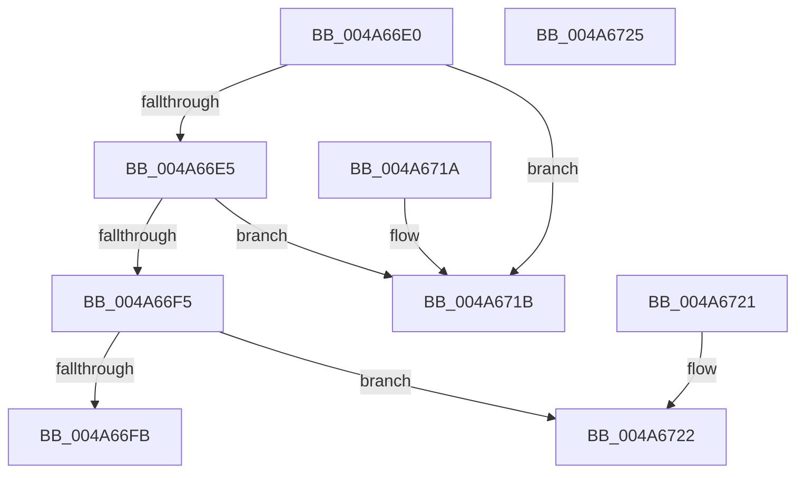

# IoValidateDeviceIoControlAccess

- RVA: `0x004A66E0`–`0x004A6726` (길이 `70` bytes)
- VA: `0x00000001404A66E0`
- 실행 섹션: `.text`
- PDB 이름 있음: `예`; PDB Function 태그: `아니요`
- unwind 정보 RVA: `0x000DB714`
- 디코드: `28`개 명령, `70/70` bytes 표시
- 미해석 바이트: `0` (있으면 어셈블리에 `.byte`로 보존)

> 이 문서는 커널 이미지의 기계어와 PDB 기호를 분석해 생성했습니다. 4번과 5번은 함수 원형과 자료형을 바이너리 사용 방식에서 추정한 C 해석이며 원본 소스 복구 결과는 아닙니다.

## 1. Dependencies

- 직접 호출 지점: **0**; 고유 호출 대상: **0**
- 직접 호출자로 확인된 함수: **0**
- RIP 상대 이미지 참조: **0**

### Outgoing calls
- 직접 디코드된 call 명령이 없습니다.

### Direct callers
- 이 함수 시작 RVA로 연결되는 직접 call은 확인되지 않았습니다. 간접 호출은 완전히 역산할 수 없습니다.

### Static image references
- 디코드된 RIP-relative 메모리 참조가 없습니다.

## 2. Other-region calls and transfers

- 다른 실행 섹션으로 향하는 call: **0**
- 별도 외부 분기/꼬리 이동을 확인하지 못했습니다.

## 3. Assembly (complete function range)

```asm
004A66E0  F6 C2 03                        test dl, 3
004A66E3  74 36                           je 0x1404a671b
004A66E5  4C 8B 81 B8 00 00 00            mov r8, qword ptr [rcx + 0xb8]
004A66EC  41 8A 00                        mov al, byte ptr [r8]
004A66EF  2C 0D                           sub al, 0xd
004A66F1  3C 01                           cmp al, 1
004A66F3  77 26                           ja 0x1404a671b
004A66F5  80 79 40 00                     cmp byte ptr [rcx + 0x40], 0
004A66F9  74 27                           je 0x1404a6722
004A66FB  41 0F B6 40 02                  movzx eax, byte ptr [r8 + 2]
004A6700  8B C8                           mov ecx, eax
004A6702  83 E0 01                        and eax, 1
004A6705  D1 E9                           shr ecx, 1
004A6707  83 E1 02                        and ecx, 2
004A670A  0B C8                           or ecx, eax
004A670C  23 CA                           and ecx, edx
004A670E  2B CA                           sub ecx, edx
004A6710  F7 D9                           neg ecx
004A6712  1B C0                           sbb eax, eax
004A6714  25 22 00 00 C0                  and eax, 0xc0000022
004A6719  C3                              ret
004A671A  CC                              int3
004A671B  B8 0D 00 00 C0                  mov eax, 0xc000000d
004A6720  C3                              ret
004A6721  CC                              int3
004A6722  33 C0                           xor eax, eax
004A6724  C3                              ret
004A6725  CC                              int3
```

## 4. C-style interpretation (structured pseudocode)

```c
__int64 __fastcall IoValidateDeviceIoControlAccess(__int64 a1, int a2)
{
    __int64 result;

    if ((((unsigned __int8)(a2)) & (3)) == 0) goto loc_004A671B;
    result = (unsigned __int8)((*(unsigned __int8 *)(*(unsigned __int64 *)(a1 + 184))) - (13));
    if (((unsigned __int8)(result)) > 1) goto loc_004A671B;
    if ((*(unsigned __int8 *)(a1 + 64)) == 0) goto loc_004A6722;
    result = (unsigned int)((*(unsigned __int8 *)(*(unsigned __int64 *)(a1 + 184) + 2)) & (1));
    a1 = (unsigned int)(((unsigned int)((unsigned int)(*(unsigned __int8 *)(*(unsigned __int64 *)(a1 + 184) + 2)))) >> (1));
    a1 = (unsigned int)((a1) & (2));
    a1 = (unsigned int)((a1) | ((unsigned int)(result)));
    a1 = (unsigned int)((a1) & (a2));
    a1 = (unsigned int)((a1) - (a2));
    a1 = (unsigned int)(-(a1));
    result = (unsigned int)((result) & (0xC0000022ULL));
    return result;
loc_004A671B:
    return (unsigned int)(0xC000000DULL);
loc_004A6722:
    result = 0;
    return result;
}
```

## 5. (Beta) C Style

```c
int64_t IoValidateDeviceIoControlAccess(void *Arg1, int32_t Arg2)
{
    uint8_t *arg1 = (uint8_t *)Arg1;

    int64_t result;

    if ((((uint8_t)(Arg2)) & (3)) == 0) goto loc_004A671B;
    result = (uint8_t)((*(uint8_t *)(*(uint64_t *)(arg1 + 0xB8))) - (13));
    if (((uint8_t)(result)) > 1) goto loc_004A671B;
    if ((*(uint8_t *)(arg1 + 0x40)) == 0) goto loc_004A6722;
    result = (uint32_t)((*(uint8_t *)(*(uint64_t *)(arg1 + 0xB8) + 0x2)) & (1));
    Arg1 = (uint32_t)(((uint32_t)((uint32_t)(*(uint8_t *)(*(uint64_t *)(arg1 + 0xB8) + 0x2)))) >> (1));
    Arg1 = (uint32_t)((Arg1) & (2));
    Arg1 = (uint32_t)((Arg1) | ((uint32_t)(result)));
    Arg1 = (uint32_t)((Arg1) & (Arg2));
    Arg1 = (uint32_t)((Arg1) - (Arg2));
    Arg1 = (uint32_t)(-(Arg1));
    result = (uint32_t)((result) & (0xC0000022ULL));
    return result;
loc_004A671B:
    return (uint32_t)(0xC000000DULL);
loc_004A6722:
    result = 0;
    return result;
}
```

### 관측된 메모리 오프셋

구조체 형식이 확인되지 않은 접근은 인자 기준의 오프셋으로만 기록했습니다.

| 기준 인자 | 오프셋 표현 | 폭 (bit) | 접근 |
|---|---:|---:|---|
| `Arg1` | `+ 0x40` | `8` | `R` |
| `Arg1` | `+ 0xB8` | `64` | `R` |

## 6. Execution-region graph

[열기: 2D/3D 그래프와 함수 탐색 컨트롤 패널](../../../control-panel.html?section=text&rva=0x004A66E0&view=graph)

- 2D 그래프는 위에서 아래로 흐르고, 3D 그래프는 빈 공간을 드래그해 회전합니다. Shift+드래그는 이동, 휠은 확대·축소, 함수 노드 선택은 대상 보고서 이동입니다.

### Static fallback


