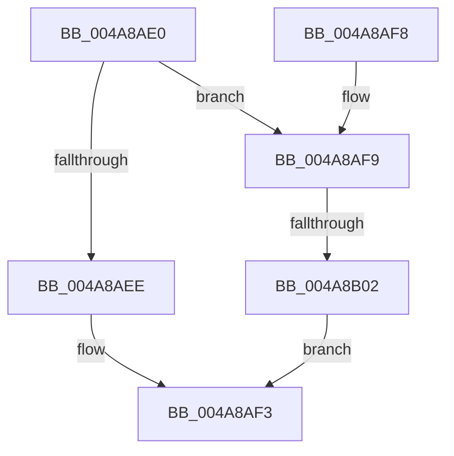

# IofCallDriverSpecifyReturn

- RVA: `0x004A8AE0`–`0x004A8B09` (길이 `41` bytes)
- VA: `0x00000001404A8AE0`
- 실행 섹션: `.text`
- PDB 이름 있음: `예`; PDB Function 태그: `예`
- unwind 정보 RVA: `0x000704D0`
- 디코드: `12`개 명령, `41/41` bytes 표시
- 미해석 바이트: `0` (있으면 어셈블리에 `.byte`로 보존)

> 이 문서는 커널 이미지의 기계어와 PDB 기호를 분석해 생성했습니다. 4번과 5번은 함수 원형과 자료형을 바이너리 사용 방식에서 추정한 C 해석이며 원본 소스 복구 결과는 아닙니다.

## 1. Dependencies

- 직접 호출 지점: **2**; 고유 호출 대상: **2**
- 직접 호출자로 확인된 함수: **2**
- RIP 상대 이미지 참조: **1**

### Outgoing calls
- `0x004A8AEE` → [IopfCallDriver](../29/IopfCallDriver_function_0029C474.md) (function, `0x0029C474`)
- `0x004A8B02` → [IopPerfCallDriver](IopPerfCallDriver_function_004A9680.md) (function, `0x004A9680`)

### Direct callers
- [PopRequestPowerIrp](../27/PopRequestPowerIrp_function_00270ED4.md) at `0x002710F8`
- [VerifierPoCallDriver](../../pagevrfy/BA/VerifierPoCallDriver_function_00BA02B0.md) at `0x00BA02D3`

### Static image references
- `0x004A8AE4` → RVA `0x00FC6D64` (`ALMOSTRO`; read)

## 2. Other-region calls and transfers

- 다른 실행 섹션으로 향하는 call: **0**
- call이 아닌 외부 분기/꼬리 이동: **1**
  - `0x004A8AFC` → [sub_006F9E34](../6F/Unknown_function_006F9E34.md) (`tail-transfer`)

## 3. Assembly (complete function range)

```asm
004A8AE0  48 83 EC 28                     sub rsp, 0x28
004A8AE4  8B 05 7A E2 B1 00               mov eax, dword ptr [rip + 0xb1e27a]
004A8AEA  85 C0                           test eax, eax
004A8AEC  75 0B                           jne 0x1404a8af9
004A8AEE  E8 81 39 DF FF                  call 0x14029c474
004A8AF3  48 83 C4 28                     add rsp, 0x28
004A8AF7  C3                              ret
004A8AF8  CC                              int3
004A8AF9  83 F8 03                        cmp eax, 3
004A8AFC  0F 85 32 13 25 00               jne 0x1406f9e34
004A8B02  E8 79 0B 00 00                  call 0x1404a9680
004A8B07  EB EA                           jmp 0x1404a8af3
```

## 4. C-style interpretation (structured pseudocode)

```c
__int64 __fastcall IofCallDriverSpecifyReturn(void)
{
    __int64 result;
    __int64 v_rsp;

    v_rsp = (v_rsp) - (40);
    if ((unsigned int)((unsigned int)(*(unsigned int *)(v_rip + 11657850))) != 0) goto loc_004A8AF9;
    result = IopfCallDriver(a1, a2, a3, a4);
loc_004A8AF3:
    v_rsp = (v_rsp) + (40);
    return result;
loc_004A8AF9:
    result = IopPerfCallDriver(a1, a2, a3, a4);
    goto loc_004A8AF3;
}
```

## 5. (Beta) C Style

```c
void IofCallDriverSpecifyReturn(void)
{
    int64_t result;
    int64_t local_rsp;

    local_rsp = (local_rsp) - (40);
    if ((uint32_t)((uint32_t)(*(uint32_t *)(v_rip + 0xB1E27A))) != 0) goto loc_004A8AF9;
    result = IopfCallDriver(a1, a2, a3, a4);
loc_004A8AF3:
    local_rsp = (local_rsp) + (40);
    return result;
loc_004A8AF9:
    result = IopPerfCallDriver(a1, a2, a3, a4);
    goto loc_004A8AF3;
}
```

## 6. Execution-region graph

[열기: 2D/3D 그래프와 함수 탐색 컨트롤 패널](../../../control-panel.html?section=text&rva=0x004A8AE0&view=graph)

- 2D 그래프는 위에서 아래로 흐르고, 3D 그래프는 빈 공간을 드래그해 회전합니다. Shift+드래그는 이동, 휠은 확대·축소, 함수 노드 선택은 대상 보고서 이동입니다.

### Static fallback


