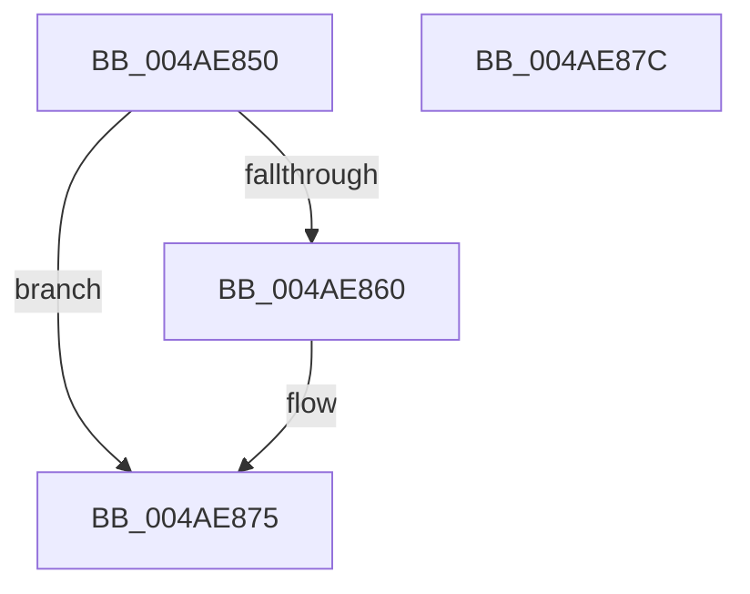

# IommuHvFlushAllPasid

- RVA: `0x004AE850`–`0x004AE87D` (길이 `45` bytes)
- VA: `0x00000001404AE850`
- 실행 섹션: `.text`
- PDB 이름 있음: `예`; PDB Function 태그: `아니요`
- unwind 정보 RVA: `0x0005D2F4`
- 디코드: `14`개 명령, `45/45` bytes 표시
- 미해석 바이트: `0` (있으면 어셈블리에 `.byte`로 보존)

> 이 문서는 커널 이미지의 기계어와 PDB 기호를 분석해 생성했습니다. 4번과 5번은 함수 원형과 자료형을 바이너리 사용 방식에서 추정한 C 해석이며 원본 소스 복구 결과는 아닙니다.

## 1. Dependencies

- 직접 호출 지점: **1**; 고유 호출 대상: **1**
- 직접 호출자로 확인된 함수: **0**
- RIP 상대 이미지 참조: **1**

### Outgoing calls
- `0x004AE870` → [guard_dispatch_icall](../6B/guard_dispatch_icall_function_006BAAD0.md) (function, `0x006BAAD0`)

### Direct callers
- 이 함수 시작 RVA로 연결되는 직접 call은 확인되지 않았습니다. 간접 호출은 완전히 역산할 수 없습니다.

### Static image references
- `0x004AE854` → RVA `0x00FC1D78` (`.data`; read)

## 2. Other-region calls and transfers

- 다른 실행 섹션으로 향하는 call: **0**
- 별도 외부 분기/꼬리 이동을 확인하지 못했습니다.

## 3. Assembly (complete function range)

```asm
004AE850  48 83 EC 38                     sub rsp, 0x38
004AE854  48 8B 05 1D 35 B1 00            mov rax, qword ptr [rip + 0xb1351d]
004AE85B  48 85 C0                        test rax, rax
004AE85E  74 15                           je 0x1404ae875
004AE860  4D 8B C8                        mov r9, r8
004AE863  C6 44 24 20 00                  mov byte ptr [rsp + 0x20], 0
004AE868  44 8B C2                        mov r8d, edx
004AE86B  33 C9                           xor ecx, ecx
004AE86D  83 CA FF                        or edx, 0xffffffff
004AE870  E8 5B C2 20 00                  call 0x1406baad0
004AE875  33 C0                           xor eax, eax
004AE877  48 83 C4 38                     add rsp, 0x38
004AE87B  C3                              ret
004AE87C  CC                              int3
```

## 4. C-style interpretation (structured pseudocode)

```c
__int64 __fastcall IommuHvFlushAllPasid(int a1, int a2, __int64 a3)
{
    __int64 result;
    __int64 v_rsp;
    unsigned __int8 v_stack_m18;

    v_rsp = (v_rsp) - (56);
    result = *(unsigned __int64 *)(v_rip + 11613469);
    if (*(unsigned __int64 *)(v_rip + 11613469) != 0) {
        a4 = a3;
        v_stack_m18 = 0;
        a3 = a2;
        a1 = 0;
        a2 = (unsigned int)((a2) | (0xFFFFFFFFULL));
        result = guard_dispatch_icall(a1, a2, a3, a4);
    }
    result = 0;
    v_rsp = (v_rsp) + (56);
    return result;
}
```

## 5. (Beta) C Style

```c
int64_t IommuHvFlushAllPasid(int32_t Arg1, int32_t Arg2, int64_t Arg3)
{
    int64_t result;
    int64_t local_rsp;
    uint8_t v_stack_m18;

    local_rsp = (local_rsp) - (56);
    result = *(uint64_t *)(v_rip + 0xB1351D);
    if (*(uint64_t *)(v_rip + 0xB1351D) != 0) {
        a4 = Arg3;
        v_stack_m18 = 0;
        Arg3 = Arg2;
        Arg1 = 0;
        Arg2 = (uint32_t)((Arg2) | (0xFFFFFFFFULL));
        result = guard_dispatch_icall(Arg1, Arg2, Arg3, a4);
    }
    result = 0;
    local_rsp = (local_rsp) + (56);
    return result;
}
```

## 6. Execution-region graph

[열기: 2D/3D 그래프와 함수 탐색 컨트롤 패널](../../../control-panel.html?section=text&rva=0x004AE850&view=graph)

- 2D 그래프는 위에서 아래로 흐르고, 3D 그래프는 빈 공간을 드래그해 회전합니다. Shift+드래그는 이동, 휠은 확대·축소, 함수 노드 선택은 대상 보고서 이동입니다.

### Static fallback


