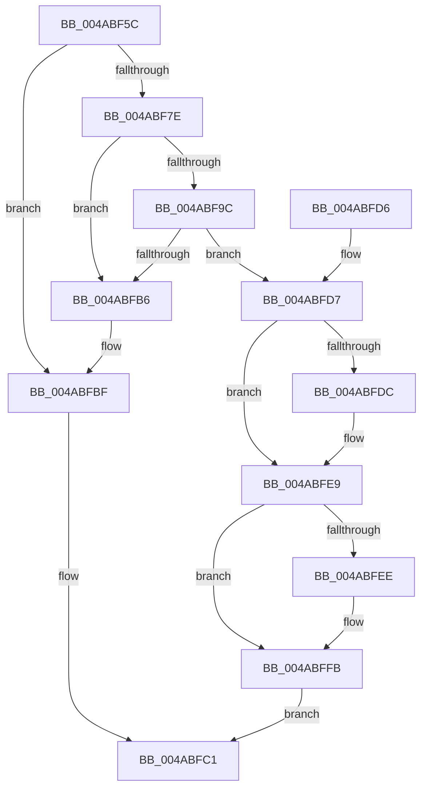

# IopAllocateErrorLogEntry

- RVA: `0x004ABF5C`–`0x004AC012` (길이 `182` bytes)
- VA: `0x00000001404ABF5C`
- 실행 섹션: `.text`
- PDB 이름 있음: `예`; PDB Function 태그: `아니요`
- unwind 정보 RVA: `0x000B81D0`
- 디코드: `50`개 명령, `182/182` bytes 표시
- 미해석 바이트: `0` (있으면 어셈블리에 `.byte`로 보존)

> 이 문서는 커널 이미지의 기계어와 PDB 기호를 분석해 생성했습니다. 4번과 5번은 함수 원형과 자료형을 바이너리 사용 방식에서 추정한 C 해석이며 원본 소스 복구 결과는 아닙니다.

## 1. Dependencies

- 직접 호출 지점: **3**; 고유 호출 대상: **2**
- 직접 호출자로 확인된 함수: **3**
- RIP 상대 이미지 참조: **1**

### Outgoing calls
- `0x004ABFA9` → [ExAllocatePool2](../../poolcode/B8/ExAllocatePool2_function_00B820F0.md) (function, `0x00B820F0`)
- `0x004ABFE4` → [ObfReferenceObjectWithTag](../21/ObfReferenceObjectWithTag_function_00210710.md) (function, `0x00210710`)
- `0x004ABFF6` → [ObfReferenceObjectWithTag](../21/ObfReferenceObjectWithTag_function_00210710.md) (function, `0x00210710`)

### Direct callers
- [IoAllocateErrorLogEntry](IoAllocateErrorLogEntry_function_004ABF20.md) at `0x004ABF47`
- [IoAllocateGenericErrorLogEntry](../59/IoAllocateGenericErrorLogEntry_function_00597908.md) at `0x00597913`
- [MiBadMemoryLogger](../67/MiBadMemoryLogger_function_00679460.md) at `0x00679470`

### Static image references
- `0x004ABF8D` → RVA `0x00F8D168` (`.data`; read/write)

## 2. Other-region calls and transfers

- 다른 실행 섹션으로 향하는 call: **1**
  - `0x004ABFA9` → [ExAllocatePool2](../../poolcode/B8/ExAllocatePool2_function_00B820F0.md) (`.text` → `POOLCODE`)
- 별도 외부 분기/꼬리 이동을 확인하지 못했습니다.

## 3. Assembly (complete function range)

```asm
004ABF5C  48 89 5C 24 08                  mov qword ptr [rsp + 8], rbx
004ABF61  48 89 6C 24 10                  mov qword ptr [rsp + 0x10], rbp
004ABF66  48 89 74 24 18                  mov qword ptr [rsp + 0x18], rsi
004ABF6B  57                              push rdi
004ABF6C  48 83 EC 20                     sub rsp, 0x20
004ABF70  41 8D 40 D0                     lea eax, [r8 - 0x30]
004ABF74  48 8B F2                        mov rsi, rdx
004ABF77  48 8B E9                        mov rbp, rcx
004ABF7A  3C C0                           cmp al, 0xc0
004ABF7C  77 41                           ja 0x1404abfbf
004ABF7E  41 8D 58 07                     lea ebx, [r8 + 7]
004ABF82  81 E3 F8 00 00 00               and ebx, 0xf8
004ABF88  83 C3 30                        add ebx, 0x30
004ABF8B  8B C3                           mov eax, ebx
004ABF8D  F0 0F C1 05 D3 11 AE 00         lock xadd dword ptr [rip + 0xae11d3], eax
004ABF95  3D 00 40 06 00                  cmp eax, 0x64000
004ABF9A  77 1A                           ja 0x1404abfb6
004ABF9C  8B D3                           mov edx, ebx
004ABF9E  B9 40 00 00 00                  mov ecx, 0x40
004ABFA3  41 B8 49 6F 45 72               mov r8d, 0x72456f49
004ABFA9  E8 42 61 6D 00                  call 0x140b820f0
004ABFAE  48 8B F8                        mov rdi, rax
004ABFB1  48 85 C0                        test rax, rax
004ABFB4  75 21                           jne 0x1404abfd7
004ABFB6  F7 DB                           neg ebx
004ABFB8  F0 01 1D A9 11 AE 00            lock add dword ptr [rip + 0xae11a9], ebx
004ABFBF  33 C0                           xor eax, eax
004ABFC1  48 8B 5C 24 30                  mov rbx, qword ptr [rsp + 0x30]
004ABFC6  48 8B 6C 24 38                  mov rbp, qword ptr [rsp + 0x38]
004ABFCB  48 8B 74 24 40                  mov rsi, qword ptr [rsp + 0x40]
004ABFD0  48 83 C4 20                     add rsp, 0x20
004ABFD4  5F                              pop rdi
004ABFD5  C3                              ret
004ABFD6  CC                              int3
004ABFD7  48 85 ED                        test rbp, rbp
004ABFDA  74 0D                           je 0x1404abfe9
004ABFDC  BA 44 66 6C 74                  mov edx, 0x746c6644
004ABFE1  48 8B CD                        mov rcx, rbp
004ABFE4  E8 27 47 D6 FF                  call 0x140210710
004ABFE9  48 85 F6                        test rsi, rsi
004ABFEC  74 0D                           je 0x1404abffb
004ABFEE  BA 44 66 6C 74                  mov edx, 0x746c6644
004ABFF3  48 8B CE                        mov rcx, rsi
004ABFF6  E8 15 47 D6 FF                  call 0x140210710
004ABFFB  66 C7 07 0B 00                  mov word ptr [rdi], 0xb
004AC000  48 8D 47 30                     lea rax, [rdi + 0x30]
004AC004  66 89 5F 02                     mov word ptr [rdi + 2], bx
004AC008  48 89 6F 18                     mov qword ptr [rdi + 0x18], rbp
004AC00C  48 89 77 20                     mov qword ptr [rdi + 0x20], rsi
004AC010  EB AF                           jmp 0x1404abfc1
```

## 4. C-style interpretation (structured pseudocode)

```c
__int64 __fastcall IopAllocateErrorLogEntry(__int64 a1, __int64 a2, __int64 a3)
{
    __int64 result;
    __int64 v_rbx;
    __int64 v_rsp;
    unsigned __int64 v_stack_p10;
    unsigned __int64 v_stack_p18;
    unsigned __int64 v_stack_p8;

    v_stack_p8 = v_rbx;
    v_stack_p10 = v_rbp;
    v_stack_p18 = v_rsi;
    v_rsp = (v_rsp) - (32);
    if (((unsigned __int8)(a3 - 48)) > 192) goto loc_004ABFBF;
    v_rbx = (unsigned int)((a3 + 7) & (248));
    v_rbx = (unsigned int)((v_rbx) + (48));
    if (((unsigned int)((unsigned int)((unsigned int)(v_rbx)))) > 0x64000ULL) goto loc_004ABFB6;
    result = ExAllocatePool2(64, (unsigned int)((unsigned int)(v_rbx)), (unsigned int)(0x72456F49ULL), a4);
    if (result != 0) goto loc_004ABFD7;
loc_004ABFB6:
    v_rbx = (unsigned int)(-(v_rbx));
loc_004ABFBF:
    result = 0;
loc_004ABFC1:
    v_rsp = (v_rsp) + (32);
    return result;
loc_004ABFD7:
    if (v_stack_p10 != 0) {
        a2 = 0x746C6644ULL;
        a1 = v_stack_p10;
        result = ObfReferenceObjectWithTag(a1, a2, (unsigned int)(0x72456F49ULL), a4);
    }
    if (v_stack_p18 != 0) {
        a2 = 0x746C6644ULL;
        a1 = v_stack_p18;
        result = ObfReferenceObjectWithTag(a1, a2, (unsigned int)(0x72456F49ULL), a4);
    }
    *(unsigned __int16 *)(result) = 11;
    *(unsigned __int16 *)(result + 2) = (unsigned __int16)(v_stack_p8);
    *(unsigned __int64 *)(result + 24) = v_stack_p10;
    *(unsigned __int64 *)(result + 32) = v_stack_p18;
    goto loc_004ABFC1;
}
```

## 5. (Beta) C Style

```c
int64_t IopAllocateErrorLogEntry(int64_t Arg1, int64_t Arg2, void *Arg3)
{
    uint8_t *arg3 = (uint8_t *)Arg3;

    int64_t result;
    int64_t local_rbx;
    int64_t local_rsp;
    uint64_t v_stack_p10;
    uint64_t v_stack_p18;
    uint64_t v_stack_p8;

    v_stack_p8 = local_rbx;
    v_stack_p10 = local_rbp;
    v_stack_p18 = local_rsi;
    local_rsp = (local_rsp) - (32);
    if (((uint8_t)(Arg3 - 48)) > 192) goto loc_004ABFBF;
    local_rbx = (uint32_t)((Arg3 + 7) & (248));
    local_rbx = (uint32_t)((local_rbx) + (48));
    if (((uint32_t)((uint32_t)((uint32_t)(local_rbx)))) > 0x64000ULL) goto loc_004ABFB6;
    result = ExAllocatePool2(64, (uint32_t)((uint32_t)(local_rbx)), (uint32_t)(0x72456F49ULL), a4);
    if (result != 0) goto loc_004ABFD7;
loc_004ABFB6:
    local_rbx = (uint32_t)(-(local_rbx));
loc_004ABFBF:
    result = 0;
loc_004ABFC1:
    local_rsp = (local_rsp) + (32);
    return result;
loc_004ABFD7:
    if (v_stack_p10 != 0) {
        Arg2 = 0x746C6644ULL;
        Arg1 = v_stack_p10;
        result = ObfReferenceObjectWithTag(Arg1, Arg2, (uint32_t)(0x72456F49ULL), a4);
    }
    if (v_stack_p18 != 0) {
        Arg2 = 0x746C6644ULL;
        Arg1 = v_stack_p18;
        result = ObfReferenceObjectWithTag(Arg1, Arg2, (uint32_t)(0x72456F49ULL), a4);
    }
    *(uint16_t *)(result) = 11;
    *(uint16_t *)(result + 0x2) = (uint16_t)(v_stack_p8);
    *(uint64_t *)(result + 0x18) = v_stack_p10;
    *(uint64_t *)(result + 0x20) = v_stack_p18;
    goto loc_004ABFC1;
}
```

### 관측된 메모리 오프셋

구조체 형식이 확인되지 않은 접근은 인자 기준의 오프셋으로만 기록했습니다.

| 기준 인자 | 오프셋 표현 | 폭 (bit) | 접근 |
|---|---:|---:|---|
| `Arg3` | `- 0x30` | `32` | `R` |
| `Arg3` | `+ 0x7` | `32` | `R` |

## 6. Execution-region graph

[열기: 2D/3D 그래프와 함수 탐색 컨트롤 패널](../../../control-panel.html?section=text&rva=0x004ABF5C&view=graph)

- 2D 그래프는 위에서 아래로 흐르고, 3D 그래프는 빈 공간을 드래그해 회전합니다. Shift+드래그는 이동, 휠은 확대·축소, 함수 노드 선택은 대상 보고서 이동입니다.

### Static fallback


