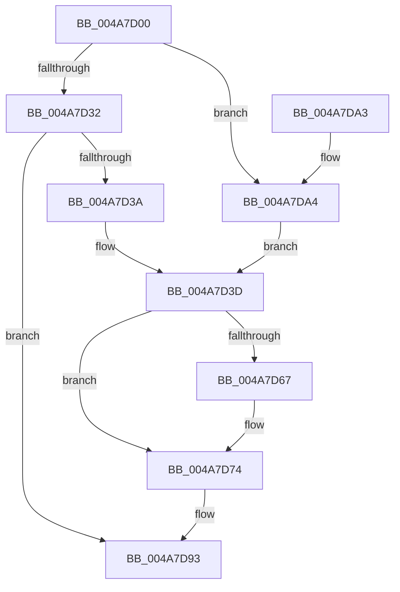

# IopCsqCancelRoutine

- RVA: `0x004A7D00`–`0x004A7DAA` (길이 `170` bytes)
- VA: `0x00000001404A7D00`
- 실행 섹션: `.text`
- PDB 이름 있음: `예`; PDB Function 태그: `아니요`
- unwind 정보 RVA: `0x000B73EC`
- 디코드: `46`개 명령, `170/170` bytes 표시
- 미해석 바이트: `0` (있으면 어셈블리에 `.byte`로 보존)

> 이 문서는 커널 이미지의 기계어와 PDB 기호를 분석해 생성했습니다. 4번과 5번은 함수 원형과 자료형을 바이너리 사용 방식에서 추정한 C 해석이며 원본 소스 복구 결과는 아닙니다.

## 1. Dependencies

- 직접 호출 지점: **5**; 고유 호출 대상: **2**
- 직접 호출자로 확인된 함수: **0**
- RIP 상대 이미지 참조: **0**

### Outgoing calls
- `0x004A7D1F` → [KeReleaseQueuedSpinLock](../27/KeReleaseQueuedSpinLock_function_00272540.md) (function, `0x00272540`)
- `0x004A7D4E` → [guard_dispatch_icall](../6B/guard_dispatch_icall_function_006BAAD0.md) (function, `0x006BAAD0`)
- `0x004A7D5D` → [guard_dispatch_icall](../6B/guard_dispatch_icall_function_006BAAD0.md) (function, `0x006BAAD0`)
- `0x004A7D7F` → [guard_dispatch_icall](../6B/guard_dispatch_icall_function_006BAAD0.md) (function, `0x006BAAD0`)
- `0x004A7D8E` → [guard_dispatch_icall](../6B/guard_dispatch_icall_function_006BAAD0.md) (function, `0x006BAAD0`)

### Direct callers
- 이 함수 시작 RVA로 연결되는 직접 call은 확인되지 않았습니다. 간접 호출은 완전히 역산할 수 없습니다.

### Static image references
- 디코드된 RIP-relative 메모리 참조가 없습니다.

## 2. Other-region calls and transfers

- 다른 실행 섹션으로 향하는 call: **0**
- 별도 외부 분기/꼬리 이동을 확인하지 못했습니다.

## 3. Assembly (complete function range)

```asm
004A7D00  48 89 5C 24 08                  mov qword ptr [rsp + 8], rbx
004A7D05  48 89 74 24 18                  mov qword ptr [rsp + 0x18], rsi
004A7D0A  57                              push rdi
004A7D0B  48 83 EC 20                     sub rsp, 0x20
004A7D0F  48 8B F2                        mov rsi, rdx
004A7D12  C6 44 24 38 00                  mov byte ptr [rsp + 0x38], 0
004A7D17  8A 52 45                        mov dl, byte ptr [rdx + 0x45]
004A7D1A  B9 07 00 00 00                  mov ecx, 7
004A7D1F  E8 1C A8 DC FF                  call 0x140272540
004A7D24  48 8B BE 90 00 00 00            mov rdi, qword ptr [rsi + 0x90]
004A7D2B  8B 07                           mov eax, dword ptr [rdi]
004A7D2D  83 F8 01                        cmp eax, 1
004A7D30  74 72                           je 0x1404a7da4
004A7D32  83 C0 FE                        add eax, -2
004A7D35  83 F8 01                        cmp eax, 1
004A7D38  77 59                           ja 0x1404a7d93
004A7D3A  48 8B DF                        mov rbx, rdi
004A7D3D  48 8B 43 20                     mov rax, qword ptr [rbx + 0x20]
004A7D41  48 8D 54 24 38                  lea rdx, [rsp + 0x38]
004A7D46  48 83 63 38 00                  and qword ptr [rbx + 0x38], 0
004A7D4B  48 8B CB                        mov rcx, rbx
004A7D4E  E8 7D 2D 21 00                  call 0x1406baad0
004A7D53  48 8B 43 10                     mov rax, qword ptr [rbx + 0x10]
004A7D57  48 8B D6                        mov rdx, rsi
004A7D5A  48 8B CB                        mov rcx, rbx
004A7D5D  E8 6E 2D 21 00                  call 0x1406baad0
004A7D62  48 3B FB                        cmp rdi, rbx
004A7D65  74 0D                           je 0x1404a7d74
004A7D67  48 83 67 08 00                  and qword ptr [rdi + 8], 0
004A7D6C  48 83 A6 90 00 00 00 00         and qword ptr [rsi + 0x90], 0
004A7D74  48 8B 43 28                     mov rax, qword ptr [rbx + 0x28]
004A7D78  48 8B CB                        mov rcx, rbx
004A7D7B  8A 54 24 38                     mov dl, byte ptr [rsp + 0x38]
004A7D7F  E8 4C 2D 21 00                  call 0x1406baad0
004A7D84  48 8B 43 30                     mov rax, qword ptr [rbx + 0x30]
004A7D88  48 8B D6                        mov rdx, rsi
004A7D8B  48 8B CB                        mov rcx, rbx
004A7D8E  E8 3D 2D 21 00                  call 0x1406baad0
004A7D93  48 8B 5C 24 30                  mov rbx, qword ptr [rsp + 0x30]
004A7D98  48 8B 74 24 40                  mov rsi, qword ptr [rsp + 0x40]
004A7D9D  48 83 C4 20                     add rsp, 0x20
004A7DA1  5F                              pop rdi
004A7DA2  C3                              ret
004A7DA3  CC                              int3
004A7DA4  48 8B 5F 10                     mov rbx, qword ptr [rdi + 0x10]
004A7DA8  EB 93                           jmp 0x1404a7d3d
```

## 4. C-style interpretation (structured pseudocode)

```c
__int64 __fastcall IopCsqCancelRoutine(__int64 a1, __int64 a2)
{
    __int64 result;
    __int64 v_rsp;
    unsigned __int8 v_stack_p10;
    unsigned __int64 v_stack_p18;
    unsigned __int64 v_stack_p8;

    v_stack_p8 = v_rbx;
    v_stack_p18 = v_rsi;
    v_rsp = (v_rsp) - (32);
    v_stack_p10 = 0;
    result = KeReleaseQueuedSpinLock(7, *(unsigned __int8 *)(a2 + 69), a3, a4);
    if (((unsigned int)((unsigned int)(*(unsigned int *)(*(unsigned __int64 *)(a2 + 144))))) == 1) goto loc_004A7DA4;
    result = (unsigned int)(((unsigned int)(*(unsigned int *)(*(unsigned __int64 *)(a2 + 144)))) + (-2));
    if (((unsigned int)(result)) > 1) goto loc_004A7D93;
loc_004A7D3D:
    result = guard_dispatch_icall(*(unsigned __int64 *)(a2 + 144), v_stack_p10, a3, a4);
    result = guard_dispatch_icall(*(unsigned __int64 *)(a2 + 144), a2, a3, a4);
    if ((*(unsigned __int64 *)(a2 + 144)) != (*(unsigned __int64 *)(a2 + 144))) {
    }
    result = guard_dispatch_icall(*(unsigned __int64 *)(a2 + 144), v_stack_p10, a3, a4);
    result = guard_dispatch_icall(*(unsigned __int64 *)(a2 + 144), a2, a3, a4);
loc_004A7D93:
    v_rsp = (v_rsp) + (32);
    return result;
loc_004A7DA4:
    goto loc_004A7D3D;
}
```

## 5. (Beta) C Style

```c
int64_t IopCsqCancelRoutine(int64_t Arg1, void *Arg2)
{
    uint8_t *arg2 = (uint8_t *)Arg2;

    int64_t result;
    int64_t local_rsp;
    uint8_t v_stack_p10;
    uint64_t v_stack_p18;
    uint64_t v_stack_p8;

    v_stack_p8 = local_rbx;
    v_stack_p18 = local_rsi;
    local_rsp = (local_rsp) - (32);
    v_stack_p10 = 0;
    result = KeReleaseQueuedSpinLock(7, *(uint8_t *)(arg2 + 0x45), a3, a4);
    if (((uint32_t)((uint32_t)(*(uint32_t *)(*(uint64_t *)(arg2 + 0x90))))) == 1) goto loc_004A7DA4;
    result = (uint32_t)(((uint32_t)(*(uint32_t *)(*(uint64_t *)(arg2 + 0x90)))) + (-2));
    if (((uint32_t)(result)) > 1) goto loc_004A7D93;
loc_004A7D3D:
    result = guard_dispatch_icall(*(uint64_t *)(arg2 + 0x90), v_stack_p10, a3, a4);
    result = guard_dispatch_icall(*(uint64_t *)(arg2 + 0x90), Arg2, a3, a4);
    if ((*(uint64_t *)(arg2 + 0x90)) != (*(uint64_t *)(arg2 + 0x90))) {
    }
    result = guard_dispatch_icall(*(uint64_t *)(arg2 + 0x90), v_stack_p10, a3, a4);
    result = guard_dispatch_icall(*(uint64_t *)(arg2 + 0x90), Arg2, a3, a4);
loc_004A7D93:
    local_rsp = (local_rsp) + (32);
    return result;
loc_004A7DA4:
    goto loc_004A7D3D;
}
```

### 관측된 메모리 오프셋

구조체 형식이 확인되지 않은 접근은 인자 기준의 오프셋으로만 기록했습니다.

| 기준 인자 | 오프셋 표현 | 폭 (bit) | 접근 |
|---|---:|---:|---|
| `Arg2` | `+ 0x45` | `8` | `R` |
| `Arg2` | `+ 0x90` | `64` | `R` |
| `Arg2` | `+ 0x90` | `64` | `R/W` |

## 6. Execution-region graph

[열기: 2D/3D 그래프와 함수 탐색 컨트롤 패널](../../../control-panel.html?section=text&rva=0x004A7D00&view=graph)

- 2D 그래프는 위에서 아래로 흐르고, 3D 그래프는 빈 공간을 드래그해 회전합니다. Shift+드래그는 이동, 휠은 확대·축소, 함수 노드 선택은 대상 보고서 이동입니다.

### Static fallback


