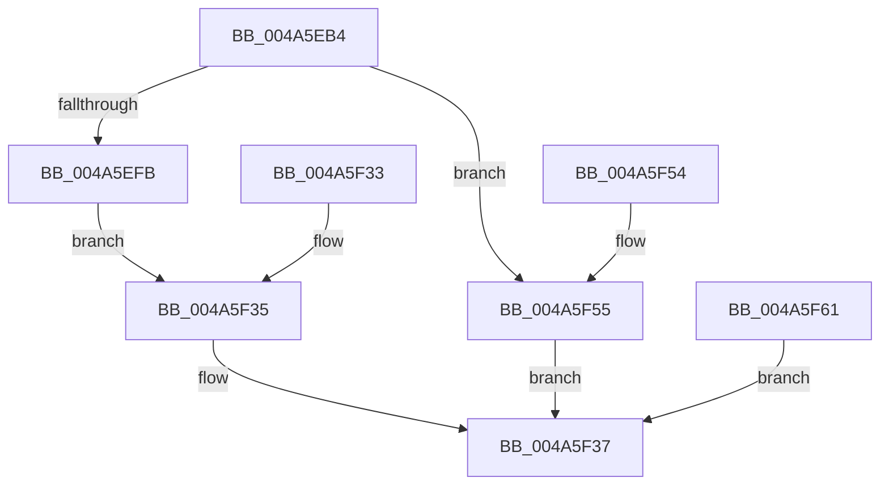

# IopGetFileVolumeNameInformation

- RVA: `0x004A5EB4`–`0x004A5F63` (길이 `175` bytes)
- VA: `0x00000001404A5EB4`
- 실행 섹션: `.text`
- PDB 이름 있음: `예`; PDB Function 태그: `아니요`
- unwind 정보 RVA: `0x000B6BD4`
- 디코드: `51`개 명령, `175/175` bytes 표시
- 미해석 바이트: `0` (있으면 어셈블리에 `.byte`로 보존)

> 이 문서는 커널 이미지의 기계어와 PDB 기호를 분석해 생성했습니다. 4번과 5번은 함수 원형과 자료형을 바이너리 사용 방식에서 추정한 C 해석이며 원본 소스 복구 결과는 아닙니다.

## 1. Dependencies

- 직접 호출 지점: **3**; 고유 호출 대상: **3**
- 직접 호출자로 확인된 함수: **1**
- RIP 상대 이미지 참조: **1**

### Outgoing calls
- `0x004A5EF2` → [ObQueryNameString](../../page/8A/ObQueryNameString_function_008A7EB0.md) (function, `0x008A7EB0`)
- `0x004A5F23` → [memcpy](../6C/memcpy_function_006C6840.md) (function, `0x006C6840`)
- `0x004A5F42` → [_security_check_cookie](../6A/_security_check_cookie_function_006AC640.md) (function, `0x006AC640`)

### Direct callers
- [NtQueryInformationFile](../../page/8A/NtQueryInformationFile_function_008AD630.md) at `0x008ADFA6`

### Static image references
- `0x004A5EC1` → RVA `0x00E0A740` (`.data`; read)

## 2. Other-region calls and transfers

- 다른 실행 섹션으로 향하는 call: **1**
  - `0x004A5EF2` → [ObQueryNameString](../../page/8A/ObQueryNameString_function_008A7EB0.md) (`.text` → `PAGE`)
- 별도 외부 분기/꼬리 이동을 확인하지 못했습니다.

## 3. Assembly (complete function range)

```asm
004A5EB4  40 53                           push rbx
004A5EB6  56                              push rsi
004A5EB7  57                              push rdi
004A5EB8  41 56                           push r14
004A5EBA  48 81 EC 48 02 00 00            sub rsp, 0x248
004A5EC1  48 8B 05 78 48 96 00            mov rax, qword ptr [rip + 0x964878]
004A5EC8  48 33 C4                        xor rax, rsp
004A5ECB  48 89 84 24 30 02 00 00         mov qword ptr [rsp + 0x230], rax
004A5ED3  4D 8B F0                        mov r14, r8
004A5ED6  48 8B FA                        mov rdi, rdx
004A5ED9  83 64 24 20 00                  and dword ptr [rsp + 0x20], 0
004A5EDE  41 8D 59 FC                     lea ebx, [r9 - 4]
004A5EE2  4C 8D 4C 24 20                  lea r9, [rsp + 0x20]
004A5EE7  41 B8 00 02 00 00               mov r8d, 0x200
004A5EED  48 8D 54 24 30                  lea rdx, [rsp + 0x30]
004A5EF2  E8 B9 1F 40 00                  call 0x1408a7eb0
004A5EF7  85 C0                           test eax, eax
004A5EF9  78 5A                           js 0x1404a5f55
004A5EFB  0F B7 4C 24 30                  movzx ecx, word ptr [rsp + 0x30]
004A5F00  8B C3                           mov eax, ebx
004A5F02  83 E0 FE                        and eax, 0xfffffffe
004A5F05  8B F1                           mov esi, ecx
004A5F07  3B D9                           cmp ebx, ecx
004A5F09  0F 42 F0                        cmovb esi, eax
004A5F0C  1B DB                           sbb ebx, ebx
004A5F0E  81 E3 05 00 00 80               and ebx, 0x80000005
004A5F14  41 89 0E                        mov dword ptr [r14], ecx
004A5F17  44 8B C6                        mov r8d, esi
004A5F1A  49 8D 4E 04                     lea rcx, [r14 + 4]
004A5F1E  48 8B 54 24 38                  mov rdx, qword ptr [rsp + 0x38]
004A5F23  E8 18 09 22 00                  call 0x1406c6840
004A5F28  89 1F                           mov dword ptr [rdi], ebx
004A5F2A  8D 4E 04                        lea ecx, [rsi + 4]
004A5F2D  48 89 4F 08                     mov qword ptr [rdi + 8], rcx
004A5F31  EB 02                           jmp 0x1404a5f35
004A5F33  8B D8                           mov ebx, eax
004A5F35  8B C3                           mov eax, ebx
004A5F37  48 8B 8C 24 30 02 00 00         mov rcx, qword ptr [rsp + 0x230]
004A5F3F  48 33 CC                        xor rcx, rsp
004A5F42  E8 F9 66 20 00                  call 0x1406ac640
004A5F47  48 81 C4 48 02 00 00            add rsp, 0x248
004A5F4E  41 5E                           pop r14
004A5F50  5F                              pop rdi
004A5F51  5E                              pop rsi
004A5F52  5B                              pop rbx
004A5F53  C3                              ret
004A5F54  CC                              int3
004A5F55  89 07                           mov dword ptr [rdi], eax
004A5F57  48 C7 47 08 00 00 00 00         mov qword ptr [rdi + 8], 0
004A5F5F  EB D6                           jmp 0x1404a5f37
004A5F61  EB D4                           jmp 0x1404a5f37
```

## 4. C-style interpretation (structured pseudocode)

```c
__int64 __fastcall IopGetFileVolumeNameInformation(__int64 a1, __int64 a2, __int64 a3, __int64 a4)
{
    __int64 result;
    __int64 v_rbx;
    __int64 v_rsi;
    __int64 v_rsp;
    unsigned __int64 v_stack_m230;
    unsigned __int64 v_stack_m238;
    unsigned int v_stack_m248;
    unsigned __int64 v_stack_m38;

    v_rsp = (v_rsp) - (584);
    result = (*(unsigned __int64 *)(v_rip + 9848952)) ^ (v_rsp);
    v_stack_m38 = result;
    result = ObQueryNameString(a1, v_stack_m238, 512, v_stack_m248);
    if (sign_flag) goto loc_004A5F55;
    result = (unsigned int)(((unsigned int)((unsigned int)(a4 - 4))) & (0xFFFFFFFEULL));
    v_rsi = (unsigned int)((unsigned int)(v_stack_m238));
    if (((unsigned int)(a4 - 4)) < ((unsigned int)(v_stack_m238))) { v_rsi = (unsigned int)(result); }
    v_rbx = (unsigned int)((a4 - 4) & (0x80000005ULL));
    *(unsigned int *)(a3) = (unsigned int)(v_stack_m238);
    result = memcpy(a3 + 4, v_stack_m230, (unsigned int)((unsigned int)(v_rsi)), v_stack_m248);
    *(unsigned int *)(a2) = (unsigned int)(v_rbx);
    *(unsigned __int64 *)(a2 + 8) = v_rsi + 4;
    goto loc_004A5F35;
loc_004A5F35:
loc_004A5F37:
    a1 = (v_stack_m38) ^ (v_rsp);
    result = _security_check_cookie(a1, v_stack_m230, (unsigned int)((unsigned int)(v_rsi)), v_stack_m248);
    v_rsp = (v_rsp) + (584);
    return result;
loc_004A5F55:
    *(unsigned int *)(a2) = (unsigned int)(result);
    *(unsigned __int64 *)(a2 + 8) = 0;
    goto loc_004A5F37;
}
```

## 5. (Beta) C Style

```c
int64_t IopGetFileVolumeNameInformation(int64_t Arg1, void *Arg2, void *Arg3, void *Arg4)
{
    uint8_t *arg2 = (uint8_t *)Arg2;
    uint8_t *arg3 = (uint8_t *)Arg3;
    uint8_t *arg4 = (uint8_t *)Arg4;

    int64_t result;
    int64_t local_rbx;
    int64_t local_rsi;
    int64_t local_rsp;
    uint64_t v_stack_m230;
    uint64_t v_stack_m238;
    uint32_t v_stack_m248;
    uint64_t v_stack_m38;

    local_rsp = (local_rsp) - (584);
    result = (*(uint64_t *)(v_rip + 0x964878)) ^ (local_rsp);
    v_stack_m38 = result;
    result = ObQueryNameString(Arg1, v_stack_m238, 512, v_stack_m248);
    if (sign_flag) goto loc_004A5F55;
    result = (uint32_t)(((uint32_t)((uint32_t)(Arg4 - 4))) & (0xFFFFFFFEULL));
    local_rsi = (uint32_t)((uint32_t)(v_stack_m238));
    if (((uint32_t)(Arg4 - 4)) < ((uint32_t)(v_stack_m238))) { local_rsi = (uint32_t)(result); }
    local_rbx = (uint32_t)((Arg4 - 4) & (0x80000005ULL));
    *(uint32_t *)(arg3) = (uint32_t)(v_stack_m238);
    result = memcpy(Arg3 + 4, v_stack_m230, (uint32_t)((uint32_t)(local_rsi)), v_stack_m248);
    *(uint32_t *)(arg2) = (uint32_t)(local_rbx);
    *(uint64_t *)(arg2 + 0x8) = local_rsi + 4;
    goto loc_004A5F35;
loc_004A5F35:
loc_004A5F37:
    Arg1 = (v_stack_m38) ^ (local_rsp);
    result = _security_check_cookie(Arg1, v_stack_m230, (uint32_t)((uint32_t)(local_rsi)), v_stack_m248);
    local_rsp = (local_rsp) + (584);
    return result;
loc_004A5F55:
    *(uint32_t *)(arg2) = (uint32_t)(result);
    *(uint64_t *)(arg2 + 0x8) = 0;
    goto loc_004A5F37;
}
```

### 관측된 메모리 오프셋

구조체 형식이 확인되지 않은 접근은 인자 기준의 오프셋으로만 기록했습니다.

| 기준 인자 | 오프셋 표현 | 폭 (bit) | 접근 |
|---|---:|---:|---|
| `Arg2` | `+ 0x0` | `32` | `W` |
| `Arg2` | `+ 0x8` | `64` | `W` |
| `Arg3` | `+ 0x0` | `32` | `W` |
| `Arg3` | `+ 0x4` | `64` | `R` |
| `Arg4` | `- 0x4` | `32` | `R` |

## 6. Execution-region graph

[열기: 2D/3D 그래프와 함수 탐색 컨트롤 패널](../../../control-panel.html?section=text&rva=0x004A5EB4&view=graph)

- 2D 그래프는 위에서 아래로 흐르고, 3D 그래프는 빈 공간을 드래그해 회전합니다. Shift+드래그는 이동, 휠은 확대·축소, 함수 노드 선택은 대상 보고서 이동입니다.

### Static fallback


