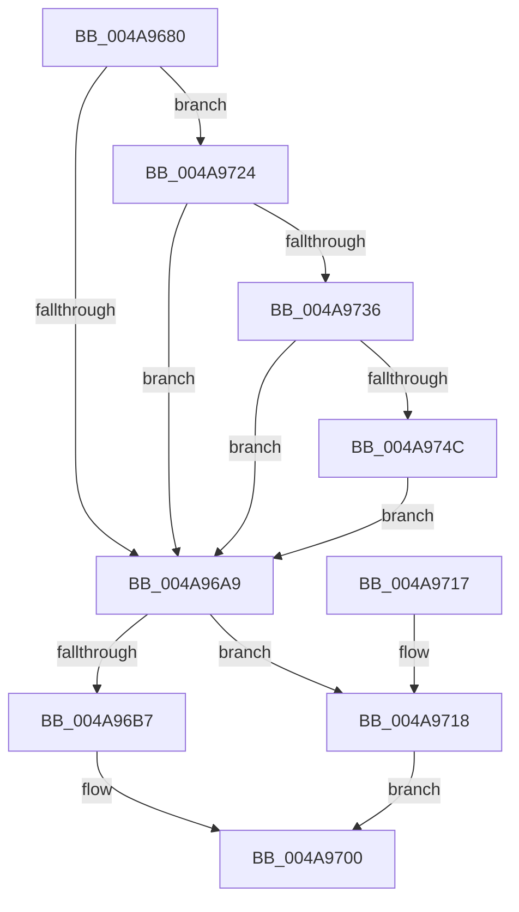

# IopPerfCallDriver

- RVA: `0x004A9680`–`0x004A975F` (길이 `223` bytes)
- VA: `0x00000001404A9680`
- 실행 섹션: `.text`
- PDB 이름 있음: `예`; PDB Function 태그: `아니요`
- unwind 정보 RVA: `0x000A6C8C`
- 디코드: `60`개 명령, `223/223` bytes 표시
- 미해석 바이트: `0` (있으면 어셈블리에 `.byte`로 보존)

> 이 문서는 커널 이미지의 기계어와 PDB 기호를 분석해 생성했습니다. 4번과 5번은 함수 원형과 자료형을 바이너리 사용 방식에서 추정한 C 해석이며 원본 소스 복구 결과는 아닙니다.

## 1. Dependencies

- 직접 호출 지점: **8**; 고유 호출 대상: **7**
- 직접 호출자로 확인된 함수: **6**
- RIP 상대 이미지 참조: **2**

### Outgoing calls
- `0x004A96BC` → [ObfReferenceObjectWithTag](../21/ObfReferenceObjectWithTag_function_00210710.md) (function, `0x00210710`)
- `0x004A96D7` → [IopPerfLogCallEvent](IopPerfLogCallEvent_function_004A97D8.md) (function, `0x004A97D8`)
- `0x004A96E2` → [IopfCallDriver](../29/IopfCallDriver_function_0029C474.md) (function, `0x0029C474`)
- `0x004A96EE` → [IopPerfLogCallReturnEvent](IopPerfLogCallReturnEvent_function_004A9768.md) (function, `0x004A9768`)
- `0x004A96FB` → [ObfDereferenceObjectWithTag](../2F/ObfDereferenceObjectWithTag_function_002F78E0.md) (function, `0x002F78E0`)
- `0x004A971B` → [IopfCallDriver](../29/IopfCallDriver_function_0029C474.md) (function, `0x0029C474`)
- `0x004A9729` → [IopIrpHasValidCombinationOfExtensionTypes](../48/IopIrpHasValidCombinationOfExtensionTypes_function_0048C070.md) (function, `0x0048C070`)
- `0x004A973B` → [IopAllocateIrpExtension](../44/IopAllocateIrpExtension_function_00444F30.md) (function, `0x00444F30`)

### Direct callers
- [IofCallDriver](../29/IofCallDriver_function_0029B4B0.md) at `0x0029B55F`
- [IofCallDriverSpecifyReturn](IofCallDriverSpecifyReturn_function_004A8AE0.md) at `0x004A8B02`
- [IovpCallDriverNoIrpTracking](../../pagevrfy/B9/IovpCallDriverNoIrpTracking_function_00B928F8.md) at `0x00B92920`
- [IovpCallDriverWithStackBuffer](../../pagevrfy/B9/IovpCallDriverWithStackBuffer_function_00B92940.md) at `0x00B92A9D`
- [IovCallDriver](../../pagevrfy/BB/IovCallDriver_function_00BB7D30.md) at `0x00BB7DD6`
- [sub_00BBC34E](../../pagevrfy/BB/Unknown_function_00BBC34E.md) at `0x00BBC4DD`

### Static image references
- `0x004A9694` → RVA `0x00E66138` (`.data`; read)
- `0x004A96C3` → RVA `0x00F8D108` (`.data`; read/write)

## 2. Other-region calls and transfers

- 다른 실행 섹션으로 향하는 call: **0**
- 별도 외부 분기/꼬리 이동을 확인하지 못했습니다.

## 3. Assembly (complete function range)

```asm
004A9680  48 89 5C 24 08                  mov qword ptr [rsp + 8], rbx
004A9685  48 89 6C 24 10                  mov qword ptr [rsp + 0x10], rbp
004A968A  48 89 74 24 18                  mov qword ptr [rsp + 0x18], rsi
004A968F  57                              push rdi
004A9690  48 83 EC 20                     sub rsp, 0x20
004A9694  8B 05 9E CA 9B 00               mov eax, dword ptr [rip + 0x9bca9e]
004A969A  48 8B FA                        mov rdi, rdx
004A969D  48 8B F1                        mov rsi, rcx
004A96A0  BD 01 00 00 00                  mov ebp, 1
004A96A5  A8 02                           test al, 2
004A96A7  75 7B                           jne 0x1404a9724
004A96A9  8B 05 89 CA 9B 00               mov eax, dword ptr [rip + 0x9bca89]
004A96AF  48 8B CE                        mov rcx, rsi
004A96B2  40 84 C5                        test bpl, al
004A96B5  74 61                           je 0x1404a9718
004A96B7  BA 44 66 6C 74                  mov edx, 0x746c6644
004A96BC  E8 4F 70 D6 FF                  call 0x140210710
004A96C1  8B DD                           mov ebx, ebp
004A96C3  F0 0F C1 1D 3D 3A AE 00         lock xadd dword ptr [rip + 0xae3a3d], ebx
004A96CB  48 8B 4E 08                     mov rcx, qword ptr [rsi + 8]
004A96CF  03 DD                           add ebx, ebp
004A96D1  44 8B C3                        mov r8d, ebx
004A96D4  48 8B D7                        mov rdx, rdi
004A96D7  E8 FC 00 00 00                  call 0x1404a97d8
004A96DC  48 8B D7                        mov rdx, rdi
004A96DF  48 8B CE                        mov rcx, rsi
004A96E2  E8 8D 2D DF FF                  call 0x14029c474
004A96E7  8B D3                           mov edx, ebx
004A96E9  48 8B CF                        mov rcx, rdi
004A96EC  8B E8                           mov ebp, eax
004A96EE  E8 75 00 00 00                  call 0x1404a9768
004A96F3  BA 44 66 6C 74                  mov edx, 0x746c6644
004A96F8  48 8B CE                        mov rcx, rsi
004A96FB  E8 E0 E1 E4 FF                  call 0x1402f78e0
004A9700  48 8B 5C 24 30                  mov rbx, qword ptr [rsp + 0x30]
004A9705  8B C5                           mov eax, ebp
004A9707  48 8B 6C 24 38                  mov rbp, qword ptr [rsp + 0x38]
004A970C  48 8B 74 24 40                  mov rsi, qword ptr [rsp + 0x40]
004A9711  48 83 C4 20                     add rsp, 0x20
004A9715  5F                              pop rdi
004A9716  C3                              ret
004A9717  CC                              int3
004A9718  48 8B D7                        mov rdx, rdi
004A971B  E8 54 2D DF FF                  call 0x14029c474
004A9720  8B E8                           mov ebp, eax
004A9722  EB DC                           jmp 0x1404a9700
004A9724  8B D5                           mov edx, ebp
004A9726  48 8B CF                        mov rcx, rdi
004A9729  E8 42 29 FE FF                  call 0x14048c070
004A972E  84 C0                           test al, al
004A9730  0F 84 73 FF FF FF               je 0x1404a96a9
004A9736  8B D5                           mov edx, ebp
004A9738  48 8B CF                        mov rcx, rdi
004A973B  E8 F0 B7 F9 FF                  call 0x140444f30
004A9740  48 8B C8                        mov rcx, rax
004A9743  48 85 C0                        test rax, rax
004A9746  0F 84 5D FF FF FF               je 0x1404a96a9
004A974C  48 A1 14 00 00 00 80 F7 FF FF   movabs rax, qword ptr [0xfffff78000000014]
004A9756  48 89 41 28                     mov qword ptr [rcx + 0x28], rax
004A975A  E9 4A FF FF FF                  jmp 0x1404a96a9
```

## 4. C-style interpretation (structured pseudocode)

```c
__int64 __fastcall IopPerfCallDriver(__int64 a1, __int64 a2)
{
    __int64 result;
    __int64 v_rbx;
    __int64 v_rsp;
    unsigned __int64 v_stack_p10;
    unsigned __int64 v_stack_p18;
    unsigned __int64 v_stack_p8;

    v_stack_p8 = v_rbx;
    v_stack_p10 = v_rbp;
    v_stack_p18 = v_rsi;
    v_rsp = (v_rsp) - (32);
    if ((((unsigned __int8)((unsigned int)(*(unsigned int *)(v_rip + 10209950)))) & (2)) != 0) goto loc_004A9724;
loc_004A96A9:
    if (((1) & ((unsigned __int8)((unsigned int)(*(unsigned int *)(v_rip + 10209929))))) == 0) goto loc_004A9718;
    result = ObfReferenceObjectWithTag(a1, (unsigned int)(0x746C6644ULL), a3, a4);
    v_rbx = (unsigned int)((1) + (1));
    result = IopPerfLogCallEvent(*(unsigned __int64 *)(a1 + 8), a2, (unsigned int)((unsigned int)(v_rbx)), a4);
    result = IopfCallDriver(a1, a2, (unsigned int)((unsigned int)(v_rbx)), a4);
    result = IopPerfLogCallReturnEvent(a2, (unsigned int)((unsigned int)(v_rbx)), (unsigned int)((unsigned int)(v_rbx)), a4);
    result = ObfDereferenceObjectWithTag(a1, (unsigned int)(0x746C6644ULL), (unsigned int)((unsigned int)(v_rbx)), a4);
loc_004A9700:
    v_rsp = (v_rsp) + (32);
    return (unsigned int)((unsigned int)((unsigned int)((unsigned int)(result))));
loc_004A9718:
    result = IopfCallDriver(a1, a2, (unsigned int)((unsigned int)(v_rbx)), a4);
    goto loc_004A9700;
loc_004A9724:
    result = IopIrpHasValidCombinationOfExtensionTypes(a2, (unsigned int)((unsigned int)((unsigned int)((unsigned int)(result)))), (unsigned int)((unsigned int)(v_rbx)), a4);
    if ((unsigned __int8)(result) == 0) goto loc_004A96A9;
    result = IopAllocateIrpExtension(a2, (unsigned int)((unsigned int)((unsigned int)((unsigned int)(result)))), (unsigned int)((unsigned int)(v_rbx)), a4);
    if (result == 0) goto loc_004A96A9;
    *(unsigned __int64 *)(result + 40) = result;
    goto loc_004A96A9;
}
```

## 5. (Beta) C Style

```c
int64_t IopPerfCallDriver(void *Arg1, int64_t Arg2)
{
    uint8_t *arg1 = (uint8_t *)Arg1;

    int64_t result;
    int64_t local_rbx;
    int64_t local_rsp;
    uint64_t v_stack_p10;
    uint64_t v_stack_p18;
    uint64_t v_stack_p8;

    v_stack_p8 = local_rbx;
    v_stack_p10 = local_rbp;
    v_stack_p18 = local_rsi;
    local_rsp = (local_rsp) - (32);
    if ((((uint8_t)((uint32_t)(*(uint32_t *)(v_rip + 0x9BCA9E)))) & (2)) != 0) goto loc_004A9724;
loc_004A96A9:
    if (((1) & ((uint8_t)((uint32_t)(*(uint32_t *)(v_rip + 0x9BCA89))))) == 0) goto loc_004A9718;
    result = ObfReferenceObjectWithTag(Arg1, (uint32_t)(0x746C6644ULL), a3, a4);
    local_rbx = (uint32_t)((1) + (1));
    result = IopPerfLogCallEvent(*(uint64_t *)(arg1 + 0x8), Arg2, (uint32_t)((uint32_t)(local_rbx)), a4);
    result = IopfCallDriver(Arg1, Arg2, (uint32_t)((uint32_t)(local_rbx)), a4);
    result = IopPerfLogCallReturnEvent(Arg2, (uint32_t)((uint32_t)(local_rbx)), (uint32_t)((uint32_t)(local_rbx)), a4);
    result = ObfDereferenceObjectWithTag(Arg1, (uint32_t)(0x746C6644ULL), (uint32_t)((uint32_t)(local_rbx)), a4);
loc_004A9700:
    local_rsp = (local_rsp) + (32);
    return (uint32_t)((uint32_t)((uint32_t)((uint32_t)(result))));
loc_004A9718:
    result = IopfCallDriver(Arg1, Arg2, (uint32_t)((uint32_t)(local_rbx)), a4);
    goto loc_004A9700;
loc_004A9724:
    result = IopIrpHasValidCombinationOfExtensionTypes(Arg2, (uint32_t)((uint32_t)((uint32_t)((uint32_t)(result)))), (uint32_t)((uint32_t)(local_rbx)), a4);
    if ((uint8_t)(result) == 0) goto loc_004A96A9;
    result = IopAllocateIrpExtension(Arg2, (uint32_t)((uint32_t)((uint32_t)((uint32_t)(result)))), (uint32_t)((uint32_t)(local_rbx)), a4);
    if (result == 0) goto loc_004A96A9;
    *(uint64_t *)(result + 0x28) = result;
    goto loc_004A96A9;
}
```

### 관측된 메모리 오프셋

구조체 형식이 확인되지 않은 접근은 인자 기준의 오프셋으로만 기록했습니다.

| 기준 인자 | 오프셋 표현 | 폭 (bit) | 접근 |
|---|---:|---:|---|
| `Arg1` | `+ 0x8` | `64` | `R` |

## 6. Execution-region graph

[열기: 2D/3D 그래프와 함수 탐색 컨트롤 패널](../../../control-panel.html?section=text&rva=0x004A9680&view=graph)

- 2D 그래프는 위에서 아래로 흐르고, 3D 그래프는 빈 공간을 드래그해 회전합니다. Shift+드래그는 이동, 휠은 확대·축소, 함수 노드 선택은 대상 보고서 이동입니다.

### Static fallback


