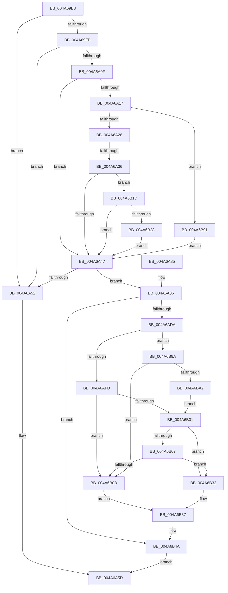

# IopPerfCompleteRequest

- RVA: `0x004A69B8`–`0x004A6BA7` (길이 `495` bytes)
- VA: `0x00000001404A69B8`
- 실행 섹션: `.text`
- PDB 이름 있음: `예`; PDB Function 태그: `예`
- unwind 정보 RVA: `0x000B6EE4`
- 디코드: `130`개 명령, `495/495` bytes 표시
- 미해석 바이트: `0` (있으면 어셈블리에 `.byte`로 보존)

> 이 문서는 커널 이미지의 기계어와 PDB 기호를 분석해 생성했습니다. 4번과 5번은 함수 원형과 자료형을 바이너리 사용 방식에서 추정한 C 해석이며 원본 소스 복구 결과는 아닙니다.

## 1. Dependencies

- 직접 호출 지점: **5**; 고유 호출 대상: **3**
- 직접 호출자로 확인된 함수: **2**
- RIP 상대 이미지 참조: **4**

### Outgoing calls
- `0x004A6A58` → [IopfCompleteRequest](../29/IopfCompleteRequest_function_0029B5F8.md) (function, `0x0029B5F8`)
- `0x004A6A64` → [_security_check_cookie](../6A/_security_check_cookie_function_006AC640.md) (function, `0x006AC640`)
- `0x004A6AD0` → [EtwTraceKernelEvent](../23/EtwTraceKernelEvent_function_00235350.md) (function, `0x00235350`)
- `0x004A6B50` → [IopfCompleteRequest](../29/IopfCompleteRequest_function_0029B5F8.md) (function, `0x0029B5F8`)
- `0x004A6B87` → [EtwTraceKernelEvent](../23/EtwTraceKernelEvent_function_00235350.md) (function, `0x00235350`)

### Direct callers
- [IofCompleteRequest](../29/IofCompleteRequest_function_0029B5C0.md) at `0x0029B5E5`
- [IovCompleteRequest](../../pagevrfy/BB/IovCompleteRequest_function_00BB6758.md) at `0x00BB684D`

### Static image references
- `0x004A69D6` → RVA `0x00E0A740` (`.data`; read)
- `0x004A6A28` → RVA `0x00E66138` (`.data`; read)
- `0x004A6A89` → RVA `0x00F8D108` (`.data`; read/write)
- `0x004A6B37` → RVA `0x004B11E0` (`IopPerfCompletionRoutine`; read)

## 2. Other-region calls and transfers

- 다른 실행 섹션으로 향하는 call: **0**
- call이 아닌 외부 분기/꼬리 이동: **1**
  - `0x004A6A30` → [sub_006F997E](../6F/Unknown_function_006F997E.md) (`tail-transfer`)

## 3. Assembly (complete function range)

```asm
004A69B8  48 89 5C 24 18                  mov qword ptr [rsp + 0x18], rbx
004A69BD  48 89 74 24 20                  mov qword ptr [rsp + 0x20], rsi
004A69C2  55                              push rbp
004A69C3  57                              push rdi
004A69C4  41 55                           push r13
004A69C6  41 56                           push r14
004A69C8  41 57                           push r15
004A69CA  48 8D 6C 24 C9                  lea rbp, [rsp - 0x37]
004A69CF  48 81 EC A0 00 00 00            sub rsp, 0xa0
004A69D6  48 8B 05 63 3D 96 00            mov rax, qword ptr [rip + 0x963d63]
004A69DD  48 33 C4                        xor rax, rsp
004A69E0  48 89 45 2F                     mov qword ptr [rbp + 0x2f], rax
004A69E4  66 83 39 06                     cmp word ptr [rcx], 6
004A69E8  0F 57 C0                        xorps xmm0, xmm0
004A69EB  0F 11 45 C7                     movups xmmword ptr [rbp - 0x39], xmm0
004A69EF  44 8A FA                        mov r15b, dl
004A69F2  48 8B F9                        mov rdi, rcx
004A69F5  0F 11 45 D7                     movups xmmword ptr [rbp - 0x29], xmm0
004A69F9  75 57                           jne 0x1404a6a52
004A69FB  8A 49 42                        mov cl, byte ptr [rcx + 0x42]
004A69FE  41 BD 01 00 00 00               mov r13d, 1
004A6A04  8A 57 43                        mov dl, byte ptr [rdi + 0x43]
004A6A07  42 8D 04 29                     lea eax, [rcx + r13]
004A6A0B  3A D0                           cmp dl, al
004A6A0D  7F 43                           jg 0x1404a6a52
004A6A0F  33 F6                           xor esi, esi
004A6A11  33 DB                           xor ebx, ebx
004A6A13  3A D1                           cmp dl, cl
004A6A15  7F 30                           jg 0x1404a6a47
004A6A17  48 8B 9F B8 00 00 00            mov rbx, qword ptr [rdi + 0xb8]
004A6A1E  48 39 73 28                     cmp qword ptr [rbx + 0x28], rsi
004A6A22  0F 84 69 01 00 00               je 0x1404a6b91
004A6A28  8B 05 0A F7 9B 00               mov eax, dword ptr [rip + 0x9bf70a]
004A6A2E  A8 02                           test al, 2
004A6A30  0F 85 48 2F 25 00               jne 0x1406f997e
004A6A36  48 8B 43 28                     mov rax, qword ptr [rbx + 0x28]
004A6A3A  48 8B 48 08                     mov rcx, qword ptr [rax + 8]
004A6A3E  48 85 C9                        test rcx, rcx
004A6A41  0F 85 D6 00 00 00               jne 0x1404a6b1d
004A6A47  8B 05 EB F6 9B 00               mov eax, dword ptr [rip + 0x9bf6eb]
004A6A4D  41 84 C5                        test r13b, al
004A6A50  75 34                           jne 0x1404a6a86
004A6A52  41 8A D7                        mov dl, r15b
004A6A55  48 8B CF                        mov rcx, rdi
004A6A58  E8 9B 4B DF FF                  call 0x14029b5f8
004A6A5D  48 8B 4D 2F                     mov rcx, qword ptr [rbp + 0x2f]
004A6A61  48 33 CC                        xor rcx, rsp
004A6A64  E8 D7 5B 20 00                  call 0x1406ac640
004A6A69  4C 8D 9C 24 A0 00 00 00         lea r11, [rsp + 0xa0]
004A6A71  49 8B 5B 40                     mov rbx, qword ptr [r11 + 0x40]
004A6A75  49 8B 73 48                     mov rsi, qword ptr [r11 + 0x48]
004A6A79  49 8B E3                        mov rsp, r11
004A6A7C  41 5F                           pop r15
004A6A7E  41 5E                           pop r14
004A6A80  41 5D                           pop r13
004A6A82  5F                              pop rdi
004A6A83  5D                              pop rbp
004A6A84  C3                              ret
004A6A85  CC                              int3
004A6A86  45 8B F5                        mov r14d, r13d
004A6A89  F0 44 0F C1 35 76 66 AE 00      lock xadd dword ptr [rip + 0xae6676], r14d
004A6A92  83 65 1B 00                     and dword ptr [rbp + 0x1b], 0
004A6A96  48 8D 45 F7                     lea rax, [rbp - 9]
004A6A9A  48 89 75 F7                     mov qword ptr [rbp - 9], rsi
004A6A9E  48 8D 4D 0F                     lea rcx, [rbp + 0xf]
004A6AA2  BE 02 18 50 00                  mov esi, 0x501802
004A6AA7  48 89 7D FF                     mov qword ptr [rbp - 1], rdi
004A6AAB  45 03 F5                        add r14d, r13d
004A6AAE  89 74 24 20                     mov dword ptr [rsp + 0x20], esi
004A6AB2  41 B9 34 01 00 00               mov r9d, 0x134
004A6AB8  44 89 75 07                     mov dword ptr [rbp + 7], r14d
004A6ABC  41 B8 10 00 00 20               mov r8d, 0x20000010
004A6AC2  48 89 45 0F                     mov qword ptr [rbp + 0xf], rax
004A6AC6  41 8B D5                        mov edx, r13d
004A6AC9  C7 45 17 14 00 00 00            mov dword ptr [rbp + 0x17], 0x14
004A6AD0  E8 7B E8 D8 FF                  call 0x140235350
004A6AD5  48 85 DB                        test rbx, rbx
004A6AD8  74 70                           je 0x1404a6b4a
004A6ADA  83 7F 30 00                     cmp dword ptr [rdi + 0x30], 0
004A6ADE  48 8B 43 40                     mov rax, qword ptr [rbx + 0x40]
004A6AE2  48 89 45 CF                     mov qword ptr [rbp - 0x31], rax
004A6AE6  48 89 5D C7                     mov qword ptr [rbp - 0x39], rbx
004A6AEA  44 89 75 DF                     mov dword ptr [rbp - 0x21], r14d
004A6AEE  8A 43 03                        mov al, byte ptr [rbx + 3]
004A6AF1  88 45 E3                        mov byte ptr [rbp - 0x1d], al
004A6AF4  8A 43 03                        mov al, byte ptr [rbx + 3]
004A6AF7  0F 8D 9D 00 00 00               jge 0x1404a6b9a
004A6AFD  84 C0                           test al, al
004A6AFF  78 0A                           js 0x1404a6b0b
004A6B01  80 7F 44 00                     cmp byte ptr [rdi + 0x44], 0
004A6B05  74 2B                           je 0x1404a6b32
004A6B07  A8 20                           test al, 0x20
004A6B09  74 27                           je 0x1404a6b32
004A6B0B  48 8B 43 38                     mov rax, qword ptr [rbx + 0x38]
004A6B0F  48 89 45 D7                     mov qword ptr [rbp - 0x29], rax
004A6B13  48 8B 43 40                     mov rax, qword ptr [rbx + 0x40]
004A6B17  48 89 45 CF                     mov qword ptr [rbp - 0x31], rax
004A6B1B  EB 1A                           jmp 0x1404a6b37
004A6B1D  0F B6 03                        movzx eax, byte ptr [rbx]
004A6B20  3C 1B                           cmp al, 0x1b
004A6B22  0F 87 1F FF FF FF               ja 0x1404a6a47
004A6B28  48 8B 74 C1 70                  mov rsi, qword ptr [rcx + rax*8 + 0x70]
004A6B2D  E9 15 FF FF FF                  jmp 0x1404a6a47
004A6B32  0C C0                           or al, 0xc0
004A6B34  88 43 03                        mov byte ptr [rbx + 3], al
004A6B37  48 8D 05 A2 A6 00 00            lea rax, [rip + 0xa6a2]
004A6B3E  48 89 43 38                     mov qword ptr [rbx + 0x38], rax
004A6B42  48 8D 45 C7                     lea rax, [rbp - 0x39]
004A6B46  48 89 43 40                     mov qword ptr [rbx + 0x40], rax
004A6B4A  41 8A D7                        mov dl, r15b
004A6B4D  48 8B CF                        mov rcx, rdi
004A6B50  E8 A3 4A DF FF                  call 0x14029b5f8
004A6B55  83 65 2B 00                     and dword ptr [rbp + 0x2b], 0
004A6B59  48 8D 45 E7                     lea rax, [rbp - 0x19]
004A6B5D  41 B9 35 01 00 00               mov r9d, 0x135
004A6B63  48 89 45 1F                     mov qword ptr [rbp + 0x1f], rax
004A6B67  41 B8 10 00 00 20               mov r8d, 0x20000010
004A6B6D  48 89 7D E7                     mov qword ptr [rbp - 0x19], rdi
004A6B71  41 8B D5                        mov edx, r13d
004A6B74  44 89 75 EF                     mov dword ptr [rbp - 0x11], r14d
004A6B78  48 8D 4D 1F                     lea rcx, [rbp + 0x1f]
004A6B7C  C7 45 27 0C 00 00 00            mov dword ptr [rbp + 0x27], 0xc
004A6B83  89 74 24 20                     mov dword ptr [rsp + 0x20], esi
004A6B87  E8 C4 E7 D8 FF                  call 0x140235350
004A6B8C  E9 CC FE FF FF                  jmp 0x1404a6a5d
004A6B91  48 8B 73 38                     mov rsi, qword ptr [rbx + 0x38]
004A6B95  E9 AD FE FF FF                  jmp 0x1404a6a47
004A6B9A  A8 40                           test al, 0x40
004A6B9C  0F 85 69 FF FF FF               jne 0x1404a6b0b
004A6BA2  E9 5A FF FF FF                  jmp 0x1404a6b01
```

## 4. C-style interpretation (structured pseudocode)

```c
__int64 __fastcall IopPerfCompleteRequest(__int64 a1, unsigned __int8 a2)
{
    __int64 result;
    __int64 v_r14;
    __int64 v_rbx;
    __int64 v_rsi;
    __int64 v_rsp;
    unsigned __int64 v_stack_m28;
    unsigned __int64 v_stack_m30;
    unsigned int v_stack_m34;
    unsigned int v_stack_m38;
    unsigned __int64 v_stack_m40;
    unsigned int v_stack_m44;
    unsigned int v_stack_m48;
    unsigned __int64 v_stack_m50;
    unsigned int v_stack_m58;
    unsigned __int64 v_stack_m5F;
    unsigned __int64 v_stack_m60;
    unsigned __int64 v_stack_m68;
    unsigned int v_stack_m70;
    unsigned __int64 v_stack_m78;
    unsigned __int8 v_stack_m7C;
    unsigned int v_stack_m80;
    unsigned __int64 v_stack_m88;
    unsigned __int64 v_stack_m90;
    unsigned __int64 v_stack_m98;
    unsigned __int64 v_stack_p18;
    unsigned __int64 v_stack_p20;

    v_stack_p18 = v_rbx;
    v_stack_p20 = v_rsi;
    v_rsp = (v_rsp) - (160);
    result = (*(unsigned __int64 *)(v_rip + 9846115)) ^ (v_rsp);
    v_stack_m30 = result;
    v_stack_m98 = v_xmm0;
    v_stack_m88 = v_xmm0;
    if ((*(unsigned __int16 *)(a1)) != 6) goto loc_004A6A52;
    if (((unsigned __int8)(*(unsigned __int8 *)(a1 + 67))) > ((unsigned __int8)(*(unsigned __int8 *)(a1 + 66) + 1 * 1))) goto loc_004A6A52;
    v_rsi = 0;
    v_rbx = 0;
    if (((unsigned __int8)(*(unsigned __int8 *)(a1 + 67))) > ((unsigned __int8)(*(unsigned __int8 *)(a1 + 66)))) goto loc_004A6A47;
    if ((*(unsigned __int64 *)(*(unsigned __int64 *)(a1 + 184) + 40)) == 0) goto loc_004A6B91;
    if (*(unsigned __int64 *)(*(unsigned __int64 *)(*(unsigned __int64 *)(a1 + 184) + 40) + 8) != 0) goto loc_004A6B1D;
loc_004A6A47:
    if (((1) & ((unsigned __int8)((unsigned int)(*(unsigned int *)(v_rip + 10221291))))) != 0) goto loc_004A6A86;
loc_004A6A52:
    result = IopfCompleteRequest(a1, a2, a3, a4);
loc_004A6A5D:
    a1 = (v_stack_m30) ^ (v_rsp);
    result = _security_check_cookie(a1, a2, a3, a4);
    return result;
loc_004A6A86:
    v_stack_m68 = *(unsigned __int64 *)(v_stack_m28 + 72);
    v_stack_m60 = a1;
    v_r14 = (unsigned int)((1) + (1));
    v_stack_m80 = (unsigned int)((unsigned int)(0x501802ULL));
    v_stack_m58 = (unsigned int)(v_r14);
    v_stack_m50 = v_stack_m68;
    v_stack_m48 = 20;
    result = EtwTraceKernelEvent(v_stack_m50, 1, (unsigned int)(0x20000010ULL), 308);
    if (*(unsigned __int64 *)(v_stack_m28 + 64) == 0) goto loc_004A6B4A;
    v_stack_m90 = *(unsigned __int64 *)(*(unsigned __int64 *)(v_stack_m28 + 64) + 64);
    v_stack_m98 = *(unsigned __int64 *)(v_stack_m28 + 64);
    v_stack_m80 = (unsigned int)(v_r14);
    v_stack_m7C = (unsigned __int8)(*(unsigned __int8 *)(*(unsigned __int64 *)(v_stack_m28 + 64) + 3));
    if ((*(unsigned int *)(a1 + 48)) >= 0) goto loc_004A6B9A;
    if (sign_flag) goto loc_004A6B0B;
loc_004A6B01:
    if ((*(unsigned __int8 *)(a1 + 68)) == 0) goto loc_004A6B32;
    if ((((unsigned __int8)(*(unsigned __int8 *)(*(unsigned __int64 *)(v_stack_m28 + 64) + 3))) & (32)) == 0) goto loc_004A6B32;
loc_004A6B0B:
    v_stack_m88 = *(unsigned __int64 *)(*(unsigned __int64 *)(v_stack_m28 + 64) + 56);
    v_stack_m90 = *(unsigned __int64 *)(*(unsigned __int64 *)(v_stack_m28 + 64) + 64);
    goto loc_004A6B37;
loc_004A6B1D:
    if (((unsigned __int8)(*(unsigned __int8 *)(*(unsigned __int64 *)(v_stack_m28 + 64)))) > 27) goto loc_004A6A47;
    goto loc_004A6A47;
loc_004A6B32:
    result = (unsigned __int8)((*(unsigned __int8 *)(*(unsigned __int64 *)(v_stack_m28 + 64))) | (192));
    *(unsigned __int8 *)(*(unsigned __int64 *)(v_stack_m28 + 64) + 3) = (unsigned __int8)(result);
loc_004A6B37:
    *(unsigned __int64 *)(*(unsigned __int64 *)(v_stack_m28 + 64) + 56) = v_rip + 42658;
    *(unsigned __int64 *)(*(unsigned __int64 *)(v_stack_m28 + 64) + 64) = v_stack_m98;
loc_004A6B4A:
    result = IopfCompleteRequest(a1, a2, (unsigned int)(0x20000010ULL), 308);
    v_stack_m40 = v_stack_m78;
    v_stack_m78 = a1;
    v_stack_m70 = (unsigned int)(v_r14);
    v_stack_m38 = 12;
    v_stack_m80 = (unsigned int)(*(unsigned __int64 *)(v_stack_m50 + *(unsigned __int8 *)(*(unsigned __int64 *)(v_stack_m28 + 64)) * 8 + 112));
    result = EtwTraceKernelEvent(v_stack_m40, 1, (unsigned int)(0x20000010ULL), 309);
    goto loc_004A6A5D;
loc_004A6B91:
    goto loc_004A6A47;
loc_004A6B9A:
    if ((((unsigned __int8)(result)) & (64)) != 0) goto loc_004A6B0B;
    goto loc_004A6B01;
}
```

## 5. (Beta) C Style

```c
int64_t IopPerfCompleteRequest(void *Arg1, uint8_t Arg2)
{
    uint8_t *arg1 = (uint8_t *)Arg1;

    int64_t result;
    int64_t local_r14;
    int64_t local_rbx;
    int64_t local_rsi;
    int64_t local_rsp;
    uint64_t v_stack_m28;
    uint64_t v_stack_m30;
    uint32_t v_stack_m34;
    uint32_t v_stack_m38;
    uint64_t v_stack_m40;
    uint32_t v_stack_m44;
    uint32_t v_stack_m48;
    uint64_t v_stack_m50;
    uint32_t v_stack_m58;
    uint64_t v_stack_m5F;
    uint64_t v_stack_m60;
    uint64_t v_stack_m68;
    uint32_t v_stack_m70;
    uint64_t v_stack_m78;
    uint8_t v_stack_m7C;
    uint32_t v_stack_m80;
    uint64_t v_stack_m88;
    uint64_t v_stack_m90;
    uint64_t v_stack_m98;
    uint64_t v_stack_p18;
    uint64_t v_stack_p20;

    v_stack_p18 = local_rbx;
    v_stack_p20 = local_rsi;
    local_rsp = (local_rsp) - (160);
    result = (*(uint64_t *)(v_rip + 0x963D63)) ^ (local_rsp);
    v_stack_m30 = result;
    v_stack_m98 = v_xmm0;
    v_stack_m88 = v_xmm0;
    if ((*(uint16_t *)(arg1)) != 6) goto loc_004A6A52;
    if (((uint8_t)(*(uint8_t *)(arg1 + 0x43))) > ((uint8_t)(*(uint8_t *)(arg1 + 0x42) + 1 * 1))) goto loc_004A6A52;
    local_rsi = 0;
    local_rbx = 0;
    if (((uint8_t)(*(uint8_t *)(arg1 + 0x43))) > ((uint8_t)(*(uint8_t *)(arg1 + 0x42)))) goto loc_004A6A47;
    if ((*(uint64_t *)(*(uint64_t *)(arg1 + 0xB8) + 0x28)) == 0) goto loc_004A6B91;
    if (*(uint64_t *)(*(uint64_t *)(*(uint64_t *)(arg1 + 0xB8) + 0x28) + 0x8) != 0) goto loc_004A6B1D;
loc_004A6A47:
    if (((1) & ((uint8_t)((uint32_t)(*(uint32_t *)(v_rip + 0x9BF6EB))))) != 0) goto loc_004A6A86;
loc_004A6A52:
    result = IopfCompleteRequest(Arg1, Arg2, a3, a4);
loc_004A6A5D:
    Arg1 = (v_stack_m30) ^ (local_rsp);
    result = _security_check_cookie(Arg1, Arg2, a3, a4);
    return result;
loc_004A6A86:
    v_stack_m68 = *(uint64_t *)(v_stack_m28 + 0x48);
    v_stack_m60 = Arg1;
    local_r14 = (uint32_t)((1) + (1));
    v_stack_m80 = (uint32_t)((uint32_t)(0x501802ULL));
    v_stack_m58 = (uint32_t)(local_r14);
    v_stack_m50 = v_stack_m68;
    v_stack_m48 = 20;
    result = EtwTraceKernelEvent(v_stack_m50, 1, (uint32_t)(0x20000010ULL), 308);
    if (*(uint64_t *)(v_stack_m28 + 0x40) == 0) goto loc_004A6B4A;
    v_stack_m90 = *(uint64_t *)(*(uint64_t *)(v_stack_m28 + 0x40) + 0x40);
    v_stack_m98 = *(uint64_t *)(v_stack_m28 + 0x40);
    v_stack_m80 = (uint32_t)(local_r14);
    v_stack_m7C = (uint8_t)(*(uint8_t *)(*(uint64_t *)(v_stack_m28 + 0x40) + 0x3));
    if ((*(uint32_t *)(arg1 + 0x30)) >= 0) goto loc_004A6B9A;
    if (sign_flag) goto loc_004A6B0B;
loc_004A6B01:
    if ((*(uint8_t *)(arg1 + 0x44)) == 0) goto loc_004A6B32;
    if ((((uint8_t)(*(uint8_t *)(*(uint64_t *)(v_stack_m28 + 0x40) + 0x3))) & (32)) == 0) goto loc_004A6B32;
loc_004A6B0B:
    v_stack_m88 = *(uint64_t *)(*(uint64_t *)(v_stack_m28 + 0x40) + 0x38);
    v_stack_m90 = *(uint64_t *)(*(uint64_t *)(v_stack_m28 + 0x40) + 0x40);
    goto loc_004A6B37;
loc_004A6B1D:
    if (((uint8_t)(*(uint8_t *)(*(uint64_t *)(v_stack_m28 + 0x40)))) > 27) goto loc_004A6A47;
    goto loc_004A6A47;
loc_004A6B32:
    result = (uint8_t)((*(uint8_t *)(*(uint64_t *)(v_stack_m28 + 0x40))) | (192));
    *(uint8_t *)(*(uint64_t *)(v_stack_m28 + 0x40) + 0x3) = (uint8_t)(result);
loc_004A6B37:
    *(uint64_t *)(*(uint64_t *)(v_stack_m28 + 0x40) + 0x38) = v_rip + 42658;
    *(uint64_t *)(*(uint64_t *)(v_stack_m28 + 0x40) + 0x40) = v_stack_m98;
loc_004A6B4A:
    result = IopfCompleteRequest(Arg1, Arg2, (uint32_t)(0x20000010ULL), 308);
    v_stack_m40 = v_stack_m78;
    v_stack_m78 = Arg1;
    v_stack_m70 = (uint32_t)(local_r14);
    v_stack_m38 = 12;
    v_stack_m80 = (uint32_t)(*(uint64_t *)(v_stack_m50 + *(uint8_t *)(*(uint64_t *)(v_stack_m28 + 0x40)) * 8 + 0x70));
    result = EtwTraceKernelEvent(v_stack_m40, 1, (uint32_t)(0x20000010ULL), 309);
    goto loc_004A6A5D;
loc_004A6B91:
    goto loc_004A6A47;
loc_004A6B9A:
    if ((((uint8_t)(result)) & (64)) != 0) goto loc_004A6B0B;
    goto loc_004A6B01;
}
```

### 관측된 메모리 오프셋

구조체 형식이 확인되지 않은 접근은 인자 기준의 오프셋으로만 기록했습니다.

| 기준 인자 | 오프셋 표현 | 폭 (bit) | 접근 |
|---|---:|---:|---|
| `Arg1` | `+ 0x0` | `16` | `R` |
| `Arg1` | `+ 0x30` | `32` | `R` |
| `Arg1` | `+ 0x42` | `8` | `R` |
| `Arg1` | `+ 0x43` | `8` | `R` |
| `Arg1` | `+ 0x44` | `8` | `R` |
| `Arg1` | `+ 0xB8` | `64` | `R` |

## 6. Execution-region graph

[열기: 2D/3D 그래프와 함수 탐색 컨트롤 패널](../../../control-panel.html?section=text&rva=0x004A69B8&view=graph)

- 2D 그래프는 위에서 아래로 흐르고, 3D 그래프는 빈 공간을 드래그해 회전합니다. Shift+드래그는 이동, 휠은 확대·축소, 함수 노드 선택은 대상 보고서 이동입니다.

### Static fallback


