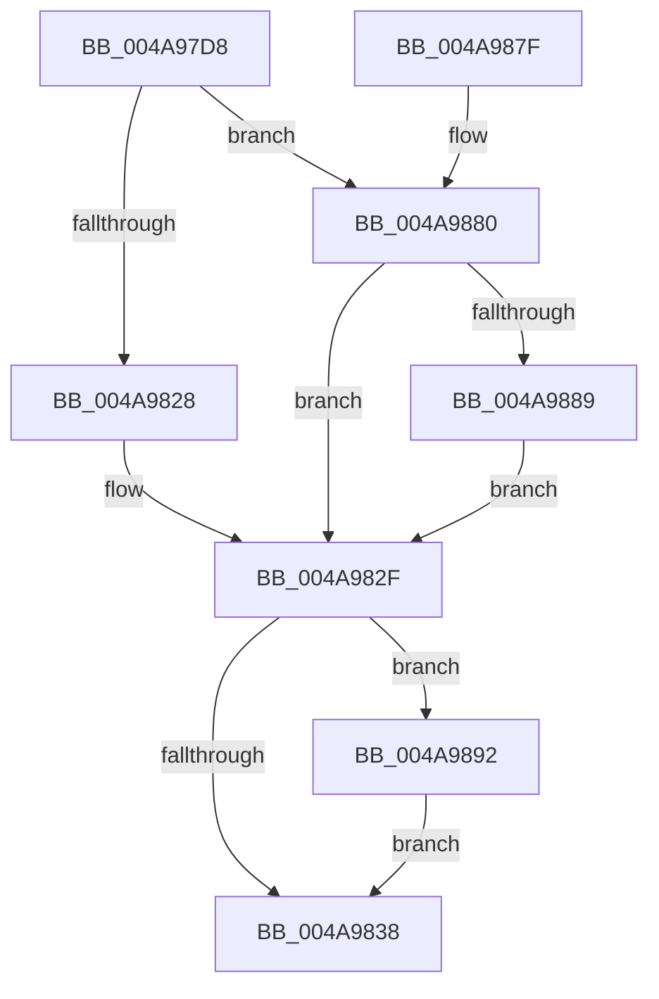

# IopPerfLogCallEvent

- RVA: `0x004A97D8`–`0x004A98A3` (길이 `203` bytes)
- VA: `0x00000001404A97D8`
- 실행 섹션: `.text`
- PDB 이름 있음: `예`; PDB Function 태그: `아니요`
- unwind 정보 RVA: `0x000B7B1C`
- 디코드: `51`개 명령, `203/203` bytes 표시
- 미해석 바이트: `0` (있으면 어셈블리에 `.byte`로 보존)

> 이 문서는 커널 이미지의 기계어와 PDB 기호를 분석해 생성했습니다. 4번과 5번은 함수 원형과 자료형을 바이너리 사용 방식에서 추정한 C 해석이며 원본 소스 복구 결과는 아닙니다.

## 1. Dependencies

- 직접 호출 지점: **2**; 고유 호출 대상: **2**
- 직접 호출자로 확인된 함수: **1**
- RIP 상대 이미지 참조: **1**

### Outgoing calls
- `0x004A9868` → [EtwTraceKernelEvent](../23/EtwTraceKernelEvent_function_00235350.md) (function, `0x00235350`)
- `0x004A9874` → [_security_check_cookie](../6A/_security_check_cookie_function_006AC640.md) (function, `0x006AC640`)

### Direct callers
- [IopPerfCallDriver](IopPerfCallDriver_function_004A9680.md) at `0x004A96D7`

### Static image references
- `0x004A97E1` → RVA `0x00E0A740` (`.data`; read)

## 2. Other-region calls and transfers

- 다른 실행 섹션으로 향하는 call: **0**
- 별도 외부 분기/꼬리 이동을 확인하지 못했습니다.

## 3. Assembly (complete function range)

```asm
004A97D8  40 55                           push rbp
004A97DA  48 8B EC                        mov rbp, rsp
004A97DD  48 83 EC 70                     sub rsp, 0x70
004A97E1  48 8B 05 58 0F 96 00            mov rax, qword ptr [rip + 0x960f58]
004A97E8  48 33 C4                        xor rax, rsp
004A97EB  48 89 45 F8                     mov qword ptr [rbp - 8], rax
004A97EF  48 83 65 D0 00                  and qword ptr [rbp - 0x30], 0
004A97F4  4C 8B 8A B8 00 00 00            mov r9, qword ptr [rdx + 0xb8]
004A97FB  41 0F B6 41 B8                  movzx eax, byte ptr [r9 - 0x48]
004A9800  89 45 C0                        mov dword ptr [rbp - 0x40], eax
004A9803  41 0F B6 41 B9                  movzx eax, byte ptr [r9 - 0x47]
004A9808  89 45 C4                        mov dword ptr [rbp - 0x3c], eax
004A980B  41 0F B6 41 B8                  movzx eax, byte ptr [r9 - 0x48]
004A9810  48 8B 4C C1 70                  mov rcx, qword ptr [rcx + rax*8 + 0x70]
004A9815  8B 42 10                        mov eax, dword ptr [rdx + 0x10]
004A9818  48 89 4D C8                     mov qword ptr [rbp - 0x38], rcx
004A981C  48 89 55 D8                     mov qword ptr [rbp - 0x28], rdx
004A9820  44 89 45 E0                     mov dword ptr [rbp - 0x20], r8d
004A9824  A8 08                           test al, 8
004A9826  75 58                           jne 0x1404a9880
004A9828  48 8B 8A C0 00 00 00            mov rcx, qword ptr [rdx + 0xc0]
004A982F  48 89 4D D0                     mov qword ptr [rbp - 0x30], rcx
004A9833  48 85 C9                        test rcx, rcx
004A9836  75 5A                           jne 0x1404a9892
004A9838  83 65 F4 00                     and dword ptr [rbp - 0xc], 0
004A983C  48 8D 45 C0                     lea rax, [rbp - 0x40]
004A9840  41 B9 22 01 00 00               mov r9d, 0x122
004A9846  48 89 45 E8                     mov qword ptr [rbp - 0x18], rax
004A984A  BA 01 00 00 00                  mov edx, 1
004A984F  C7 45 F0 24 00 00 00            mov dword ptr [rbp - 0x10], 0x24
004A9856  41 B8 10 00 00 20               mov r8d, 0x20000010
004A985C  C7 44 24 20 02 18 50 00         mov dword ptr [rsp + 0x20], 0x501802
004A9864  48 8D 4D E8                     lea rcx, [rbp - 0x18]
004A9868  E8 E3 BA D8 FF                  call 0x140235350
004A986D  48 8B 4D F8                     mov rcx, qword ptr [rbp - 8]
004A9871  48 33 CC                        xor rcx, rsp
004A9874  E8 C7 2D 20 00                  call 0x1406ac640
004A9879  48 83 C4 70                     add rsp, 0x70
004A987D  5D                              pop rbp
004A987E  C3                              ret
004A987F  CC                              int3
004A9880  48 8B 4A 18                     mov rcx, qword ptr [rdx + 0x18]
004A9884  48 85 C9                        test rcx, rcx
004A9887  74 A6                           je 0x1404a982f
004A9889  48 8B 89 C0 00 00 00            mov rcx, qword ptr [rcx + 0xc0]
004A9890  EB 9D                           jmp 0x1404a982f
004A9892  48 8B 41 18                     mov rax, qword ptr [rcx + 0x18]
004A9896  48 85 C0                        test rax, rax
004A9899  48 0F 45 C8                     cmovne rcx, rax
004A989D  48 89 4D D0                     mov qword ptr [rbp - 0x30], rcx
004A98A1  EB 95                           jmp 0x1404a9838
```

## 4. C-style interpretation (structured pseudocode)

```c
__int64 __fastcall IopPerfLogCallEvent(__int64 a1, __int64 a2, int a3)
{
    __int64 result;
    __int64 v_rsp;
    unsigned __int64 v_stack_m10;
    unsigned int v_stack_m14;
    unsigned int v_stack_m18;
    unsigned __int64 v_stack_m20;
    unsigned int v_stack_m28;
    unsigned __int64 v_stack_m30;
    unsigned __int64 v_stack_m38;
    unsigned __int64 v_stack_m40;
    unsigned int v_stack_m44;
    unsigned int v_stack_m48;
    unsigned int v_stack_m58;

    v_rsp = (v_rsp) - (112);
    result = (*(unsigned __int64 *)(v_rip + 9834328)) ^ (v_rsp);
    v_stack_m10 = result;
    v_stack_m48 = (unsigned int)(*(unsigned __int8 *)(*(unsigned __int64 *)(a2 + 184) - 72));
    v_stack_m44 = (unsigned int)(*(unsigned __int8 *)(*(unsigned __int64 *)(a2 + 184) - 71));
    v_stack_m40 = *(unsigned __int64 *)(a1 + *(unsigned __int8 *)(*(unsigned __int64 *)(a2 + 184) - 72) * 8 + 112);
    v_stack_m30 = a2;
    v_stack_m28 = a3;
    if ((((unsigned __int8)((unsigned int)(*(unsigned int *)(a2 + 16)))) & (8)) != 0) goto loc_004A9880;
loc_004A982F:
    v_stack_m38 = *(unsigned __int64 *)(a2 + 192);
    if (*(unsigned __int64 *)(a2 + 192) != 0) goto loc_004A9892;
loc_004A9838:
    v_stack_m20 = v_stack_m48;
    v_stack_m18 = 36;
    v_stack_m58 = 0x501802ULL;
    result = EtwTraceKernelEvent(v_stack_m20, 1, (unsigned int)(0x20000010ULL), 290);
    a1 = (v_stack_m10) ^ (v_rsp);
    result = _security_check_cookie(a1, 1, (unsigned int)(0x20000010ULL), 290);
    v_rsp = (v_rsp) + (112);
    return result;
loc_004A9880:
    if (*(unsigned __int64 *)(1 + 24) == 0) goto loc_004A982F;
    goto loc_004A982F;
loc_004A9892:
    a1 = *(unsigned __int64 *)(*(unsigned __int64 *)(1 + 24) + 192);
    if (*(unsigned __int64 *)(*(unsigned __int64 *)(*(unsigned __int64 *)(1 + 24) + 192) + 24) != 0) { a1 = *(unsigned __int64 *)(*(unsigned __int64 *)(*(unsigned __int64 *)(1 + 24) + 192) + 24); }
    v_stack_m38 = a1;
    goto loc_004A9838;
}
```

## 5. (Beta) C Style

```c
int64_t IopPerfLogCallEvent(void *Arg1, void *Arg2, int32_t Arg3)
{
    uint8_t *arg1 = (uint8_t *)Arg1;
    uint8_t *arg2 = (uint8_t *)Arg2;

    int64_t result;
    int64_t local_rsp;
    uint64_t v_stack_m10;
    uint32_t v_stack_m14;
    uint32_t v_stack_m18;
    uint64_t v_stack_m20;
    uint32_t v_stack_m28;
    uint64_t v_stack_m30;
    uint64_t v_stack_m38;
    uint64_t v_stack_m40;
    uint32_t v_stack_m44;
    uint32_t v_stack_m48;
    uint32_t v_stack_m58;

    local_rsp = (local_rsp) - (112);
    result = (*(uint64_t *)(v_rip + 0x960F58)) ^ (local_rsp);
    v_stack_m10 = result;
    v_stack_m48 = (uint32_t)(*(uint8_t *)(*(uint64_t *)(arg2 + 0xB8) - 0x48));
    v_stack_m44 = (uint32_t)(*(uint8_t *)(*(uint64_t *)(arg2 + 0xB8) - 0x47));
    v_stack_m40 = *(uint64_t *)(arg1 + *(uint8_t *)(*(uint64_t *)(arg2 + 0xB8) - 0x48) * 8 + 0x70);
    v_stack_m30 = Arg2;
    v_stack_m28 = Arg3;
    if ((((uint8_t)((uint32_t)(*(uint32_t *)(arg2 + 0x10)))) & (8)) != 0) goto loc_004A9880;
loc_004A982F:
    v_stack_m38 = *(uint64_t *)(arg2 + 0xC0);
    if (*(uint64_t *)(arg2 + 0xC0) != 0) goto loc_004A9892;
loc_004A9838:
    v_stack_m20 = v_stack_m48;
    v_stack_m18 = 36;
    v_stack_m58 = 0x501802ULL;
    result = EtwTraceKernelEvent(v_stack_m20, 1, (uint32_t)(0x20000010ULL), 290);
    Arg1 = (v_stack_m10) ^ (local_rsp);
    result = _security_check_cookie(Arg1, 1, (uint32_t)(0x20000010ULL), 290);
    local_rsp = (local_rsp) + (112);
    return result;
loc_004A9880:
    if (*(uint64_t *)(1 + 0x18) == 0) goto loc_004A982F;
    goto loc_004A982F;
loc_004A9892:
    Arg1 = *(uint64_t *)(*(uint64_t *)(1 + 0x18) + 0xC0);
    if (*(uint64_t *)(*(uint64_t *)(*(uint64_t *)(1 + 0x18) + 0xC0) + 0x18) != 0) { Arg1 = *(uint64_t *)(*(uint64_t *)(*(uint64_t *)(1 + 0x18) + 0xC0) + 0x18); }
    v_stack_m38 = Arg1;
    goto loc_004A9838;
}
```

### 관측된 메모리 오프셋

구조체 형식이 확인되지 않은 접근은 인자 기준의 오프셋으로만 기록했습니다.

| 기준 인자 | 오프셋 표현 | 폭 (bit) | 접근 |
|---|---:|---:|---|
| `Arg1` | `+ 0x70 + rax*8` | `64` | `R` |
| `Arg2` | `+ 0x10` | `32` | `R` |
| `Arg2` | `+ 0x18` | `64` | `R` |
| `Arg2` | `+ 0xB8` | `64` | `R` |
| `Arg2` | `+ 0xC0` | `64` | `R` |

## 6. Execution-region graph

[열기: 2D/3D 그래프와 함수 탐색 컨트롤 패널](../../../control-panel.html?section=text&rva=0x004A97D8&view=graph)

- 2D 그래프는 위에서 아래로 흐르고, 3D 그래프는 빈 공간을 드래그해 회전합니다. Shift+드래그는 이동, 휠은 확대·축소, 함수 노드 선택은 대상 보고서 이동입니다.

### Static fallback


