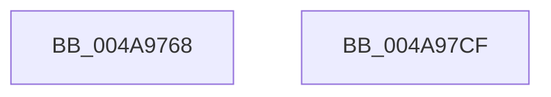

# IopPerfLogCallReturnEvent

- RVA: `0x004A9768`–`0x004A97D0` (길이 `104` bytes)
- VA: `0x00000001404A9768`
- 실행 섹션: `.text`
- PDB 이름 있음: `예`; PDB Function 태그: `아니요`
- unwind 정보 RVA: `0x00065FB8`
- 디코드: `23`개 명령, `104/104` bytes 표시
- 미해석 바이트: `0` (있으면 어셈블리에 `.byte`로 보존)

> 이 문서는 커널 이미지의 기계어와 PDB 기호를 분석해 생성했습니다. 4번과 5번은 함수 원형과 자료형을 바이너리 사용 방식에서 추정한 C 해석이며 원본 소스 복구 결과는 아닙니다.

## 1. Dependencies

- 직접 호출 지점: **2**; 고유 호출 대상: **2**
- 직접 호출자로 확인된 함수: **1**
- RIP 상대 이미지 참조: **1**

### Outgoing calls
- `0x004A97B8` → [EtwTraceKernelEvent](../23/EtwTraceKernelEvent_function_00235350.md) (function, `0x00235350`)
- `0x004A97C5` → [_security_check_cookie](../6A/_security_check_cookie_function_006AC640.md) (function, `0x006AC640`)

### Direct callers
- [IopPerfCallDriver](IopPerfCallDriver_function_004A9680.md) at `0x004A96EE`

### Static image references
- `0x004A976F` → RVA `0x00E0A740` (`.data`; read)

## 2. Other-region calls and transfers

- 다른 실행 섹션으로 향하는 call: **0**
- 별도 외부 분기/꼬리 이동을 확인하지 못했습니다.

## 3. Assembly (complete function range)

```asm
004A9768  4C 8B DC                        mov r11, rsp
004A976B  48 83 EC 68                     sub rsp, 0x68
004A976F  48 8B 05 CA 0F 96 00            mov rax, qword ptr [rip + 0x960fca]
004A9776  48 33 C4                        xor rax, rsp
004A9779  48 89 44 24 50                  mov qword ptr [rsp + 0x50], rax
004A977E  49 89 4B C8                     mov qword ptr [r11 - 0x38], rcx
004A9782  49 8D 43 C8                     lea rax, [r11 - 0x38]
004A9786  49 89 43 D8                     mov qword ptr [r11 - 0x28], rax
004A978A  49 8D 4B D8                     lea rcx, [r11 - 0x28]
004A978E  83 64 24 4C 00                  and dword ptr [rsp + 0x4c], 0
004A9793  41 B9 23 01 00 00               mov r9d, 0x123
004A9799  89 54 24 38                     mov dword ptr [rsp + 0x38], edx
004A979D  41 B8 10 00 00 20               mov r8d, 0x20000010
004A97A3  BA 01 00 00 00                  mov edx, 1
004A97A8  C7 44 24 48 0C 00 00 00         mov dword ptr [rsp + 0x48], 0xc
004A97B0  C7 44 24 20 02 18 50 00         mov dword ptr [rsp + 0x20], 0x501802
004A97B8  E8 93 BB D8 FF                  call 0x140235350
004A97BD  48 8B 4C 24 50                  mov rcx, qword ptr [rsp + 0x50]
004A97C2  48 33 CC                        xor rcx, rsp
004A97C5  E8 76 2E 20 00                  call 0x1406ac640
004A97CA  48 83 C4 68                     add rsp, 0x68
004A97CE  C3                              ret
004A97CF  CC                              int3
```

## 4. C-style interpretation (structured pseudocode)

```c
__int64 __fastcall IopPerfLogCallReturnEvent(__int64 a1, int a2)
{
    __int64 result;
    __int64 v_rsp;
    unsigned __int64 v_stack_m18;
    unsigned int v_stack_m1C;
    unsigned int v_stack_m20;
    unsigned int v_stack_m30;
    unsigned int v_stack_m48;

    v_rsp = (v_rsp) - (104);
    result = (*(unsigned __int64 *)(v_rip + 9834442)) ^ (v_rsp);
    v_stack_m18 = result;
    *(unsigned __int64 *)(v_rsp - 56) = a1;
    *(unsigned __int64 *)(v_rsp - 40) = v_rsp - 56;
    v_stack_m30 = a2;
    v_stack_m20 = 12;
    v_stack_m48 = 0x501802ULL;
    result = EtwTraceKernelEvent(v_rsp - 40, 1, (unsigned int)(0x20000010ULL), 291);
    a1 = (v_stack_m18) ^ (v_rsp);
    result = _security_check_cookie(a1, 1, (unsigned int)(0x20000010ULL), 291);
    v_rsp = (v_rsp) + (104);
    return result;
}
```

## 5. (Beta) C Style

```c
int64_t IopPerfLogCallReturnEvent(int64_t Arg1, int32_t Arg2)
{
    int64_t result;
    int64_t local_rsp;
    uint64_t v_stack_m18;
    uint32_t v_stack_m1C;
    uint32_t v_stack_m20;
    uint32_t v_stack_m30;
    uint32_t v_stack_m48;

    local_rsp = (local_rsp) - (104);
    result = (*(uint64_t *)(v_rip + 0x960FCA)) ^ (local_rsp);
    v_stack_m18 = result;
    *(uint64_t *)(local_rsp - 0x38) = Arg1;
    *(uint64_t *)(local_rsp - 0x28) = local_rsp - 56;
    v_stack_m30 = Arg2;
    v_stack_m20 = 12;
    v_stack_m48 = 0x501802ULL;
    result = EtwTraceKernelEvent(local_rsp - 40, 1, (uint32_t)(0x20000010ULL), 291);
    Arg1 = (v_stack_m18) ^ (local_rsp);
    result = _security_check_cookie(Arg1, 1, (uint32_t)(0x20000010ULL), 291);
    local_rsp = (local_rsp) + (104);
    return result;
}
```

## 6. Execution-region graph

[열기: 2D/3D 그래프와 함수 탐색 컨트롤 패널](../../../control-panel.html?section=text&rva=0x004A9768&view=graph)

- 2D 그래프는 위에서 아래로 흐르고, 3D 그래프는 빈 공간을 드래그해 회전합니다. Shift+드래그는 이동, 휠은 확대·축소, 함수 노드 선택은 대상 보고서 이동입니다.

### Static fallback


