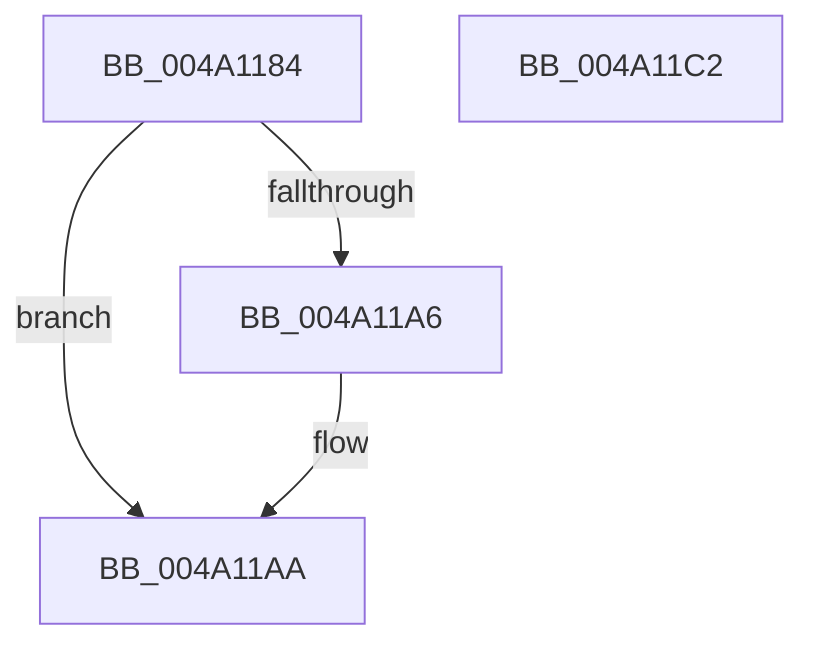

# IopQueryVpbFlagsSafe

- RVA: `0x004A1184`–`0x004A11C3` (길이 `63` bytes)
- VA: `0x00000001404A1184`
- 실행 섹션: `.text`
- PDB 이름 있음: `예`; PDB Function 태그: `아니요`
- unwind 정보 RVA: `0x0005CAAC`
- 디코드: `20`개 명령, `63/63` bytes 표시
- 미해석 바이트: `0` (있으면 어셈블리에 `.byte`로 보존)

> 이 문서는 커널 이미지의 기계어와 PDB 기호를 분석해 생성했습니다. 4번과 5번은 함수 원형과 자료형을 바이너리 사용 방식에서 추정한 C 해석이며 원본 소스 복구 결과는 아닙니다.

## 1. Dependencies

- 직접 호출 지점: **2**; 고유 호출 대상: **2**
- 직접 호출자로 확인된 함수: **2**
- RIP 상대 이미지 참조: **0**

### Outgoing calls
- `0x004A1196` → [KeAcquireQueuedSpinLock](../27/KeAcquireQueuedSpinLock_function_00273D80.md) (function, `0x00273D80`)
- `0x004A11AF` → [KeReleaseQueuedSpinLock](../27/KeReleaseQueuedSpinLock_function_00272540.md) (function, `0x00272540`)

### Direct callers
- [IopMountVolume](../../page/A3/IopMountVolume_function_00A329D0.md) at `0x00A32AF6`
- [sub_00B39BB0](../../page/B3/Unknown_function_00B39BB0.md) at `0x00B39C0F`

### Static image references
- 디코드된 RIP-relative 메모리 참조가 없습니다.

## 2. Other-region calls and transfers

- 다른 실행 섹션으로 향하는 call: **0**
- 별도 외부 분기/꼬리 이동을 확인하지 못했습니다.

## 3. Assembly (complete function range)

```asm
004A1184  48 89 5C 24 08                  mov qword ptr [rsp + 8], rbx
004A1189  57                              push rdi
004A118A  48 83 EC 20                     sub rsp, 0x20
004A118E  48 8B D9                        mov rbx, rcx
004A1191  33 FF                           xor edi, edi
004A1193  8D 4F 09                        lea ecx, [rdi + 9]
004A1196  E8 E5 2B DD FF                  call 0x140273d80
004A119B  8A D0                           mov dl, al
004A119D  48 8B 43 38                     mov rax, qword ptr [rbx + 0x38]
004A11A1  48 85 C0                        test rax, rax
004A11A4  74 04                           je 0x1404a11aa
004A11A6  0F B7 78 04                     movzx edi, word ptr [rax + 4]
004A11AA  B9 09 00 00 00                  mov ecx, 9
004A11AF  E8 8C 13 DD FF                  call 0x140272540
004A11B4  48 8B 5C 24 30                  mov rbx, qword ptr [rsp + 0x30]
004A11B9  0F B7 C7                        movzx eax, di
004A11BC  48 83 C4 20                     add rsp, 0x20
004A11C0  5F                              pop rdi
004A11C1  C3                              ret
004A11C2  CC                              int3
```

## 4. C-style interpretation (structured pseudocode)

```c
__int64 __fastcall IopQueryVpbFlagsSafe(__int64 a1)
{
    __int64 result;
    __int64 v_rdi;
    __int64 v_rsp;
    unsigned __int64 v_stack_p8;

    v_stack_p8 = v_rbx;
    v_rsp = (v_rsp) - (32);
    v_rdi = 0;
    result = KeAcquireQueuedSpinLock(v_rdi + 9, a2, a3, a4);
    if (*(unsigned __int64 *)(a1 + 56) != 0) {
        v_rdi = *(unsigned __int16 *)(*(unsigned __int64 *)(a1 + 56) + 4);
    }
    result = KeReleaseQueuedSpinLock(9, (unsigned __int8)(result), a3, a4);
    v_rsp = (v_rsp) + (32);
    return (unsigned __int16)(v_rdi);
}
```

## 5. (Beta) C Style

```c
int64_t IopQueryVpbFlagsSafe(void *Arg1)
{
    uint8_t *arg1 = (uint8_t *)Arg1;

    int64_t result;
    int64_t local_rdi;
    int64_t local_rsp;
    uint64_t v_stack_p8;

    v_stack_p8 = local_rbx;
    local_rsp = (local_rsp) - (32);
    local_rdi = 0;
    result = KeAcquireQueuedSpinLock(local_rdi + 9, a2, a3, a4);
    if (*(uint64_t *)(arg1 + 0x38) != 0) {
        local_rdi = *(uint16_t *)(*(uint64_t *)(arg1 + 0x38) + 0x4);
    }
    result = KeReleaseQueuedSpinLock(9, (uint8_t)(result), a3, a4);
    local_rsp = (local_rsp) + (32);
    return (uint16_t)(local_rdi);
}
```

### 관측된 메모리 오프셋

구조체 형식이 확인되지 않은 접근은 인자 기준의 오프셋으로만 기록했습니다.

| 기준 인자 | 오프셋 표현 | 폭 (bit) | 접근 |
|---|---:|---:|---|
| `Arg1` | `+ 0x38` | `64` | `R` |

## 6. Execution-region graph

[열기: 2D/3D 그래프와 함수 탐색 컨트롤 패널](../../../control-panel.html?section=text&rva=0x004A1184&view=graph)

- 2D 그래프는 위에서 아래로 흐르고, 3D 그래프는 빈 공간을 드래그해 회전합니다. Shift+드래그는 이동, 휠은 확대·축소, 함수 노드 선택은 대상 보고서 이동입니다.

### Static fallback


