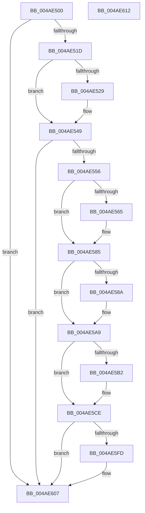

# KcsanMarkAddressIgnored

- RVA: `0x004AE500`–`0x004AE613` (길이 `275` bytes)
- VA: `0x00000001404AE500`
- 실행 섹션: `.text`
- PDB 이름 있음: `예`; PDB Function 태그: `아니요`
- unwind 정보 RVA: `0x0006E5F8`
- 디코드: `68`개 명령, `275/275` bytes 표시
- 미해석 바이트: `0` (있으면 어셈블리에 `.byte`로 보존)

> 이 문서는 커널 이미지의 기계어와 PDB 기호를 분석해 생성했습니다. 4번과 5번은 함수 원형과 자료형을 바이너리 사용 방식에서 추정한 C 해석이며 원본 소스 복구 결과는 아닙니다.

## 1. Dependencies

- 직접 호출 지점: **6**; 고유 호출 대상: **3**
- 직접 호출자로 확인된 함수: **2**
- RIP 상대 이미지 참조: **3**

### Outgoing calls
- `0x004AE520` → [KasanTrackAddress](../46/KasanTrackAddress_function_00462520.md) (function, `0x00462520`)
- `0x004AE543` → [KeBugCheckEx](../4F/KeBugCheckEx_function_004FD660.md) (function, `0x004FD660`)
- `0x004AE57F` → [KeBugCheckEx](../4F/KeBugCheckEx_function_004FD660.md) (function, `0x004FD660`)
- `0x004AE5A3` → [KeBugCheckEx](../4F/KeBugCheckEx_function_004FD660.md) (function, `0x004FD660`)
- `0x004AE5C8` → [KeBugCheckEx](../4F/KeBugCheckEx_function_004FD660.md) (function, `0x004FD660`)
- `0x004AE602` → [memset](../6C/memset_function_006C6C40.md) (function, `0x006C6C40`)

### Direct callers
- [MiAllocateSlabEntry](MiAllocateSlabEntry_function_004AE468.md) at `0x004AE4E1`
- [MiInitializeDecayPfns](../../init/C6/MiInitializeDecayPfns_function_00C6CC04.md) at `0x00C6CC31`

### Static image references
- `0x004AE50A` → RVA `0x00F654F8` (`.data`; read)
- `0x004AE549` → RVA `0x00FCEC68` (`ALMOSTRO`; read)
- `0x004AE5E9` → RVA `0x00FC6ED8` (`ALMOSTRO`; read)

## 2. Other-region calls and transfers

- 다른 실행 섹션으로 향하는 call: **0**
- 별도 외부 분기/꼬리 이동을 확인하지 못했습니다.

## 3. Assembly (complete function range)

```asm
004AE500  48 89 5C 24 08                  mov qword ptr [rsp + 8], rbx
004AE505  57                              push rdi
004AE506  48 83 EC 30                     sub rsp, 0x30
004AE50A  80 3D E7 6F AB 00 00            cmp byte ptr [rip + 0xab6fe7], 0
004AE511  48 8B FA                        mov rdi, rdx
004AE514  48 8B D9                        mov rbx, rcx
004AE517  0F 84 EA 00 00 00               je 0x1404ae607
004AE51D  45 33 C0                        xor r8d, r8d
004AE520  E8 FB 3F FB FF                  call 0x140462520
004AE525  85 C0                           test eax, eax
004AE527  79 20                           jns 0x1404ae549
004AE529  BA 04 00 00 00                  mov edx, 4
004AE52E  4C 63 C8                        movsxd r9, eax
004AE531  B9 F1 01 00 00                  mov ecx, 0x1f1
004AE536  48 C7 44 24 20 02 00 00 00      mov qword ptr [rsp + 0x20], 2
004AE53F  44 8D 42 01                     lea r8d, [rdx + 1]
004AE543  E8 18 F1 04 00                  call 0x1404fd660
004AE548  CC                              int3
004AE549  80 3D 18 07 B2 00 00            cmp byte ptr [rip + 0xb20718], 0
004AE550  0F 84 B1 00 00 00               je 0x1404ae607
004AE556  48 B8 00 00 00 00 00 80 FF FF   movabs rax, 0xffff800000000000
004AE560  48 3B D8                        cmp rbx, rax
004AE563  73 20                           jae 0x1404ae585
004AE565  BA 02 00 00 00                  mov edx, 2
004AE56A  48 C7 44 24 20 00 00 00 00      mov qword ptr [rsp + 0x20], 0
004AE573  4C 8B CB                        mov r9, rbx
004AE576  B9 F1 01 00 00                  mov ecx, 0x1f1
004AE57B  44 8D 42 FF                     lea r8d, [rdx - 1]
004AE57F  E8 DC F0 04 00                  call 0x1404fd660
004AE584  CC                              int3
004AE585  F6 C3 07                        test bl, 7
004AE588  74 1F                           je 0x1404ae5a9
004AE58A  BA 02 00 00 00                  mov edx, 2
004AE58F  48 C7 44 24 20 08 00 00 00      mov qword ptr [rsp + 0x20], 8
004AE598  44 8B C2                        mov r8d, edx
004AE59B  4C 8B CB                        mov r9, rbx
004AE59E  B9 F1 01 00 00                  mov ecx, 0x1f1
004AE5A3  E8 B8 F0 04 00                  call 0x1404fd660
004AE5A8  CC                              int3
004AE5A9  48 8D 04 3B                     lea rax, [rbx + rdi]
004AE5AD  48 3B C3                        cmp rax, rbx
004AE5B0  73 1C                           jae 0x1404ae5ce
004AE5B2  BA 02 00 00 00                  mov edx, 2
004AE5B7  48 89 7C 24 20                  mov qword ptr [rsp + 0x20], rdi
004AE5BC  4C 8B CB                        mov r9, rbx
004AE5BF  B9 F1 01 00 00                  mov ecx, 0x1f1
004AE5C4  44 8D 42 01                     lea r8d, [rdx + 1]
004AE5C8  E8 93 F0 04 00                  call 0x1404fd660
004AE5CD  CC                              int3
004AE5CE  48 8D 47 FF                     lea rax, [rdi - 1]
004AE5D2  48 B9 00 00 00 00 00 80 00 00   movabs rcx, 0x800000000000
004AE5DC  48 03 CB                        add rcx, rbx
004AE5DF  83 E0 07                        and eax, 7
004AE5E2  48 2B F8                        sub rdi, rax
004AE5E5  48 C1 E9 03                     shr rcx, 3
004AE5E9  48 03 0D E8 88 B1 00            add rcx, qword ptr [rip + 0xb188e8]
004AE5F0  48 83 C7 07                     add rdi, 7
004AE5F4  48 C1 EF 03                     shr rdi, 3
004AE5F8  48 85 FF                        test rdi, rdi
004AE5FB  74 0A                           je 0x1404ae607
004AE5FD  4C 8B C7                        mov r8, rdi
004AE600  B2 08                           mov dl, 8
004AE602  E8 39 86 21 00                  call 0x1406c6c40
004AE607  48 8B 5C 24 40                  mov rbx, qword ptr [rsp + 0x40]
004AE60C  48 83 C4 30                     add rsp, 0x30
004AE610  5F                              pop rdi
004AE611  C3                              ret
004AE612  CC                              int3
```

## 4. C-style interpretation (structured pseudocode)

```c
__int64 __fastcall KcsanMarkAddressIgnored(__int64 a1, __int64 a2, int a3)
{
    __int64 result;
    __int64 v_rdi;
    __int64 v_rsp;
    unsigned __int64 v_stack_m18;
    unsigned __int64 v_stack_p8;

    v_stack_p8 = v_rbx;
    v_rsp = (v_rsp) - (48);
    if ((*(unsigned __int8 *)(v_rip + 11235303)) == 0) goto loc_004AE607;
    a3 = 0;
    result = KasanTrackAddress(a1, a2, a3, a4);
    if (sign_flag) {
        a2 = 4;
        a4 = (int)((unsigned int)(result));
        a1 = 497;
        v_stack_m18 = 2;
        a3 = a2 + 1;
        result = KeBugCheckEx(a1, a2, a3, a4);
    }
    if ((*(unsigned __int8 *)(v_rip + 11667224)) == 0) goto loc_004AE607;
    if (a1 < result) {
        a2 = 2;
        v_stack_m18 = 0;
        a4 = a1;
        a1 = 497;
        a3 = a2 - 1;
        result = KeBugCheckEx(a1, a2, a3, a4);
    }
    if ((((unsigned __int8)(a1)) & (7)) != 0) {
        a2 = 2;
        v_stack_m18 = 8;
        a3 = (unsigned int)(a2);
        a4 = a1;
        a1 = 497;
        result = KeBugCheckEx(a1, a2, a3, a4);
    }
    result = a1 + a2 * 1;
    if ((a1 + a2 * 1) < a1) {
        a2 = 2;
        v_stack_m18 = a2;
        a4 = a1;
        a1 = 497;
        a3 = a2 + 1;
        result = KeBugCheckEx(a1, a2, a3, a4);
    }
    a1 = (a1) + (a1);
    result = (unsigned int)((a2 - 1) & (7));
    v_rdi = (a2) - (result);
    a1 = (a1) >> (3);
    a1 = (a1) + (*(unsigned __int64 *)(v_rip + 11634920));
    v_rdi = (v_rdi) + (7);
    v_rdi = (v_rdi) >> (3);
    if (v_rdi != 0) {
        a3 = v_rdi;
        a2 = 8;
        result = memset(a1, a2, a3, a4);
    }
    v_rsp = (v_rsp) + (48);
    return result;
}
```

## 5. (Beta) C Style

```c
int64_t KcsanMarkAddressIgnored(int64_t Arg1, void *Arg2, int32_t Arg3)
{
    uint8_t *arg2 = (uint8_t *)Arg2;

    int64_t result;
    int64_t local_rdi;
    int64_t local_rsp;
    uint64_t v_stack_m18;
    uint64_t v_stack_p8;

    v_stack_p8 = local_rbx;
    local_rsp = (local_rsp) - (48);
    if ((*(uint8_t *)(v_rip + 0xAB6FE7)) == 0) goto loc_004AE607;
    Arg3 = 0;
    result = KasanTrackAddress(Arg1, Arg2, Arg3, a4);
    if (sign_flag) {
        Arg2 = 4;
        a4 = (int32_t)((uint32_t)(result));
        Arg1 = 497;
        v_stack_m18 = 2;
        Arg3 = Arg2 + 1;
        result = KeBugCheckEx(Arg1, Arg2, Arg3, a4);
    }
    if ((*(uint8_t *)(v_rip + 0xB20718)) == 0) goto loc_004AE607;
    if (Arg1 < result) {
        Arg2 = 2;
        v_stack_m18 = 0;
        a4 = Arg1;
        Arg1 = 497;
        Arg3 = Arg2 - 1;
        result = KeBugCheckEx(Arg1, Arg2, Arg3, a4);
    }
    if ((((uint8_t)(Arg1)) & (7)) != 0) {
        Arg2 = 2;
        v_stack_m18 = 8;
        Arg3 = (uint32_t)(Arg2);
        a4 = Arg1;
        Arg1 = 497;
        result = KeBugCheckEx(Arg1, Arg2, Arg3, a4);
    }
    result = Arg1 + Arg2 * 1;
    if ((Arg1 + Arg2 * 1) < Arg1) {
        Arg2 = 2;
        v_stack_m18 = Arg2;
        a4 = Arg1;
        Arg1 = 497;
        Arg3 = Arg2 + 1;
        result = KeBugCheckEx(Arg1, Arg2, Arg3, a4);
    }
    Arg1 = (Arg1) + (Arg1);
    result = (uint32_t)((Arg2 - 1) & (7));
    local_rdi = (Arg2) - (result);
    Arg1 = (Arg1) >> (3);
    Arg1 = (Arg1) + (*(uint64_t *)(v_rip + 0xB188E8));
    local_rdi = (local_rdi) + (7);
    local_rdi = (local_rdi) >> (3);
    if (local_rdi != 0) {
        Arg3 = local_rdi;
        Arg2 = 8;
        result = memset(Arg1, Arg2, Arg3, a4);
    }
    local_rsp = (local_rsp) + (48);
    return result;
}
```

### 관측된 메모리 오프셋

구조체 형식이 확인되지 않은 접근은 인자 기준의 오프셋으로만 기록했습니다.

| 기준 인자 | 오프셋 표현 | 폭 (bit) | 접근 |
|---|---:|---:|---|
| `Arg2` | `- 0x1` | `64` | `R` |

## 6. Execution-region graph

[열기: 2D/3D 그래프와 함수 탐색 컨트롤 패널](../../../control-panel.html?section=text&rva=0x004AE500&view=graph)

- 2D 그래프는 위에서 아래로 흐르고, 3D 그래프는 빈 공간을 드래그해 회전합니다. Shift+드래그는 이동, 휠은 확대·축소, 함수 노드 선택은 대상 보고서 이동입니다.

### Static fallback


