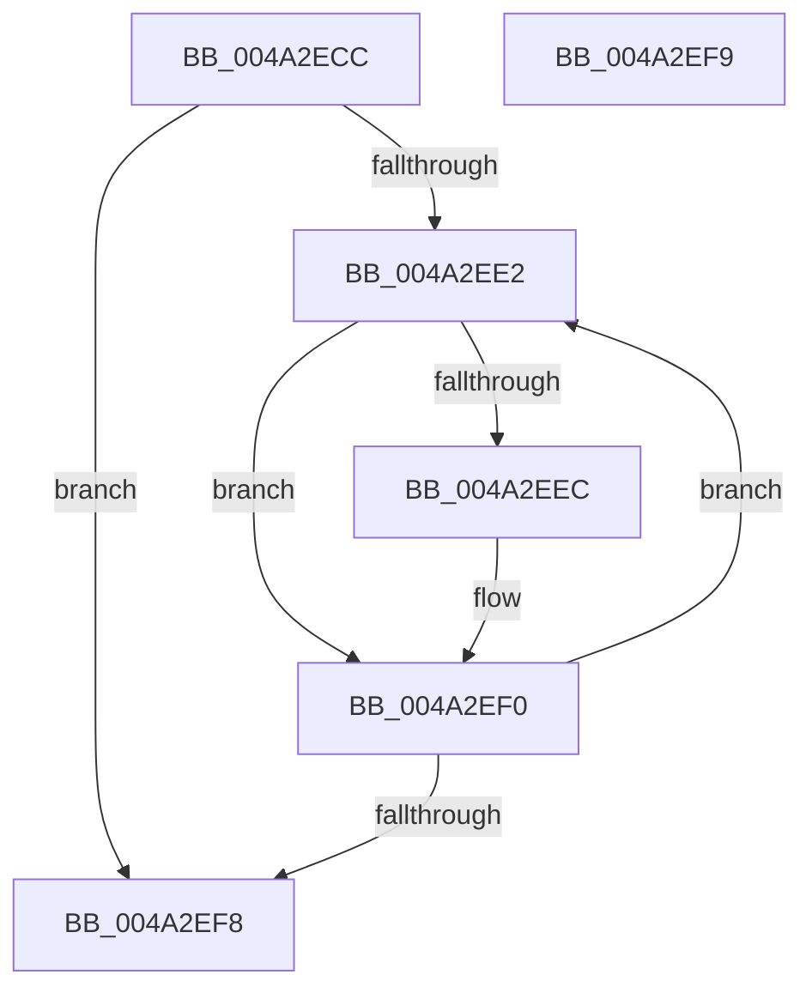

# KeComputeGroupMask

- RVA: `0x004A2ECC`–`0x004A2EFA` (길이 `46` bytes)
- VA: `0x00000001404A2ECC`
- 실행 섹션: `.text`
- PDB 이름 있음: `예`; PDB Function 태그: `아니요`
- unwind 정보 RVA: `0x000DB714`
- 디코드: `16`개 명령, `46/46` bytes 표시
- 미해석 바이트: `0` (있으면 어셈블리에 `.byte`로 보존)

> 이 문서는 커널 이미지의 기계어와 PDB 기호를 분석해 생성했습니다. 4번과 5번은 함수 원형과 자료형을 바이너리 사용 방식에서 추정한 C 해석이며 원본 소스 복구 결과는 아닙니다.

## 1. Dependencies

- 직접 호출 지점: **0**; 고유 호출 대상: **0**
- 직접 호출자로 확인된 함수: **4**
- RIP 상대 이미지 참조: **0**

### Outgoing calls
- 직접 디코드된 call 명령이 없습니다.

### Direct callers
- [KeStartThread](../3C/KeStartThread_function_003C21B8.md) at `0x003C2486`
- [EtwTraceThreadAffinity](../3C/EtwTraceThreadAffinity_function_003C29A0.md) at `0x003C2A5D`
- [KeQueryCpuPartitionAffinity](../5C/KeQueryCpuPartitionAffinity_function_005C0EF8.md) at `0x005C0FA1`
- [KiExtendProcessAffinity](../5C/KiExtendProcessAffinity_function_005CA600.md) at `0x005CA6D0`

### Static image references
- 디코드된 RIP-relative 메모리 참조가 없습니다.

## 2. Other-region calls and transfers

- 다른 실행 섹션으로 향하는 call: **0**
- 별도 외부 분기/꼬리 이동을 확인하지 못했습니다.

## 3. Assembly (complete function range)

```asm
004A2ECC  45 33 C9                        xor r9d, r9d
004A2ECF  0F 57 C0                        xorps xmm0, xmm0
004A2ED2  0F 11 02                        movups xmmword ptr [rdx], xmm0
004A2ED5  4C 8B C2                        mov r8, rdx
004A2ED8  41 0F B7 C1                     movzx eax, r9w
004A2EDC  66 44 3B 09                     cmp r9w, word ptr [rcx]
004A2EE0  73 16                           jae 0x1404a2ef8
004A2EE2  0F B7 D0                        movzx edx, ax
004A2EE5  4C 39 4C D1 08                  cmp qword ptr [rcx + rdx*8 + 8], r9
004A2EEA  74 04                           je 0x1404a2ef0
004A2EEC  49 0F AB 10                     bts qword ptr [r8], rdx
004A2EF0  66 FF C0                        inc ax
004A2EF3  66 3B 01                        cmp ax, word ptr [rcx]
004A2EF6  72 EA                           jb 0x1404a2ee2
004A2EF8  C3                              ret
004A2EF9  CC                              int3
```

## 4. C-style interpretation (structured pseudocode)

```c
__int64 __fastcall KeComputeGroupMask(__int64 a1, __int64 a2, __int64 a3, int a4)
{
    __int64 result;

    a4 = 0;
    *(unsigned __int64 *)(a2) = v_xmm0;
    if (0 >= (*(unsigned __int16 *)(a1))) goto loc_004A2EF8;
loc_004A2EE2:
    if ((*(unsigned __int64 *)(a1 + 0 * 8 + 8)) != 0) {
    }
    result = (unsigned __int16)((0) + 1);
    if (((unsigned __int16)(result)) < (*(unsigned __int16 *)(a1))) goto loc_004A2EE2;
loc_004A2EF8:
    return result;
}
```

## 5. (Beta) C Style

```c
int64_t KeComputeGroupMask(void *Arg1, void *Arg2, int64_t Arg3, int32_t Arg4)
{
    uint8_t *arg1 = (uint8_t *)Arg1;
    uint8_t *arg2 = (uint8_t *)Arg2;

    int64_t result;

    Arg4 = 0;
    *(uint64_t *)(arg2) = v_xmm0;
    if (0 >= (*(uint16_t *)(arg1))) goto loc_004A2EF8;
loc_004A2EE2:
    if ((*(uint64_t *)(arg1 + 0x0 * 8 + 0x8)) != 0) {
    }
    result = (uint16_t)((0) + 1);
    if (((uint16_t)(result)) < (*(uint16_t *)(arg1))) goto loc_004A2EE2;
loc_004A2EF8:
    return result;
}
```

### 관측된 메모리 오프셋

구조체 형식이 확인되지 않은 접근은 인자 기준의 오프셋으로만 기록했습니다.

| 기준 인자 | 오프셋 표현 | 폭 (bit) | 접근 |
|---|---:|---:|---|
| `Arg1` | `+ 0x0` | `16` | `R` |
| `Arg1` | `+ 0x8 + rdx*8` | `64` | `R` |
| `Arg2` | `+ 0x0` | `64` | `R/W` |
| `Arg2` | `+ 0x0` | `128` | `R` |

## 6. Execution-region graph

[열기: 2D/3D 그래프와 함수 탐색 컨트롤 패널](../../../control-panel.html?section=text&rva=0x004A2ECC&view=graph)

- 2D 그래프는 위에서 아래로 흐르고, 3D 그래프는 빈 공간을 드래그해 회전합니다. Shift+드래그는 이동, 휠은 확대·축소, 함수 노드 선택은 대상 보고서 이동입니다.

### Static fallback


