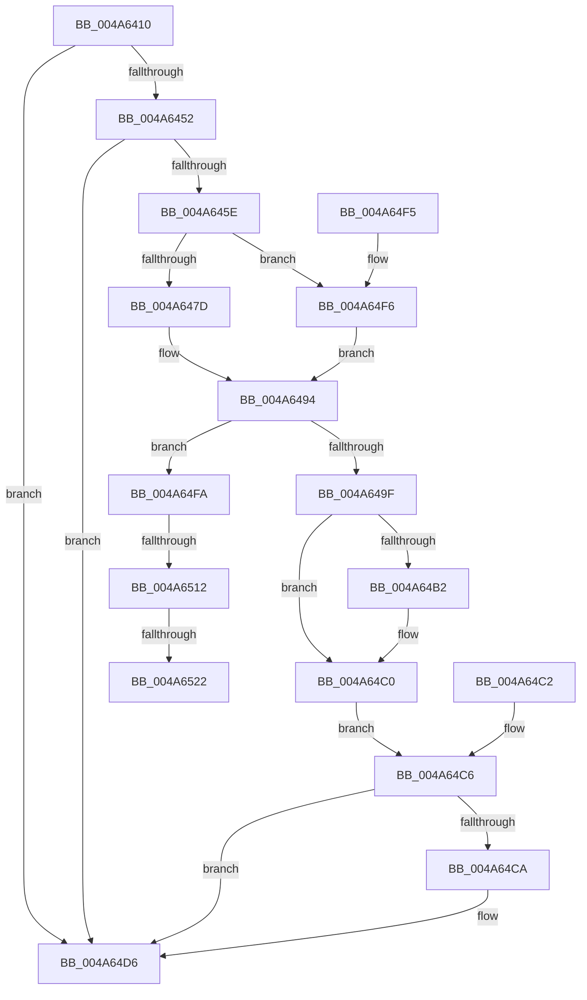

# KeCopyXfdMaskToTeb

- RVA: `0x004A6410`–`0x004A6529` (길이 `281` bytes)
- VA: `0x00000001404A6410`
- 실행 섹션: `.text`
- PDB 이름 있음: `예`; PDB Function 태그: `예`
- unwind 정보 RVA: `0x000B6CD4`
- 디코드: `67`개 명령, `281/281` bytes 표시
- 미해석 바이트: `0` (있으면 어셈블리에 `.byte`로 보존)

> 이 문서는 커널 이미지의 기계어와 PDB 기호를 분석해 생성했습니다. 4번과 5번은 함수 원형과 자료형을 바이너리 사용 방식에서 추정한 C 해석이며 원본 소스 복구 결과는 아닙니다.

## 1. Dependencies

- 직접 호출 지점: **3**; 고유 호출 대상: **3**
- 직접 호출자로 확인된 함수: **2**
- RIP 상대 이미지 참조: **2**

### Outgoing calls
- `0x004A6487` → [KiStackAttachProcess](../21/KiStackAttachProcess_function_00216820.md) (function, `0x00216820`)
- `0x004A64D1` → [KiUnstackDetachProcess](../21/KiUnstackDetachProcess_function_00217D30.md) (function, `0x00217D30`)
- `0x004A64DE` → [_security_check_cookie](../6A/_security_check_cookie_function_006AC640.md) (function, `0x006AC640`)

### Direct callers
- [KxEnableOptionalXStateFeatures](../5B/KxEnableOptionalXStateFeatures_function_005BA164.md) at `0x005BA268`
- [KeInitThread](../../pagelk/B7/KeInitThread_function_00B78450.md) at `0x00B788EA`

### Static image references
- `0x004A641F` → RVA `0x00E0A740` (`.data`; read)
- `0x004A6443` → RVA `0x00FC6B30` (`ALMOSTRO`; read)

## 2. Other-region calls and transfers

- 다른 실행 섹션으로 향하는 call: **0**
- call이 아닌 외부 분기/꼬리 이동: **3**
  - `0x004A650C` → [sub_006F98C0](../6F/Unknown_function_006F98C0.md) (`tail-transfer`)
  - `0x004A651C` → [sub_006F98C0](../6F/Unknown_function_006F98C0.md) (`tail-transfer`)
  - `0x004A6524` → [sub_006F98C0](../6F/Unknown_function_006F98C0.md) (`tail-transfer`)

## 3. Assembly (complete function range)

```asm
004A6410  48 89 5C 24 10                  mov qword ptr [rsp + 0x10], rbx
004A6415  48 89 74 24 18                  mov qword ptr [rsp + 0x18], rsi
004A641A  57                              push rdi
004A641B  48 83 EC 60                     sub rsp, 0x60
004A641F  48 8B 05 1A 43 96 00            mov rax, qword ptr [rip + 0x96431a]
004A6426  48 33 C4                        xor rax, rsp
004A6429  48 89 44 24 58                  mov qword ptr [rsp + 0x58], rax
004A642E  48 8B D9                        mov rbx, rcx
004A6431  0F 57 C0                        xorps xmm0, xmm0
004A6434  0F 11 44 24 28                  movups xmmword ptr [rsp + 0x28], xmm0
004A6439  0F 11 44 24 38                  movups xmmword ptr [rsp + 0x38], xmm0
004A643E  0F 11 44 24 48                  movups xmmword ptr [rsp + 0x48], xmm0
004A6443  48 0F BA 25 E4 06 B2 00 37      bt qword ptr [rip + 0xb206e4], 0x37
004A644C  0F 83 84 00 00 00               jae 0x1404a64d6
004A6452  48 8B B1 F0 00 00 00            mov rsi, qword ptr [rcx + 0xf0]
004A6459  48 85 F6                        test rsi, rsi
004A645C  74 78                           je 0x1404a64d6
004A645E  48 8B B9 20 02 00 00            mov rdi, qword ptr [rcx + 0x220]
004A6465  32 D2                           xor dl, dl
004A6467  88 54 24 20                     mov byte ptr [rsp + 0x20], dl
004A646B  65 48 8B 04 25 88 01 00 00      mov rax, qword ptr gs:[0x188]
004A6474  48 3B B8 B8 00 00 00            cmp rdi, qword ptr [rax + 0xb8]
004A647B  74 79                           je 0x1404a64f6
004A647D  4C 8D 44 24 28                  lea r8, [rsp + 0x28]
004A6482  33 D2                           xor edx, edx
004A6484  48 8B CF                        mov rcx, rdi
004A6487  E8 94 03 D7 FF                  call 0x140216820
004A648C  B0 01                           mov al, 1
004A648E  8A D0                           mov dl, al
004A6490  88 44 24 20                     mov byte ptr [rsp + 0x20], al
004A6494  33 C9                           xor ecx, ecx
004A6496  48 39 8F 10 03 00 00            cmp qword ptr [rdi + 0x310], rcx
004A649D  75 5B                           jne 0x1404a64fa
004A649F  48 8B 83 28 04 00 00            mov rax, qword ptr [rbx + 0x428]
004A64A6  48 89 86 48 18 00 00            mov qword ptr [rsi + 0x1848], rax
004A64AD  48 85 C9                        test rcx, rcx
004A64B0  74 0E                           je 0x1404a64c0
004A64B2  48 8B 83 28 04 00 00            mov rax, qword ptr [rbx + 0x428]
004A64B9  48 89 81 10 10 00 00            mov qword ptr [rcx + 0x1010], rax
004A64C0  EB 04                           jmp 0x1404a64c6
004A64C2  8A 54 24 20                     mov dl, byte ptr [rsp + 0x20]
004A64C6  84 D2                           test dl, dl
004A64C8  74 0C                           je 0x1404a64d6
004A64CA  33 D2                           xor edx, edx
004A64CC  48 8D 4C 24 28                  lea rcx, [rsp + 0x28]
004A64D1  E8 5A 18 D7 FF                  call 0x140217d30
004A64D6  48 8B 4C 24 58                  mov rcx, qword ptr [rsp + 0x58]
004A64DB  48 33 CC                        xor rcx, rsp
004A64DE  E8 5D 61 20 00                  call 0x1406ac640
004A64E3  4C 8D 5C 24 60                  lea r11, [rsp + 0x60]
004A64E8  49 8B 5B 18                     mov rbx, qword ptr [r11 + 0x18]
004A64EC  49 8B 73 20                     mov rsi, qword ptr [r11 + 0x20]
004A64F0  49 8B E3                        mov rsp, r11
004A64F3  5F                              pop rdi
004A64F4  C3                              ret
004A64F5  CC                              int3
004A64F6  B0 01                           mov al, 1
004A64F8  EB 9A                           jmp 0x1404a6494
004A64FA  44 0F B7 87 EC 06 00 00         movzx r8d, word ptr [rdi + 0x6ec]
004A6502  41 B9 4C 01 00 00               mov r9d, 0x14c
004A6508  66 45 3B C1                     cmp r8w, r9w
004A650C  0F 84 AE 33 25 00               je 0x1406f98c0
004A6512  41 B9 C4 01 00 00               mov r9d, 0x1c4
004A6518  66 45 3B C1                     cmp r8w, r9w
004A651C  0F 84 9E 33 25 00               je 0x1406f98c0
004A6522  32 C0                           xor al, al
004A6524  E9 97 33 25 00                  jmp 0x1406f98c0
```

## 4. C-style interpretation (structured pseudocode)

```c
__int64 __fastcall KeCopyXfdMaskToTeb(__int64 a1, unsigned __int8 a2)
{
    __int64 result;
    __int64 v_rsp;
    unsigned __int64 v_stack_m10;
    unsigned __int64 v_stack_m20;
    unsigned __int64 v_stack_m30;
    unsigned __int64 v_stack_m40;
    unsigned __int8 v_stack_m48;
    unsigned __int64 v_stack_m8;
    unsigned __int64 v_stack_p10;
    unsigned __int64 v_stack_p18;

    v_stack_p10 = v_rbx;
    v_stack_p18 = v_rsi;
    v_rsp = (v_rsp) - (96);
    result = (*(unsigned __int64 *)(v_rip + 9847578)) ^ (v_rsp);
    v_stack_m10 = result;
    v_stack_m40 = v_xmm0;
    v_stack_m30 = v_xmm0;
    v_stack_m20 = v_xmm0;
    if (condition_is_above_or_equal) goto loc_004A64D6;
    if (*(unsigned __int64 *)(a1 + 240) == 0) goto loc_004A64D6;
    a2 = 0;
    v_stack_m48 = 0;
    if ((*(unsigned __int64 *)(a1 + 544)) == (*(unsigned __int64 *)(*(unsigned __int64 *)(gs_base + (0 + 392)) + 184))) goto loc_004A64F6;
    a2 = 0;
    result = KiStackAttachProcess(*(unsigned __int64 *)(a1 + 544), a2, v_stack_m40, a4);
    v_stack_m48 = 1;
loc_004A6494:
    a1 = 0;
    if ((*(unsigned __int64 *)(*(unsigned __int64 *)(a1 + 544) + 784)) != 0) goto loc_004A64FA;
    *(unsigned __int64 *)(*(unsigned __int64 *)(a1 + 240) + 6216) = *(unsigned __int64 *)(a1 + 1064);
    result = *(unsigned __int64 *)(a1 + 1064);
    if (0 != 0) {
        result = *(unsigned __int64 *)(a1 + 1064);
        *(unsigned __int64 *)(a1 + 4112) = result;
    }
    goto loc_004A64C6;
loc_004A64C6:
    if (1 != 0) {
        a2 = 0;
        a1 = v_stack_m40;
        result = KiUnstackDetachProcess(a1, a2, v_stack_m40, a4);
    }
    a1 = (v_stack_m10) ^ (v_rsp);
    result = _security_check_cookie(a1, a2, v_stack_m40, a4);
    return result;
loc_004A64F6:
    goto loc_004A6494;
loc_004A64FA:
    result = 0;
}
```

## 5. (Beta) C Style

```c
int64_t KeCopyXfdMaskToTeb(void *Arg1, uint8_t Arg2)
{
    uint8_t *arg1 = (uint8_t *)Arg1;

    int64_t result;
    int64_t local_rsp;
    uint64_t v_stack_m10;
    uint64_t v_stack_m20;
    uint64_t v_stack_m30;
    uint64_t v_stack_m40;
    uint8_t v_stack_m48;
    uint64_t v_stack_m8;
    uint64_t v_stack_p10;
    uint64_t v_stack_p18;

    v_stack_p10 = local_rbx;
    v_stack_p18 = local_rsi;
    local_rsp = (local_rsp) - (96);
    result = (*(uint64_t *)(v_rip + 0x96431A)) ^ (local_rsp);
    v_stack_m10 = result;
    v_stack_m40 = v_xmm0;
    v_stack_m30 = v_xmm0;
    v_stack_m20 = v_xmm0;
    if (condition_is_above_or_equal) goto loc_004A64D6;
    if (*(uint64_t *)(arg1 + 0xF0) == 0) goto loc_004A64D6;
    Arg2 = 0;
    v_stack_m48 = 0;
    if ((*(uint64_t *)(arg1 + 0x220)) == (*(uint64_t *)(*(uint64_t *)(gs_base + (0 + 0x188)) + 0xB8))) goto loc_004A64F6;
    Arg2 = 0;
    result = KiStackAttachProcess(*(uint64_t *)(arg1 + 0x220), Arg2, v_stack_m40, a4);
    v_stack_m48 = 1;
loc_004A6494:
    Arg1 = 0;
    if ((*(uint64_t *)(*(uint64_t *)(arg1 + 0x220) + 0x310)) != 0) goto loc_004A64FA;
    *(uint64_t *)(*(uint64_t *)(arg1 + 0xF0) + 0x1848) = *(uint64_t *)(arg1 + 0x428);
    result = *(uint64_t *)(arg1 + 0x428);
    if (0 != 0) {
        result = *(uint64_t *)(arg1 + 0x428);
        *(uint64_t *)(arg1 + 0x1010) = result;
    }
    goto loc_004A64C6;
loc_004A64C6:
    if (1 != 0) {
        Arg2 = 0;
        Arg1 = v_stack_m40;
        result = KiUnstackDetachProcess(Arg1, Arg2, v_stack_m40, a4);
    }
    Arg1 = (v_stack_m10) ^ (local_rsp);
    result = _security_check_cookie(Arg1, Arg2, v_stack_m40, a4);
    return result;
loc_004A64F6:
    goto loc_004A6494;
loc_004A64FA:
    result = 0;
}
```

### 관측된 메모리 오프셋

구조체 형식이 확인되지 않은 접근은 인자 기준의 오프셋으로만 기록했습니다.

| 기준 인자 | 오프셋 표현 | 폭 (bit) | 접근 |
|---|---:|---:|---|
| `Arg1` | `+ 0xF0` | `64` | `R` |
| `Arg1` | `+ 0x220` | `64` | `R` |
| `Arg1` | `+ 0x428` | `64` | `R` |

## 6. Execution-region graph

[열기: 2D/3D 그래프와 함수 탐색 컨트롤 패널](../../../control-panel.html?section=text&rva=0x004A6410&view=graph)

- 2D 그래프는 위에서 아래로 흐르고, 3D 그래프는 빈 공간을 드래그해 회전합니다. Shift+드래그는 이동, 휠은 확대·축소, 함수 노드 선택은 대상 보고서 이동입니다.

### Static fallback


