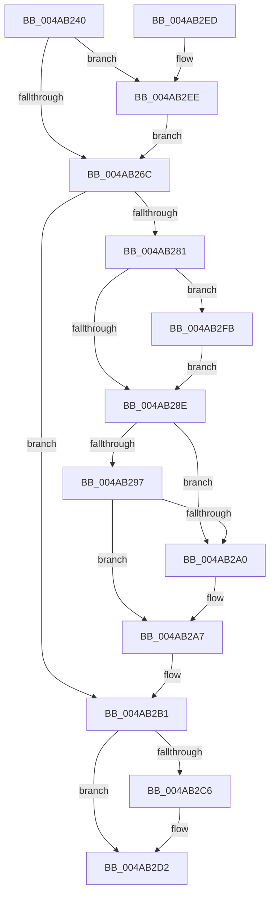

# KeDeregisterBugCheckReasonCallback

- RVA: `0x004AB240`–`0x004AB304` (길이 `196` bytes)
- VA: `0x00000001404AB240`
- 실행 섹션: `.text`
- PDB 이름 있음: `예`; PDB Function 태그: `아니요`
- unwind 정보 RVA: `0x0005C774`
- 디코드: `50`개 명령, `196/196` bytes 표시
- 미해석 바이트: `0` (있으면 어셈블리에 `.byte`로 보존)

> 이 문서는 커널 이미지의 기계어와 PDB 기호를 분석해 생성했습니다. 4번과 5번은 함수 원형과 자료형을 바이너리 사용 방식에서 추정한 C 해석이며 원본 소스 복구 결과는 아닙니다.

## 1. Dependencies

- 직접 호출 지점: **4**; 고유 호출 대상: **4**
- 직접 호출자로 확인된 함수: **2**
- RIP 상대 이미지 참조: **3**

### Outgoing calls
- `0x004AB273` → [KeAcquireSpinLockAtDpcLevel](../20/KeAcquireSpinLockAtDpcLevel_function_00208430.md) (function, `0x00208430`)
- `0x004AB2B8` → [KxReleaseSpinLock](../20/KxReleaseSpinLock_function_00206670.md) (function, `0x00206670`)
- `0x004AB2CD` → [KiLowerIrqlProcessIrqlFlags](../4F/KiLowerIrqlProcessIrqlFlags_function_004F5698.md) (function, `0x004F5698`)
- `0x004AB2F1` → [KiRaiseIrqlProcessIrqlFlags](../4F/KiRaiseIrqlProcessIrqlFlags_function_004F56FC.md) (function, `0x004F56FC`)

### Direct callers
- [CarCleanup](../61/CarCleanup_function_0061850C.md) at `0x00618556`
- [CmFcDebugUninitialize](../66/CmFcDebugUninitialize_function_0066B750.md) at `0x0066B75B`

### Static image references
- `0x004AB25F` → RVA `0x00FC6D20` (`ALMOSTRO`; read)
- `0x004AB26C` → RVA `0x00F231A0` (`.data`; read)
- `0x004AB2FB` → RVA `0x00F1090C` (`.data`; read/write)

## 2. Other-region calls and transfers

- 다른 실행 섹션으로 향하는 call: **0**
- 별도 외부 분기/꼬리 이동을 확인하지 못했습니다.

## 3. Assembly (complete function range)

```asm
004AB240  48 89 5C 24 08                  mov qword ptr [rsp + 8], rbx
004AB245  48 89 74 24 10                  mov qword ptr [rsp + 0x10], rsi
004AB24A  57                              push rdi
004AB24B  48 83 EC 20                     sub rsp, 0x20
004AB24F  48 8B D9                        mov rbx, rcx
004AB252  44 0F 20 C7                     mov rdi, cr8
004AB256  BA 0F 00 00 00                  mov edx, 0xf
004AB25B  44 0F 22 C2                     mov cr8, rdx
004AB25F  83 3D BA BA B1 00 00            cmp dword ptr [rip + 0xb1baba], 0
004AB266  0F 85 82 00 00 00               jne 0x1404ab2ee
004AB26C  48 8D 0D 2D 7F A7 00            lea rcx, [rip + 0xa77f2d]
004AB273  E8 B8 D1 D5 FF                  call 0x140208430
004AB278  40 32 F6                        xor sil, sil
004AB27B  80 7B 2C 01                     cmp byte ptr [rbx + 0x2c], 1
004AB27F  75 30                           jne 0x1404ab2b1
004AB281  81 7B 28 FF 03 00 00            cmp dword ptr [rbx + 0x28], 0x3ff
004AB288  40 88 73 2C                     mov byte ptr [rbx + 0x2c], sil
004AB28C  74 6D                           je 0x1404ab2fb
004AB28E  48 8B 0B                        mov rcx, qword ptr [rbx]
004AB291  48 39 59 08                     cmp qword ptr [rcx + 8], rbx
004AB295  75 09                           jne 0x1404ab2a0
004AB297  48 8B 43 08                     mov rax, qword ptr [rbx + 8]
004AB29B  48 39 18                        cmp qword ptr [rax], rbx
004AB29E  74 07                           je 0x1404ab2a7
004AB2A0  B9 03 00 00 00                  mov ecx, 3
004AB2A5  CD 29                           int 0x29
004AB2A7  48 89 08                        mov qword ptr [rax], rcx
004AB2AA  40 B6 01                        mov sil, 1
004AB2AD  48 89 41 08                     mov qword ptr [rcx + 8], rax
004AB2B1  48 8D 0D E8 7E A7 00            lea rcx, [rip + 0xa77ee8]
004AB2B8  E8 B3 B3 D5 FF                  call 0x140206670
004AB2BD  83 3D 5C BA B1 00 00            cmp dword ptr [rip + 0xb1ba5c], 0
004AB2C4  74 0C                           je 0x1404ab2d2
004AB2C6  44 0F 20 C1                     mov rcx, cr8
004AB2CA  40 8A D7                        mov dl, dil
004AB2CD  E8 C6 A3 04 00                  call 0x1404f5698
004AB2D2  40 0F B6 CF                     movzx ecx, dil
004AB2D6  44 0F 22 C1                     mov cr8, rcx
004AB2DA  48 8B 5C 24 30                  mov rbx, qword ptr [rsp + 0x30]
004AB2DF  40 8A C6                        mov al, sil
004AB2E2  48 8B 74 24 38                  mov rsi, qword ptr [rsp + 0x38]
004AB2E7  48 83 C4 20                     add rsp, 0x20
004AB2EB  5F                              pop rdi
004AB2EC  C3                              ret
004AB2ED  CC                              int3
004AB2EE  40 8A CF                        mov cl, dil
004AB2F1  E8 06 A4 04 00                  call 0x1404f56fc
004AB2F6  E9 71 FF FF FF                  jmp 0x1404ab26c
004AB2FB  F0 FF 0D 0A 56 A6 00            lock dec dword ptr [rip + 0xa6560a]
004AB302  EB 8A                           jmp 0x1404ab28e
```

## 4. C-style interpretation (structured pseudocode)

```c
__int64 __fastcall KeDeregisterBugCheckReasonCallback(__int64 a1)
{
    __int64 result;
    __int64 v_rsi;
    __int64 v_rsp;
    unsigned __int64 v_stack_p10;
    unsigned __int64 v_stack_p8;

    v_stack_p8 = v_rbx;
    v_stack_p10 = v_rsi;
    v_rsp = (v_rsp) - (32);
    if ((*(unsigned int *)(v_rip + 11647674)) != 0) goto loc_004AB2EE;
loc_004AB26C:
    result = KeAcquireSpinLockAtDpcLevel(v_rip + 10977069, 15, a3, a4);
    v_rsi = 0;
    if ((*(unsigned __int8 *)(a1 + 44)) != 1) goto loc_004AB2B1;
    *(unsigned __int8 *)(a1 + 44) = 0;
    if ((*(unsigned int *)(a1 + 40)) == 0x3FFULL) goto loc_004AB2FB;
loc_004AB28E:
    if ((*(unsigned __int64 *)(*(unsigned __int64 *)(a1) + 8)) != a1) goto loc_004AB2A0;
    if ((*(unsigned __int64 *)(*(unsigned __int64 *)(a1 + 8))) != a1) {
        a1 = 3;
    }
    *(unsigned __int64 *)(*(unsigned __int64 *)(a1 + 8)) = a1;
    *(unsigned __int64 *)(a1 + 8) = *(unsigned __int64 *)(a1 + 8);
loc_004AB2B1:
    result = KxReleaseSpinLock(v_rip + 10977000, 15, a3, a4);
    if ((*(unsigned int *)(v_rip + 11647580)) != 0) {
        a1 = 15;
        a2 = (unsigned __int8)(v_cr8);
        result = KiLowerIrqlProcessIrqlFlags(a1, a2, a3, a4);
    }
    v_rsp = (v_rsp) + (32);
    return 1;
loc_004AB2EE:
    result = KiRaiseIrqlProcessIrqlFlags((unsigned __int8)(v_cr8), a2, a3, a4);
    goto loc_004AB26C;
loc_004AB2FB:
    goto loc_004AB28E;
}
```

## 5. (Beta) C Style

```c
int64_t KeDeregisterBugCheckReasonCallback(void *Arg1)
{
    uint8_t *arg1 = (uint8_t *)Arg1;

    int64_t result;
    int64_t local_rsi;
    int64_t local_rsp;
    uint64_t v_stack_p10;
    uint64_t v_stack_p8;

    v_stack_p8 = local_rbx;
    v_stack_p10 = local_rsi;
    local_rsp = (local_rsp) - (32);
    if ((*(uint32_t *)(v_rip + 0xB1BABA)) != 0) goto loc_004AB2EE;
loc_004AB26C:
    result = KeAcquireSpinLockAtDpcLevel(v_rip + 10977069, 15, a3, a4);
    local_rsi = 0;
    if ((*(uint8_t *)(arg1 + 0x2C)) != 1) goto loc_004AB2B1;
    *(uint8_t *)(arg1 + 0x2C) = 0;
    if ((*(uint32_t *)(arg1 + 0x28)) == 0x3FFULL) goto loc_004AB2FB;
loc_004AB28E:
    if ((*(uint64_t *)(*(uint64_t *)(arg1) + 0x8)) != Arg1) goto loc_004AB2A0;
    if ((*(uint64_t *)(*(uint64_t *)(arg1 + 0x8))) != Arg1) {
        Arg1 = 3;
    }
    *(void **)(*(uint64_t *)(arg1 + 0x8)) = Arg1;
    *(uint64_t *)(arg1 + 0x8) = *(uint64_t *)(arg1 + 0x8);
loc_004AB2B1:
    result = KxReleaseSpinLock(v_rip + 10977000, 15, a3, a4);
    if ((*(uint32_t *)(v_rip + 0xB1BA5C)) != 0) {
        Arg1 = 15;
        a2 = (uint8_t)(v_cr8);
        result = KiLowerIrqlProcessIrqlFlags(Arg1, a2, a3, a4);
    }
    local_rsp = (local_rsp) + (32);
    return 1;
loc_004AB2EE:
    result = KiRaiseIrqlProcessIrqlFlags((uint8_t)(v_cr8), a2, a3, a4);
    goto loc_004AB26C;
loc_004AB2FB:
    goto loc_004AB28E;
}
```

### 관측된 메모리 오프셋

구조체 형식이 확인되지 않은 접근은 인자 기준의 오프셋으로만 기록했습니다.

| 기준 인자 | 오프셋 표현 | 폭 (bit) | 접근 |
|---|---:|---:|---|
| `Arg1` | `+ 0x0` | `64` | `R` |
| `Arg1` | `+ 0x8` | `64` | `R` |
| `Arg1` | `+ 0x28` | `32` | `R` |
| `Arg1` | `+ 0x2C` | `8` | `R` |
| `Arg1` | `+ 0x2C` | `8` | `W` |

## 6. Execution-region graph

[열기: 2D/3D 그래프와 함수 탐색 컨트롤 패널](../../../control-panel.html?section=text&rva=0x004AB240&view=graph)

- 2D 그래프는 위에서 아래로 흐르고, 3D 그래프는 빈 공간을 드래그해 회전합니다. Shift+드래그는 이동, 휠은 확대·축소, 함수 노드 선택은 대상 보고서 이동입니다.

### Static fallback


